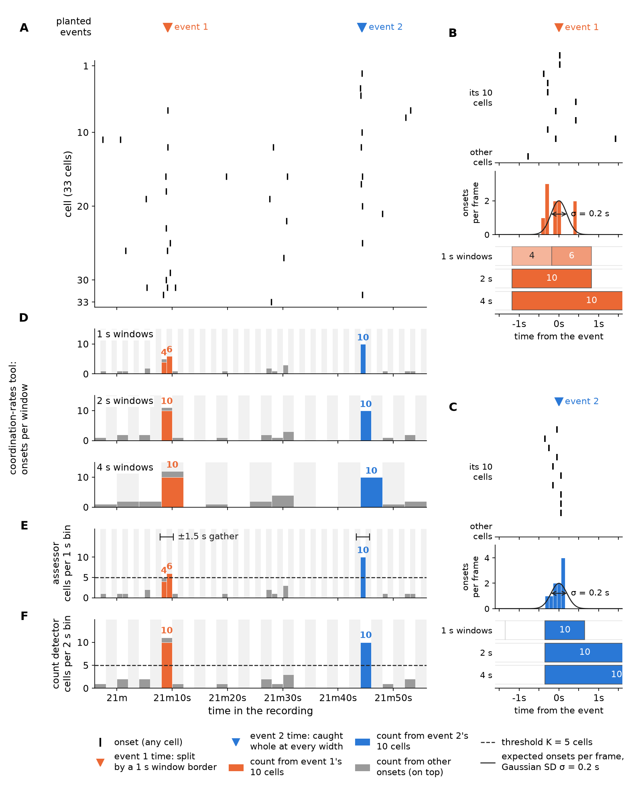
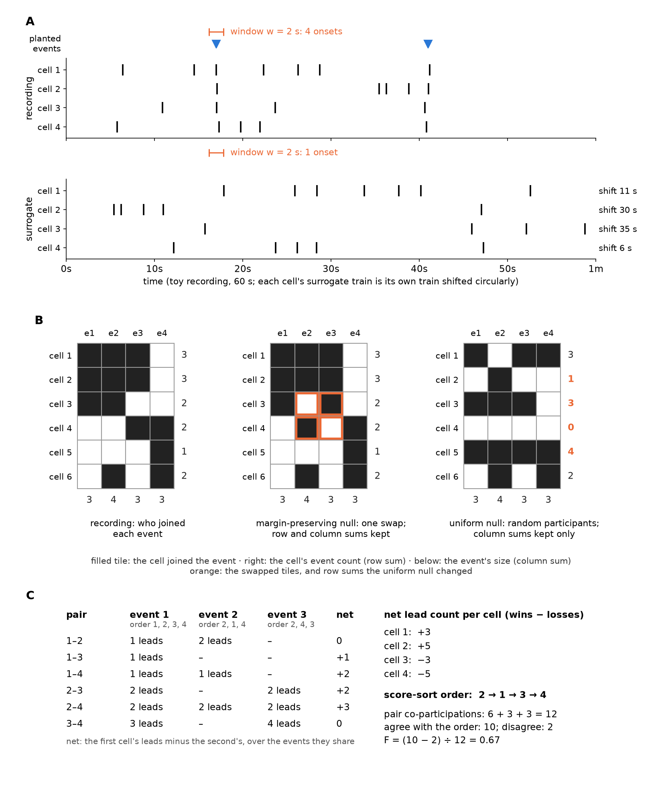
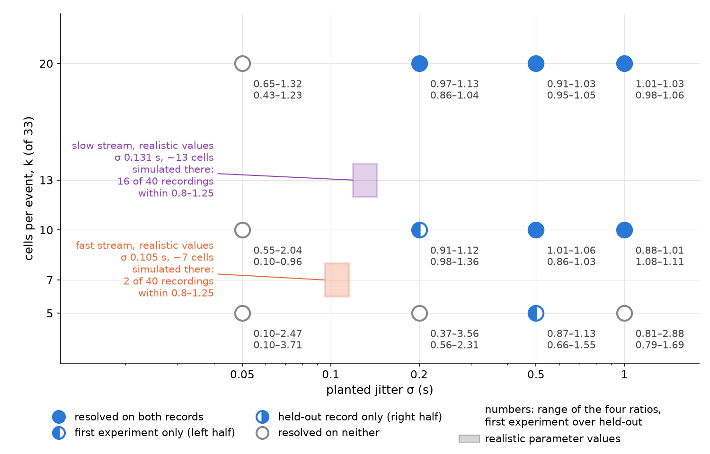
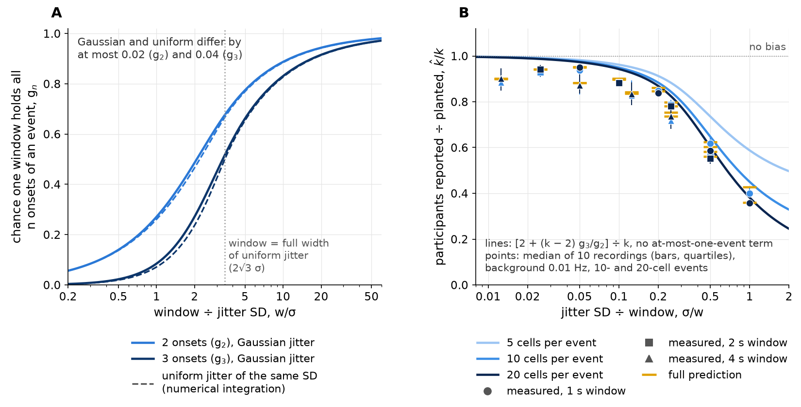
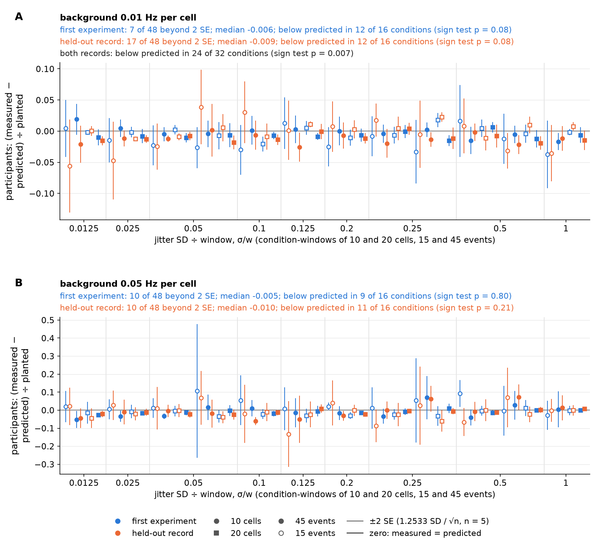
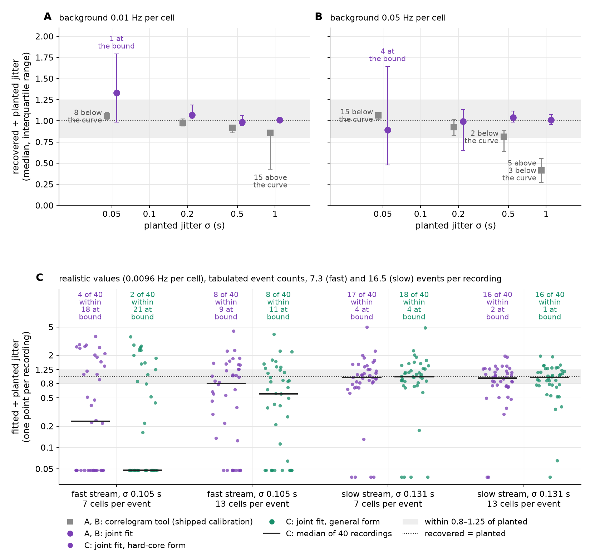
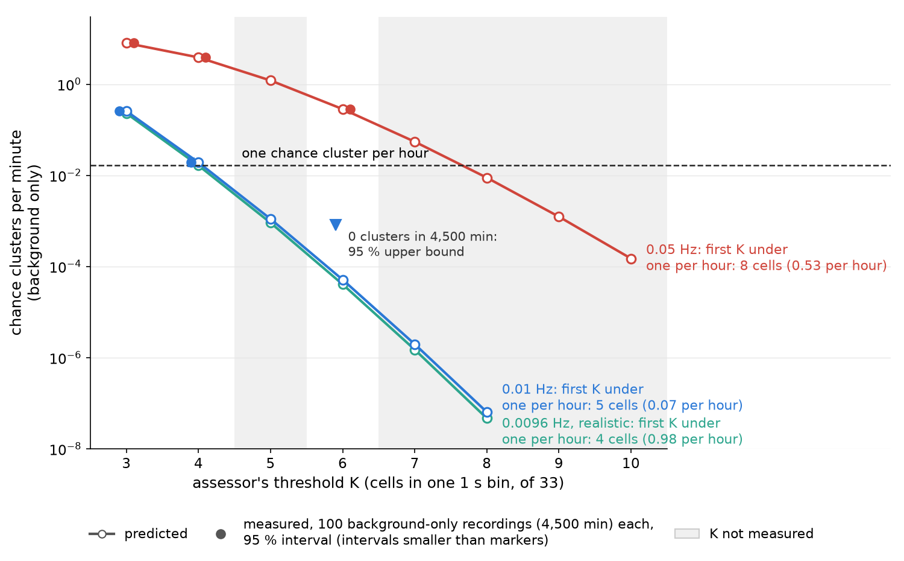
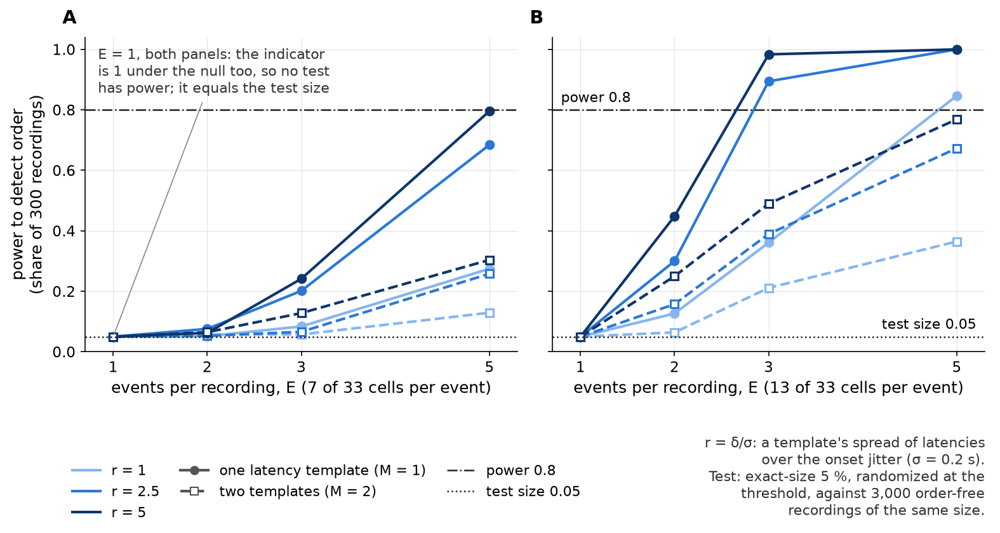

# Chapter 1. Predict first, simulate to check: an analytical baseline for finding coordinated events in multichannel event times

*A theory chapter checked by simulation, written by Claude with Tony DeFazio as an exercise in how
far the two can take a piece of research together. No human has reviewed the derivations. How it
was made, and what it does not claim, is in the note at the end. References marked ⚠ were cited
from the repository's earlier reading or were not opened; every other source was read against the
claim it supports.*

## 1.1 Introduction

### The problem

Reduce a calcium-imaging recording of a few dozen cells to the onset times of each cell's calcium
events, and the result is a multichannel stream of unlabeled event times. Some onsets are
coordinated: several cells have an event within a fraction of a second of one another, more often
than their own rates would produce by chance. The rest are background. Downstream analysis rests on
knowing which onsets belong to which coordinated event, how many events there were, and what
generated them.

The premise of this dissertation is that a recording mixes **two or more sources** of coordinated
events. A source is one generating process, with its own participation (how many cells join an
event), jitter (how far each participant's onset scatters about the event time), intervals between
events, membership rule (a fixed set of cells, or a fresh random set each event) and, optionally, a
latency template (a fixed lead or lag per cell). The goal is a toolset that measures those
parameters from the event times alone, simulates recordings from them, and then characterizes each
detector against known truth.

This chapter takes **one source on purpose**. Before asking whether tools can separate two sources,
it asks what they return for one, and whether that can be derived rather than simulated.

### What brute force found

The obvious way to characterize the tools is a simulation grid: plant a source at many conditions,
measure each recording without looking at the planted values, and compare. The first such
experiment (*1.3*) planted one source at 48 conditions in 240 recordings and measured them with two
of the tools described in *1.2.2*. The **coordination-rates tool** counts how often pairs and
triples of onsets share a time window, more than chance would give, and solves for participants
per event. The **assessor** calls a *cluster* wherever at least K cells are active in a 1 s bin,
and reports participants and jitter from the onsets around each cluster. The experiment found
three failures it could not explain (Figure 1.1). Each is taken up in a section of its own.

**Figure 1.1. What the first experiment found: participants undercounted at wide jitter, and a flat
jitter reading at the busier background.** Events of 10 or more cells, 160 of the 240 simulated
recordings. Each point is a median over participation, event count and the 5 recordings per
condition; bars are the interquartile range. A–C (background 0.01 onsets per second per cell) and
E–G (0.05 Hz): recovered ÷ planted participants, event rate and coordinated share (defined in
*1.2.2*). D and H: recovered jitter in seconds against the identity line, so an estimator that
returns a constant draws as a flat line; markers are dodged horizontally for visibility. The violet
series is an estimator built from the theory in *1.4.6* and can be ignored until then.

1. **Participants are undercounted when jitter approaches the window.** At 1 s jitter the
   coordination-rates tool's 1 s window read 0.34–0.42 of planted participants, and its 4 s window
   0.68–0.85 (Figure 1.1 A, E). *1.4* derives this.
2. **The assessor reads jitter only at the quieter background.** At 0.01 Hz and K = 4 it read 0.07,
   0.23, 0.49 and 0.72 s for planted 0.05, 0.2, 0.5 and 1 s (Figure 1.1 D). At 0.05 Hz it read
   0.64–0.73 s whatever was planted at K = 3 or 4, and at K = 6 it rose only from a planted 0.5 s
   (0.43–0.68 s; Figure 1.1 H). *1.5.2* derives this.
3. **A fixed threshold does not transfer across backgrounds.** On recordings with no coordinated
   events at all, at 0.05 Hz per cell, chance alone gave the assessor 7.97 clusters per minute at
   K = 3 and 3.85 at K = 4, against the 0.33 or 1 planted events per minute of the event-bearing
   recordings. *1.5.1* derives this.

A grid can find such failures. It cannot say why they happen, or where else they will.

### The question, and the answer

**For each measuring tool and each simple detector, can we derive from the planted parameters what
it should return, and use simulation only to test the derivation and measure what is left over?**
We call this Aim 0: *predict first, simulate to check*.

For one source, mostly yes. The undercount follows from how often one window holds all of an
event's onsets. The flat jitter reading is the median of the assessor's chance clusters, whose share
of all clusters the chance-cluster rate predicts. The threshold failure follows from how steeply
that rate rises with the background. The theory predicts the coordination-rates tool's participant
estimate to a median of 1–2 % of planted (worst 13 %) for events of 10 or more cells, and it yields
an estimator of jitter, participation and event rate together. For cell-by-cell structure it
derives two means, the excess variance that reused cell groups add and the order indicator's mean
when no order is present; how many events a test then needs is measured by simulation.

It does not replace simulation. It tells simulation where to look, and it is wrong in specific,
measurable places that this chapter reports. At realistic parameter values it shows that
participants can be read from one recording but jitter, on the fast stream, cannot.

### Contributions

Each is tagged with its standing against prior work; *1.2.3* gives the precedents and *1.8.2* the
full comparison.

1. **Window sharing under Gaussian jitter.** A closed form for the chance that one window holds all
   n onsets of an event, and from it the coordination-rates tool's participant undercount. *New in
   form; numerically within 0.04 of the uniform-jitter case that earlier work treats.*
2. **The tool's correction for event trains that cannot share a window**, and its generalization to
   any stationary event train, including the dependence of the tool's surrogates on the event train.
   *The underlying moment formulas for cluster processes are textbook; their application to this
   tool, and the surrogate term, were not found.*
3. **A joint fit** that recovers jitter, participation and event rate together from the tool's pair
   and triple counts at three window widths. *The construction, fitting factorial cumulants across
   bin widths, is that of time-integrated fluorescence cumulant analysis (Wu & Müller 2005); new
   here are the jittered-cluster forms it fits.*
4. **The assessor's chance-cluster rate** at each threshold, and from it the smallest threshold safe
   against chance at a given background. *Known in form; the assessor's run-start factor is
   specific to it.*
5. **The assessor's jitter reading as a mixture** of chance and event clusters, with weights from
   the chance-cluster rate. *Not found; semi-analytic, because the chance clusters' own spread is
   taken from simulation.*
6. **The excess pair co-participation variance of reused cell groups.** *Known in form: it is
   Kish's design effect.*
7. **Order with few events:** the exact mean of the order indicator when no order is present, for
   any number of cells and events. *Not found; the one-template value of the indicator is Greiner's
   relation, and the ranking it uses is Copeland's.*

The chapter also reports how close two events can be before the tools merge them (*1.6*). No
prior-art search was made for that result, so it is not claimed as a contribution.

## 1.2 Background

### 1.2.1 The data and the generative model

The input is one list of onset times per channel (a cell, or region of interest) and the
recording's duration; the frame interval is optional. Parameter values called *realistic* here are
taken from the lab's recordings, which are imaged at a 0.1 s frame and hold two kinds of calcium
event distinguished by their time course, fast and slow (DeFazio et al. 2026); the dissertation
calls each kind a **stream**. They serve only to choose where to simulate; no statement in this
chapter is about the recordings themselves. The realistic values are:

- a background rate of 0.0096 Hz per cell (estimated from the fast stream);
- onset jitter of 0.105 s (fast) and 0.131 s (slow);
- 7 cells per event (fast) and 13 (slow), of 33, which are the simulator's middle participation
  levels (0.20 and 0.38);
- 9.7 events per hour (fast) and 22.0 (slow), and two measured lists of intervals between events,
  one per stream. The lists came from a detector with 2 s bins, which merged events closer than
  about 2 s before the intervals were taken, so they understate close pairs;
- 1–8 coordinated events per recording window (medians 1, 2 and 3 for the fast, slow and combined
  streams).

The generative model is a cluster process of the Neyman–Scott type (Neyman & Scott 1952): cluster
centers placed at random, and the members of each cluster scattered about its center by a
probability law. With Gaussian scatter it is called the Thomas process, although Thomas (1949) gave
only the count distribution of clustered plants in sampling quadrats, with no spatial scatter law.
Each of N cells carries independent Poisson background onsets at rate b. On top of that, E
coordinated events occur in a recording of duration T (rate λ = E/T). Each event is joined by k of
the N cells, chosen afresh; each participant's onset is the event time plus independent Gaussian
jitter of standard deviation σ, rounded to the frame. Two departures from the textbook process
matter: the number of events is fixed, not Poisson, and events are held at least 20 s apart, a
**hard-core** train, rather than placed independently.

**Table 1.1. Symbols.**

| symbol | meaning | values in the first experiment |
|---|---|---|
| N | cells in a recording | 33 |
| k | participants per event (cells) | 5, 10, 20 (participation 0.15, 0.3, 0.6) |
| σ | jitter: SD of a participant's onset about the event time | 0.05, 0.2, 0.5, 1.0 s |
| b | background rate per cell | 0.01 Hz (near the realistic 0.0096 Hz) and 0.05 Hz |
| E, λ | coordinated events per recording; per second | 15 or 45 in 45 min (0.0056 or 0.0167 Hz) |
| w | the coordination-rates tool's window | 1, 2, 4 s |
| K | the assessor's threshold, a count of cells | 3, 4, 6 cells |
| g_n | the chance that all n onsets of one event fall in one window | |
| M | number of assemblies, or of latency templates | |
| δ, r | SD of a latency template's offsets; r = δ/σ | |
| F, n̄ | the order indicator; mean number of events a pair of cells shares | |

### 1.2.2 The tools

**Figure 1.2. What one recording looks like, and what each tool counts.** A: one minute of a
simulated 45-minute recording of 33 cells, one mark per onset. The background is 0.0096 onsets per
second per cell, and there are two coordinated events of 10 cells each with onset jitter σ = 0.2 s.
Triangles above the raster mark the planted event times. B, C: each event enlarged. Each shows its
10 cells' onsets, then those onsets per 0.1 s frame against the Gaussian they were drawn from (σ is
its SD), then the coordination-rates tool's 1, 2 and 4 s windows with the number of the event's
onsets in each. A 1 s window border splits event 1 into 4 and 6, while event 2 falls inside one
window at every width. D–F: what each tool counts in the same minute, colored by event. The
coordination-rates tool counts onsets per window, the assessor counts distinct cells per 1 s bin,
and the count detector counts distinct cells per 2 s bin; the threshold of 5 cells is set for
illustration. This minute was picked from the recording because it shows one split event and one
whole one; the onsets in it are exactly as simulated.

Four population-count tools are analyzed. Each sees only how many onsets or cells fall in a window
or bin, never which cells they are.

- **The coordination-rates tool** counts how much more often pairs and triples of onsets fall in the
  same window than in **surrogates**: copies of the recording in which each cell's train is shifted
  in time by its own random offset, which keeps each cell's train but breaks the alignment between
  cells (Figure 1.3 A). The excess pair and triple counts, f₂ and f₃, are averaged over two window
  offsets. From them the tool solves for participants per event, events per minute and the
  **coordinated onset rate per cell**, λk/N. The figures plot that rate as a ratio to planted and
  label it "coordinated share". The tool needs no event definition and no threshold.
- **The assessor** counts distinct active cells per 1 s bin. A cluster starts at a bin with at least
  K cells and joins later such bins with at most one bin between them. The cluster's center is the
  mean of its bins' centers. The assessor then takes **each cell's nearest onset within ±1.5 s of
  that center, from every cell**, background cells included, and keeps the cluster if at least K
  cells are gathered. A cluster's jitter is the SD of its gathered onsets; the assessor reports the
  median over all its clusters.
- **The count detector** calls a coordinated event wherever the number of distinct cells active in a
  2 s bin reaches a threshold, joining called bins with at most one uncalled bin between them.
- **The correlogram tool** estimates jitter without bins, from the width of the peak in the
  cross-cell onset correlogram. As shipped, it pools the cell pairs of all the recordings it is
  given before taking the width, and converts the width to jitter through a calibration curve.
  *1.4.6* compares it with the joint fit.

Two further statistics look at *which* cells are active together: the repository's **assembly
test** (*1.7.1*; Figure 1.3 B) and an **order indicator** (*1.7.2*; Figure 1.3 C). Detectors that
compare each moment with its recent context (two methods from the literature, implemented in the
repository) are outside this chapter.

**Figure 1.3. Three mechanisms the tests rest on, drawn on toy values.** All values are small,
synthetic and chosen for illustration. A: the coordination-rates tool's time-shift surrogate. Top:
60 s of four cells' onsets, with background onsets and two coordinated events of all four cells,
whose planted times are marked in the lane above. Bottom: the surrogate, in which each cell's whole
train is shifted circularly by its own random offset (right). Each cell keeps its own onsets and
spacing, but the events no longer line up across cells; the 2 s window marked in each lane holds 4
onsets in the recording and 1 in the surrogate. B: the assembly test's two nulls, on a membership
matrix of 6 cells by 4 events (filled tile = the cell joined the event; row sums at right are each
cell's event count, column sums below each event's size). The margin-preserving null swaps a
checkerboard pair of tiles (orange), which keeps every row and column sum. The uniform null draws
each event's participants at random, which keeps the column sums only; the row sums it changed are
in orange. C: the score sort and F for 4 cells and 3 events (onset orders 1, 2, 3, 4; 2, 1, 4; and
2, 4, 3). For each pair, the table gives who leads in each shared event and the net, the first
cell's leads minus the second's. A cell's net lead count, wins minus losses over all its pairs, is
+3, +5, −3 and −5, so the score sort orders the cells 2, 1, 3, 4. Of the 12 pair
co-participations, 10 agree with that order and 2 disagree, so F = (10 − 2) ÷ 12 = 0.67.

### 1.2.3 Prior work

**Coincidences across bin widths.** Grün et al. (1999, eq. 5) derived the chance that a
near-coincidence is split by a bin border, averaged over a displacement of up to ±j time steps (the
"fission probability"), and showed how detection depends on the analysis bin width. Pazienti et al.
(2008) derived how dithering interacts with jittered coincidences and estimated synchronization
precision from how detection decays with the dither interval, at a single tolerated spread. Louis,
Borgelt & Grün (2010), building on Grün, Abeles & Diesmann (2008 ⚠), gave the full distribution of
the population count for groups with **uniform** jitter: given how far a jitter window overlaps a
bin, each member is captured independently, so the group contributes a binomial count. They
estimated group size and jitter from where one feature of the observed-minus-independent
distribution (its second maximum) changes slope as the bin widens, by fitting two straight lines to
that feature's trajectory.

**Cumulants of binned counts.** CuBIC (Staude, Rotter & Grün 2010) infers a lower bound on the order
of correlation from ordinary cumulants of the population count, under a compound Poisson model: event
times form a Poisson process (the *carrier*), and each event places exactly synchronous copies in
several cells. The multiple-interaction model of Kuhn, Aertsen & Rotter (2003 ⚠) is a special case.
The same authors adapted CuBIC to rates that change from bin to bin (Staude, Grün & Rotter 2010).
Ehm, Staude & Rotter (2007 ⚠), before CuBIC, had fitted rates per event size, and Reimer et al.
(2012 ⚠; abstract only), from Rotter's group, tested that method on non-Poisson renewal trains.
In fluorescence fluctuation spectroscopy, Müller (2004) related the factorial cumulants of binned
photon counts to the brightness and number of emitters, as functions of the sampling time; Wu &
Müller (2005) fitted factorial cumulants at several rebinned sampling times jointly for brightness,
occupation number and diffusion time, with the variances of the cumulants. That is the joint fit's
construction (*1.4.6*), for diffusing emitters rather than jittered clusters.

**Cluster processes.** The second- and third-order moments of a cluster process with a non-Poisson
center process are textbook point-process theory (Daley & Vere-Jones 2003 ⚠; Møller &
Waagepetersen 2004 ⚠). In spatial statistics the parameters of a Neyman–Scott process are fitted by
minimum contrast on Ripley's K-function, the pair-count curve across scales (Diggle 1978 ⚠, 1983 ⚠);
the Thomas process's K-function has a closed form used in practice (Waagepetersen 2007). Diggle &
Gratton (1984) fitted models that can only be simulated by matching simulated summaries; their
spatial example is a hard-core inhibition process, not a cluster process. Neyman–Scott rainfall
models are fitted by matching moments of totals at several aggregation windows, and recover storm
arrival rate and cells per storm (Rodriguez-Iturbe, Cox & Isham 1987 ⚠). PP-Seq (Williams et al.
2020) is a Neyman–Scott model of neural sequences with per-neuron offsets, and Wang et al. (2024)
give Bayesian inference for the class.

**Assemblies.** The PCA assembly method with a Marčenko–Pastur null (Marčenko & Pastur 1967 ⚠)
comes from Peyrache et al. (2009 ⚠, 2010), building on Nicolelis et al. (1995 ⚠) and Chapin &
Nicolelis (1999 ⚠), and was extended by Lopes-dos-Santos et al. (2011, 2013 ⚠). Schrader et al.
(2008) detect synfire chains from the overlap of active-cell sets between time bins.

**Order.** Kreuz, Satuvuori, Pofahl & Mulansky (2017) define SPIKE-order and the Synfire Indicator,
which finds an order of spike trains by simulated annealing and scores it against surrogates. The
same group applied it to wide-field calcium imaging (Cecchini et al. 2021), introduced a direct
shift beside annealing for latency correction (Kreuz et al. 2022) and later an extrapolation direct
shift for it (Mariani et al. 2025); its 2026 review still orders trains by annealing (Kreuz 2026 ⚠).
Tomlinson et al. (2019) rank the nodes of interictal spike propagation by a net downstream-minus-
upstream count and score each sequence against that in-sample order with a shuffle null; the
scores fall with network size, which they read as biological. Silva, Feng & Foster (2015)
showed that picking the better of two behavioral templates for each hippocampal event inflates its
rank correlation unless the shuffle repeats the choice. The replay and cortical-sequence literature was
searched at abstract level (Lee & Wilson 2002 ⚠; Luczak et al. 2007 ⚠; record in
[the prior-art search](../learned/synthetic_validation/prior_art/README.md)).

**What is missing.** As far as the search went, none of this work gives the window-sharing function
for Gaussian jitter at n onsets; this tool's correction for event trains that cannot share a window,
including the surrogate's dependence on the event train; the assessor's chance-cluster rate and
jitter reading; or an analytical no-order mean for an order indicator scored on few events.
Table 1.6 (*1.8.2*) sets each result against its nearest precedent.

## 1.3 Methods: the testbed and how the theory is checked

**The first experiment** simulated one source, with a fresh random set of participants per event, on
a grid of 4 jitters × 3 participations × 2 event counts × 2 backgrounds = 48 conditions, 5
recordings each: 240 recordings of 33 cells and 45 minutes. Each was measured without access to the
planted values, with the coordination-rates tool at its windows of 1, 2 and 4 s and the assessor at
K = 3, 4 and 6. A further 200 background-only recordings (100 per background) tested the
chance-cluster rate. A first run of this grid shared backgrounds across conditions (every condition
with the same replicate index had the same background), so its errors were correlated; it was rerun
with a seed per recording, and every number here is from the rerun.

**The residual** for each condition and window is the absolute difference between the condition's
median recovered ÷ planted ratio and the predicted ÷ planted ratio, unless marked signed. The
prediction is the tool's own estimator applied to the expected excess counts; the measurement is the
median over recordings of the same estimator applied to each recording's counts. Because the
estimator is nonlinear, the two could differ even under an exact theory; on these records that gap
is about 0.1 % of k, small beside the residuals reported. The tool refused (a count was not
positive) in 17 of 720 recording-windows, all 5-cell events at 0.05 Hz; the medians exclude those.

**A held-out record.** Some model choices were made while looking at the first experiment: a
frame-rounding term was dropped because it biased jitter low on these recordings, the joint fit was
re-specified, and the event-train form was judged partly by how far it shrank these residuals. So
the whole grid was rerun with fresh seeds and every check repeated on that held-out record. Both are
reported; where they differ, the held-out value is the one to trust.

**Realistic values** fall between the grid's points (Figure 1.4), so they were simulated directly.
Events followed renewal trains whose intervals were resampled from each stream's measured list,
with each event then kept at random so that the rate matched the stream's tabulated rate (thinning
keeps the train's pair correlation). With σ 0.105 or 0.131 s, 7 or 13 cells per event and
b = 0.0096 Hz, 40 recordings of 45 minutes per combination held 7.3 events on average on the fast
stream (range 2–19) and 16.5 on the slow (range 2–35). An earlier run at about 3.7 and 3.2 times
those rates (25.5 and 53.6 events per recording) is kept as a check on denser trains.

**Figure 1.4. Realistic parameter values sit between the points the joint fit resolves.** Each
circle is a combination of planted jitter and cells per event, judged on two records: the first
experiment and the held-out rerun on fresh seeds. On each record a point counts as resolved when
the joint fit (*1.4.6*) recovers jitter within 0.8–1.25 of planted, a band of ±25 % on a log scale,
in all four conditions (15 or 45 events, background 0.01 or 0.05 Hz), each the median of 5
recordings. A filled circle is resolved on both records, an open one on neither; a half-filled
circle is resolved on the first experiment only (left half). The numbers under each circle give the
range of the four ratios, first experiment above and held-out record below. On both records only
the 20-cell row is resolved from 0.2 s up. Boxes mark the realistic values, jitter 0.105 s with 7
cells per event (fast stream) and 0.131 s with 13 cells (slow stream); box sizes are nominal.
Beside each box is the share of 40 recordings simulated there whose per-recording jitter falls
within 0.8–1.25 (Figure 1.8 C).

**Rederivation.** Two further Claude sessions were given the original question, the code and the
first experiment's record, each in its own checkout, without these results. All three reached the
same core derivation: the expected pair and triple counts with the at-most-one-event term, k̂, and
the chance-cluster rate. They shared the prompt, repository, model and tool definitions, and the
tool is itself defined by cumulants, so the route was close to forced: a consistency check, not
independent review. The rederivations found the shared-background flaw in the first run and added
the joint fit, the per-estimate noise and when the tool refuses, the assessor's output as a mixture
of chance and event clusters, and the event floor.

## 1.4 The coordination-rates tool: predicted, then tested

### 1.4.1 The undercount

The coordination-rates tool assumes every window catches every onset of an event. Under that
assumption the ratio of excess triple to excess pair counts is f₃/f₂ = k − 2, and the tool reports
k̂ = 2 + f₃/f₂. If instead a window holds all of an event's pairs with probability g₂ and all of its
triples with probability g₃, then, dropping small terms derived in *1.4.3*, f₃/f₂ ≈ (k − 2) g₃/g₂ and
the tool reports

  k̂ = 2 + (k − 2) g₃/g₂.

The first failure of *1.1* is therefore a question about g_n.

### 1.4.2 Window sharing

Place a window of width w at a uniformly random phase. The chance that it holds all n onsets of one
event is

  g_n(w, σ) = 𝔼[max(0, 1 − R_n / w)],

where R_n is the range of the n onsets. For two onsets the difference D is N(0, 2σ²), and with
s = σ√2 and a = w/s,

  g₂(w, σ) = (2Φ(a) − 1) − (2s/w)(φ(0) − φ(a)),

with Φ and φ the standard normal distribution and density. For three onsets g₃ is a
one-dimensional integral over the distribution of the range of three normals; it depends only on
w/σ and is tabulated once. Rounding onsets to the frame changes nothing, because the windows sit on
the frame grid.

How much does the Gaussian shape matter? Computed the same way for uniform jitter of the same SD,
g₂ and g₃ differ from the Gaussian values by at most 0.02 and 0.04 (Figure 1.5 A). With the window's
phase random, both are smooth in w. The edge in Louis, Borgelt & Grün's analysis comes from
conditioning on a fixed overlap between the jitter window and a bin, not from the jitter law. So the
Gaussian form is new on paper but close to its uniform counterpart in value.

As σ approaches w, g₃ falls faster than g₂ and k̂ falls toward 2. For 10-cell events, k̂/k falls
below 0.9 once σ passes about w/6 and reaches 0.45 at σ = w (Figure 1.5 B), which is the undercount
of Figure 1.1 A and E.

**Figure 1.5. Window sharing, and the undercount of participants it causes.** A: the chance that
one window holds all the onsets of an event, for two onsets (g₂) and three (g₃), against window
width over jitter SD. Solid lines are Gaussian jitter; dashed lines are uniform jitter of the same
SD, computed by numerical integration and checked by simulation; they differ by at most 0.02 (g₂)
and 0.04 (g₃). B: participants reported over planted (k̂/k) against jitter over window, from
k̂ = 2 + (k − 2) g₃/g₂, for 5, 10 and 20 cells per event. Points are medians from the first
experiment (10 recordings each, background 0.01 Hz). Yellow dashes are the full prediction of
*1.4.3*, which adds the at-most-one-event term and accounts for the points below the lines at the
4 s window.

### 1.4.3 The expected excess counts

The tool's excess counts are **factorial cumulants** of the population count: factorial moments
count ordered pairs and triples of onsets in a window, and their cumulants are the combinations that
add across independent sources, so the background drops out. With at most one event per window, the
coordinated part of the count has factorial moments p (k)_r g_r, where p = λw and (k)_r is the
falling factorial k(k − 1)…(k − r + 1). The surrogate keeps each cell's train, so it carries each
cell's coordinated onsets (rate λk/N) but scatters them. The excess pair and triple counts the tool
measures are then

    f₂ = p (k)₂ g₂ − (pk)² (1 − 1/N)

    f₃ = p (k)₃ g₃ − 3 p² k (k)₂ g₂ + 2 (pk)³ (1 − 1/N²)

In each, the terms beyond the first are the **at-most-one-event term**: a Poisson event train would
let two events share a window now and then, and the hard-core train forbids it, so that contribution
is removed. CuBIC's eq. 3 relates ordinary cumulants to the distribution of event sizes in the same
way, assuming exactly synchronous copies and a Poisson carrier; window sharing drops the first
assumption and the at-most-one-event term the second.

### 1.4.4 The test

**Figure 1.6. The full prediction against the coordination-rates tool.** One point per condition and
window, first experiment. A–C (0.01 Hz) and E–G (0.05 Hz): the tool's three estimates as ratios to
planted, against the prediction. Colored points use the full prediction with the at-most-one-event
term; gray points are the same measurements placed at the prediction for a Poisson event train. D,
H: chance clusters per minute, discussed in *1.5.1*.

**Participants.** For events of 10 or more cells, the prediction matches the condition median to a
median residual of 0.007 of planted at 0.01 Hz and 0.016 at 0.05 Hz in the first experiment (worst
0.037 and 0.11); without the at-most-one-event term it is about 0.05. On the held-out record the
same residuals are 0.012 and 0.021 (worst 0.056 and 0.13).

The prediction is close but not exact (Figure 1.7). With events of 10 or 20 cells there are 16
conditions and 48 condition-windows per background. If the prediction were exact, about 6 of the 48
would sit beyond 2 standard errors, not the 2.4 a normal error would give, because the error of a
5-recording median divided by its estimated standard error has heavy tails (simulated). The first
experiment had 7 and 10; the held-out record has 17 at 0.01 Hz (probability under exactness below
0.001) and 10 at 0.05 Hz. The three windows reuse the same recordings, so these counts overstate the
independent evidence. Taking one sign per condition, 16 conditions × 2 records = 32 at 0.01 Hz,
measured is below predicted in 24 (sign test p = 0.007): the hard-core form overpredicts
participants by about 1 %.

**Figure 1.7. The participant prediction is close, with a small excess on both records.** Each point
is one condition-window with events of 10 or 20 cells (15 or 45 events; 1, 2 or 4 s window): the
coordination-rates tool's reported participants minus the full prediction, divided by planted
participants. Points are ordered by jitter SD over window (σ/w) and dodged by record: blue for the
first experiment, orange for the held-out record. Circles are 10-cell and squares 20-cell events;
filled markers are 45 events and open markers 15. Whiskers are ±2 standard errors of the median of
5 recordings, 1.2533 × SD ÷ √5. A: background 0.01 Hz per cell; B: 0.05 Hz; the y-axes differ.
Above each panel are the counts beyond 2 standard errors, the median signed residual, and the
number of conditions, of 16, in which measured lies below predicted, with a two-sided sign test.

**Rate and coordinated onset rate** are predicted less well. At 0.01 Hz the median rate residual is
0.032 (held-out 0.024), and at 0.05 Hz 0.055 (worst 0.38; held-out worst 0.62). The coordinated
onset rate's median residual is 0.018 at 0.01 Hz (held-out 0.011).

### 1.4.5 Where the hard-core form fails, and the general form

The first experiment's events were at least 20 s apart, so no window held two. Real event trains
need not be. The general form replaces the at-most-one-event term with the event train's **pair
correlation**, the rate of event pairs at each lag relative to independent placement. It also adds
an effect the hard-core form omitted: the surrogates' shifted copies are not independent of the
event train, so they carry some of its structure
([derivation](../learned/synthetic_validation/separation/real_intervals/derivation.md)). Poisson,
hard-core, renewal and empirical trains are implemented, and so is a train built from the planted
event times' own intervals.

On the first experiment's own trains, the general form changes little and moves the right way:

- **Participants.** The 1 % overprediction disappears as a consistent sign: 18 of 32 conditions
  below predicted on the pooled records (p = 0.60). But at 0.01 Hz, 12 condition-windows still sit
  beyond 2 standard errors on the held-out record, against about 6 expected (p = 0.009).
- **Rate at 0.01 Hz.** The median residual falls from 0.032 to 0.020 (held-out 0.024 to 0.014); its
  signed median, the bias, falls from +0.030 to +0.013. Measured still sat above predicted in 35 of
  48 condition-windows in the first experiment (p = 0.002), but not on the held-out record (18 of
  48, p = 0.11). **At 0.05 Hz** the general form does not help (0.055 to 0.059).

**On denser trains with realistic intervals** the difference is large. Unlike the hard-core trains,
these allow intervals shorter than 20 s, so two events can share a window. At 25.5 events per
recording on the fast stream, for 7-cell events at the 4 s window, the hard-core form predicts the
tool's rate at 1.16 of planted and participants at 0.90, where the tool measures 0.99 and 0.97; the
general form predicts the tool to within 0.01–0.04 at every window. On the slow stream (53.6 events
per recording) the tool reads rate up to 1.37 and participants down to 0.80 of planted, and the
general form predicts 1.31 and 0.82.

**At the realistic counts** (7.3 and 16.5 events per recording) the two forms nearly coincide,
within 0.025 everywhere and 0.01 at the 1 and 2 s windows, because few pairs of events fall close
together. On the fast stream both agree with the tool within 1.5 standard errors at every window.
On the slow stream the tool reads above both forms in rate and below them in participants in all
6 of 6 combinations of k and window. Each miss is small (rate 0.010–0.079, participants
0.005–0.024; 1.3–2.6 standard errors), and the largest is at the 4 s window with 7 cells: rate 1.160
measured against 1.081 predicted, participants 0.909 against 0.932. The denser slow trains miss the
same way. **This residual is unexplained.**

### 1.4.6 The joint fit, and the correlogram tool

The tool reports a pair and a triple count at each of its three windows. Fitting those six numbers
against the exact forms above for (σ, k, λ) gives jitter, participants and rate at once; the pair
and triple counts are each scaled by their mean absolute value. The dependence on w enters only
through g₂ and g₃, which is what makes σ identifiable when σ is a sizable fraction of the windows;
the fit is bounded at σ = 0.005 s. When σ is *not* identifiable has not been derived: once σ is much
smaller than every window, g_n ≈ 1 throughout and the six counts carry little information about σ,
and a Fisher-information calculation would predict the failure region that simulation finds below.
The scaling is ad hoc, and it ignores the strong correlation between counts at nested windows from
one recording; Wu & Müller (2005) give the variances of factorial cumulants that a properly
weighted fit, and an uncertainty for it, would need. The fit reports no per-recording uncertainty.

**On the first experiment**, for events of 10 or more cells and planted jitter of 0.2 s or more, the
condition medians of recovered ÷ planted jitter lie within 0.91–1.13 at 0.01 Hz and 0.88–1.12 at
0.05 Hz, with participants within 0.94–1.14 and rate within 0.73–1.14. **On the held-out record**
they lie within 0.86–1.22 and 0.86–1.36, participants 0.98–1.06 and 0.89–1.16, rate 0.94–1.04 and
0.87–1.45. Planted 0.05 s is not resolved: it reads 0.041 s at 0.01 Hz (3 of 20 recordings at the
bound) and 0.030 s at 0.05 Hz (7 of 20), held-out. Events of 5 cells read anywhere from 0.1 to 3.6
times planted.

**Against the correlogram tool** (Figure 1.8 A, B; Table 1.2) the comparison depends on how the
correlogram is used. Applied to one recording at a time, which is not how it ships, it reads 0.05–0.2
s jitter as well as the joint fit or better, though at 0.05 s often only as "below the curve", and it
falls short at the busier background from 0.5 s (0.81 and 0.42 of planted). Pooled over each
condition's 5 recordings, as shipped, it reads 0.89 and 0.94 there, though at 1 s two of the four
conditions fall off its calibration curve. At 0.01 Hz and 1 s its only miss is that the calibration
curve ends at 1.0 s; the plain Gaussian conversion of the same widths reads 0.97. So, **per
recording, the joint fit is the better estimator at the busier background from 0.5 s up**; elsewhere
the correlogram, pooled or converted directly, does as well. At the quieter background the assessor
also tracks planted jitter up to 0.5 s (*1.5.2*).

**Figure 1.8. The joint fit against the correlogram tool, and at realistic values.** A, B: recovered
÷ planted jitter against planted jitter, for events of 10 or 20 cells on the 240 first-experiment
recordings (20 recordings per point), at backgrounds of 0.01 Hz (A) and 0.05 Hz (B) per cell. Gray
squares are the correlogram tool applied per recording with its shipped calibration, and violet
circles the joint fit (hard-core form). Markers are medians and bars interquartile ranges. Gray text
counts recordings whose correlogram width fell above or below the calibration curve; these have no
estimate and are left out of the median and range, which are therefore censored where the count is
large. Violet text counts joint fits at the jitter bound. The shaded band is 0.8–1.25 of planted and
the dotted line equality. C: the joint fit per recording at the realistic values, background
0.0096 Hz per cell, 40 recordings per strip, with events following each stream's measured
intervals thinned to the tabulated rates (7.3 and 16.5 events per recording on average). Violet is
the hard-core form and green the general form given the true train. Bars are medians; fits at the
lower bound sit at 0.005 s ÷ σ. The counts above each strip give recordings within 0.8–1.25 and at
the bound.

**Table 1.2. Recovered ÷ planted jitter, events of 10 or more cells, first experiment.** Per
recording: median [interquartile range] over the recordings with a value, 20 per row, and how many
fell below / above the calibration curve. Pooled as shipped: median [range] over the 4 conditions,
and how many conditions fell off the curve. Gaussian: the correlogram width converted directly, per
recording.

| b | planted σ | correlogram, per recording | correlogram, pooled as shipped | correlogram, Gaussian | joint fit, per recording |
|---|---|---|---|---|---|
| 0.01 Hz | 0.05 s | 1.06 [1.02, 1.10]; 8 / 0 | 1.04 [1.02–1.06]; 2 of 4 off | 1.19 [1.11, 1.26] | 1.33 [0.98, 1.79]; 1 at the bound |
| 0.01 Hz | 0.2 s | 0.97 [0.94, 1.02] | 0.96 [0.89–1.00] | 1.03 [0.99, 1.07] | 1.07 [1.02, 1.19] |
| 0.01 Hz | 0.5 s | 0.92 [0.86, 0.94] | 0.92 [0.90–0.97] | 1.01 [0.93, 1.03] | 0.98 [0.94, 1.06] |
| 0.01 Hz | 1.0 s | 0.86 [0.43, 0.87]; 0 / 15 | none: 4 of 4 above the curve's end | 0.97 [0.91, 1.08] | 1.01 [0.98, 1.03] |
| 0.05 Hz | 0.05 s | 1.07 [1.02, 1.07]; 15 / 0 | none: 4 of 4 off | 1.12 [1.09, 1.16] | 0.89 [0.48, 1.64]; 4 at the bound |
| 0.05 Hz | 0.2 s | 0.93 [0.83, 1.01] | 0.96 [0.85–1.02] | 0.97 [0.87, 1.07] | 0.99 [0.65, 1.13] |
| 0.05 Hz | 0.5 s | 0.81 [0.64, 0.88]; 2 / 0 | 0.89 [0.83–1.11] | 0.83 [0.58, 0.96] | 1.04 [0.98, 1.12] |
| 0.05 Hz | 1.0 s | 0.42 [0.27, 0.55]; 3 / 5 | 0.94 [0.88–0.99]; 2 of 4 off | 0.48 [0.20, 0.84] | 1.01 [0.95, 1.07] |

**At realistic values and realistic event counts** (Figure 1.8 C), the joint fit reads participants
in each recording but not jitter on the fast stream. Under the general form given the true train:

| stream, cells | jitter, fitted ÷ planted | jitter: at bound; in band | participants (in band) | rate (in band) |
|---|---|---|---|---|
| fast, 7 | 0.05 [0.05, 1.52] | 21; 2 of 40 | 0.97 [0.88, 1.07] (35) | 1.06 [0.75, 1.39] (13) |
| fast, 13 | 0.57 [0.05, 1.17] | 11; 8 | 0.98 [0.94, 1.00] (39) | 1.00 [0.95, 1.08] (36) |
| slow, 7 | 1.00 [0.80, 1.34] | 4; 18 | 0.99 [0.94, 1.04] (39) | 1.04 [0.93, 1.18] (30) |
| slow, 13 | 0.97 [0.76, 1.25] | 1; 16 | 1.00 [0.98, 1.02] (40) | 1.01 [0.98, 1.04] (39) |

Median [interquartile range] over 40 recordings; "in band" counts recordings within 0.8–1.25 of
planted. A jitter ratio of 0.05 is the fit's lower bound. With 7 cells on the fast stream, more than
half the recordings sit at the bound and 2 of 40 land in the band. On the slow stream jitter is
marginal (16–18 of 40 in the band). Participants are usable in every case (35–40 of 40), and rate
with 13 cells (36 and 39 of 40) but not with 7 on the fast stream (13 of 40).

**The fit was given the true event train**, the interval law the recordings were simulated from. On
data that law is unknown until events have been found. At these counts it matters little if the
analyst assumes the 20 s hard core instead: participants and rate change by at most 0.03, jitter on
the slow stream is unchanged, and jitter on the fast stream stays unresolved either way (median 0.23
and 0.80 of planted for 7 and 13 cells). Assuming a Poisson train is the wrong default: on the slow
stream it reads jitter at 0.55–0.62 of planted (11 and 9 of 40 in the band), participants at
0.91–0.93 and rate at 1.08–1.11. On the denser trains the hard-core assumption did cost something
(jitter read 1.62 and 1.43 times planted on the fast stream). A fit to a train built from
*detected* events was not run.

## 1.5 The assessor: predicted, then tested

### 1.5.1 Chance clusters and the threshold

On a background-only recording with every cell at the same rate, each cell is active in a 1 s bin
with probability 1 − e^(−b), so a bin reaches K cells with probability

  q = P(Binomial(N, 1 − e^(−b)) ≥ K).

The assessor starts a cluster on a bin at or over K whose two preceding bins are below it, so its
chance-cluster rate is

  60 q (1 − q)² per minute.

**Figure 1.9. How many clusters chance alone gives the assessor at each threshold.** Lines show the
predicted rate of chance clusters per minute against the threshold K, for 33 cells at three
background rates. Each line is labeled at its end with the first K whose predicted rate is at most
one chance cluster per hour (dashed), and the rate at that K. Filled points were measured on 100
background-only recordings of 45 minutes per background, with exact Poisson 95 % intervals, which
are smaller than the markers. At K = 6 and 0.01 Hz no cluster occurred, so the triangle marks the
95 % upper bound. Only K = 3, 4 and 6 were simulated; the shaded thresholds are predictions only.
The 0.01 and 0.0096 Hz lines stop at K = 8, where they leave the axis.

Predicted 0.256 and 0.019 per minute at K = 3 and 4 and 0.01 Hz (measured 0.262 and 0.020); 7.97,
3.86 and 0.284 at K = 3, 4 and 6 and 0.05 Hz (measured 7.97, 3.85 and 0.279). All lie within their
95 % intervals. At K = 6 and 0.01 Hz the prediction is 0.2 clusters in all 100 background-only
recordings together, so measuring none tests nothing. This explains the third failure of *1.1*.

How many chance clusters are acceptable? We accept at most one per hour of recording: under one per
45-minute recording, against the 7–16 coordinated events a realistic recording holds. The smallest
threshold under that budget is 5 cells at 0.01 Hz, 8 at 0.05 Hz and 4 at the realistic 0.0096 Hz
(0.98 per hour). K = 5 and 8 were not simulated, so those values extrapolate a formula checked at
K = 3, 4 and 6. A threshold therefore has to be set per recording from its own background. The
count detector's **event floor**, the smallest count that chance reaches less than once per hour in
a 2 s sliding window, is a related statistic and gives 6 and 12 cells at 0.01 and 0.05 Hz.

A safe threshold also loses spread-out events. At 0.01 Hz and K = 6, one cell above the safe
threshold, the assessor reports 0.76–0.80 of planted 10-cell events at 0.5 s jitter and 0.29–0.33 at
1 s, because their onsets fall in several bins. The chance that one isolated event reaches K is
derived exactly in *1.6* (π_K); these recall figures were not compared with it.

The formula assumes a flat, temporally homogeneous background. Real fields are not: some cells are
silent and others busy. With unequal rates, q becomes a Poisson-binomial tail over the per-cell
rates; what temporal over-dispersion does to it is not derived.

### 1.5.2 The jitter reading

The assessor's jitter is the median, over all its clusters, of each cluster's SD of gathered onsets
(*1.2.2*). Chance clusters count in that median like any other. If each planted event gives one
cluster, the share of chance clusters is c/(c + e), with c the chance-cluster rate of *1.5.1* and
e = E/45 planted events per minute. At 0.05 Hz that share is 0.89–0.96 at K = 3 and 0.79–0.92 at
K = 4; at 0.01 Hz and K = 4 it is 0.02–0.05. The measured share, from labeling each cluster by
whether most of its gathered onsets were planted, agrees within about 0.05 in most conditions.

The reading is then the median of a two-part mixture:

- **chance clusters**, with weight c/(c + e), whose SDs were measured on 40 new background-only
  recordings per background (median 0.73 s at 0.05 Hz and K = 3, 0.68 s at K = 4, 0.60 s at K = 6;
  about 0.38 s at 0.01 Hz);
- **event clusters**, with weight e/(c + e): the SD of k onsets drawn from N(0, σ²) and kept within
  ±1.5 s, plus one uniform onset on ±1.5 s from each other cell with probability 1 − e^(−3b),
  rounded to 0.1 s, kept only if at least K onsets are gathered.

The event part is derived; the chance part's spread is taken from simulation, so the mixture is
semi-analytic. Pooled as Figure 1.1 D and H pool, it predicts the reading as in Table 1.3.

**Table 1.3. The assessor's jitter reading, measured / predicted by the mixture (s).** Events of 10
or more cells; measured is the median over 20 recordings, as in Figure 1.1 D and H.

| b | K | σ = 0.05 s | 0.2 s | 0.5 s | 1.0 s |
|---|---|---|---|---|---|
| 0.01 Hz | 4 | 0.068 / 0.067 | 0.226 / 0.222 | 0.486 / 0.500 | 0.725 / 0.736 |
| 0.05 Hz | 3 | 0.715 / 0.711 | 0.711 / 0.713 | 0.717 / 0.717 | 0.733 / 0.738 |
| 0.05 Hz | 4 | 0.644 / 0.642 | 0.646 / 0.640 | 0.657 / 0.652 | 0.692 / 0.698 |
| 0.05 Hz | 6 | 0.430 / 0.399 | 0.461 / 0.429 | 0.565 / 0.568 | 0.683 / 0.719 |

- **At 0.01 Hz and K = 4** almost no clusters are chance clusters, and the reading is the SD of a
  Gaussian truncated at ±1.5 s, within 0.015 s. That truncation sets the ceiling, 0.743 s at
  σ = 1 s, and explains why the assessor tracks planted jitter up to 0.5 s.
- **At 0.05 Hz and K = 3 or 4**, 85–93 % of clusters are chance clusters, so the reading is the
  chance clusters' own spread whatever was planted, within 0.006 s. This is the second failure of
  *1.1*.
- **At 0.05 Hz and K = 6** the shape is right, a rise only from 0.5 s, but the mixture is 0.03 s low
  at small σ and 0.036 s high at 1 s. Two misses partly cancel: the chance share at small σ is
  0.28–0.29 against a predicted 0.34, and event clusters at this background are wider than the
  model, because the uniform term undercounts the background onsets the gather catches and the
  cluster's center is not the event time.
- **At σ = 1 s the event part runs high** where the threshold is high relative to k (0.58–0.62
  measured against 0.74 at 0.01 Hz, K = 6, 10-cell events): a wide event reaches K cells in one bin
  only when its onsets happen to bunch, so the clusters that form are narrower than the model,
  which has no such selection. Wide events also split into more than one cluster.

## 1.6 How close two events can be

Two coordinated events closer than a tool's bins are counted as one, which lowers the event count and
raises the apparent participation. How close can they be before that happens, and is the limit set
by the tools or by what the onsets themselves can show? Three derivations answer it, each checked by
simulation ([separation record](../learned/synthetic_validation/separation/README.md)). The closest
precedent in hand is Mariani et al. (2025), whose latency correction is designed to disentangle
overlapping global events; no wider search was made (super-resolution and radar range resolution are
the obvious fields).

The two sides are not given the same information. The **likelihood-ratio tests** know the
background rate and are handed a 12 s stretch already known to hold either one event or two; they
are scored at 80 % power and 5 % false alarm. The **tools** must find events in a continuous
recording and are scored by the separation at which they report a pair as two half as often as they
ever will. One property of real cells matters for the tests: a cell cannot show two onsets closer
than its shortest interval between its own events. That within-cell minimum interval, g, is a
realistic value (0.4 s fast, 3.2 s slow). The model as first stated set g to one frame, which lets a
cell that joins both events show two onsets and so reveal two events by itself.

**Figure 1.10. Likelihood-ratio tests separate events far closer than the tools' bins.** A–C: the
separation Δ at which a test calls a pair of events two with 80 % power (filled, solid) and 50 %
(open, dashed), against cells per event, at σ = 0.105, 0.131 and 0.5 s; b = 0.0096 Hz, 0.1 s frame,
5 % false alarm. Blue tests pool the onsets. Orange and green also use cell identity: orange with a
within-cell minimum interval of one frame, at which a cell shared by both events shows two onsets,
so shared cells alone resolve every separation tried (down-pointing triangles at the axis floor);
green with the measured minimum interval. Gray tests know which event each onset belongs to.
† marks a test whose false-alarm rate exceeded 7.5 %, so its value is optimistic. Reference lines:
the frame, 2σ, the assessor's half-split point (2.5 s) and the 5th percentiles of the two measured
interval lists (3.8 s fast, 7.1 s slow). D: power against Δ at the two realistic parameter sets.

- **The separation the tests achieve.** At 80 % power and 5 % false alarm, b = 0.0096 Hz, the test
  using onset times and cell identity with the measured g resolves two events 0.44 s apart at
  σ = 0.105 s with 7 cells per event, and 0.59 s apart at σ = 0.131 s with 13 cells; across all four
  combinations of those values the range is 0.26–0.76 s, about 2.5–5.8 σ. Jitter sets it; the frame
  does not bind. These are the power of particular tests, fitted by expectation-maximization against
  simulated nulls, so they bound the best achievable separation from above. The test that knows each
  onset's event reaches 0.07–0.2 s.
- **The tools' limit is set by their bins.** The chance that a pair is reported as two reaches half
  its plateau at 2.5 bin widths: (m + ½) bins, with m = 2 because both tools join triggered bins
  that have at most one untriggered bin between them. That is about 2.5 s for the assessor (1 s bins)
  and 5 s for the count detector (2 s bins), almost whatever the jitter, participation, background or
  threshold. The plateau is π_K², where π_K is the chance one event reaches K by itself; it is
  derived exactly, and the prediction matched 28,800 simulated pairs within binomial noise (4 of 576
  points at p < 0.01).
- **So, in principle, given the pair's location and the background, between about 0.5 and 2.5 s
  the tools merge pairs that onset times could separate.** In practice the limit rarely binds at
  realistic intervals. The fast stream's measured list has its 5th percentile at 3.8 s and 1.7 % of
  intervals under 3 s, so the assessor resolves about 98 % of them (where both events are detected);
  the count detector merges about 7 % of fast-stream intervals and 1 % of slow ones. Because the
  lists were themselves made with 2 s bins, these shares are lower bounds.

**Figure 1.11. The tools merge pairs closer than their bins.** The chance a pair of events is
reported as two, against the separation of their centers (A–D) and against the separation measured
from the onsets themselves, the difference of the two events' median onsets (E–H); E–H show the
same result when separation is read from the data rather than planted. Lines are the exact
prediction; points are 400 simulated pairs each. Assessor solid, count detector dashed; 7 and 13 of
33 cells; jitter 0.105 and 0.5 s; background 0.0096 and 0.05 Hz. The assessor's threshold is 5 cells
at 0.0096 Hz, one above the smallest that meets the one-per-hour budget there (4). Dotted: 2σ.
Dash-dot: the 3.8 s 5th percentile of the fast stream's measured intervals.

## 1.7 Structure the population count cannot see

Two sources with the same jitter look, to pair and triple counts, like one source whose
participation blends the two (derived, not simulated; *1.8.3*). Separating them may therefore need
structure in *which* cells take part (membership) or in *when* each takes part relative to the
others (order), which the population-count tools cannot see by construction. This section asks how
much of each a test needs.

### 1.7.1 Membership: how much reuse a test needs

Let a source draw each event's participants from one of M fixed assemblies of k cells, chosen with
equal probability, and assume perfect readout (every member seen, no background cell joining). Two
events then share an assembly with probability 1/M, and the variance of pair co-participation counts
across cell pairs is

  1 + (E − 1)/M

times its value under random participation. With unequal use, 1/M becomes Σ p_m², where p_m is the
share of events using assembly m. This has the form of Kish's design effect for clustered samples,
deft² = 1 + roh(b̄ − 1), with b̄ the mean cluster size and roh his "ratio of homogeneity" (Kish 1995,
pp. 63–64; it is the intraclass correlation). Here E plays b̄ and 1/M plays roh.

Assembled participation therefore converges to random as assemblies multiply **only if the total
number of events is held fixed**, and then almost by definition, since many assemblies each used
once are random participation. If each new assembly brings its own e events (E = Me), the excess
stays near e and never reaches random (derived, not simulated). Membership is invisible to the
population-count tools by construction, exactly so when every cell has the same rate.

The variance is not what a test detects, though. The assembly test has two nulls. The
**margin-preserving null** shuffles which cells join which event while keeping each cell's event
count and each event's size (Figure 1.3 B); the **uniform null** draws each event's participants at
random. *Reuse* is E/M, the mean number of events per assembly; below 1 there are more assemblies
than events, and at reuse 0.045 (M = 1,000, E = 45) on average only one pair of the 45 events
shares an assembly, which the variance barely registers.

**Figure 1.12. Assembled participation stays detectable after its variance has converged.** 33
cells, 10 per event, 45 events. A: pair co-participation variance over its value under random
participation, mean of 400 simulations, against reuse E/M (M = 1 is E/M = 45). The points share one
simulated random baseline, so their common 1–2 % shortfall is one error, not seven. B: share of 60
recordings in which the assembly test rejects both of its nulls, and either one, with 200 surrogates
per null. Under random participation both reject in 1 of 60 and either in 3 of 60 (dotted and dashed
lines).

Detection outlasts the variance: both nulls reject in every recording while reuse lies between 1
and 15, in 72 % at reuse 0.3, and still in 13 % at reuse 0.045 (8 of 60; binomial 95 % interval
about 6–25 %), where the variance ratio is 1.04. One exactly repeated 10-cell set per recording is
enough for the test. At M = 1 only the uniform null rejects, because one assembly holding every
event is the case a margin-preserving null cannot see.

### 1.7.2 Order: how many events does an order test need?

**The motivating observation.** An earlier, unpublished analysis of the lab's recordings found
Kreuz's Synfire Indicator falling as the number of events rose. Kreuz et al. (2017, sec. 3.1 of the
preprint) already warn that the indicator is "not sufficient to reliably compare two datasets with
widely different number of spike trains and spikes", without a formula for the effect. This section
supplies the bias side of that question for a simpler indicator and does not analyze those
recordings.

**A latency template is extra jitter to the population count.** If each participant has a fixed
offset drawn from N(0, δ²), two participants' lag has SD √(2(δ² + σ²)), so g_n and the joint fit see
an effective jitter √(δ² + σ²) (derived, not simulated). Only cell-by-cell statistics separate the
two.

**The indicator.** With known events and no background, count for each pair of cells who leads
across the events they share. The **score sort** orders cells by net lead count, wins minus losses
(Copeland's rule; its cost grows with the square of the number of cells, with no search). F is the
net agreement of the pair lead signs with that order, as a share of pair co-participations: 1 for a
perfect sequence, near 0 with no order once events are many (Figure 1.3 C works one example). A
**local search** then moves single cells while that raises F.

**Figure 1.13. The order indicator follows its closed forms.** 33 cells, 10 per event. A: one
template, 200 events; solid, (2/π) arctan r; dashed, with the no-order bias of 200 events added. B:
M templates at r = 2.5, 2000 events; solid, the many-template asymptote; dashed, with the bias added.
C: no order planted. Blue lines are derived: the exact mean under the score sort and its asymptote
0.376/√n̄. Points are simulated; open points come from a separate 200-recording check at small n̄.
The local search's line is fitted.

- **One template.** F = (2/π) arctan r, with r = δ/σ. This is the population Kendall rank
  correlation between template and observed latencies under a normal model: for a bivariate normal
  pair with correlation ρ, τ = (2/π) arcsin ρ, a relation usually credited to Greiner (1909 ⚠), which
  Kruskal (1958, sec. 4) derives from the quadrant-probability relation as stated by Cramér; here
  ρ = r/√(1 + r²). The score sort sits on it at r = 1 and 2.5 (0.503 and 0.753).
- **M templates.** The signal falls as 1/√M from √(2/π) · √((2/π) arcsin(r²/(1 + r²))), 0.65 at
  r = 2.5. This form is asymptotic and runs up to 10 % high at M = 2–16, checked at fixed E only.
- **No order.** Under the score sort the mean of F is exact for every N, k and E, computed by
  convolving the score distributions on the integer lattice
  ([derivation](../learned/synthetic_validation/kendall_w/derivation.md)). For n̄ ≳ 2 it approaches
  c/√n̄ with c(N, k) = √(4(k + 1)/(3πN)), 0.376 at 33 cells and 10 per event, nothing fitted; at
  n̄ = 0.4 the asymptote runs 0.03 high. The exact mean matched fresh simulation in 33 of 33
  comparisons. With every cell in every event, F is the Kendall-τ analogue of √W, Kendall's
  coefficient of concordance (Kendall & Babington Smith 1939); with partial participation the score's
  covariance is that of Durbin's (1951) incomplete-block test in Skillings & Mack's (1981) form. Kreuz
  et al. (2017, sec. 2.5) considered an analytical binomial null for their indicator and rejected it,
  because pairwise orders within one event are not independent; the exact mean here handles that
  dependence. Silva, Feng & Foster (2015) is the closest neuroscience precedent for the bias of
  choosing an order to fit the events, though their templates come from behavior. Only the mean is derived, not the spread, which is what detection depends
  on. The local search's constant (0.50) is fitted.

**With few events the bias is large**: at 33 cells the no-order F is 0.48 ± 0.06 (SD over 200
recordings) at 10 events of 7 cells and 0.14 ± 0.02 at 140. A null of order-free recordings of the
same size removes the mean bias; detection then depends on the null's spread.

**Power** (Figure 1.14; Table 1.4) is computed at 1–5 events per recording because a realistic
recording window holds 1–8 coordinated events (*1.2.1*). Power is the share of recordings with order
planted whose F exceeds the null's 95th percentile. Because F takes few values at small E, recordings
that tie the threshold are rejected at random with the probability that makes the false-positive
rate exactly 5 % (a randomized test). Power here is for detecting that order is present, not for
recovering how many templates there are.

**Figure 1.14. An order test needs several events, and two templates need more than five.** Power to
detect order: the share of 300 simulated recordings in which the order indicator rejects an
exact-size 5 % test, calibrated on 3,000 order-free recordings of the same size and randomized at its
threshold. It is plotted against events per recording (1, 2, 3, 5), for 7 (A) and 13 (B) of 33 cells
per event. Lines are for a template's latency spread of 1, 2.5 or 5 times the onset jitter (r); solid
lines with filled circles are one template and dashed lines with open squares two. The dash-dot line
is power 0.8 and the dotted line the test size.

**Table 1.4. Power to detect order, exact 5 % test**, 300 recordings per point, 33 cells.
One template / two templates.

| cells per event | events | r = 1 | r = 2.5 | r = 5 |
|---|---|---|---|---|
| 7 | 1 | 0.05 / 0.05 | 0.05 / 0.05 | 0.05 / 0.05 |
| 7 | 2 | 0.05 / 0.06 | 0.08 / 0.05 | 0.06 / 0.06 |
| 7 | 3 | 0.08 / 0.06 | 0.20 / 0.07 | 0.24 / 0.13 |
| 7 | 5 | 0.27 / 0.13 | 0.68 / 0.26 | 0.80 / 0.30 |
| 13 | 1 | 0.05 / 0.05 | 0.05 / 0.05 | 0.05 / 0.05 |
| 13 | 2 | 0.13 / 0.06 | 0.30 / 0.16 | 0.45 / 0.25 |
| 13 | 3 | 0.36 / 0.21 | 0.89 / 0.39 | 0.98 / 0.49 |
| 13 | 5 | 0.85 / 0.36 | 1.00 / 0.67 | 1.00 / 0.77 |

At one event no test has power: F is 1 with or without order. At two or three events of 7 cells,
order is barely detectable whatever r is, and at five it reaches 0.8 only when r = 5. With 13 cells
per event, one template is detected at three events when r ≥ 2.5; two templates stay below 0.8
power even at five events.

**Frame rounding.** These powers are for unrounded onsets. Rounding onsets to the 0.1 s frame creates
ties, which add nothing to the net lead count but still count as co-participations, so they pull F
toward 0. Measured with the production rounding, mean F at δ = σ = 0.1 s and 200 events falls by
5.2 % (SE 0.08 %), with 19.6 % of pairs tied, and by 1.3 % at δ = σ = 0.2 s. Rounding does not cost
power at realistic jitter: with one template, r = 2.5 and 3 events of 13 cells, power rises from
0.91 to 0.99 at σ = 0.105 s, because order-free events, whose onsets all lie within about ±σ, tie
more often (26 % of pairs) than ordered ones (10 %), so the null shrinks more than the signal.

**Against the Synfire Indicator.** Kreuz's indicator differs from F in four ways (Table 1.5).

**Table 1.5. F and the Synfire Indicator.**

| | F here | Kreuz's Synfire Indicator |
|---|---|---|
| coincidences | known events | ISI-adaptive windows, which on sparse trains also pair onsets of neighboring events |
| order | score sort, no search | simulated annealing |
| normalization | pair co-participations | all spikes; with known coincidences and no background, F_Kreuz = F (k − 1)/(N − 1) with N the trains scored, 0.28 × F at 10 of 33 cells (derived; not run through the repository's wrapper of the published code, which was not installed) |
| null | order-free recordings, or the exact no-order mean | surrogates that swap order within coincidences; the earlier analysis instead permuted which cell owns each onset |

The repository's wrapper scores only trains with at least one onset in the window, so N varies from
recording to recording. Ranking by net wins is the textbook Copeland ranking (Copeland 1951 ⚠), and
Tomlinson et al. (2019) use the same net count. Two optimality results exist for it, and neither
applies directly here: Coppersmith, Fleischer & Rudra (2006) bound it within a factor of 5 of the
fewest disagreements only when each pair's two weights sum to one, which unequal co-participation
breaks; Shah & Wainwright (2018) prove it optimal for top-m recovery from comparisons independent
across pairs, whereas lead signs within one event are transitive and so dependent. A search of the
Kreuz group's papers, code and website found no ranking sort and no analytical null
([search record](../learned/synthetic_validation/kreuz_sort/README.md)).

## 1.8 Discussion

### 1.8.1 What the theory replaces, and what it does not

For one source, theory predicts the coordination-rates tool, the assessor's chance clusters and
jitter reading, and what each window can and cannot read. It turns the three failures of Figure 1.1
into consequences of formulas, and it yields an estimator, the joint fit, that the grid did not
contain.

It does not predict the assessor's reported participants, the recall of the assessor at a threshold
in a continuous recording (the isolated-pair prediction of *1.6* was not compared with it), the
detectors that compare each moment with its recent context, clustered intervals or per-cell
burstiness. Those stay with simulation. What changes is where the grid goes: around the predicted
boundaries, on dimensionless axes (σ/w, λw, Nbw, and K against the chance-cluster rate), rather than
on a uniform grid chosen in advance.

At realistic values (Figure 1.4) the theory's reach is limited. Participants can be read from one
recording at 7–16 events, but jitter cannot on the fast stream and only marginally on the slow one
(*1.4.6*). Seven cells per event lies between the noise-dominated 5-cell arm of the grid and the
well-predicted 10-cell arm. One to three events of 7 cells carry almost no power to detect order
(*1.7.2*).

### 1.8.2 What is old and what is new

**Table 1.6. Results against their nearest precedents.**

| result | status |
|---|---|
| Window sharing, two onsets, uniform jitter | Grün et al. 1999 (fission probability) |
| The full population-count distribution for jittered groups, all orders | Louis, Borgelt & Grün 2010, for uniform jitter |
| Group size and jitter read across bin widths | Grün, Abeles & Diesmann 2008 ⚠; Louis, Borgelt & Grün 2010, by a two-line change-point fit to one feature of the distribution |
| The cumulant route | CuBIC (Staude, Rotter & Grün 2010): ordinary cumulants, Poisson carrier, synchronous copies; non-stationary rates in Staude, Grün & Rotter 2010 |
| Factorial cumulants across bin widths, fitted jointly for size, number and timescale | fluorescence cumulant analysis (Müller 2004; Wu & Müller 2005), for diffusing emitters, with cumulant variances |
| Fitting a cluster process by pair counts across scales | minimum contrast on the K-function (Diggle 1978 ⚠, 1983 ⚠; Waagepetersen 2007); multi-window moment fits of Neyman–Scott rainfall (Rodriguez-Iturbe, Cox & Isham 1987 ⚠) |
| Moments of a cluster process with a non-Poisson center process | textbook (Daley & Vere-Jones 2003 ⚠; Møller & Waagepetersen 2004 ⚠) |
| g_n for Gaussian jitter and n onsets, and k̂ built on it | not found; numerically close to the uniform case (*1.4.2*) |
| The at-most-one-event term and the surrogate's dependence on the event train, for this tool | not found; Reimer et al. 2012 read in abstract only |
| The joint fit's jittered-cluster forms (Gaussian g_n, falling factorials, event-train term, surrogates) | not found; the fitting construction is Wu & Müller's |
| The chance-cluster rate | known in form: accidental-coincidence rates and scan statistics (Glaz, Naus & Wallenstein 2001 ⚠); the assessor's run-start factor is specific to it |
| The assessor's jitter reading as a chance/event mixture | not found |
| The membership variance ratio | the form of Kish's design effect (Kish 1995; root in Kish 1965 ⚠) |
| One-template F = (2/π) arctan r | τ = (2/π) arcsin ρ under the bivariate normal (Greiner 1909 ⚠; Kruskal 1958) |
| The score sort | Copeland ranking (Copeland 1951 ⚠); net counts in Tomlinson et al. 2019; summed pairwise delays in Schneider, Havenith & Nikolić 2006 ⚠ |
| The exact no-order mean of F | the covariance is Durbin's and Skillings–Mack's; Kreuz et al. 2017 describe the finite-size bias and reject an analytical null; Silva, Feng & Foster 2015 on in-sample order bias; an analytical null for this indicator was not found |
| How close two events can be | Mariani et al. 2025 disentangle overlapping events; no wider search (super-resolution and radar resolution are the obvious fields) |

"Not found" describes the search, recorded in
[the prior-art search](../learned/synthetic_validation/prior_art/README.md). Fields not searched in
depth: point-process counting theory beyond the textbooks named, hydrology beyond the one rainfall
paper, and the distribution of the normal range (relevant to g_n). Two enquiries would settle more
than any search and have not been sent: whether the Grün lab has a Gaussian or formal-fit version of
the 2010 analysis, and why the Kreuz group anneals rather than ranks.

### 1.8.3 Two sources

The dissertation's premise is that several sources are mixed. On that the chapter has a prediction and
no test: two sources with the same jitter look, to pair and triple counts, like one source whose
participation blends the two, so the coordination-rates tool cannot tell them apart. The full
population-count distribution carries more. Louis, Borgelt & Grün (2010, Fig. 6) separated two and
three groups of different sizes from it, and noted that groups become hard to disentangle as their
sizes converge. Separating sources may therefore need higher orders of the population count,
different jitters (which the joint fit might resolve), or cell-by-cell structure, which *1.7* shows
needs more events than a realistic recording window often holds. That is where Chapter 2 starts.

### 1.8.4 Limitations

1. **One generator.** Every check uses one simulated source with Gaussian jitter, one k per source and
   random membership. Real data will need a mixture over k.
2. **The prediction is not exact.** On held-out recordings the participant residuals exceed sampling
   noise (*1.4.4*); the rate prediction at the busier background is no better under the general form;
   and on the slow stream's intervals the tool misses both forms the same way in all six cases, for a
   reason not found (*1.4.5*).
3. **The joint fit** cannot read jitter per recording on the fast stream at realistic values, reports
   no per-recording uncertainty, uses an ad hoc weighting, and has no derived condition for when
   jitter is identifiable (*1.4.6*). It was given the true event train; assuming a 20 s hard core
   costs little at realistic counts, but a fit to a train built from detected events was not run.
4. **The assessor's jitter mixture** takes the chance clusters' spread from simulation, and its
   event part misses where the threshold selects bunched onsets (*1.5.2*).
5. **The order results** assume known events and no background onsets. Frame rounding lowers mean F
   by 5.2 % at δ = σ = 0.1 s and does not cost power at three events (*1.7.2*). The relation to
   Kreuz's indicator is derived, not run.
6. **No human has reviewed the derivations** in
   [the theory module](../learned/synthetic_validation/theory.py), the
   [no-order derivation](../learned/synthetic_validation/kendall_w/derivation.md) and the
   [separation record](../learned/synthetic_validation/separation/README.md). Eleven AI agents
   checked the underlying record in four rounds, and eleven more checked this chapter in three
   (*About this chapter*).

### 1.8.5 Next steps

1. Test the two-source prediction by simulation, including the full population-count distribution, and
   test that a latency template reads as jitter in the joint fit.
2. Add realistic jitter (σ = 0.105 and 0.131 s) and 7 cells per event to the first experiment's grid;
   give the joint fit an inverse-covariance weighting and an uncertainty, borrowing Wu & Müller's
   cumulant variances or a parametric bootstrap; derive when σ is identifiable; and fit a train built
   from detected events.
3. Compare the assessor's recall in a continuous recording with the isolated-event prediction π_K,
   and model the dilution of the membership excess by real readout.
4. Compare the order indicator with Kreuz's on the same simulated trains.

Further out: the random-matrix threshold for when a fixed assembly shows in the co-activation matrix;
likelihood bounds on the best precision any method could reach for (λ, k, σ); and the
shared-modulation prediction, that shared slow rate change adds pair excess growing with the window
while coordination levels off (Staude, Rotter & Grün 2008 ⚠; Staude, Grün & Rotter 2010).

## 1.9 Conclusion

Brute-force simulation answers the questions it is asked, at the conditions it contains. For one
source, a few closed forms say why it found what it found, and where those failures will recur: a
window shorter than the jitter undercounts participants, a fixed threshold drowns in chance clusters
at a busier background, and those chance clusters then set the assessor's jitter reading. Chapter 2
starts from the two-source prediction, where the full count distribution, not pairs and triples
alone, is the first thing to test.

## About this chapter

This chapter is an exercise: Tony set it up to test how far he and Claude can take a piece of research
together, written as if it were a dissertation's first chapter, from the record on the goal page
([`goals/synthetic-validation.md`](../goals/synthetic-validation.md)) and the scripts in
[`learned/synthetic_validation/`](../learned/synthetic_validation/README.md). Claude wrote the text,
the derivations' write-up and the follow-up analyses; Tony directed it and obtained the paywalled
sources through the university library. Every simulation number is printed by a script listed under
*Reproducing*, including the follow-ups in
[`ch1_followups/`](../learned/synthetic_validation/ch1_followups/README.md) that an AI review panel
asked for. That panel was eleven Claude agents, each given one reviewing role, in blind rounds with a
follow-up pass between them; its run records are in `docs/reviews/`. It is not a committee and not
peer review.

## Reproducing this chapter

From the repository root, with `PYTHONPATH=src`:

    python docs/learned/synthetic_validation/aim1_one_source.py --workers 24
    python docs/learned/synthetic_validation/theory.py                      # in-sample checks
    python docs/learned/synthetic_validation/theory.py --from-record        # prints 1.1 and 1.4 numbers
    python docs/learned/synthetic_validation/theory.py --train empirical    # general form
    python docs/learned/synthetic_validation/ch1_followups/held_out.py      # held-out record
    python docs/learned/synthetic_validation/ch1_followups/like_for_like.py # sign tests, residuals
    python docs/learned/synthetic_validation/ch1_followups/lab_values.py    # denser realistic trains
    python docs/learned/synthetic_validation/ch1_followups/realistic_counts.py   # realistic counts, unknown train
    python docs/learned/synthetic_validation/ch1_followups/correlogram_vs_joint.py
    python docs/learned/synthetic_validation/ch1_followups/correlogram_table.py  # Table 1.2
    python docs/learned/synthetic_validation/ch1_followups/assessor_jitter.py    # 1.5.2, Table 1.3
    python docs/learned/synthetic_validation/ch1_followups/order_power.py
    python docs/learned/synthetic_validation/ch1_followups/order_rounding.py     # frame rounding
    python docs/learned/synthetic_validation/membership_limit.py
    python docs/learned/synthetic_validation/order_limit.py
    python docs/dissertation/figures/ch1_new_figures.py
    python docs/learned/synthetic_validation/aim1_figure.py
    python docs/learned/synthetic_validation/aim0_figures.py

The separation scripts and their run times are in
[`separation/README.md`](../learned/synthetic_validation/separation/README.md). The tools are
`tools/measure_coordination_rates.py`, `bugarach.assess`, `bugarach.detectors.count`,
`tools/measure_jitter_correlogram.py` and `bugarach.assembly`.

## References

⚠ cited from the repository's earlier reading, or not opened.

- Cecchini G, Scaglione A, Allegra Mascaro AL, et al. (2021). Cortical propagation tracks functional recovery after stroke. *PLoS Comput Biol* 17:e1008963.
- Chapin JK, Nicolelis MAL (1999). Principal component analysis of neuronal ensemble activity reveals multidimensional somatosensory representations. *J Neurosci Methods* 94:121–140. ⚠
- Copeland AH (1951). A "reasonable" social welfare function. Unpublished seminar notes. ⚠
- Coppersmith D, Fleischer L, Rudra A (2006). Ordering by weighted number of wins gives a good ranking for weighted tournaments. *Proc. SODA 2006*, 776–782; journal version *ACM Trans Algorithms* 6(3), 2010.
- Daley DJ, Vere-Jones D (2003). *An Introduction to the Theory of Point Processes*, vol. I, 2nd ed. Springer. ⚠
- DeFazio RA, Burgess CR, Burger LL, Gibson AG, Moenter SM (2026). Arcuate kisspeptin neurons display two types of calcium events: regulation by sex, gonads, and senktide. *J Neuroendocrinol* 38:e70298.
- Diggle PJ (1978). On parameter estimation for spatial point processes. *J R Stat Soc B* 40:178–181. ⚠
- Diggle PJ (1983). *Statistical Analysis of Spatial Point Patterns*. Academic Press. ⚠
- Diggle PJ, Gratton RJ (1984). Monte Carlo methods of inference for implicit statistical models. *J R Stat Soc B* 46:193–212 (to 227 with discussion).
- Durbin J (1951). Incomplete blocks in ranking experiments. *Br J Stat Psychol* 4:85–90.
- Ehm W, Staude B, Rotter S (2007). Decomposition of neuronal assembly activity via empirical de-Poissonization. *Electron J Stat* 1:473–495. ⚠
- Glaz J, Naus J, Wallenstein S (2001). *Scan Statistics*. Springer. ⚠
- Greiner R (1909). Über das Fehlersystem der Kollektivmaßlehre. *Z Math Phys* 57. ⚠
- Grün S, Diesmann M, Grammont F, Riehle A, Aertsen A (1999). Detecting unitary events without discretization of time. *J Neurosci Methods* 94:67–79.
- Grün S, Abeles M, Diesmann M (2008). Impact of higher-order correlations on coincidence distributions of massively parallel data. *LNCS* 5286:96–114. ⚠
- Kendall MG, Babington Smith B (1939). The problem of m rankings. *Ann Math Stat* 10:275–287.
- Kish L (1965). *Survey Sampling*. Wiley. ⚠
- Kish L (1995). Methods for design effects. *J Off Stat* 11:55–77.
- Kreuz T (2026). Quantifying spike train synchrony and directionality: measures and applications. *Biol Cybern* 120:21. ⚠
- Kreuz T, Satuvuori E, Pofahl M, Mulansky M (2017). Leaders and followers: quantifying consistency in spatio-temporal propagation patterns. *New J Phys* 19:043028. Read as arXiv 1610.07986.
- Kreuz T, Senocrate F, Cecchini G, et al. (2022). Latency correction in sparse neuronal spike trains. *J Neurosci Methods* 381:109703.
- Kruskal WH (1958). Ordinal measures of association. *JASA* 53:814–861.
- Kuhn A, Aertsen A, Rotter S (2003). Higher-order statistics of input ensembles and the response of simple model neurons. *Neural Comput* 15:67–101. ⚠
- Lee AK, Wilson MA (2002). Memory of sequential experience in the hippocampus during slow wave sleep. *Neuron* 36:1183–1194. ⚠
- Lopes-dos-Santos V, Conde-Ocazionez S, Nicolelis MAL, Ribeiro ST, Tort ABL (2011). Neuronal assembly detection and cell membership specification by principal component analysis. *PLoS ONE* 6:e20996.
- Lopes-dos-Santos V, Ribeiro S, Tort ABL (2013). Detecting cell assemblies in large neuronal populations. *J Neurosci Methods* 220:149–166. ⚠
- Louis S, Borgelt C, Grün S (2010). Complexity distribution as a measure for assembly size and temporal precision. *Neural Netw* 23:705–712.
- Luczak A, Barthó P, Marguet SL, Buzsáki G, Harris KD (2007). Sequential structure of neocortical spontaneous activity in vivo. *PNAS* 104:347–352. ⚠
- Marčenko VA, Pastur LA (1967). Distribution of eigenvalues for some sets of random matrices. *Math USSR Sb* 1:457–483. ⚠
- Mariani B, Senocrate F, Mikiel-Hunter J, et al. (2025). Latency correction in sparse neuronal spike trains with overlapping global events. *J Neurosci Methods* 416:110378. Read as arXiv 2410.15018.
- Møller J, Waagepetersen RP (2004). *Statistical Inference and Simulation for Spatial Point Processes*. Chapman & Hall/CRC. ⚠
- Müller JD (2004). Cumulant analysis in fluorescence fluctuation spectroscopy. *Biophys J* 86:3981–3992.
- Neyman J, Scott EL (1952). A theory of the spatial distribution of galaxies. *ApJ* 116:144.
- Nicolelis MAL, Baccala LA, Lin RCS, Chapin JK (1995). Sensorimotor encoding by synchronous neural ensemble activity at multiple levels of the somatosensory system. *Science* 268:1353–1358. ⚠
- Pazienti A, Maldonado PE, Diesmann M, Grün S (2008). Effectiveness of systematic spike dithering depends on the precision of cortical synchronization. *Brain Res* 1225:39–46.
- Peyrache A, Khamassi M, Benchenane K, Wiener SI, Battaglia FP (2009). Replay of rule-learning related neural patterns in the prefrontal cortex during sleep. *Nat Neurosci* 12:919–926. ⚠
- Peyrache A, Benchenane K, Khamassi M, Wiener SI, Battaglia FP (2010). Principal component analysis of ensemble recordings reveals cell assemblies at high temporal resolution. *J Comput Neurosci* 29:309–325.
- Reimer ICG, Staude B, Ehm W, Rotter S (2012). Modeling and analyzing higher-order correlations in non-Poissonian spike trains. *J Neurosci Methods* 208:18–33. ⚠ (abstract only)
- Rodriguez-Iturbe I, Cox DR, Isham V (1987). Some models for rainfall based on stochastic point processes. *Proc R Soc A* 410:269–288. ⚠
- Schneider G, Havenith MN, Nikolić D (2006). Spatiotemporal structure in large neuronal networks detected from cross-correlation. *Neural Comput* 18:2387–2413. ⚠
- Schrader S, Grün S, Diesmann M, Gerstein GL (2008). Detecting synfire chain activity using massively parallel spike train recording. *J Neurophysiol* 100:2165–2176.
- Shah NB, Wainwright MJ (2018). Simple, robust and optimal ranking from pairwise comparisons. *JMLR* 18(199). Read as arXiv 1512.08949.
- Silva D, Feng T, Foster DJ (2015). Trajectory events across hippocampal place cells require previous experience. *Nat Neurosci* 18:1772.
- Skillings JH, Mack GA (1981). On the use of a Friedman-type statistic in balanced and unbalanced block designs. *Technometrics* 23:171–177.
- Staude B, Rotter S, Grün S (2008). Can spike coordination be differentiated from rate covariation? *Neural Comput* 20:1973–1999. ⚠
- Staude B, Rotter S, Grün S (2010). CuBIC: cumulant based inference of higher-order correlations in massively parallel spike trains. *J Comput Neurosci* 29:327.
- Staude B, Grün S, Rotter S (2010). Higher-order correlations in non-stationary parallel spike trains: statistical modeling and inference. *Front Comput Neurosci* 4:16.
- Thomas M (1949). A generalization of Poisson's binomial limit for use in ecology. *Biometrika* 36:18–25.
- Tomlinson SB, Wong JN, Conrad EC, Kennedy BC, Marsh ED (2019). Reproducibility of interictal spike propagation in children with refractory epilepsy. *Epilepsia* 60:898–910.
- Waagepetersen RP (2007). An estimating function approach to inference for inhomogeneous Neyman–Scott processes. *Biometrics* 63:252–258.
- Wang Y, Degleris A, Williams AH, Linderman SW (2024). Spatiotemporal clustering with Neyman–Scott processes via connections to Bayesian nonparametric mixture models. *JASA* 119:2382–2395.
- Williams AH, Degleris A, Wang Y, Linderman SW (2020). Point process models for sequence detection in high-dimensional neural spike trains. *NeurIPS*. Read as arXiv 2010.04875.
- Wu B, Müller JD (2005). Time-integrated fluorescence cumulant analysis in fluorescence fluctuation spectroscopy. *Biophys J* 89:2721–2735.
