# Chapter 1. Predict first, simulate to check: an analytical reference for finding coordinated events in multichannel event times

*A theory chapter checked by simulation, written by Claude with Tony DeFazio as an exercise; no
human has reviewed the derivations (see the note at the end). References marked ⚠ were taken from
earlier reading recorded in this project's repository, or were not opened; every other source was
read against the claim it supports.*

## 1.1 Introduction

### The problem

Reduce a calcium-imaging recording of a few dozen cells to the onset times of each cell's calcium
events, and the result is a multichannel stream of unlabeled event times. Some onsets are
coordinated: several cells have an event within a fraction of a second of one another, more often
than their own rates would produce by chance. The rest are background. Downstream analysis rests on
knowing which onsets belong to which coordinated event, how many events there were, and what
generated them.

In this dissertation a **recording** is one continuous imaging session of one field of view: a few
dozen cells in a brain slice, imaged together every 0.1 s (one **frame**) for tens of minutes. A
**calcium event** is a brief rise in a cell's calcium-reporting fluorescence. Each cell's
fluorescence is reduced to the times at which its calcium events begin, its **onsets**, so a
recording becomes one list of onset times per cell (one **channel** per cell), together with its
duration. Nothing else about the cells is used: not where they sit, how large their events are, or
what kind of cell each is. Figure 1.1, the problem, shows a recording of this kind built by
simulation, so that which onsets are coordinated is known.

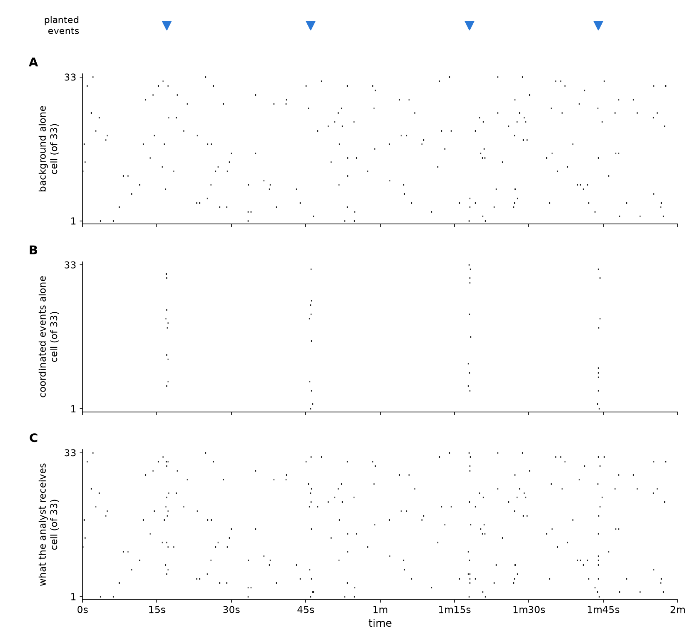

**Figure 1.1. The problem: coordinated events hidden in a background of independent onsets.** Two
minutes of a simulated recording of 33 cells. Each row is one cell and each mark one onset, drawn
in one ink with nothing else on it (a **raster**). A: the **background**, onsets that each cell
produces on its own, independently of the others and at random times, here 0.05 onsets per second
per cell (190 onsets in all). B: four **coordinated events**, each joined by 10 cells chosen at
random, every cell's onset scattered about the event's time with a standard deviation (SD) of
0.2 s (40 onsets). The triangles above the rasters mark the four event times; they point down at
the panels they describe. C: A and B together, which is all an analyst receives: no onset is
labeled background or coordinated, and the event times are not known.

Getting this wrong is not a local error. Every later step of the dissertation uses the counts:
Chapter 2 builds simulated data from the participation, jitter and event rate measured here and
tunes detectors on them, so a mismeasured property is planted into every simulated set, and
Chapter 4 compares those properties across treatments. Section *1.6.2* gives a concrete case: at a
busier background, one of the repository's tools reports the spread of chance groupings, about
0.7 s, as the jitter, whatever the true jitter is.

The working premise of this dissertation, not yet tested, is that a recording mixes **two or more
sources** of coordinated events. A source is one generating process, with its own
**participation** (the share of cells that join an event; an event's **participants** are those
cells, k of the N cells), **jitter** (how far each participant's onset scatters about the event
time), intervals between events, membership rule (a fixed set of cells, or a fresh random set each
event) and, optionally, a **latency template** (a fixed lead or lag for each cell). The goal is a
toolset that measures those properties from the onset times alone, builds simulated recordings
from the measurements, and then tests detectors on recordings whose coordinated events are known.

The dissertation takes that in four steps. **Chapter 1**, this one, builds and checks the tools
that measure coordination without first finding the events. **Chapter 2** builds simulated data
sets from the parameters those tools measure, and works out how detectors are tuned,
characterized and compared on them. **Chapter 3** applies the result to real recordings, at
**baseline** only: the untreated part of each recording, before any drug is applied. **Chapter 4**
asks how to assess a treatment that may itself change the properties of coordination. The tools are
part of bugarach, the open-source toolset this dissertation builds; "the repository" below means
its code and records.

This chapter takes **one source on purpose**. Before asking whether tools can separate two
sources, it asks what they return for one, and whether that can be derived rather than simulated.

### How the chapter proceeds

A reader who has not met this problem needs three things before the results make sense: why
simple detectors fail, the tools that measure coordination without detecting it, and the question
those tools raise. The chapter gives them in that order. Section *1.2* tries the simplest detectors
on a recording like Figure 1.1's: count the active cells in fixed time bins, count them in a window
that slides, and let the threshold follow the local background. It shows where each succeeds and
where it fails, and why every detector needs settings that depend on properties of coordination
nobody has measured yet. Section *1.3* introduces the tools that measure those properties without
detecting anything (the cross-cell correlogram, pair and triple counts in windows, and counts of
active cells in bins) and builds the mathematics of each on two simulated sets, one sharp and one
jittered.

Section *1.4* shows that a first, brute-force simulation of the tools found failures it could not
explain, and states the chapter's question: can what each tool returns be derived in advance, with
simulation used only to check the derivation? Sections *1.5* to *1.8* answer it tool by tool,
*1.9* discusses what the answers replace and what they leave to Chapter 2, and *1.10* concludes.

## 1.2 Finding coordinated events: three simple detectors

A **detector** takes a recording and returns the times at which it **calls** a coordinated event.
Every detector in this chapter rests on one quantity: the number of distinct cells with an onset
in a short stretch of time. A coordinated event raises that number; the background raises it only
by chance. The three detectors below differ in how they lay out the stretches and where they put
the threshold. Figure 1.2 runs all three on one recording built to show their successes and
failures, and Table 1.1 gives how often each outcome occurs. The recording is simulated, so its
coordinated events are **planted**: placed by design, with their times and cells known, which is
what lets each call be scored as right or wrong.

### 1.2.1 Fixed bins

The simplest detector cuts time into consecutive **bins** of fixed width, 2 s here, counts the
distinct cells with an onset in each bin, and calls an event wherever that count reaches a
**threshold** K, here 6 cells. A cell counts once per bin however many onsets it has there, so one
busy cell cannot make an event on its own. Called bins are joined into one call when the gap
between them is at most a **merge gap**, here 3 s, the repository's setting, because one event's
onsets can spill into a neighboring bin. This is the repository's **count detector**, and
Figure 1.2 C shows its counts.

Its weakness is the bin border. Borders are fixed in advance, so an event that happens to sit on
one has its onsets divided between two bins, and neither half may reach the threshold.

### 1.2.2 A sliding window

The second detector removes the borders. At every instant t it counts the distinct cells with an
onset in the last 2 s, the window (t − 2 s, t], and calls an event while that count is at or
above the threshold (Figure 1.2 D, gray). This is the sliding form of the count detector, with the
same 3 s merge gap. The window passes over every position, so an event whose onsets span less than
2 s is caught whole at some moment, wherever it falls. The cost is that the window also passes
over every chance grouping of background onsets, so at the same threshold it calls chance more
often than fixed bins do.

### 1.2.3 A threshold that follows the background (CFAR)

Both detectors so far use one threshold for the whole recording. The right threshold depends on
the background. Suppose each of N cells has background onsets at random times at a constant rate b
(a **Poisson** process; rates are given in hertz, onsets per second, per cell). The chance that
one cell has at least one onset in a window of width w is a = 1 − e^(−bw), and the cells are
independent, so the count of active cells in the window follows a binomial distribution with N
trials and probability a. Background alone lifts the sliding count to K when the count already sits
at K − 1 and one of the N − K + 1 inactive cells has an onset, so chance calls occur about

  3600 × P(Binomial(N, a) = K − 1) × (N − K + 1) × b

times per hour. This chapter allows **at most one chance call per hour**, the same allowance the
repository's detectors use, and calls the smallest K that meets it, for that K and every larger
one, the **chance floor**. For 33 cells and a 2 s window the floor is 6 cells at 0.0096 Hz, a
background rate typical of the lab's recordings, and 12 cells at 0.05 Hz. The formula counts every
up-crossing and so errs toward a higher floor. At 0.01 and 0.05 Hz the repository's own floor for
the count detector, found by simulating chance on flat Poisson backgrounds rather than by this
formula, gives the same 6 and 12 cells (*1.6.1*, where it is called the event floor). A threshold
of 6 cells is therefore right for the lower background and far too low for the busier one. The
floor also depends on the window: at 0.0096 Hz a 0.2 s window has a floor of 4 cells.

Radar engineers met this problem in the 1960s, with echoes from the ground or the sea in place of
background onsets. In radar a **cell** is a slot of range or time, not a biological cell; here
each cell is an instant of the recording. Constant false-alarm rate (**CFAR**) regulation first set
a radar's threshold from receiver noise; Finn & Johnson (1968) set it instead from an estimate of
the background made in the **reference cells** around the **cell under test**, leaving the cell
under test out, so that the rate of false alarms stays fixed while the background changes. By 1983
**guard cells** next to the cell under test were also left out (Rohling 1983), so that an event
cannot raise its own threshold. Applied here, the CFAR detector estimates b from the onsets in the
30 s on either side of each instant, leaving out the 5 s nearest it on each side, and sets the
threshold at that instant to the chance floor for the estimate (Figure 1.2 D, violet). It then
calls events on the sliding count, joining and spanning calls exactly as the sliding detector
does.

The method has two known weaknesses. A second target in the reference cells raises the estimate
and hides the first (**masking**; Finn & Johnson 1968, severe in Rohling 1983, Fig. 3): here, the
onsets of nearby events count as background. And where the background changes, at a **clutter
edge**, reference cells on the two sides disagree, so the threshold runs high on the quieter side
and low on the busier one (Rohling 1983).

### 1.2.4 What each detector finds

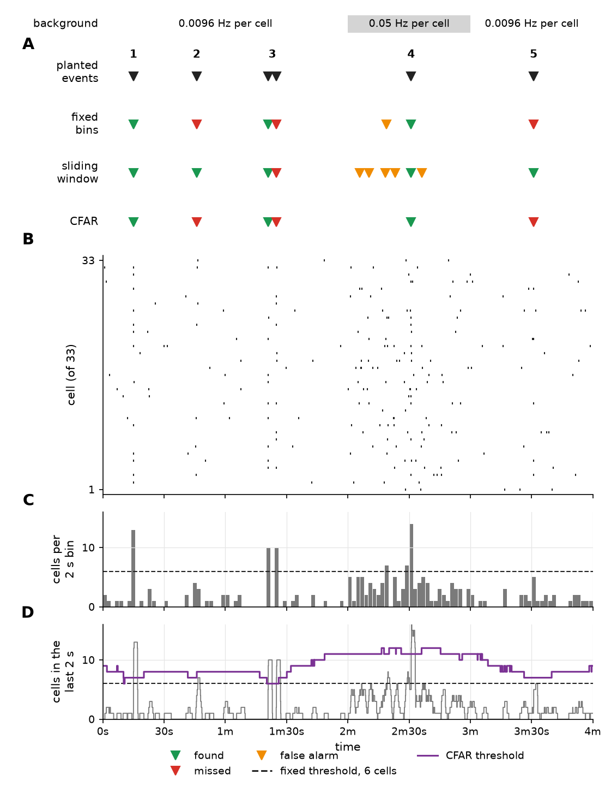

**Figure 1.2. Three simple detectors on one recording: fixed bins, a sliding window and CFAR.** A
4-minute simulated recording of 33 cells, built to hold five situations. The background lane gives
the background rate: 0.0096 onsets per second per cell, except from 2 min to 3 min, where it is
0.05. A: the planted events, numbered by situation, and, in one lane per detector, what that
detector did: green for a planted event it found, red for one it missed, orange for a call where
nothing was planted (a **false alarm**). All marks point down, at the raster they describe; the
color is the verdict. B: the raster, one mark per onset. C: the fixed-bin detector's count of
active cells per 2 s bin, against its threshold of 6 cells (dashed). D: the sliding count of active
cells in the last 2 s, against the same fixed threshold (dashed) and against the CFAR threshold
(violet). All three detectors join calls at most 3 s apart. The planted events are: 1, 12 cells
with jitter SD 0.05 s; 2, 7 cells with jitter SD 0.5 s, centered on a border between two fixed
bins; 3, two events of 10 cells (jitter SD 0.1 s) 4 s apart; 4, 12 cells (jitter SD 0.1 s) in the
busier stretch; 5, 5 cells (jitter SD 0.05 s). Every event other than event 2 sits in the middle of
a bin. The draw shown is one of 200 independent draws of the same design (Table 1.1).

**Table 1.1. How often each detector finds each planted event, and its false alarms**, over 200
simulated draws of the recording of Figure 1.2. A planted event is found when a call spans it,
give or take 1 s; one call finds one event at most. The false alarm columns give the rate and, in
brackets, the count and the time it was counted over.

| detector | 1: sharp, 12 cells (share of draws) | 2: jittered, 7 cells, on a bin border (share) | 3: two events 4 s apart, both found (share) | 4: 12 cells, 0.05 Hz stretch (share) | 5: 5 cells (share) | false alarms, 0.05 Hz stretch | false alarms, 0.0096 Hz stretches |
|---|---|---|---|---|---|---|---|
| fixed bins | 1.00 | 0.34 | 0.00 | 1.00 (0.21 by chance) | 0.41 | 1.82 per min (364 in 200 min) | 0.1 per h (1 in 10 h) |
| sliding window | 1.00 | 1.00 | 0.00 | 1.00 (0.34 by chance) | 0.66 | 3.58 per min (717 in 200 min) | 0.5 per h (5 in 10 h) |
| CFAR | 1.00 | 0.45 | 0.00 | 1.00 (0.01 by chance) | 0.49 | 0.03 per min (5 in 200 min) | 0 per h (0 in 10 h) |

"By chance" is the share of draws with event 4 left out in which a call still lands within 1 s of
its time. The draw in Figure 1.2 is the first of the 200 in which every detector's outcome for every
situation is its most common one (7 of the 200 draws are).

Each situation shows one property of the problem.

1. **A large, sharp event is easy.** Twelve cells within a fraction of a second stand far above
   anything the background makes, and all three detectors find it in every draw.
2. **Jitter across a bin border defeats fixed bins.** Seven onsets spread with an SD of 0.5 s
   across a border fall about half into each bin, and the fixed bins find the event in only 34 %
   of draws. The sliding window, which has no borders, finds it in every draw. CFAR uses the same
   sliding count but finds it in only 45 %: events 1 and 3 sit in its reference stretches, and
   their onsets raise its threshold near event 2 to 7 or 8 cells in 196 of the 200 draws, against
   6 for the 0.0096 Hz background alone (Figure 1.2 D). That is masking.
3. **A merge gap longer than the gap between events joins them.** The two events are 4 s apart,
   and the counts separate them: the sliding count rises and falls twice (Figure 1.2 D). But the
   runs of called counts are less than 3 s apart, so the merge gap joins them, and each detector
   calls one event in every draw. With a merge gap of 0.5 s, all three detectors find both events
   in every draw. Section *1.7* derives how far apart two events must be before the tools' merge
   rules stop joining them, and how much closer any method could go.
4. **A fixed threshold drowns in a busier background.** At 0.05 onsets per second per cell, chance
   gathers 6 cells into one 2 s stretch often. The fixed-threshold detectors make 1.82 and 3.58
   false alarms per minute there, and so many that a call lands near event 4 by chance in 21 % and
   34 % of draws with event 4 removed; their "found" is partly luck. CFAR raises its threshold to
   10–12 cells in that stretch and makes 0.03 false alarms per minute (1.5 per hour), above the
   one-per-hour allowance. The stretch is 60 s long, shorter than CFAR's 70 s reference span, so
   at every instant in it the reference stretches still hold some of the lower background and the
   estimate runs low (the clutter edge); four of the five false alarms fall within 13 s of its ends. Section *1.6.1* derives the
   fixed threshold's failure for the repository's assessor, a tool introduced in *1.3.4*.
5. **An event below the chance floor is found only when the background helps.** Five cells are
   one fewer than the fixed threshold, so event 5 is found only when a background onset happens to
   join it in the same bin or window: in 66 % of draws by the sliding window, whose window catches
   more background, and in 41 % by fixed bins. CFAR finds it in 49 %: event 5 sits just after the
   busier stretch, whose onsets still fall in its reference stretches, so its threshold there is 6
   cells in 119 draws and 7 or more in 67. The floor belongs to the 2 s window, not to counting:
   a 0.2 s window, whose floor is 4 cells at this background, would hold all five onsets of an
   event this sharp, but it would split jittered events like event 2.

CFAR's numbers here belong to this design as much as to CFAR. The recording packs six events into
4 minutes, about 90 per hour against the lab's 10–22, and puts a busier stretch in the middle; in
the 0.0096 Hz stretches CFAR's background estimate has a median of 0.021 Hz, twice the true rate.

Every detector here has a window or bin width, a threshold and a merge gap, and each setting
depends on a property of coordination. The window must be wide compared with the jitter, or it
splits events, and narrow, or it gathers background. The threshold must sit below the number of
participants, or it misses events, and above the chance floor, or it calls the background. The
merge gap must be shorter than the gap between events, or it joins them. None of these properties
is known before the analysis. They must be measured first, without a detector, and that is what
the tools of *1.3* do. The repository's more elaborate detectors, which test each moment against
shifted copies of the recording or against its recent past, belong to the same families. Chapter 2
characterizes them on simulated data built from what the tools measure.

## 1.3 Measuring coordination without finding events

### 1.3.1 The data and the generative model

The input is one list of onset times per channel (a cell, or **region of interest**) and the
recording's duration; the frame interval is optional. Parameter values called *realistic* here are
taken from the lab's recordings of arcuate kisspeptin neurons in mouse brain slices, which are
imaged at a 0.1 s frame and hold two kinds of calcium event distinguished by their time course,
fast and slow (DeFazio et al. 2026). The dissertation calls the onsets of each kind a **stream**:
the fast stream and the slow stream are analyzed separately. They serve only to choose where to
simulate; no statement in this chapter is about the recordings themselves. The realistic values
are:

- a background rate of 0.0096 Hz per cell, estimated from the fast stream and used for both streams;
- onset jitter of 0.105 s (fast) and 0.131 s (slow);
- 7 cells per event (fast) and 13 (slow), of 33;
- **baseline segments** of about 20 minutes (17–20 min): the stretch of each recording, before
  any drug is applied, that the lab analyzes. Per segment the fast stream holds a mean of 3.2
  coordinated events (median 1, range 0–23, with 28 of 66 segments holding none) and the slow
  stream 7.3 (median 2, range 0–49, 25 of 66 with none); the pooled rates are 9.7 and 22.0 events
  per hour ([run record](../learned/runs/2026-09-25-real-intervals/README.md));
- two measured lists of intervals between events, one per stream. They came from a count of
  co-active cells in a sliding 2 s window, which merged events closer than 2 s before the intervals
  were taken, so they understate close pairs.

The generative model is a cluster process of the Neyman–Scott type (Neyman & Scott 1952): cluster
centers placed at random, and the members of each cluster scattered about its center by a
probability law. Here a cluster is a coordinated event, its center the event time and its members
the participants' onsets; with Gaussian scatter it is called the Thomas process. Each of N cells
carries independent Poisson background onsets at rate b. On top of that, E coordinated events
occur in a recording of duration T (rate λ = E/T). Each event is joined by k of the N cells, chosen
afresh; each participant's onset is the event time plus independent Gaussian jitter of standard
deviation σ, rounded to the frame. Two departures from the textbook process matter: the number of
events is fixed, not Poisson, and events are held at least 20 s apart, a **hard-core** train, the
simulator's default spacing, chosen so that no counting window holds two events. Figures 1.1 and
1.2 were drawn from this model with the event times chosen by hand. Table 1.2 (*1.4*) collects the
symbols.

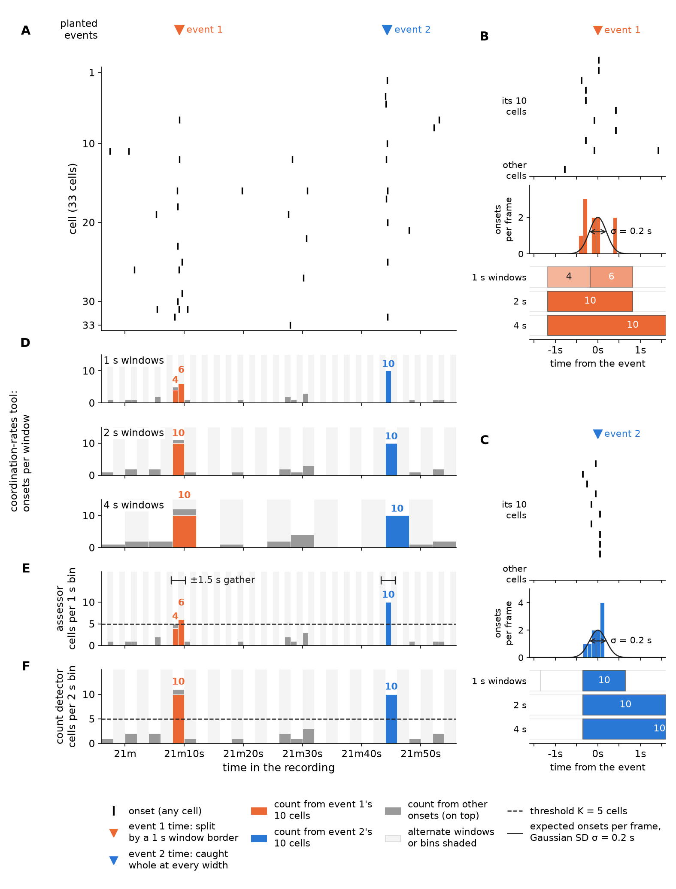

**Figure 1.3. One recording, and what each tool counts in it.** A: one minute of a simulated
45-minute recording of 33 cells, one mark per onset. The background is 0.0096 onsets per second
per cell, and there are two coordinated events of 10 cells each with onset jitter σ = 0.2 s.
Triangles above the raster mark the planted event times. B, C: each event enlarged. Each shows its
10 cells' onsets, then those onsets per 0.1 s frame against the Gaussian they were drawn from (σ is
its SD), then the coordination-rates tool's 1, 2 and 4 s windows with the number of the event's
onsets in each; a window's shade deepens with its share of the event's onsets, so event 1's 1 s
windows holding 4 and 6 onsets are a lighter and a darker orange. A 1 s window border splits event 1
into 4 and 6, while event 2 falls inside one window at every width. D–F: what each tool counts in
the same minute, colored by event, with alternate windows or bins shaded so their edges can be seen.
The coordination-rates tool counts onsets per window (*1.3.3*), the assessor counts distinct cells
per 1 s bin, and the count detector counts distinct cells per 2 s bin (*1.3.4*); the threshold of 5
cells is set for illustration. D shows the windows starting on whole multiples of the width; the
tool also counts on a grid offset by half a window and averages the two, which is not drawn. This
minute was picked from the recording because it shows one split event and one whole one. The onsets
in it are exactly as simulated. In this figure cell 1 is at the top of the raster.

Figure 1.3 shows what each tool counts in one minute of a simulated recording. The rest of this
section introduces the tools and their mathematics on two simulated sets that differ only in jitter
(Figure 1.4). Both have 33 cells, a background of 0.0096 Hz per cell and 45 events of 10 cells in
each 45-minute recording, 10 recordings per set; the **sharp set** has jitter SD σ = 0.1 s, near
the realistic value, and the **jittered set** σ = 0.5 s.

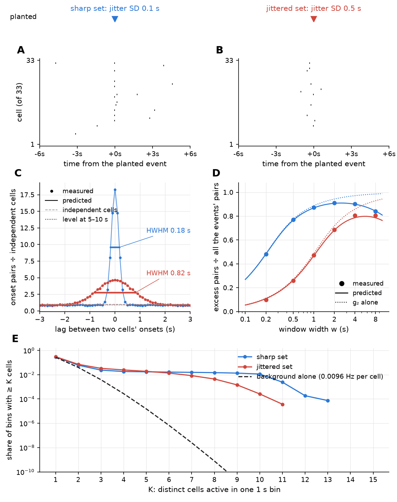

**Figure 1.4. Two sets, sharp and jittered, through each tool.** Simulated with the repository's
generator: 33 cells, background 0.0096 onsets per second per cell, 45 events of 10 cells in each
45-minute recording, events at least 20 s apart, 10 recordings per set. The sharp set (blue) has
jitter SD 0.1 s and the jittered set (red) 0.5 s. A, B: 12 s of one recording from each set
around one planted event (triangle). C: the cross-cell correlogram (*1.3.2*): onset pairs between
two different cells at each lag of one frame, pooled over all pairs and recordings, divided by the
number expected if the cells were independent at their own rates (dashed line at 1). Lines are the
prediction derived in *1.3.2*; dotted lines are the level each set settles to at 5–10 s lag, and
the thick bars extend one half-width at half maximum (HWHM) either side of zero lag. D: the excess
pair count in windows of width w, as a share of all the pairs the events' onsets form (*1.3.3*),
measured by the coordination-rates tool (points) and predicted (solid lines; the dotted lines are
window sharing g₂ alone). E: the share of 1 s bins in which at least K distinct cells are active
(*1.3.4*), with the share the 0.0096 Hz background alone would give (dashed). Shares of zero are not
drawn.

### 1.3.2 Pairs of cells: the correlogram and its width

The most direct trace of coordination is in pairs of cells. Take every ordered pair of two
different cells, i and j, and every pair of their onsets, one from each, and record the **lag**,
j's onset time minus i's. The histogram of those lags, pooled over all pairs of cells, is the
**cross-cell correlogram** (Perkel, Gerstein & Moore 1967 call the two-cell version the
cross-correlation histogram). If the cells were independent, the lags would fall evenly: in a lag
bin of width h (here one frame) the expected number of onset pairs is C₀ = Σ_(i≠j) n_i n_j h/T,
where n_i is cell i's number of onsets. That level, the same at every lag, is what independence
predicts.

Coordination adds a peak at zero lag. One event of k participants contributes k(k − 1) ordered
pairs of onsets from different cells. Each onset is the event time plus its own jitter, so the
event time cancels from the lag, and the lag of two participants is the difference of two
independent Gaussians of SD σ: a Gaussian of SD σ√2. Over E events the correlogram is therefore

  C(τ) = C₀ (1 − d) + E k(k − 1) h φ(τ; σ√2),

where φ(τ; s) is the Gaussian density of SD s at lag τ, and d is explained below. The correlogram
reads three things.

- **Its width is set by the jitter alone.** A Gaussian of SD s falls to half its height at
  s√(2 ln 2), so the peak's **half-width at half maximum** (HWHM) is σ√2 · √(2 ln 2) = 2√(ln 2) σ,
  about 1.67 σ. The participation, the number of events and the background change the peak's
  height, not its width.
- **Its area above the level away from zero counts coordinated pairs**: E k(k − 1), whatever the
  jitter.
- **Its height measures how visible the coordination is.** Divided by C₀, which grows with the
  square of the onset rate per cell, the peak stands at about 1 + E k(k − 1) φ(0; σ√2) h / C₀. It
  falls as the jitter widens the peak and as the background raises C₀.

**Away from zero lag the correlogram sits below independence**, by the share d. Events held at
least 20 s apart never put the onsets of two different events close together, which removes pairs
that independent placement would make, the same hard-core effect *1.3.3* meets in windows. With
(Ek)² of the onset pairs coordinated, d ≈ (Ek)²(1 − 1/N)/(Σn_i)², which predicts a level of 0.887
for the sharp set and 0.884 for the jittered; the measured level at 5–10 s lag is 0.891 and 0.881
(Figure 1.4 C). The width is read above that level, as the repository's correlogram tool reads it.

The onsets are rounded to the frame, so lags come in whole frames. A lag that falls between two
frames is counted in one or the other, with odds set by how close it is to each, which widens the
peak slightly. With that included, the prediction for the sharp set is a peak of 18.4 times the
independent level and an HWHM of 0.174 s (0.167 s before rounding); the correlogram tool measures
18.3 and 0.177 s (bootstrap standard error over the 10 recordings 0.003 s). For the jittered set
the prediction is 4.6 and 0.835 s, and the measurement 4.6 and 0.821 s (standard error 0.021 s).
Both widths agree with their predictions within about one standard error. Five times the jitter
makes the peak about five times wider and a quarter as tall.

The repository's **correlogram tool** measures jitter this way. It counts onset pairs at each
one-frame lag out to 10 s and divides by the count expected from each pair of cells' totals. It
then subtracts the mean excess at 5–10 s lag, which removes both the hard-core deficit and slow
changes of rate shared across cells, and takes the HWHM of what is left. As shipped, it pools the
cell pairs of all the recordings it is given before taking the width. It converts the width to
jitter through a calibration curve made by simulation at the fast stream's participation and event
rate, rather than through the 1.67 factor, because frame rounding, the background and the
subtracted level all move the measured width away from the ideal. Section *1.5.6* compares it with
the joint fit derived later.

### 1.3.3 Counting in windows: pairs and triples

The correlogram looks at pairs of cells. The **coordination-rates tool** looks at the whole
population at once. It cuts time into windows of width w, counts every onset in each window (from
all cells), and asks how many more pairs of onsets share a window than chance would give
(Figure 1.3 D).

For a count X of onsets in a window, the number of ordered pairs is X(X − 1). If every cell were
independent and Poisson, the mean of X(X − 1) would equal the square of the mean of X, so the
difference

  f₂ = mean[X(X − 1)] − mean[X]²

is zero for background alone and counts **excess pairs**. The matching quantity for triples,
f₃ = mean[X(X − 1)(X − 2)] − 3 mean[X(X − 1)] mean[X] + 2 mean[X]³, counts **excess triples**.
These are the second and third **factorial cumulants** of the count. Factorial moments count
ordered pairs and triples; cumulants are the combinations of them that add across independent
processes, so the background's contribution drops out and only coordination remains.

An event whose k onsets all fall in one window adds k(k − 1) pairs and k(k − 1)(k − 2) triples to
that window, so the ratio of excess triples to excess pairs is k − 2 and gives the number of
participants. The tool reports **k̂ = 2 + f₃/f₂** participants per event, and from f₂ and k̂ the
number of events per minute and the **coordinated onset rate per cell**, λk/N: how often an average
cell has an onset that belongs to an event.

Jitter breaks the assumption that a window holds all of an event. Let g₂(w, σ) be the share of an
event's pairs of onsets that fall in the same window, for windows placed at random. Two onsets with
lag D share a window of width w with probability max(0, 1 − |D|/w): certainly when D = 0, never
when |D| ≥ w. So g₂ is the correlogram's peak averaged with that triangular weight,

  g₂(w, σ) = 𝔼[max(0, 1 − |D|/w)], D Gaussian with SD σ√2,

and the excess pair count is close to p k(k − 1) g₂, where p = λw is the expected number of events
per window. g₂ rises from 0 for windows much narrower than the jitter to 1 for windows much wider,
and is one half when the window is about twice the jitter SD (2.08 σ). Figure 1.4 D shows it for the
two sets, with the tool's measured excess pairs. For the sharp set g₂ is 0.49 at a 0.2 s window and
0.89 at 1 s, and the measured shares are 0.48 and 0.87; for the jittered set g₂ is 0.11 and 0.49,
and the measured shares 0.10 and 0.47. At 4 s and 8 s the measured share turns down for the sharp
set, and levels off for the jittered set, instead of approaching 1. That is not the jitter: the
hard-core train never puts two events in one window, which removes pairs that independent events
would make, and the full prediction (solid lines, derived in *1.5.3*) includes it. The measured
shares lie within about 0.02 of the full prediction at every window for both sets.

The same reasoning holds for triples, with g₃ the share of an event's triples that fall in one
window. Because g₃ falls faster than g₂ as jitter grows, the tool's k̂ falls below the true number
of participants when the window is not much wider than the jitter. Section *1.5* derives that
undercount and tests it.

**Chance from the data themselves.** Real cells are not Poisson and do not share one rate, so the
tool does not take chance from the formula. It takes it from **surrogates**: copies of the
recording in which each cell's whole train of onsets is shifted in time, circularly, by its own
offset (Figure 1.5 A). A test against such copies is a test against a **null**: data built to have
no coordination. Shifting keeps each cell's own rate and spacing and destroys the alignment between
cells. The offsets are distinct multiples of two windows, assigned at random and centered on zero,
so they span only about N × 2w (64 s at the 1 s window). Independent random shifts of up to ±5 s
were tried and lost 35 % of the planted pairs, because two cells of one event shifted by similar
amounts stay together. The tool subtracts the surrogates' pair and triple counts from the
recording's, averages over two window offsets (0 and w/2) at each of its windows of 1, 2 and 4 s,
and solves for participants, events per minute and the coordinated onset rate. It estimates
participants once, from f₃/f₂ pooled across all the recordings it is given, and reports that value
for each recording. It needs no event definition and no threshold.

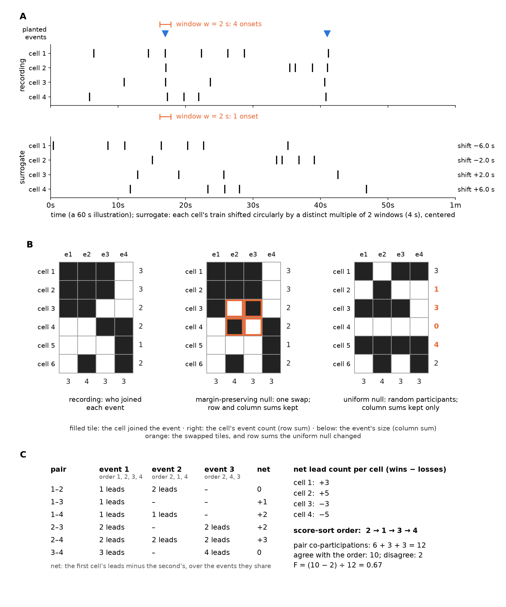

**Figure 1.5. Three mechanisms the tests rest on, drawn on small illustrative values.** No value
comes from a run. A: the coordination-rates tool's time-shift surrogate. "Recording": 60 s of four
cells' onsets (one mark per onset), with background onsets and two coordinated events of all four
cells, whose planted times are marked in the lane above. "Surrogate": each cell's train is shifted
circularly by its own offset; offsets are distinct multiples of two windows, centered on zero, so
they span only about N·2w (here −6, −2, +2 and +6 s for a 2 s window, listed beside each cell). Each
cell keeps its own onsets and spacing, but the events no longer line up across cells. The 2 s window
marked in each lane holds 4 onsets in the recording and 1 in the surrogate. Panels B and C belong
to *1.8.1* and *1.8.2*. B: the assembly test's two nulls, on a membership matrix of 6 cells by 4
events (filled tile = the cell joined the event; the numbers beside each row are that cell's event
count, those under each column that event's size). The margin-preserving null swaps a checkerboard
pair of tiles (orange), which keeps every row and column count. The uniform null draws each event's
participants at random, which keeps the column counts only; the row counts it changed are in
orange. C: the score sort and F for 4 cells and 3 events (onset orders 1, 2, 3, 4; 2, 1, 4; and 2,
4, 3). For each pair, the table gives who leads in each shared event and the net, the first cell's
leads minus the second's. A cell's net lead count, wins minus losses over all its pairs, is +3, +5,
−3 and −5, so the score sort orders the cells 2, 1, 3, 4. Of the 6 + 3 + 3 = 12 times a pair of
cells shares an event, 10 agree with that order and 2 disagree, so F = (10 − 2) ÷ 12 = 0.67.

### 1.3.4 Counting cells in bins: the assessor and the count detector

The detectors of *1.2* count **distinct active cells** rather than onsets. With background alone,
each cell is active in a bin of width B with probability 1 − e^(−bB), independently of the others,
so the count of active cells in a bin is binomial, and the share of bins in which it reaches K
falls steeply with K. Coordination adds bins far out in that tail (Figure 1.4 E). At the
0.0096 Hz background alone, at least 8 cells are active in a 1 s bin in a share 8 × 10⁻¹⁰ of
bins. In the sharp set, 397 of its 450 events (88 %) put at least 8 cells into some 1 s bin; in the
jittered set only 119 (26 %) do, because its events spread over neighboring bins. At 5 cells the
two sets are close (450 of 450 sharp events, 442 of 450 jittered). A threshold high enough to sit
far above chance therefore misses most jittered events.

Two of the repository's tools work on this count (Figure 1.3 E, F).

- **The assessor** counts distinct active cells per 1 s bin. A **cluster** starts at a bin with at
  least K cells and joins later such bins with at most one bin between them. The cluster's center
  is the mean of its bins' centers. The assessor then takes **each cell's nearest onset within
  ±1.5 s of that center, from every cell**, background cells included, and keeps the cluster if at
  least K cells are gathered. A cluster's jitter is the SD of its gathered onsets; the assessor
  reports the median over all its clusters (its **jitter reading**), the same median on circularly
  shifted surrogates (its **null reading**), and the difference of the two (its **excess
  reading**).
- **The count detector** is the fixed-bin detector of *1.2.1*: it calls a coordinated event
  wherever the number of distinct cells active in a 2 s bin reaches a threshold, joining calls at
  most 3 s apart (with 2 s bins, at most one uncalled bin between them).

Two further statistics look at *which* cells are active together, which no count can see: the
repository's **assembly test**, which asks whether the same groups of cells recur across events
(*1.8.1*), and an **order indicator**, which asks whether cells keep the same order of onsets
within events (*1.8.2*). Both are introduced where they are analyzed.

## 1.4 The first simulation, and the question it raised

### What brute force found

The first way to characterize the tools is a simulation grid: plant a source at many settings,
measure each recording without looking at the planted values, and compare. The first such
experiment found three failures in the coordination-rates tool (*1.3.3*) and the assessor
(*1.3.4*) that, when it was run, nothing explained (Figure 1.6). Section *1.3* has sketched their
mechanisms; *1.5* and *1.6* derive them.

**The first experiment** simulated one source, with a fresh random set of participants per event, on
a grid of 4 jitters × 3 participations × 2 event counts × 2 backgrounds = 48 **conditions**, 5
recordings each: 240 recordings of 33 cells and 45 minutes (Table 1.2 lists the values). Each was
measured without access to the planted values, with the coordination-rates tool at its windows of
1, 2 and 4 s and the assessor at K = 3, 4 and 6 cells. A further 200 background-only recordings
(100 per background) tested the chance-cluster rate. A first run of this grid shared backgrounds
across conditions (every condition with the same replicate index had the same random draw of
background, its **seed**), so its errors were correlated; it was rerun with a seed per recording,
and every number here is from the rerun.

**Table 1.2. Symbols.** Each is also defined where it is first used.

| symbol | meaning | values in the first experiment |
|---|---|---|
| N | cells in a recording | 33 |
| k | participants per event (cells) | 5, 10, 20 (participation 0.15, 0.3, 0.6) |
| σ | jitter: SD of a participant's onset about the event time | 0.05, 0.2, 0.5, 1.0 s |
| b | background rate per cell | 0.01 Hz (near the realistic 0.0096 Hz) and 0.05 Hz |
| E, λ | coordinated events per recording; per second | 15 or 45 in 45 min (0.0056 or 0.0167 Hz) |
| w, p | a counting window's width (the coordination-rates tool's; the detectors' of *1.2* is 2 s); p = λw, events per window | 1, 2, 4 s |
| h, B | the correlogram's lag bin; a cell count's bin width | 0.1 s; 1 or 2 s |
| f₂, f₃ | excess pair and triple counts per window (*1.3.3*) | |
| g_n | the chance that all n onsets of one event fall in one window | |
| K, q | a threshold in cells (the detectors' of *1.2*; the assessor's); the chance a 1 s bin reaches K by chance | 3, 4, 6 cells (assessor) |
| ν_c, ν_e | chance clusters and planted events per minute | |
| π_K | the chance one event reaches K cells in a bin | |
| Δ, τ_min | separation of two events; a cell's minimum interval between its own onsets | |
| M | number of assemblies, or of latency templates | |
| δ, r | SD of a latency template's offsets; r = δ/σ | |
| F, n̄ | the order indicator; mean number of events a pair of cells shares | |

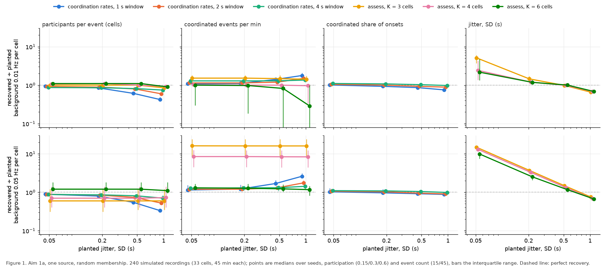

**Figure 1.6. What the first experiment found: participants undercounted at wide jitter, and a flat
jitter reading at the busier background, with the joint fit derived later.** Events of 10 or more
cells, 160 of the 240 simulated recordings. Each point is a median over participation, event count
and the 5 recordings per condition; bars are the interquartile range. A–C (background 0.01 onsets
per second per cell) and E–G (0.05 Hz): recovered ÷ planted participants, event rate and coordinated
onset rate per cell (*1.3.3*). D and H: recovered jitter in seconds against the identity line, so an
estimator that returns a constant draws as a flat line; markers are dodged horizontally for
visibility. The violet series is not part of the first experiment: it is the joint fit, an
estimator built afterwards from the theory of *1.5.6*, drawn here for comparison.

1. **Participants are undercounted when jitter approaches the window.** At 1 s jitter the
   coordination-rates tool's 1 s window read 0.34–0.42 of planted participants, and its 4 s window
   0.68–0.85 (Figure 1.6 A, E). *1.5* derives this.
2. **A fixed threshold does not transfer across backgrounds.** On recordings with no coordinated
   events at all, at 0.05 Hz per cell, chance alone gave the assessor 7.97 clusters per minute at
   K = 3 and 3.85 at K = 4, against the 0.33 or 1 planted events per minute of the event-bearing
   recordings (Figure 1.6 F shows the inflated event rate). This is situation 4 of Figure 1.2, in
   the assessor. *1.6.1* derives this.
3. **The assessor reads jitter only at the quieter background.** At 0.01 Hz and K = 4 it read 0.07,
   0.23, 0.49 and 0.72 s for planted 0.05, 0.2, 0.5 and 1 s (Figure 1.6 D). At 0.05 Hz it read
   0.64–0.73 s whatever was planted at K = 3 or 4, and at K = 6 it rose only from a planted 0.5 s
   (0.43–0.68 s; Figure 1.6 H). *1.6.2* derives this.

The first experiment held events at least 20 s apart, which hid a fourth limit, the one situation 3
of Figure 1.2 shows: two events close together are counted as one. *1.7* takes that up.

A grid can find such failures. It cannot say why they happen, or where else they will.

### The question, and the answer in brief

**For each measuring tool and each simple detector, can we derive from the planted parameters what
it should return, and use simulation only to test the derivation and measure what is left over?**
This is the chapter's question, labeled **Aim 0** because it comes before the aims of the later
chapters: *predict first, simulate to check*.

For one source, mostly yes. The undercount follows from window sharing, how often one window holds
all of an event's onsets (*1.5*). The threshold failure follows from how steeply the rate of chance
clusters rises with the background (*1.6.1*). The flat jitter reading is the median of the
assessor's chance clusters, whose share of all clusters that rate predicts (*1.6.2*). The theory
predicts the coordination-rates tool's participant estimate to a median of 1–2 % of planted (worst
13 %) for events of 10 or more cells, though not exactly: on the held-out rerun the residuals exceed
sampling noise (*1.5.4*), and on the slow stream's measured intervals the tool misses the
prediction in the same direction at every window, for a reason not found (*1.5.5*). It yields an
estimator of jitter, participation and event rate together, the joint fit (*1.5.6*). For structure
in which cells take part, and in what order (*1.8*), it derives two quantities: how much extra
variance reused groups of cells add to the counts of events each pair of cells shares, and the mean
of the order indicator when no order is present. How many events a test then needs is measured by
simulation.

It does not replace simulation. It tells simulation where to look, and it is wrong in specific,
measurable places that this chapter reports. At realistic values, in a 20-minute baseline segment
like the lab's (*1.3.1*), it shows that participants can be read from one segment when events are
large (13 cells, two or more events) but not when they are small (7 cells) and few, and that jitter
cannot be read from one segment by the joint fit (*1.5.7*). The correlogram tool was not tested at
those values.

### How the predictions are tested

**The residual** for each condition and window is the absolute difference between the condition's
median recovered ÷ planted ratio and the predicted ÷ planted ratio, unless marked signed. The
prediction is the tool's estimator applied to the expected excess counts; the measurement is the
median over recordings of the same estimator applied to each recording's counts. The tool's shipped
report instead pools f₃/f₂ across recordings; on that path the participant residuals change by at
most 0.004, and the rate bias is smaller (*1.5.5*). The two can differ even under an exact theory,
because the estimator is nonlinear; for rate that gap is within ±0.008 and changes sign between
runs, so it is noise at 5 recordings. The tool **refused** (a count was not positive, so it
returned no estimate) in 17 of 720 combinations of recording and window (25 on the held-out rerun
described next), all 5-cell events at 0.05 Hz. The medians exclude those and the predictions
cannot, so the 5-cell medians at 0.05 Hz carry a selection bias.

**A held-out rerun.** Some model choices were made while looking at the first experiment: a
frame-rounding term was dropped (it is wrong: the windows sit on the frame grid, so rounding does
not change which onsets share a window, and it also biased jitter low), the joint fit was
re-specified, and the correction for the event train (*1.5.5*) was judged partly by how far it
shrank these residuals. So the whole grid was rerun with fresh seeds and every check repeated on
that **held-out rerun**. Both runs are reported; where they differ, the held-out value is the one
to trust.

**Realistic values** fall between the grid's points (Figure 1.12), so they were simulated directly,
two ways. Events followed **renewal trains**, in which each interval between events is drawn
independently, here resampled from each stream's measured list, with events then kept at random to
set the count (this keeps the train's **pair correlation**, how often two events fall a given lag
apart relative to independent placement). σ was 0.105 or 0.131 s, k 7 or 13 of 33 cells, b
0.0096 Hz, 40 recordings per combination.

- **45-minute recordings at the pooled rates**: 7.3 events on average on the fast stream (range
  2–19) and 16.5 on the slow (range 2–35), about 2.25 times a baseline segment.
- **20-minute segments with a fixed count**: E = 1, 2, 4, 8 or 16 events, which spans the median
  segment (1–2 events) to its busy tail.

An earlier run at about 3.5 and 3.3 times the pooled rates (25.5 and 53.6 events per 45-minute
recording) is kept as a check on denser trains. These trains were placed by the follow-up scripts
rather than through the simulator's own measured-interval option, because the general form
(*1.5.5*) needs a **stationary** train (one whose statistics do not change over the recording)
with a known pair correlation, which the simulator's fixed-count placement is not.

### Prior work

**Detectors.** Counting the cells active together in a short window, against a threshold, is how
synchronous calcium events are found in imaging of hippocampal populations (Malvache et al. 2016).
The chance that a sliding window ever reaches a given count is the subject of scan statistics
(Glaz, Naus & Wallenstein 2001 ⚠). Setting the threshold from a local estimate of the background, with
the cell under test left out, is cell-averaging CFAR (Finn & Johnson 1968, who credit the earlier
noise-regulated CFAR); leaving out its neighbors too, the guard cells, was routine by 1983. Rohling
(1983) compared cell-averaging with its greatest-of variant and introduced an ordered-statistic
estimate that resists a second target in the reference cells. The correlogram is the cross-correlation histogram of
Perkel, Gerstein & Moore (1967), pooled over pairs of cells.

**Coincidences across bin widths.** Grün et al. (1999, eq. 5) derived the chance that a
near-coincidence is split by a bin border, with one onset of the pair displaced uniformly by up to
±s time steps (the "fission probability"), and showed how detection depends on the analysis bin
width. Pazienti et al. (2008) derived how dithering interacts with jittered coincidences and
estimated synchronization precision from how detection decays with the dither interval, at a single
tolerated spread. Louis, Borgelt & Grün (2010), building on Grün, Abeles & Diesmann (2008), gave the
full distribution of the population count for groups with **uniform** jitter: given how far a
jitter window overlaps a bin, each member is captured independently, so the group contributes a
binomial count. They estimated group size and jitter from where one feature of the
observed-minus-independent distribution (its second maximum) changes slope as the bin widens, by
fitting two straight lines to that feature's trajectory.

**Cumulants of binned counts.** In fluorescence fluctuation spectroscopy, Müller (2004) related the
factorial cumulants of binned photon counts to the brightness and number of emitters as functions of
the sampling time, and Wu & Müller (2005) fitted factorial cumulants at several rebinned sampling
times jointly for brightness, occupation number and diffusion time, with the variances of the
cumulants. That is the joint fit's construction (*1.5.6*), for diffusing emitters rather than
jittered clusters. In spike-train analysis, CuBIC (Staude, Rotter & Grün 2010) infers a lower bound
on the order of correlation from ordinary cumulants of the population count, under a compound
Poisson model: event times form a Poisson process (the *carrier*), and each event places exactly
synchronous copies in several cells. The multiple-interaction model of Kuhn, Aertsen & Rotter
(2003 ⚠) is a special case. The same authors adapted CuBIC to rates that change from bin to bin
(Staude, Grün & Rotter 2010). Ehm, Staude & Rotter (2007 ⚠), before CuBIC, had fitted rates per event
size, and Reimer et al. (2012 ⚠; abstract only), from Rotter's group, tested that method on
non-Poisson renewal trains (trains whose intervals are drawn independently from one distribution).

**Cluster processes.** The second- and third-order moments of a cluster process with a non-Poisson
center process are textbook point-process theory (Daley & Vere-Jones 2003 ⚠; Møller &
Waagepetersen 2004 ⚠). In spatial statistics the parameters of a Neyman–Scott process are fitted by
minimum contrast on Ripley's pair-count function across scales (Diggle 1978 ⚠, 1983 ⚠); the Thomas
process's version has a closed form used in practice (Waagepetersen 2007). The Thomas process is
named for Thomas (1949), who gave only the count distribution of clustered plants in sampling
quadrats, with no scatter law. Diggle & Gratton (1984)
fitted models that can only be simulated by matching simulated summaries; their spatial example is a
pairwise-interaction inhibition process (a hard core plus soft repulsion), not a cluster process.
Neyman–Scott rainfall models are fitted by matching moments of totals at several aggregation
windows, and recover storm arrival rate and cells per storm (Rodriguez-Iturbe, Cox & Isham 1987 ⚠).
PP-Seq (Williams et al. 2020) is a Neyman–Scott model of neural sequences with per-neuron offsets,
and Wang et al. (2024) give Bayesian inference for the class.

**Assemblies.** Shuffle tests on which cells join which events, like the repository's assembly test,
sit beside a line of work based on principal component analysis (PCA) that tests the leading
eigenvalue of the co-activation matrix (how often each pair of cells is active together) against a
random-matrix (Marčenko–Pastur) null (Peyrache et al. 2010; Lopes-dos-Santos et al. 2011); the
assembly test's second statistic is such an eigenvalue. Schrader et al. (2008) detect synfire chains (groups of
cells that become active one after another, in a fixed sequence) from the overlap of active-cell sets between time bins.

**Order.** Kreuz, Satuvuori, Pofahl & Mulansky (2017) define SPIKE-order and the Synfire Indicator,
which finds an order of spike trains by simulated annealing and scores it against surrogates. The
same group applied it to wide-field calcium imaging (Cecchini et al. 2021), introduced a direct
shift beside annealing for latency correction (Kreuz et al. 2022) and later an extrapolation direct
shift for it (Mariani et al. 2025); its 2026 review still orders trains by annealing (Kreuz 2026).
Tomlinson et al. (2019) rank the nodes of interictal spike propagation by a net downstream-minus-
upstream count and score each sequence against that in-sample order with a shuffle null; the
scores fall with network size, which they read as biological. Silva, Feng & Foster (2015) showed
that picking the better of two behavioral templates for each hippocampal event inflates its rank
correlation unless the shuffle repeats the choice. The replay and cortical-sequence literature was
searched at abstract level (Lee & Wilson 2002 ⚠; Luczak et al. 2007 ⚠; record in
[the prior-art search](../learned/synthetic_validation/prior_art/README.md)).

**What is missing.** As far as the search went, none of this work gives the window-sharing function
for Gaussian jitter at n onsets; this tool's correction for event trains that cannot share a window,
including the surrogate's dependence on the event train; the assessor's cluster-start factor and its
jitter reading; or an analytical no-order mean for an order indicator scored on few events.
Table 1.9 (*1.9.2*) sets each result against its nearest precedent.

### Contributions

Each is tagged with its standing against the prior work above (Table 1.9 gives the full
comparison).

1. **Window sharing under Gaussian jitter** (*1.5.2*): a closed form for the chance that one counting
   window holds all n onsets of an event, and from it the coordination-rates tool's participant
   undercount. *New in form; within 0.04 of the uniform-jitter case earlier work treats.*
2. **The tool's correction for event trains** (*1.5.3*, *1.5.5*): the term for events that cannot
   share a window, its generalization to any stationary train of events, and the dependence of the
   tool's surrogates on that train. *The underlying moment formulas for cluster processes are
   textbook; their application to this tool, and the surrogate term, were not found.*
3. **A joint fit** (*1.5.6*) that recovers jitter, participation and event rate together from the
   tool's pair and triple counts at three window widths, on both runs for events of 20 cells from
   jitter 0.2 s and of 10 cells from 0.5 s. *The construction, fitting factorial cumulants across bin widths, is Wu &
   Müller's (2005) in fluorescence spectroscopy; new here are the jittered-cluster forms it fits.*
4. **The assessor's chance-cluster rate** (*1.6.1*) at each threshold, and the smallest threshold
   safe against chance at a given background. *Known in form; the factor for where a cluster starts
   is specific to the assessor.*
5. **The assessor's jitter reading as a mixture** of chance and event clusters (*1.6.2*), with
   weights from the chance-cluster rate. *Not found; the tool's own shuffled-copy null measures the
   chance part but does not remove it.*
6. **The excess variance of reused cell groups** (*1.8.1*). *Known in form: Kish's design effect,
   the factor by which clustering inflates a variance in survey sampling.*
7. **Order with few events** (*1.8.2*): the exact mean of an order indicator when no order is
   present, for any number of cells and events, with and without onsets tied by frame rounding.
   *Not found; the one-template value of the indicator is the classical arcsine relation, and the
   ranking it uses is a Borda score, which ranks cells by wins minus losses.*

The chapter also reports how close two events can be before the tools merge them (*1.7*). No
prior-art search was made for that result, so it is not claimed as a contribution. The three
detectors and two sets of *1.2* and *1.3* are illustrations, not contributions.

## 1.5 The coordination-rates tool: predicted, then tested

This section derives what the coordination-rates tool of *1.3.3* should report for given planted
values, and tests the derivation against the first experiment and the held-out rerun. In short:
jitter wide compared with the window makes the tool undercount participants, by an amount window
sharing predicts (*1.5.1*–*1.5.2*); a correction for how events are spaced in time brings the
prediction to a median of 1–2 % of planted participants (*1.5.3*–*1.5.5*); fitting all three
windows at once recovers the jitter as well, on both runs for events of 20 cells from 0.2 s and of
10 cells from 0.5 s (*1.5.6*); and at realistic values one 20-minute segment is enough for participants only when
events are large or many, and never for jitter (*1.5.7*).

### 1.5.1 The undercount

The coordination-rates tool assumes every window catches every onset of an event. Under that
assumption the ratio of excess triple to excess pair counts is f₃/f₂ = k − 2, and the tool reports
k̂ = 2 + f₃/f₂ (*1.3.3*). If instead a window holds all of an event's pairs with probability g₂ and all of its
triples with probability g₃, then, dropping small terms derived in *1.5.3*, f₃/f₂ ≈ (k − 2) g₃/g₂ and
the tool reports

  k̂ = 2 + (k − 2) g₃/g₂.

The first failure of *1.4*, the undercount, is therefore a question about g_n.

### 1.5.2 Window sharing

Section *1.3.3* introduced g₂ for a pair of onsets. In general, place a window of width w at a
uniformly random phase. The chance that it holds all n onsets of one event is

  g_n(w, σ) = 𝔼[max(0, 1 − R_n / w)],

where R_n is the range of the n onsets, the time from the first to the last. For two onsets the
range is the absolute lag |D|, with D Gaussian of mean 0 and SD s = σ√2, and with a = w/s the
average has a closed form,

  g₂(w, σ) = (2Φ(a) − 1) − (2s/w)(φ(0) − φ(a)),

with Φ and φ the standard normal distribution and density. For three onsets g₃ is a
one-dimensional integral over the distribution of the range of three normals; it depends only on
w/σ and is tabulated once. Rounding onsets to the frame changes nothing, because the windows sit on
the frame grid.

How much does the Gaussian shape matter? Computed the same way for uniform jitter of the same SD,
g₂ and g₃ differ from the Gaussian values by at most 0.02 and 0.04 (Figure 1.7 A). With the window's
phase random, both are smooth in w; the sharp edge in Louis, Borgelt & Grün's analysis comes from
conditioning on a fixed overlap between the jitter window and a bin, not from the jitter law. So the
Gaussian form is new on paper but close to its uniform counterpart in value.

As σ approaches w, g₃ falls faster than g₂ and k̂ falls toward 2. For 10-cell events, k̂/k falls
below 0.9 once σ passes about w/6 and reaches 0.45 at σ = w (Figure 1.7 B), which is the undercount
of Figure 1.6 A and E. The small terms dropped here, which bring the prediction onto the
measurements at the 4 s window, are the subject of *1.5.3*.

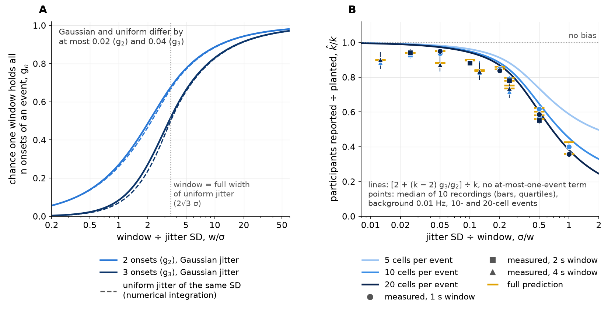

**Figure 1.7. Window sharing, and the undercount of participants it causes.** A: the chance that one
window holds all the onsets of an event, for two onsets (g₂) and three (g₃), against window width
over jitter standard deviation (SD). Solid lines are Gaussian jitter; dashed lines are uniform
jitter of the same SD, computed by numerical integration and checked by simulation. B: participants
reported over planted (k̂/k) against jitter over window, from k̂ = 2 + (k − 2) g₃/g₂, for 5, 10 and
20 cells per event (light to dark blue); points, for 10 and 20 cells, are medians from the first
experiment (10 recordings each, background 0.01 Hz). Yellow dashes are the hard-core form (*1.5.3*),
which adds the term for at most one event per window and accounts for the points that sit below the
lines at the 4 s window. The dotted line at k̂/k = 1 marks no bias. With 10-cell events, the
reported count falls below 0.9 of planted once the jitter passes about a sixth of the window, and to
0.45 when the jitter equals the window.

### 1.5.3 The expected excess counts

The tool's excess counts are factorial cumulants of the count of onsets in a window (*1.3.3*), so
the background drops out. With at most one event per window, the coordinated part of the count
has factorial moments p (k)_r g_r, where p = λw and (k)_r is the
falling factorial k(k − 1)…(k − r + 1). If the surrogate's shifts were independent of the event
train, it would carry each cell's coordinated onsets (rate λk/N) but scatter them, and the excess
pair and triple counts would be

    f₂ = p (k)₂ g₂ − (pk)² (1 − 1/N)

    f₃ = p (k)₃ g₃ − 3 p² k (k)₂ g₂ + 2 (pk)³ (1 − 1/N²)

In each, the terms beyond the first are the **at-most-one-event term**: a Poisson event train would
let two events share a window now and then, and the hard-core train forbids it, so that contribution
is removed. These are the **hard-core form** of the prediction. CuBIC's eq. 3 relates ordinary
cumulants to the distribution of event sizes in the same way, assuming exactly synchronous copies
and a Poisson carrier; window sharing drops the first assumption and the at-most-one-event term the
second.

The independence assumption is not quite right for this tool: its offsets span only about N × 2w,
so a surrogate often shifts two cells by less than the 20 s spacing of events and keeps some of the
train's structure. That makes the surrogate's own pair count 4–15 times the independent value,
about +0.4 to +1 % of the excess f₂, and *1.5.5* adds it.

**Two sources look like one.** Because f₂ and f₃ are sums over independent processes, two sources
with the same jitter add their terms: f₂ ∝ Σ λ_s (k_s)₂ g₂ and f₃ ∝ Σ λ_s (k_s)₃ g₃. The tool's k̂
is then 2 + Σ λ_s(k_s)₃ / Σ λ_s(k_s)₂ (times g₃/g₂), which is a single participation weighted toward
the larger source, and a single rate solves for the rest. Pair and triple counts therefore cannot
tell two such sources from one (derived, not simulated). *1.8* and *1.9.3* return to this.

### 1.5.4 The test

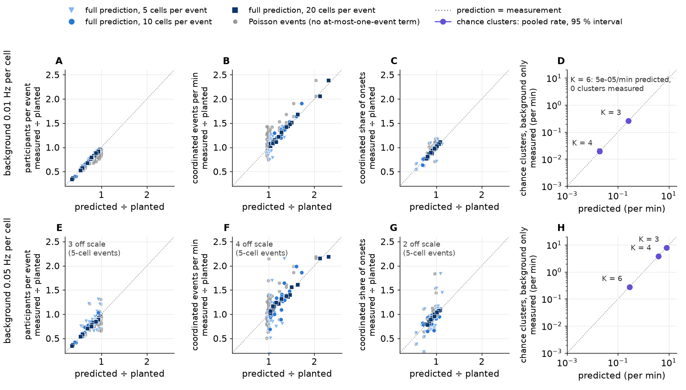

**Figure 1.8. The hard-core form against the coordination-rates tool.** One point per condition and
window, first experiment. A–C (0.01 Hz) and D–F (0.05 Hz): the tool's three estimates as ratios to
planted (participants, event rate, coordinated onset rate per cell). Colored points are the
measurements placed at the hard-core form's prediction; gray points are the same measurements placed
at the prediction for a Poisson event train. Chance clusters are in Figure 1.13.

**The hard-core form overpredicts participants by about 1 %**: with events of 10 or 20 cells,
measured lies below predicted in 24 of 32 conditions at 0.01 Hz (16 conditions × 2 records, one
sign per condition; a sign test, which asks whether measured falls below predicted more often than
half the time, gives p = 0.007). The median residual is 0.007 of planted at 0.01 Hz and
0.016 at 0.05 Hz in the first experiment (worst 0.037 and 0.11); without the at-most-one-event term
it is about 0.05. On the held-out rerun the same residuals are 0.012 and 0.021 (worst 0.056 and
0.13).

Per background there are 48 condition-windows. If the prediction were exact, about 6 of them would
sit beyond 2 standard errors, rather than the 2.2 of a normal error, because the error of a
5-recording median divided by its estimated standard error has heavy tails (simulated). The first
experiment had 7 and 10. The held-out rerun has 17 at 0.01 Hz and 10 at 0.05 Hz (Figure 1.9). The
three windows reuse the same recordings, so their counts are not independent; under a null that
keeps that dependence, 17 of 48 has probability 0.0005–0.002 under exactness.

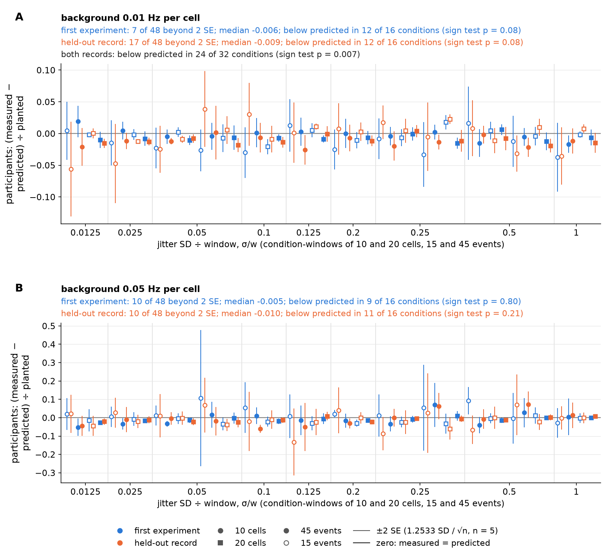

**Figure 1.9. The participant prediction is close, with a small excess on both runs.** Each point
is one condition-window with events of 10 or 20 cells (15 or 45 events; 1, 2 or 4 s window): the
coordination-rates tool's reported participants minus the hard-core form's prediction, divided by
planted participants. The x-axis is categorical: condition-windows are grouped by jitter SD over
window (σ/w), in increasing order, and gray vertical lines divide the groups; the tick under each
group gives its σ/w. Within a group, points are dodged by run: blue for the first experiment,
orange for the held-out rerun on fresh seeds. Circles are 10-cell and squares 20-cell events; filled
markers are 45 events and open markers 15. Whiskers are ±2 standard errors (SE) of the median of 5
recordings, 1.2533 × SD ÷ √5. A: background 0.01 Hz per cell; B: 0.05 Hz. The y-axes differ between
panels. Above each panel are the counts beyond 2 SE (about 5.7 of 48 are expected if the prediction
is exact; the text gives dependence-aware p) and the median signed residual. They also give the
number of conditions, of 16, in which measured lies below predicted, with a two-sided sign test,
counting one sign per condition because the three windows reuse the same recordings. At 0.01 Hz,
measured lies below predicted in 24 of 32 conditions across the two runs (p = 0.007), a median
shortfall of about 0.01 of planted. On the held-out rerun, 17 of 48 condition-windows lie beyond 2
SE.

**Rate and coordinated onset rate** are predicted less well. At 0.01 Hz the median rate residual is
0.032 (held-out 0.024), and at 0.05 Hz 0.055 (worst 0.38; held-out worst 0.62). The coordinated
onset rate's median residual is 0.018 at 0.01 Hz (held-out 0.011).

### 1.5.5 Where the hard-core form fails, and the general form

The first experiment's events were at least 20 s apart, so no window held two. Real event trains
need not be. The **general form** replaces the at-most-one-event term with the event train's **pair
correlation**, the rate of event pairs at each lag relative to independent placement, and adds the
surrogate's dependence on the train described in *1.5.3*
([derivation](../learned/synthetic_validation/separation/real_intervals/derivation.md)). Poisson,
hard-core, renewal and empirical trains are implemented, and so is a train built from the planted
event times' own intervals (Figure 1.10).

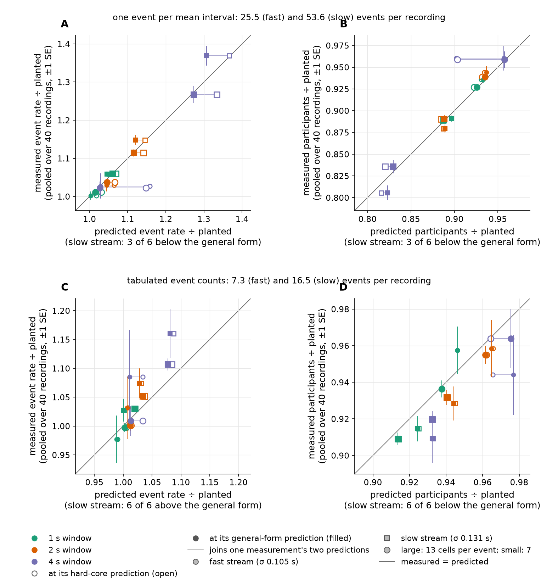

**Figure 1.10. The coordination-rates tool on event trains built from measured intervals.** Measured
against predicted event rate (A, C) and participants (B, D), as ratios to planted, on event trains
whose intervals are resampled from the measured interval lists of the fast stream (σ 0.105 s,
circles) and the slow stream (σ 0.131 s, squares), with 7 (small) or 13 (large) of 33 cells per
event, background 0.0096 Hz per cell, 45-minute recordings, 40 recordings per stream and cell count.
Color is the window (1, 2, 4 s). Each measurement (the tool's estimate from f₂ and f₃ pooled over 40
recordings) is drawn twice at the same height: open at its hard-core-form prediction and filled at
its general-form prediction, joined by a thin line; the vertical bar is ±1 bootstrap SE (the standard error estimated by resampling recordings) of the
measurement. A, B: one event per mean interval (25.5 and 53.6 events per recording;
`separation/real_intervals/intervals_results.json`). C, D: thinned to the pooled rates, 7.3 and 16.5
events per recording. The count under each x-axis is how many of the six slow-stream measurements
lie on one side of the general form. At the pooled rates, all six slow-stream rates lie above it and
all six participant counts below it. At the 4 s window the hard-core form misses the fast-stream
rate by up to 0.17 of planted, and the general form brings it close to the identity line.

On the first experiment's own trains, the general form changes little and moves the right way:

- **Participants.** The 1 % overprediction disappears as a consistent sign: 18 of 32 conditions
  below predicted on the pooled records (p = 0.60). At 0.01 Hz, 12 condition-windows still sit
  beyond 2 standard errors on the held-out rerun, against about 6 expected (p = 0.03–0.07 once the
  windows' dependence is kept): suggestive, not decisive.
- **Rate at 0.01 Hz.** The median residual falls from 0.032 to 0.020 (held-out 0.024 to 0.014); its
  signed median, the bias, falls from +0.030 to +0.013, and to +0.005 on the tool's pooled report.
  The surrogate term accounts for all of the reduction. Measured still sat above predicted in 35 of
  48 condition-windows in the first experiment (p = 0.01–0.04 with the dependence kept), but not on
  the held-out rerun (18 of 48). **At 0.05 Hz** the general form does not help (0.055 to 0.059).

**On denser trains with realistic intervals** the difference is large. Unlike the hard-core trains,
these allow intervals shorter than 20 s, so two events can share a window. At 25.5 events per
recording on the fast stream, for 7-cell events at the 4 s window, the hard-core form predicts the
tool's rate at 1.16 of planted and participants at 0.90, where the tool measures 0.99 and 0.97; the
general form predicts the tool to within 0.04 at every window. On the slow stream (53.6 events per
recording) the tool reads rate up to 1.37 and participants down to 0.80 of planted, and the general
form predicts 1.31 and 0.82.

**At the pooled rates** (7.3 and 16.5 events per 45-minute recording) the two forms nearly coincide,
within 0.025 everywhere and 0.01 at the 1 and 2 s windows, because few pairs of events fall close
together. On the fast stream both agree with the tool within 1.5 standard errors at every window.
On the slow stream the tool reads above the general form in rate and below it in participants at
every window and for both k. The misses are up to 3.3 standard errors (rate 0.010–0.079,
participants 0.005–0.023); the largest is at the 4 s window with 7 cells, rate 1.160 measured
against 1.081 predicted and participants 0.909 against 0.932. Rate and participants are tied
together through the well-determined product λk, and the six cases come from two sets of
recordings, so this is one coupled deviation seen twice, not twelve. The denser slow trains miss the
same way. **This residual is unexplained.**

### 1.5.6 The joint fit, and the correlogram tool

The tool reports a pair and a triple count at each of its three windows. Fitting those six numbers
against the exact forms above for (σ, k, λ) gives jitter, participants and rate at once; the pair
and triple counts are each scaled by their mean absolute value. σ enters only through g₂ and g₃,
which change with w, and that is what makes σ **identifiable** (recoverable from the counts at
all) when σ is a sizable fraction of the windows. The fit is bounded below at σ = 0.005 s, a twentieth of the frame. The condition under which σ cannot be
identified has not been derived: once σ is much smaller than every window, g_n ≈ 1 throughout and
the six counts carry little information about σ, and a Fisher-information calculation (how sharply
the expected counts change with σ, against their noise) would predict the failure region that simulation finds below. The scaling is ad hoc, and it ignores the strong
correlation between counts at nested windows from one recording; Wu & Müller (2005) give the
variances of factorial cumulants that a properly weighted fit, and an uncertainty for it, would
need. The fit reports no per-recording uncertainty.

**On the first experiment**, for events of 10 or more cells and planted jitter of 0.2 s or more, the
condition medians of recovered ÷ planted jitter lie within 0.91–1.13 at 0.01 Hz and 0.88–1.12 at
0.05 Hz, with participants within 0.94–1.14 and rate within 0.73–1.14. **On the held-out rerun**
they lie within 0.86–1.22 and 0.86–1.36, participants 0.98–1.06 and 0.89–1.16, rate 0.94–1.04 and
0.87–1.45. Planted 0.05 s is not resolved: it reads 0.041 s at 0.01 Hz (3 of 20 recordings at the
bound) and 0.030 s at 0.05 Hz (7 of 20), held-out. Events of 5 cells read anywhere from 0.1 to 3.7
times planted (held-out; 3.6 in the first experiment).

**Per recording, the joint fit is the better jitter estimator at the busier background from 0.5 s
up; elsewhere the correlogram tool does as well** (Figure 1.11 A, B; Table 1.3). Applied to one
recording at a time, which is not how it ships, the correlogram reads 0.2 s as well as the joint
fit, gives no estimate in many recordings at 0.05 s (widths below its calibration curve), and falls
short at 0.05 Hz from 0.5 s (0.81 and 0.42 of planted). Pooled over each condition's 5 recordings,
as shipped, it reads 0.89 and 0.94 there, though at 1 s two of the four conditions fall off its
curve. At 0.01 Hz and 1 s its only miss is that the curve ends at 1.0 s; the plain Gaussian
conversion of the same widths reads 0.97. Its curve was made at the fast stream's participation and
rate, so this grid lies partly outside it.

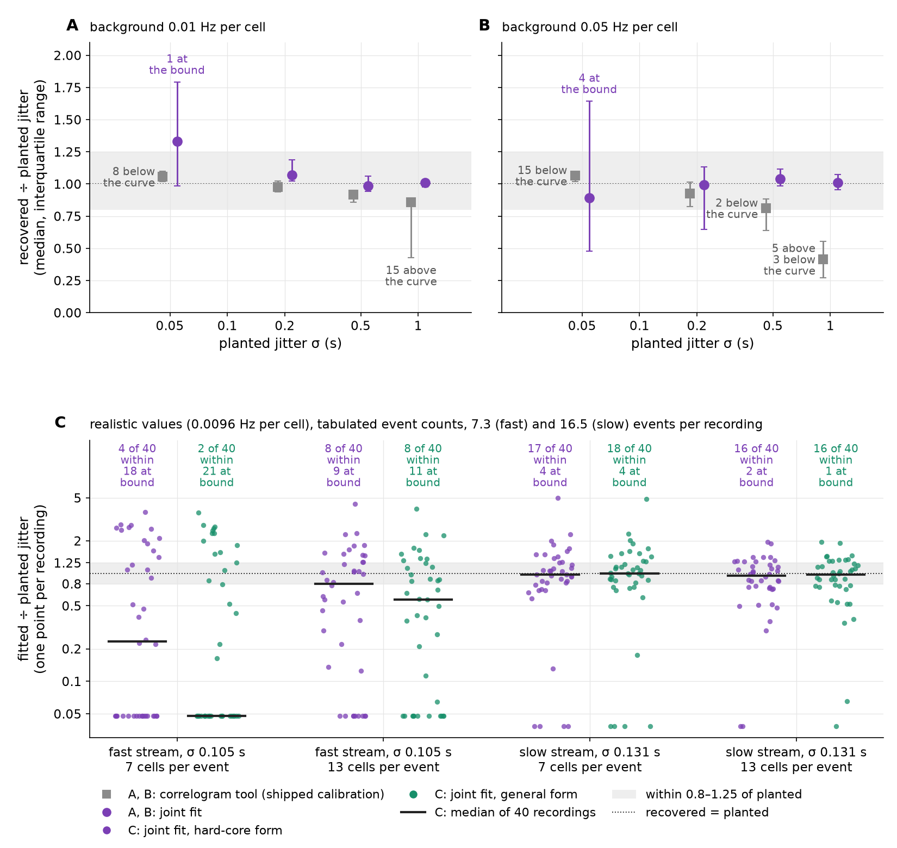

**Figure 1.11. The joint fit against the correlogram tool, and at realistic values.** A, B: recovered
÷ planted jitter against planted jitter, for events of 10 or 20 cells on the 240 first-experiment
recordings (20 recordings per point), at backgrounds of 0.01 Hz (A) and 0.05 Hz (B) per cell. Gray
squares are the correlogram tool as shipped (its own calibration) and violet circles the joint fit
(hard-core form). Markers are medians and bars interquartile ranges. Gray text counts recordings
whose correlogram width fell above or below the calibration curve; these have no estimate and are
left out of the median and range, which are therefore censored (biased by what is left out) where the count is large. Violet text
counts joint fits at the jitter bound (within 2 % of 0.005 or 5 s). The shaded band is 0.8–1.25 of
planted and the dotted line equality. C: the joint fit per recording at the realistic values,
background 0.0096 Hz per cell, 40 recordings per strip, for the fast stream (σ 0.105 s) and slow
stream (σ 0.131 s), with 7 or 13 cells per event. Events follow the measured interval lists, thinned
to the pooled rates of 9.7 and 22.0 per hour (7.3 and 16.5 per recording on average). Violet is the
hard-core form and green the general form given the true train. Bars are medians, and fits at the
lower bound sit at 0.005 s ÷ σ. Above each strip: recordings in band (within 0.8–1.25) · at the
bound. In band: fast stream, 4 and 2 of 40 for 7 cells and 8 and 8 for 13 cells (hard-core,
general); slow stream, 17 and 18 for 7 cells and 16 and 16 for 13 cells.

**Table 1.3. Recovered ÷ planted jitter, events of 10 or more cells, first experiment.** Per
recording: median [interquartile range] over the recordings with a value (20 per row, less those
off the curve), and how many fell below / above the calibration curve. This pools recordings, so
it differs from the medians of condition medians quoted in the text. Pooled as shipped: median
[range] over the 4 conditions, and how many conditions fell off the curve. Gaussian: the width
converted directly, per recording.

| b | planted σ | correlogram, per recording | correlogram, pooled as shipped | correlogram, Gaussian | joint fit, per recording |
|---|---|---|---|---|---|
| 0.01 Hz | 0.05 s | 1.06 [1.02, 1.10]; 8 / 0 | 1.04 [1.02–1.06]; 2 of 4 off | 1.19 [1.11, 1.26] | 1.33 [0.98, 1.79]; 1 at the bound |
| 0.01 Hz | 0.2 s | 0.97 [0.94, 1.02] | 0.96 [0.89–1.00] | 1.03 [0.99, 1.07] | 1.07 [1.02, 1.19] |
| 0.01 Hz | 0.5 s | 0.92 [0.86, 0.94] | 0.92 [0.90–0.97] | 1.01 [0.93, 1.03] | 0.98 [0.94, 1.06] |
| 0.01 Hz | 1.0 s | 0.86 [0.43, 0.87]; 0 / 15 (n = 5) | none: 4 of 4 above the curve's end | 0.97 [0.91, 1.08] | 1.01 [0.98, 1.03] |
| 0.05 Hz | 0.05 s | 1.07 [1.02, 1.07]; 15 / 0 (n = 5) | none: 4 of 4 off | 1.12 [1.09, 1.16] | 0.89 [0.48, 1.64]; 4 at the bound |
| 0.05 Hz | 0.2 s | 0.93 [0.83, 1.01] | 0.96 [0.85–1.02] | 0.97 [0.87, 1.07] | 0.99 [0.65, 1.13] |
| 0.05 Hz | 0.5 s | 0.81 [0.64, 0.88]; 2 / 0 | 0.89 [0.83–1.11] | 0.83 [0.58, 0.96] | 1.04 [0.98, 1.12] |
| 0.05 Hz | 1.0 s | 0.42 [0.27, 0.55]; 3 / 5 | 0.94 [0.88–0.99]; 2 of 4 off | 0.48 [0.20, 0.84] | 1.01 [0.95, 1.07] |

### 1.5.7 At realistic values

Realistic jitter, 0.105–0.131 s, lies between the grid's unresolved 0.05 s column and its 0.2 s
column, which is resolved on both runs only for 20-cell events (Figure 1.12). Simulated directly, the joint fit reads participants per recording but not
jitter on the fast stream.

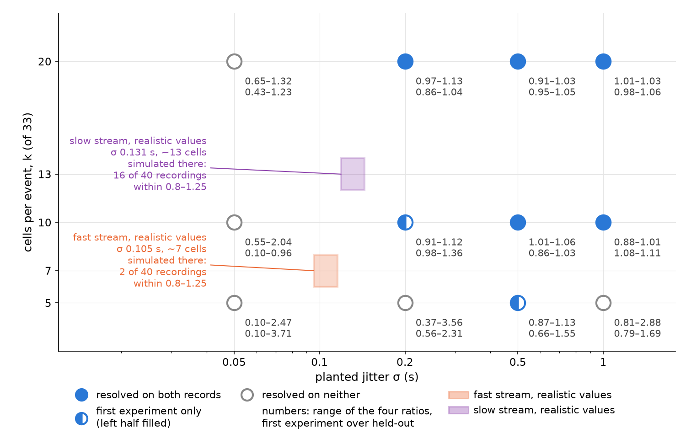

**Figure 1.12. Realistic values lie below the jitter the joint fit resolves.** Each circle is a
combination of planted jitter and cells per event, judged on two runs: the first experiment and
the held-out rerun on fresh seeds. On each run the point counts as resolved when the joint fit's
(*1.5.6*) recovered ÷ planted jitter is within 0.8–1.25, a ±25 % convention, in all four conditions
(15 or 45 events, background 0.01 or 0.05 Hz), each the median of 5 recordings. A filled circle is
resolved on both runs, an open one on neither, and a circle with its left half filled on the
first experiment only; no point is resolved on the held-out rerun only. The two lines of numbers
under each circle give the range of the four ratios, first experiment above and held-out rerun
below. Two points are resolved on the first experiment only: 10 cells at 0.2 s (held-out 0.98–1.36)
and 5 cells at 0.5 s (held-out 0.66–1.55). On both runs the 20-cell row is resolved from 0.2 s up
and the 10-cell row from 0.5 s. The orange and violet boxes mark realistic parameter values for the
fast stream and the slow stream: jitter 0.105 s with 7 cells per event, and 0.131 s with 13 cells.
The box sizes are nominal. Beside each box is the share of 40 recordings simulated at those values,
with the pooled rates, whose per-recording jitter falls within 0.8–1.25 under the general form
(Figure 1.11 C): 2 of 40 for the fast stream and 16 of 40 for the slow stream.

**45-minute recordings at the pooled rates** (Table 1.4; Figure 1.11 C). With 7 cells on the fast
stream more than half the recordings sit at the jitter bound and 2 of 40 land within 0.8–1.25 of
planted, a ±25 % band chosen as a convention; Figure 1.11 C shows the full spread for any other band.
On the slow stream jitter is marginal (16–18 of 40 in the band). Participants are usable in every
case (35–40 of 40), and rate with 13 cells (36 and 39 of 40) but not with 7 on the fast stream.

**Table 1.4. The joint fit at the pooled rates**, general form given the true train, 40 recordings
of 45 minutes each. Median [interquartile range] of fitted ÷ planted; "in band" counts recordings
within 0.8–1.25. The fit's lower bound is a jitter ratio of 0.05 on the fast stream and 0.04 on
the slow.

| stream, cells | jitter | jitter: at bound; in band | participants (in band) | rate (in band) |
|---|---|---|---|---|
| fast, 7 | 0.05 [0.05, 1.52] | 21; 2 of 40 | 0.97 [0.88, 1.07] (35) | 1.06 [0.75, 1.39] (13) |
| fast, 13 | 0.57 [0.05, 1.17] | 11; 8 | 0.98 [0.94, 1.00] (39) | 1.00 [0.95, 1.08] (36) |
| slow, 7 | 1.00 [0.80, 1.34] | 4; 18 | 0.99 [0.94, 1.04] (39) | 1.04 [0.93, 1.18] (30) |
| slow, 13 | 0.97 [0.76, 1.25] | 1; 16 | 1.00 [0.98, 1.02] (40) | 1.01 [0.98, 1.04] (39) |

**20-minute segments** hold fewer events than that, and the answer depends on the count (Table 1.5).
With 13 cells per event, participants are readable in one segment from two events on (39–40 of 40),
and the tool's own 1 s estimate from one. With 7 cells the joint fit needs about eight events and
the tool four. At a median window (one fast or two slow events) 7-cell events are therefore not
readable, and 13-cell events are borderline to readable. Rate needs at least four events with 13
cells and sixteen with 7. Jitter is not readable per window at any count tried (at best 12–13 of 40
in the band, at 16 slow events). The tool's participant estimate sits at 0.90–0.95 of planted
throughout, the undercount of *1.5.2*; the joint fit's median is 0.97–1.02 from four events.

**Table 1.5. Participants readable in one 20-minute segment.** Recordings of 40 within 0.8–1.25 of
planted participants, by events per window E.

| stream, cells | joint fit, E = 1 / 2 / 4 / 8 / 16 | tool's 1 s estimate, E = 1 / 2 / 4 / 8 / 16 |
|---|---|---|
| fast, 7 | 13 / 19 / 30 / 40 / 40 | 18 / 34 / 38 / 40 / 40 |
| fast, 13 | 30 / 40 / 39 / 39 / 39 | 40 at every E |
| slow, 7 | 12 / 25 / 36 / 39 / 40 | 21 / 37 / 39 / 40 / 40 |
| slow, 13 | 26 / 40 / 40 / 40 / 40 | 35 / 40 / 40 / 40 / 40 |

**The fit was given the true event train**, the interval law the recordings were simulated from. On
a real recording that law is unknown until events have been found. It matters little if the analyst
assumes the 20 s hard core instead: up to eight events per window, and at the pooled rates,
participants and rate change by at most 0.03 and slow-stream jitter by at most 0.03, and fast-stream
jitter stays unresolved either way. Assuming a Poisson train is the wrong default: at the pooled
rates on the slow stream it reads jitter at 0.55–0.62 of planted, participants at 0.91–0.93 and rate
at 1.08–1.11. On denser trains the hard-core assumption does cost something (jitter 1.62 and 1.43
times planted on the fast stream at 25.5 events per recording, and 1.32–1.45 at 16 events per
window). A fit to a train built from *detected* events was not run.

## 1.6 The assessor: predicted, then tested

The assessor of *1.3.4* failed in two ways in the first experiment: at the busier background it
found far more clusters than were planted, and its jitter reading stopped following the planted
jitter. This section shows that both follow from one quantity, the rate at which background alone
makes clusters (*1.6.1*), and that the jitter reading is a mixture of chance clusters and real
ones in proportion to that rate (*1.6.2*).

### 1.6.1 Chance clusters and the threshold

On a background-only recording with every cell at the same rate, each cell is active in a 1 s bin
with probability 1 − e^(−b), so a bin reaches K cells with probability

  q = P(Binomial(N, 1 − e^(−b)) ≥ K).

The binomial tail was already in the repository's chance-floor tools, with a Poisson-binomial
version (the same count when each cell has its own rate) for unequal rates. The assessor starts a cluster on a bin at or over K whose two preceding
bins are below it; that **cluster-start factor** (1 − q)² gives its chance-cluster rate as

  ν_c = 60 q (1 − q)² per minute.

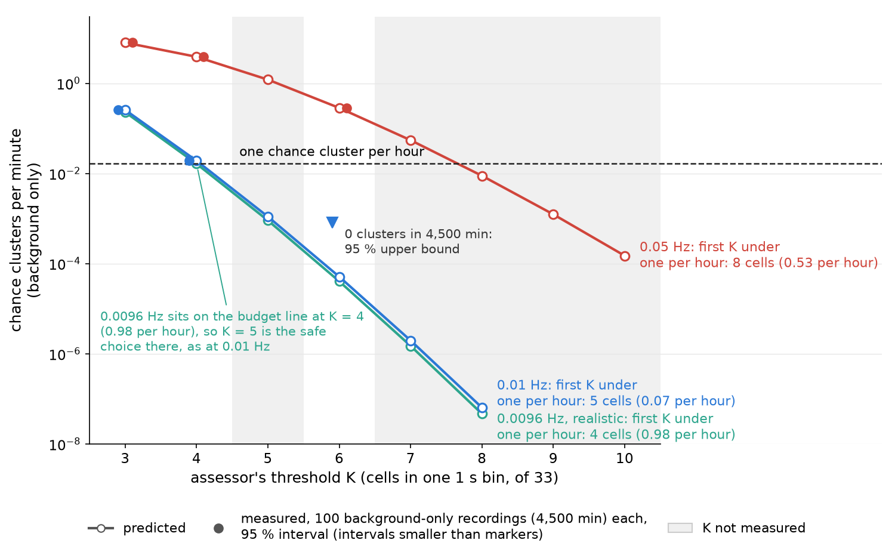

**Figure 1.13. How many clusters chance alone gives the assessor at each threshold.** Lines show the
predicted rate of chance clusters per minute against the threshold K, for 33 cells at three
background rates. Each line is labeled at its end with the first K whose predicted rate is at most
one chance cluster per hour (dashed), and the rate at that K. Filled points were measured on 100
background-only recordings of 45 minutes per background, with exact Poisson 95 % intervals, which
are smaller than the markers. At K = 6 and 0.01 Hz no cluster occurred, so the triangle marks the 95
% upper bound. Only K = 3, 4 and 6 were simulated; the shaded thresholds are predictions only. The
0.01 and 0.0096 Hz lines stop at K = 8, where they leave the axis. They lie on top of each other at
this scale, yet their first K under one per hour differs: 0.0096 Hz sits on the budget line at K = 4
(0.98 chance clusters per hour) and 0.01 Hz just above it, so K = 5 is the safe choice at both. At
0.05 Hz the first K under one per hour is 8, so one fixed threshold cannot serve both backgrounds.

The formula predicts 0.256 and 0.019 per minute at K = 3 and 4 and 0.01 Hz (measured 0.262 and 0.020); 7.97,
3.86 and 0.284 at K = 3, 4 and 6 and 0.05 Hz (measured 7.97, 3.85 and 0.279). All lie within their
95 % intervals. At K = 6 and 0.01 Hz the prediction is 0.2 clusters in all 100 background-only
recordings together, so measuring none tests nothing. This explains the third failure of *1.4*.

**A threshold therefore has to be set per recording from its own background.** This chapter
accepts at most one chance cluster per hour, which is 0.33 per 20-minute segment. Against a median segment of one or
two events, that still leaves chance clusters as up to a quarter of all clusters, so it is a loose
budget, not a strict one. The smallest threshold under it is 5 cells at 0.01 Hz and 8 at 0.05 Hz, lower than the 6 and 12
cells of *1.2.3* because the assessor counts in 1 s bins, not a 2 s sliding window.
At the realistic 0.0096 Hz it is 4 cells, at 0.98 per hour, but K = 4 crosses the budget at
b = 0.00964 Hz, so a background a few percent busier needs 5, and 5 is the safe choice there. K = 5 and 8
were not simulated with events, so those values extrapolate a formula checked at K = 3, 4 and 6. The
count detector's **event floor**, the larger of 3 cells and the smallest count that chance reaches at
most once per hour in a 2 s sliding window under a rigid-shift null (each cell's train shifted as a whole, at random), is a related
statistic and
gives 6 and 12 cells at 0.01 and 0.05 Hz.

**Real backgrounds are not flat**: some cells are silent and others busy, and the lab's baselines
are over-dispersed in time (more variable from minute to minute than a Poisson process).
Simulated with the generator's fitted per-cell burstiness, the
chance-cluster rate at 0.0096 Hz does not change (0.99 per hour at K = 4, as for a flat background),
because coincidences across cells depend only on each cell's rate per bin. Unequal cell rates lower
it by about 20 % (0.79 per hour), so the flat formula is conservative for this generator. Bursts
shared across cells, which would raise it, were not modeled.

A safe threshold also loses spread-out events. At 0.01 Hz and K = 6, one cell above the safe
threshold, the assessor reports 0.76–0.80 of planted 10-cell events at 0.5 s jitter and 0.29–0.33 at
1 s, because their onsets fall in several bins. That share of planted events reported is the
assessor's **recall**. The chance π_K that one isolated event reaches K is
derived exactly in *1.7*; these recall figures were not compared with it.

### 1.6.2 The jitter reading

The assessor's jitter is the median, over all its clusters, of each cluster's SD of gathered onsets
(*1.3.4*). Chance clusters count in that median like any other. If each planted event gives one
cluster, the share of chance clusters is ν_c/(ν_c + ν_e), with ν_e = E/45 planted events per minute.
At 0.05 Hz that predicted share is 0.89–0.96 at K = 3 and 0.79–0.92 at K = 4; at 0.01 Hz and K = 4
it is 0.02–0.05. The measured share, from labeling each cluster by whether most of its gathered
onsets were planted, agrees within about 0.05 in most conditions.

The reading is then the median of a two-part mixture:

- **chance clusters**, with weight ν_c/(ν_c + ν_e), whose SDs were measured on 40 new
  background-only recordings per background (median 0.73 s at 0.05 Hz and K = 3, 0.68 s at K = 4,
  0.60 s at K = 6; about 0.38 s at 0.01 Hz);
- **event clusters**, with weight ν_e/(ν_c + ν_e): the SD of k onsets drawn from N(0, σ²) and kept
  within ±1.5 s, plus one uniform onset on ±1.5 s from each other cell with probability 1 − e^(−3b),
  rounded to 0.1 s, kept only if at least K onsets are gathered.

The event part is derived; the chance part's spread is taken from simulation, so the mixture is
semi-analytic. Pooled as Figure 1.6 D and H pool, it predicts the reading as in Table 1.6 and
Figure 1.14.

**Table 1.6. The assessor's jitter reading, measured / predicted by the mixture (s).** Events of 10
or more cells; measured is the median over 20 recordings, as in Figure 1.6 D and H.

| b | K | σ = 0.05 s | 0.2 s | 0.5 s | 1.0 s |
|---|---|---|---|---|---|
| 0.01 Hz | 3 | 0.158 / 0.139 | 0.258 / 0.239 | 0.473 / 0.485 | 0.705 / 0.688 |
| 0.01 Hz | 4 | 0.068 / 0.067 | 0.226 / 0.222 | 0.486 / 0.500 | 0.725 / 0.736 |
| 0.05 Hz | 3 | 0.715 / 0.711 | 0.711 / 0.713 | 0.717 / 0.717 | 0.733 / 0.738 |
| 0.05 Hz | 4 | 0.644 / 0.642 | 0.646 / 0.640 | 0.657 / 0.652 | 0.692 / 0.698 |
| 0.05 Hz | 6 | 0.430 / 0.399 | 0.461 / 0.429 | 0.565 / 0.568 | 0.683 / 0.719 |

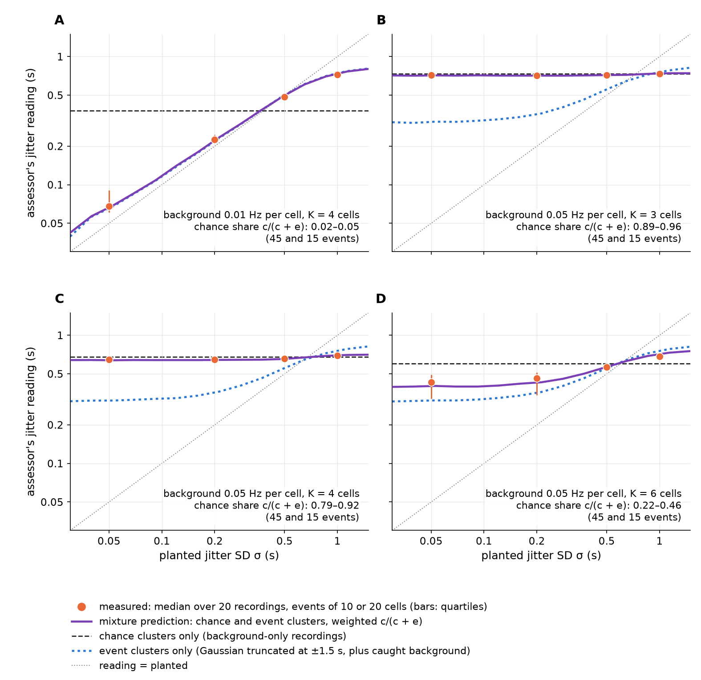

**Figure 1.14. The assessor's jitter reading is a mixture of chance and event clusters.** The
assessor's jitter reading (the median, over all its clusters, of each cluster's onset SD) against
planted jitter, at background 0.01 Hz per cell with K = 4 cells (A) and 0.05 Hz with K = 3 (B), 4
(C) and 6 (D). Orange points: measured, the median over the 20 first-experiment recordings with
events of 10 or 20 cells (bars: quartiles). Violet line: the mixture prediction, in which a share
ν_c/(ν_c + ν_e) of clusters are chance clusters with the spread of chance clusters measured on
background-only recordings, and the rest are event clusters. Blue dotted line: event clusters only,
the SD of an event's onsets under a Gaussian truncated at the ±1.5 s gather, plus background onsets
the gather catches; it reaches 0.74 s at σ = 1 s. Dashed line: chance clusters only, the reading on
background-only recordings. Dotted gray line: reading = planted. The chance share printed in each
panel is the range over 45 and 15 events per recording. Where chance clusters are few (A), the
reading follows the event-only curve up to its ceiling; where they are most clusters (B, C), it sits
on the chance-only level whatever was planted; at K = 6 (D) it lies between.

- **At 0.01 Hz and K = 4** almost no clusters are chance clusters, and the reading is the SD of a
  Gaussian truncated at ±1.5 s, within 0.015 s. That truncation sets the ceiling, 0.743 s at
  σ = 1 s, and explains why the assessor tracks planted jitter up to 0.5 s at the quieter
  background. This row tests the event part alone.
- **At 0.05 Hz and K = 3 or 4**, 85–93 % of clusters (measured, pooled) are chance clusters, so the
  reading is the chance clusters' own spread whatever was planted, within 0.006 s. This is the
  second failure of *1.4*. These rows confirm that chance clusters dominate; they cannot test the
  mixture's weights, because a median dominated by one part barely moves when the weight changes.
- **The rows that test the mixture as a mixture** are 0.01 Hz with K = 3 (chance share about 0.4),
  where it runs up to 0.02 s low pooled and up to 0.04 s low in single conditions, and 0.05 Hz with
  K = 6, where it is 0.03 s low at small σ and 0.036 s high at 1 s. At K = 6 two misses partly
  cancel: the measured chance share at small σ is 0.28–0.29 against a predicted 0.34, and event
  clusters at this background are wider than the model, because the uniform term undercounts the
  background onsets the gather catches and the cluster's center is not the event time.
- **At σ = 1 s the event part runs high** where the threshold is high relative to k (0.58–0.62
  measured against 0.74 at 0.01 Hz, K = 6, 10-cell events): a wide event reaches K cells in one bin
  only when its onsets happen to bunch, so the clusters that form are narrower than the model,
  which has no such selection. Wide events also split into more than one cluster.

**The assessor's own null does not rescue the reading.** At the shipped 1000 surrogates on the same
240 recordings, its null reading at 0.05 Hz equals the background-only chance-cluster SD within 0.01 s
(0.727, 0.671 and 0.595 s at K = 3, 4 and 6) and does not depend on σ. So its excess reading is the flat
reading minus a constant, and stays flat: at K = 3 and 4 it moves 0.02–0.04 s as planted σ goes from
0.05 to 1 s. The tool offers no other null-corrected jitter. Its null reading is in effect the
mixture's chance part, measured per recording. The repository's step that turns assessor readings
into simulator parameters plants the jitter reading as the simulated jitter, so at the busier background it plants
the chance clusters' spread, about 0.65–0.73 s, whatever the true jitter.

## 1.7 How close two events can be

Situation 3 of Figure 1.2 showed two events 3 s apart called as one by every detector. Two
coordinated events closer than a tool's bins are counted as one, which lowers the event count and
raises the apparent participation. How close can they be before that happens, and is the limit set
by the tools or by what the onsets themselves can show? Three analyses answer it, each checked by
simulation ([separation record](../learned/synthetic_validation/separation/README.md)). The closest
precedent in hand is Mariani et al. (2025), whose latency correction is designed to disentangle
overlapping global events. Radar met the same question: Finn & Johnson (1968) analyze how their
detector resolves a pair of targets, and Trunk (1978 ⚠, not held) the range resolution of
automatic detectors. How *1.7* relates to them has not been worked out, and super-resolution was
not searched.

The two sides are not given the same information. The **likelihood-ratio tests**, which compare how
probable the onsets are under one event and under two, know the background rate and are handed a 12 s stretch already known to hold either one event or two; they
are scored at 80 % power (they call a true pair two in 80 % of trials) and 5 % false alarm. The **tools** must find events in a continuous
recording and are scored by the separation at which the chance of reporting the pair as two reaches
half its plateau. One property of real cells matters for the tests: a cell cannot show two onsets
closer than its shortest interval between its own events. That minimum interval, τ_min, is a
realistic value (0.4 s fast, 3.2 s slow). The separation analysis as first run set τ_min to one frame, which
lets a cell that joins both events show two onsets and so reveal two events by itself.

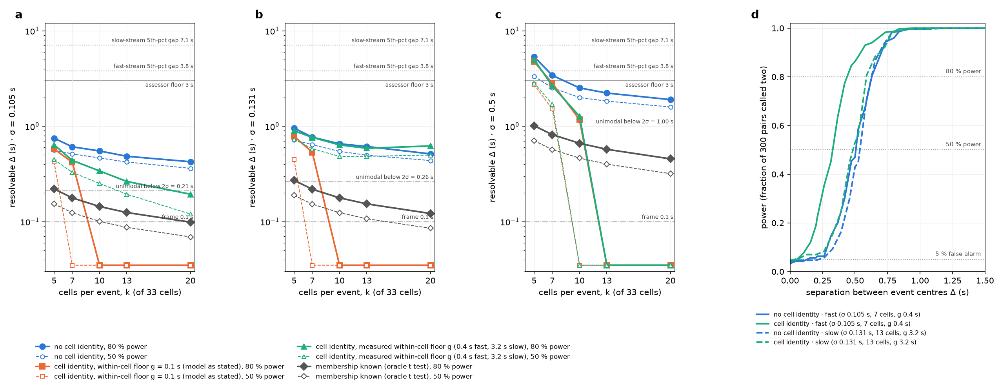

**Figure 1.15. Likelihood-ratio tests separate events far closer than the tools' bins.** A–C: the
separation Δ at which a test calls a pair of events two with 80 % power (filled, solid) and 50 %
(open, dashed), against cells per event, at σ = 0.105, 0.131 and 0.5 s; b = 0.0096 Hz, 0.1 s frame,
5 % false alarm. Blue tests pool the onsets. Orange and green also use cell identity: orange with a
minimum interval τ_min of one frame, at which a cell shared by both events shows two onsets, and
green with the measured τ_min. Down-pointing triangles at the axis floor mark orange or green tests
that resolved every separation tried, from shared cells alone. Gray tests know which event each
onset belongs to. † marks a test whose false-alarm rate exceeded 7.5 %, so its value is optimistic.
Reference lines: the frame, 2σ, the assessor's half-split point (2.5 s) and the 5th percentiles of
the two measured interval lists (3.8 s fast, 7.1 s slow). D: power against Δ at the two realistic
parameter sets; the fast stream is solid with ✚ markers and the slow stream dashed with ✖ markers
(this dashing is not A–C's 50 %-power dashing).

- **The separation the tests achieve.** At 80 % power and 5 % false alarm, b = 0.0096 Hz, the test
  using onset times and cell identity with the measured τ_min resolves two events 0.44 s apart at
  σ = 0.105 s with 7 cells per event, and 0.59 s apart at σ = 0.131 s with 13 cells; across all four
  combinations of those values the range is 0.26–0.76 s, about 2.5–5.8 σ. Jitter sets it; the frame
  does not bind. These are separations reached by particular tests, fitted by
  expectation-maximization (an iterative maximum-likelihood fit) against simulated nulls, so they bound the best achievable separation from
  above. The test that knows each onset's event reaches 0.12–0.22 s on the same basis.
- **The tools' limit is set by their bins.** The chance that a pair is reported as two reaches half
  its plateau at (m + ½) bin widths, where m is the merge rule in bins: m = 2 for the assessor (it
  joins bins with at most one bin between) and, for the count detector, its 3 s merge gap over its
  2 s bins rounds to the same. That is about 2.5 s for the assessor and 5 s for the count detector,
  almost whatever the jitter, participation, background or threshold. The plateau is π_K²; it is
  derived exactly, and the prediction matched 28,800 simulated pairs within binomial noise (4 of 576
  points at p < 0.01).
- **So, in principle, given the pair's location and the background, between about 0.5 and 2.5 s
  the tools merge pairs that onset times could separate.** In practice the limit rarely binds at
  realistic intervals. The fast stream's measured list has its 5th percentile at 3.8 s and 1.7 % of
  intervals under 3 s, so the assessor resolves about 98 % of them (where both events are detected);
  the count detector merges about 7 % of fast-stream intervals and 1 % of slow ones. Because the
  lists themselves merged events closer than 2 s, the merged shares are lower bounds and the 98 % is
  an upper bound.

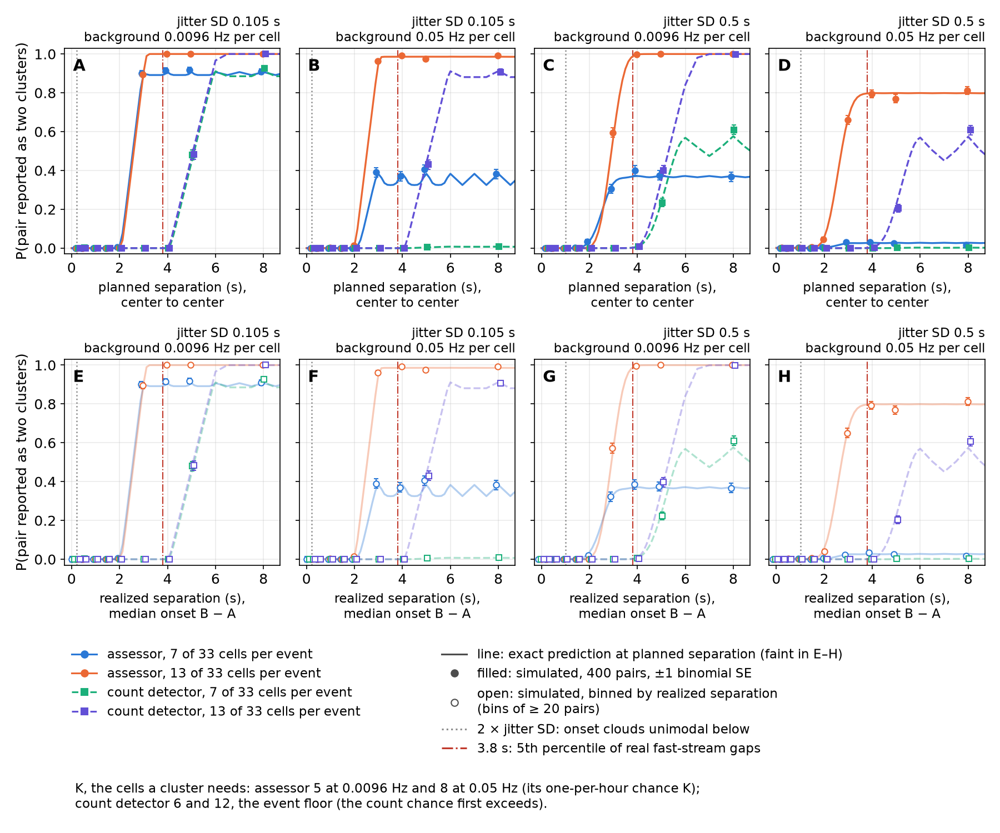

**Figure 1.16. The tools merge pairs closer than their bins.** The chance a pair of events is
reported as two, against the separation of their centers (A–D) and against the separation measured
from the onsets themselves, the difference of the two events' median onsets (E–H); E–H show the same
result when separation is read from the data rather than planted. Lines are the exact prediction;
points are 400 simulated pairs each. Assessor solid, count detector dashed; 7 and 13 of 33 cells;
jitter 0.105 and 0.5 s; background 0.0096 and 0.05 Hz. Thresholds: assessor 5 cells at 0.0096 Hz
(one above the smallest that meets the one-per-hour budget there) and 8 at 0.05 Hz; count detector 6
and 12. Events of 7 cells rarely reach 8 or 12, so the 0.05 Hz panels for 7 cells stay near 0.
Dotted: 2σ. Dash-dot: the 3.8 s 5th percentile of the fast stream's measured intervals.

## 1.8 Structure the population count cannot see

Two sources with the same jitter look, to pair and triple counts, like one source with blended
participation (*1.5.3*). Separating them may therefore need structure in *which* cells take part
(membership) or in *when* each takes part relative to the others (order), which the
population-count tools cannot see by construction. This section asks how much of each a test needs.

### 1.8.1 Membership: how much reuse a test needs

Let a source draw each event's participants from one of M fixed assemblies of k cells, chosen with
equal probability, and assume perfect readout (every member seen, no background cell joining).
**Reuse** is E/M, the mean number of events per assembly; below 1 there are more assemblies than
events. The repository's **assembly test** compares two statistics, the dispersion of pair
co-participation counts (how often each pair of cells shares an event) and the leading eigenvalue of
the cells' co-activation matrix, against two nulls (Figure 1.5 B), with a Bonferroni correction
(each test's significance level divided by the number of tests) within each null. The **margin-preserving null** shuffles which cells join which event while keeping
each cell's event count and each event's size; the **uniform null** draws each event's participants
at random.

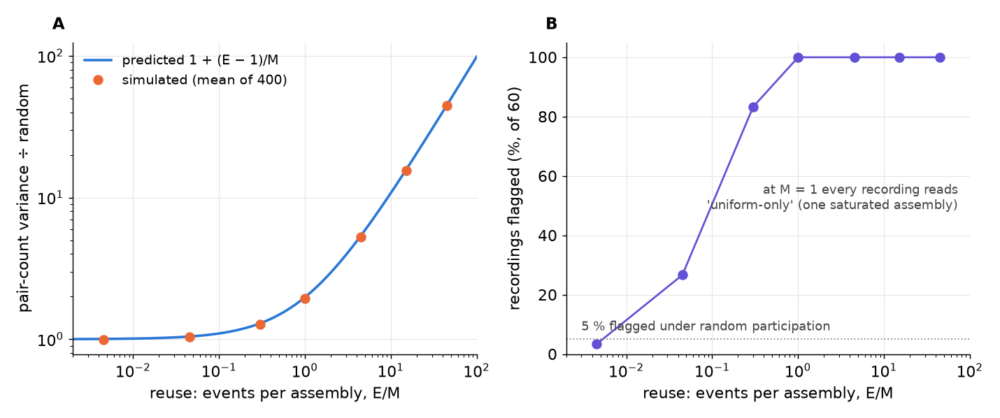

**Figure 1.17. Assembled participation stays detectable after its variance has converged.** 33
cells, 10 per event, 45 events. A: pair co-participation variance over its value under random
participation, mean of 400 simulations, against reuse E/M (M = 1 is E/M = 45). The points share one
simulated random baseline, so their common 1–2 % shortfall is one error, not seven. B: share of 60
recordings in which the assembly test rejects both of its nulls, and either one, with 200 surrogates
per null (the shipped default is 1000; rerun at 1000, the low-reuse rates are the same). Under
random participation both reject in 1 of 60 and either in 3 of 60 (dotted and dashed lines). At M =
1 (E/M = 45) only the uniform null rejects.

**Detection.** Both nulls reject in every recording while reuse lies between 1 and 15, in 72 % at
reuse 0.3, and still in 13 % at reuse 0.045 (M = 1,000, E = 45; 8 of 60, binomial 95 % interval
about 6–25 %). At that reuse 62 % of recordings hold at least one repeated assembly. Detection comes
from those: 14 % of them are detected (26 % of those with two or more repeats), against 2 % of
recordings with no repeat, which is the test's false-positive rate. Under the margin-preserving null
the dispersion statistic does most of the work; under the uniform null the eigenvalue does. At the
shipped 1000 surrogates the rates are the same as at 200. At M = 1 only the uniform null rejects,
because one assembly holding every event is the case a margin-preserving null cannot see.

**Why the variance converges first.** Two events share an assembly with probability 1/M, and the
variance of pair co-participation counts across cell pairs is

  1 + (E − 1)/M

times its value under random participation. With unequal use, 1/M becomes Σ p_m², where p_m is the
share of events using assembly m. This has the form of Kish's design effect for clustered samples,
deft² = 1 + roh(n/a − 1), with n/a the mean cluster size and roh his "synthetic but useful" ratio of
homogeneity, an analogue of the intraclass correlation (Kish 1995, pp. 63–64). Here E plays n/a and
1/M plays roh. At reuse 0.045 the ratio is 1.04, which barely registers the one or two repeated
sets that the test detects. Assembled participation converges to random as assemblies multiply
**only if the total number of events is held fixed**, and then almost by definition, since many
assemblies each used once are random participation. If each new assembly brings its own e_a events
(E = M e_a), the excess stays near e_a and never reaches random (derived, not simulated).

### 1.8.2 Order: how many events does an order test need?

**The motivating observation.** An earlier, unpublished analysis of the lab's recordings found
Kreuz's Synfire Indicator falling as the number of events rose. Kreuz et al. (2017, sec. 3.1 of the
preprint) already warn that the indicator is "not sufficient to reliably compare two datasets with
widely different number of spike trains and spikes", without a formula for the effect. This section
supplies the bias side of that question for a simpler indicator and does not analyze those
recordings.

**A latency template is extra jitter to the population count.** If each participant has a fixed
offset drawn from N(0, δ²), two participants' lag has SD √(2(δ² + σ²)), so g_n and the joint fit see
an effective jitter √(δ² + σ²) (derived, not simulated). Only cell-by-cell statistics separate the
two.

**The indicator.** With known events and no background, count for each pair of cells who leads
across the events they share. The **score sort** orders cells by net lead count, wins minus losses
summed over events: a Borda (row-sum) score, which Shah & Wainwright (2018) call Copeland counting;
its cost grows with the square of the number of cells, with no search. F is the net agreement of the
pair lead signs with that order, as a share of pair co-participations: 1 for a perfect sequence,
near 0 with no order once events are many (Figure 1.5 C works one example). A **local search** then
moves single cells while that raises F.

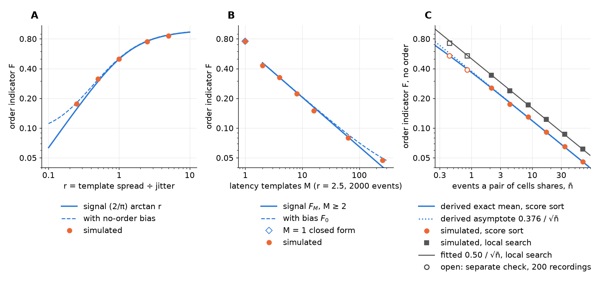

**Figure 1.18. The order indicator follows its closed forms.** 33 cells, 10 per event. A: one
template, 200 events; solid, (2/π) arctan r; dashed, with the no-order bias of 200 events added. B:
M templates at r = 2.5, 2000 events; solid, the many-template asymptote; dashed, with the bias
added. C: no order planted. Blue lines are derived: the exact mean under the score sort and its
asymptote 0.376/√n̄. Points are simulated; open points come from a separate 200-recording check at
small n̄. The local search's line is fitted. In the legends, F_M is the indicator with M templates
and F₀ with none.

- **One template.** F = (2/π) arctan r, with r = δ/σ. In words: F equals the rank correlation
  (Kendall's τ) between the template's latencies and the observed ones, a standard result for
  normally distributed latencies, τ = (2/π) arcsin ρ for correlation ρ (Kruskal 1958, sec. 4;
  its lineage is in Table 1.9); here ρ = r/√(1 + r²). The score sort sits on it at r = 1 and 2.5 (0.503 and 0.753).
- **M templates.** F ≈ C/√M with C = √(2/π) · √((2/π) arcsin(r²/(1 + r²))), 0.65 at r = 2.5. This
  form is asymptotic and runs up to 10 % high at M = 2–16, checked at fixed E only.
- **No order.** For continuous (untied) onsets, the mean of F under the score sort is exact for every
  N, k and E, computed by convolving the score distributions on the integer lattice
  ([derivation](../learned/synthetic_validation/kendall_w/derivation.md)); it matched fresh
  simulation in 33 of 33 comparisons (all |z| ≤ 2.2). For n̄ ≳ 2 it approaches c/√n̄ with
  c(N, k) = √(4(k + 1)/(3πN)), 0.376 at 33 cells and 10 per event, nothing fitted; at n̄ = 0.4 the
  asymptote runs 0.03 high. Kreuz et al. (2017, sec. 2.5) considered an analytical binomial null for
  their indicator and rejected it, because pairwise orders within one event are not independent; the
  exact mean handles that dependence. Only the mean is derived, not the spread, which is what
  detection depends on. The local search's constant (0.50) is fitted.

**With few events the bias is large**: at 33 cells the no-order F is 0.48 ± 0.06 (SD over 200
recordings) at 10 events of 7 cells and 0.14 ± 0.02 at 140. A null of order-free recordings of the
same size removes the mean bias; detection then depends on the null's spread.

**Power** (Figure 1.19; Table 1.7) is computed at 1–5 events per recording because the median
baseline segment holds one or two (*1.3.1*); busier segments lie in the tail. Power is the share of
recordings with order planted whose F exceeds the null's 95th percentile. Because F takes few values
at small E, recordings that tie the threshold are rejected at random with the probability that makes
the false-positive rate exactly 5 % (a randomized test). Unrounded power depends on σ and δ only
through r, so the table's σ = 0.2 s stands for any σ. Power here is for detecting that order is
present, not for recovering how many templates there are.

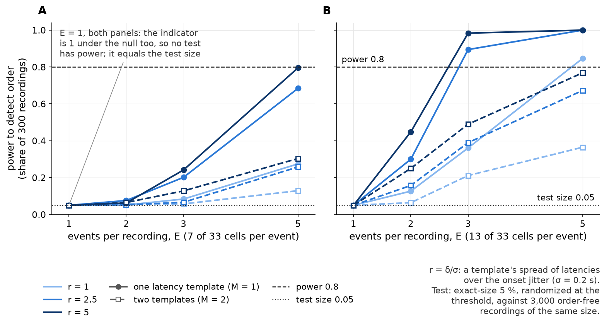

**Figure 1.19. An order test needs several events, and two templates need more than five.** The
y-axis is power to detect order: the share of 300 simulated recordings in which the order indicator
rejects an exact-size 5 % test. The test is calibrated on 3,000 order-free recordings of the same
size and randomized at its threshold. Power is plotted against events per recording (1, 2, 3, 5),
for 7 (A) and 13 (B) of 33 cells per event, with onset jitter σ = 0.2 s. Lines are for a template's
latency spread δ of 1, 2.5 or 5 times the onset jitter (r = δ/σ); solid lines with filled circles
are one template and dashed lines with open squares are two. The dash-dot line is power 0.8 and the
dotted line the test size, both labeled in B. With one event no test has power, because the
indicator is 1 with or without order. One template reaches power 0.8 at 3 events of 13 cells when r
is 2.5 or more, but at 5 events of 7 cells only when r = 5. Two templates stay below 0.8 everywhere
up to 5 events.

**Table 1.7. Power to detect order, exact 5 % test, unrounded onsets**, 300 recordings per point,
33 cells. One template / two templates.

| cells per event | events | r = 1 | r = 2.5 | r = 5 |
|---|---|---|---|---|
| 7 | 1 | 0.05 / 0.05 | 0.05 / 0.05 | 0.05 / 0.05 |
| 7 | 2 | 0.05 / 0.06 | 0.08 / 0.05 | 0.06 / 0.06 |
| 7 | 3 | 0.08 / 0.06 | 0.20 / 0.07 | 0.24 / 0.13 |
| 7 | 5 | 0.27 / 0.13 | 0.68 / 0.26 | 0.80 / 0.30 |
| 13 | 1 | 0.05 / 0.05 | 0.05 / 0.05 | 0.05 / 0.05 |
| 13 | 2 | 0.13 / 0.06 | 0.30 / 0.16 | 0.45 / 0.25 |
| 13 | 3 | 0.36 / 0.21 | 0.89 / 0.39 | 0.98 / 0.49 |
| 13 | 5 | 0.85 / 0.36 | 1.00 / 0.67 | 1.00 / 0.77 |

At one event no test has power: F is 1 with or without order. At two or three events of 7 cells,
unrounded order is barely detectable whatever r is, and at five it reaches about 0.8 (0.80 ± 0.02)
only when r = 5. With 13 cells per event, one template is detected at three events when r ≥ 2.5; two
templates stay below 0.8 power even at five events.

**Frame rounding changes both the null and the power.** Rounding onsets to the 0.1 s frame creates
ties, which add nothing to the net lead count but still count as co-participations, so they pull F
toward 0. Order-free events, whose onsets all lie within about ±σ, tie more often (21–26 % of pairs
at realistic jitter) than ordered ones (8–10 % at r = 2.5), so the null mean falls two to three times
as far as the signal. With production rounding, at realistic σ (0.105 and 0.131 s), 7 and 13 cells,
r = 1 and 2.5, one or two templates and E = 2, 3 and 5 (1,000 recordings per point, a 2,000-recording
rounded null), power rises, or stays saturated, at all 48 points: for 7 cells, r = 2.5 and
σ = 0.105 s it goes from 0.06 to 0.66 at E = 2, 0.18 to 0.73 at E = 3 and 0.69 to 0.92 at E = 5.
The untied exact mean then misses the rounded null by up to 0.18. A tie-corrected exact mean, from
the same lattice convolution with per-event laws estimated from 400,000 rounded events, matches the
rounded simulation in all 12 cases within 0.004. With many events the signal loss is small: mean F
at δ = σ = 0.1 s and 200 events falls by 5.2 % of its value. The power gain depends on the
generator's rounding model (independent Gaussian onsets with uniform frame phase), so on recorded
data the test needs a null rounded the same way.

**Against the Synfire Indicator.** Kreuz's indicator differs from F in four ways (Table 1.8).

**Table 1.8. F and the Synfire Indicator.**

| | F here | Kreuz's Synfire Indicator |
|---|---|---|
| coincidences | known events | windows that adapt to each train's interspike intervals, which on sparse trains also pair onsets of neighboring events |
| order | score sort, no search | simulated annealing |
| normalization | pair co-participations | all spikes; with known coincidences and no background, F_Kreuz = F (k − 1)/(N_scored − 1), 0.28 × F at 10 of 33 cells (derived; not run through the repository's wrapper of the published code, whose library was not installed) |
| null | order-free recordings, or the exact no-order mean | surrogates that swap order within coincidences; the earlier analysis instead permuted which cell owns each onset |

N_scored is the number of trains with at least one onset in the window, which the repository's
wrapper scores, so it varies from recording to recording. Tomlinson et al. (2019) use the same net
count as the score sort. No optimality result covers net-win ranking with unequal co-participation
and lead signs that are dependent within an event (Coppersmith, Fleischer & Rudra 2006; Shah &
Wainwright 2018). A search of the Kreuz group's papers, code and website found no ranking sort and no
analytical null ([search record](../learned/synthetic_validation/kreuz_sort/README.md)).

## 1.9 Discussion

### 1.9.1 What the theory replaces, and what it does not

For one source, theory predicts the coordination-rates tool, the assessor's chance clusters and
jitter reading, and what each window can and cannot read. It turns the three failures of Figure 1.6
into consequences of formulas, and it yields an estimator, the joint fit, that the grid did not
contain.

The simple detectors of *1.2* show the same thing in small. Most failures in Table 1.1 are a
setting that does not match a property of the coordination: a bin border through a jittered
event, a fixed threshold under the chance floor of a busier background, a merge gap longer than the
gap between events. CFAR's are of another kind, masking by nearby events and the clutter edge,
which come from where it takes its estimate. Its threshold kept false alarms near their allowance
only because it was itself a prediction: the chance floor from the binomial count, which gives the
same 6 and 12 cells as the repository's simulated floor.

The theory does not predict the assessor's reported participants, its recall at a threshold in a
continuous recording (the isolated-event prediction π_K of *1.7* was not compared with it), the detectors that
compare each moment with its recent context, the effect of clustered intervals between events, or
bursts shared across cells.
Those stay with simulation. What changes is where the grid goes: around the predicted boundaries, on
dimensionless axes (σ/w, λw, the expected background onsets per window Nbw, and K against the
chance-cluster rate), rather than on a uniform grid chosen in advance.

### 1.9.2 What is old and what is new

**Table 1.9. Results against their nearest precedents.**

| result | status |
|---|---|
| Window sharing, two onsets, uniform jitter | Grün et al. 1999 (fission probability; its root, Grün 1996, not held) |
| The full population-count distribution for jittered groups, all orders | Louis, Borgelt & Grün 2010, for uniform jitter |
| Group size and jitter read across bin widths | Grün, Abeles & Diesmann 2008; Louis, Borgelt & Grün 2010, by a two-line change-point fit to one feature of the distribution |
| The cumulant route | CuBIC (Staude, Rotter & Grün 2010): ordinary cumulants, Poisson carrier, synchronous copies; non-stationary rates in Staude, Grün & Rotter 2010 |
| Factorial cumulants across bin widths, fitted jointly for size, number and timescale | fluorescence cumulant analysis (Müller 2004; Wu & Müller 2005), for diffusing emitters, with cumulant variances |
| Fitting a cluster process by pair counts across scales | minimum contrast on Ripley's function (Diggle 1978 ⚠, 1983 ⚠; Waagepetersen 2007); multi-window moment fits of Neyman–Scott rainfall (Rodriguez-Iturbe, Cox & Isham 1987 ⚠) |
| Moments of a cluster process with a non-Poisson center process | textbook (Daley & Vere-Jones 2003 ⚠; Møller & Waagepetersen 2004 ⚠) |
| g_n for Gaussian jitter and n onsets, and k̂ built on it | not found; numerically close to the uniform case (*1.5.2*) |
| The at-most-one-event term and the surrogate's dependence on the event train, for this tool | not found; Reimer et al. 2012 read in abstract only |
| The joint fit's jittered-cluster forms (Gaussian g_n, falling factorials, event-train term, surrogates) | not found; the fitting construction is Wu & Müller's |
| The chance-cluster rate | known in form: binomial chance floors already in the repository; accidental-coincidence rates and scan statistics (Glaz, Naus & Wallenstein 2001 ⚠); the assessor's cluster-start factor is specific to it |
| The assessor's jitter reading as a chance/event mixture | not found; the tool's own null reading measures the chance part |
| The membership variance ratio | the form of Kish's design effect (Kish 1995; root in Kish 1965 ⚠) |
| One-template F = (2/π) arctan r | τ = (2/π) arcsin ρ under the bivariate normal (Kruskal 1958, via Cramér; often credited to Greiner 1909 ⚠) |
| The score sort | a Borda score ("Copeland counting" in Shah & Wainwright 2018); net counts in Tomlinson et al. 2019; summed pairwise delays in Schneider, Havenith & Nikolić 2006 ⚠ |
| The exact no-order mean of F, untied and tie-corrected | the covariance is Durbin's incomplete-block test in Skillings & Mack's form, and with every cell in every event F is the Kendall-τ analogue of √W (Kendall & Babington Smith 1939); Kreuz et al. 2017 describe the finite-size bias and reject an analytical null; Silva, Feng & Foster 2015 on the bias of choosing an order to fit the events; an analytical null for this indicator was not found |
| How close two events can be | Mariani et al. 2025 disentangle overlapping events; radar's target-pair resolution (Finn & Johnson 1968; Trunk 1978 ⚠) not yet compared; super-resolution not searched |

"Not found" describes the search, recorded in
[the prior-art search](../learned/synthetic_validation/prior_art/README.md). Fields not searched in
depth: point-process counting theory beyond the textbooks named, including counter dead time and
hard-core point processes, where a correction like the at-most-one-event term may already exist;
hydrology beyond the one rainfall paper; and the distribution of the normal range (relevant to
g_n). Two enquiries would settle more
than any search and have not been sent: whether the Grün lab has a Gaussian or formal-fit version of
the 2010 analysis, and why the Kreuz group anneals rather than ranks.

### 1.9.3 Two sources

The dissertation's premise is that several sources are mixed. On that the chapter has a prediction and
no test: pair and triple counts cannot tell two same-jitter sources from one (*1.5.3*). The full
population-count distribution carries more. Louis, Borgelt & Grün (2010, Fig. 6) separated two groups
reliably and three less clearly, and noted that groups become hard to disentangle as their sizes
converge. Separating sources may therefore need higher orders of the population count, different
jitters (which the joint fit might resolve), or cell-by-cell structure, which *1.8* shows needs more
events than a median baseline segment holds. The test belongs to Chapter 2: the simulated sets it
builds from measured parameters must hold two or more sources, because that is the dissertation's
premise, and those sets are where this prediction is first checked.

### 1.9.4 Limitations

1. **One generator.** Every check uses one simulated source with Gaussian jitter, one k per source and
   random membership. Real data will need a mixture over k.
2. **The prediction is not exact.** On held-out recordings the participant residuals exceed sampling
   noise (*1.5.4*); the rate prediction at the busier background is no better under the general form;
   and on the slow stream's intervals the tool misses the general form the same way at every window,
   for a reason not found (*1.5.5*).
3. **The joint fit** cannot read jitter per recording at realistic values, reports no per-recording
   uncertainty, uses an ad hoc weighting, and has no derived condition for when jitter is identifiable
   (*1.5.6*). It was given the true event train; assuming a 20 s hard core costs little at realistic
   counts, but a fit to a train built from detected events was not run, and the realistic trains were
   not placed through the simulator's own measured-interval option (*1.4*).
4. **The assessor's jitter mixture** takes the chance clusters' spread from simulation, and its event
   part misses where the threshold selects bunched onsets (*1.6.2*).
5. **The order results** assume known events and no background onsets. With frame rounding the
   untied no-order mean no longer holds; the tie-corrected mean does, under the generator's rounding
   model (*1.8.2*). The relation to Kreuz's indicator is derived, not run.
6. **The simple detectors were shown on one designed recording** (*1.2*): six events in 4 minutes,
   far denser than real, with a busier stretch shorter than CFAR's reference span. Their rates in
   Table 1.1 belong to that design.
7. **No human has reviewed the derivations** in
   [the theory module](../learned/synthetic_validation/theory.py), the
   [no-order derivation](../learned/synthetic_validation/kendall_w/derivation.md) and the
   [separation record](../learned/synthetic_validation/separation/README.md).

### 1.9.5 Next steps

Chapter 2 builds simulated data sets from the parameters these tools measure and uses them to tune,
characterize and compare detectors; Chapter 3 applies the result to real baseline recordings, and
Chapter 4 to treatments that may change coordination itself. The open items of this chapter fall to
those chapters as follows.

1. **For Chapter 2's generators.** Test the two-source prediction by simulation, including the full
   population-count distribution, and test that a latency template reads as jitter in the joint fit.
   Add realistic jitter (σ = 0.105 and 0.131 s) and 7 cells per event to the first experiment's grid;
   give the joint fit an inverse-covariance weighting and an uncertainty, borrowing Wu & Müller's
   cumulant variances or a parametric bootstrap, so that a generator can carry the uncertainty of
   the parameters it is built from; derive when σ is identifiable; and fit a train built from
   detected events.
2. **For Chapter 2's detector comparisons.** Compare the assessor's recall in a continuous recording
   with the isolated-event prediction π_K, and extend the chance floor of *1.2.3* and *1.6.1* to
   bursts shared across cells. Model the dilution of the membership excess by real readout, and
   compare the order indicator with Kreuz's on the same simulated trains.
3. **For Chapters 3 and 4.** Derive the shared-modulation prediction: a slow change of rate shared
   by all cells adds pair excess that grows with the window, while coordination levels off (Staude,
   Rotter & Grün 2008 ⚠; Staude, Grün & Rotter 2010). Real baselines drift, and a treatment that
   changes every cell's rate at once is the case Chapter 4 must not read as a change in
   coordination.

Further out: the random-matrix threshold for when a fixed assembly shows in the co-activation matrix,
and likelihood bounds on the best precision any method could reach for (λ, k, σ).

## 1.10 Conclusion

Counting cells together finds coordinated events only when the counting matches the coordination:
windows wide enough for the jitter, a threshold between the chance floor and the participation,
and a merge gap shorter than the interval between events (*1.2*). This chapter derives what the
tools that measure those properties return. What a realistic 20-minute baseline segment can support, for one
source: participants, when events are large (13 of 33 cells, from two events per segment) or
plentiful (7 cells, about eight events); event rate from four events of 13 cells or sixteen of 7; jitter, not at all from one segment by the joint fit; and order,
for 13-cell events, from three events with a strong template. For 10-cell events, a window shorter than
about six times the jitter undercounts participants (below 0.9 of planted), a fixed threshold drowns in chance clusters at a busier
background, and those chance clusters then set the assessor's jitter reading. Chapter 2 builds
simulated sets from these measurements, with two or more sources, to tune and compare detectors;
the two-source prediction of *1.5.3*, and the full count distribution rather than pairs and
triples alone, are the first things those sets test.

## About this chapter

This chapter is an exercise: Tony set it up to test how far he and Claude can take a piece of research
together, written as if it were a dissertation's first chapter, from the record on the goal page
([`goals/synthetic-validation.md`](../goals/synthetic-validation.md)) and the scripts in
[`learned/synthetic_validation/`](../learned/synthetic_validation/README.md). Claude wrote the text,
the derivations' write-up and the follow-up analyses; Tony directed it and obtained the paywalled
sources through the university library.

**Checks.** Every simulation number is printed by a script listed under *Reproducing*, including the
follow-ups in [`ch1_followups/`](../learned/synthetic_validation/ch1_followups/README.md) that an AI
review panel asked for. Two further Claude sessions, given the original question, the code and the
first experiment's record but not these results, reached the same core derivation (the expected pair
and triple counts with the at-most-one-event term, k̂, and the chance-cluster rate). They shared the
prompt, repository, model and tool definitions, so this was a consistency check, not independent
review; they also found the shared-background flaw in the first run and contributed the joint fit,
the per-estimate noise, the conditions under which the tool refuses, and the assessor's output as a
mixture. Eleven AI agents, each given one reviewing role, checked the underlying record in four rounds
and this chapter in three, with a follow-up pass between rounds; the run records are in
`docs/reviews/`. That panel is not a committee and not peer review.

**Revision of 2026-11-13.** After his first read, Tony asked for an opening a reader outside the
field can follow: the problem drawn first, then the simple detectors, then the tools with their
mathematics. Sections *1.1* to *1.4*, Figures 1.1, 1.2 and 1.4 and Table 1.1 were written for that;
the prior work moved into *1.4*; the openings of *1.5* to *1.7*, *1.9.1*, *1.9.3*, *1.9.5*, a new
limitation and *1.10* gained text; the rest was renumbered; and the discussion was pointed at the
dissertation's four-chapter outline. The new figures are illustrations, printed by their own
script. No number from the earlier version changed. Two earlier claims were narrowed by the
review of the revision: the joint fit's range (both runs: 20-cell events from 0.2 s, 10-cell from
0.5 s) and the reach of "jitter cannot be read from one segment" (shown for the joint fit only).

## Reproducing this chapter

From the repository root, with `PYTHONPATH=src` and the repository's virtual environment:

    python docs/learned/synthetic_validation/aim1_one_source.py --workers 24
    python docs/learned/synthetic_validation/theory.py                      # in-sample checks
    python docs/learned/synthetic_validation/theory.py --from-record        # prints the 1.4 and 1.5 numbers
    python docs/learned/synthetic_validation/theory.py --train empirical    # general form
    python docs/learned/synthetic_validation/blind_a/theory_floor.py        # chance floor, 1.2.3 and 1.6.1
    python docs/learned/synthetic_validation/ch1_followups/held_out.py      # held-out rerun
    python docs/learned/synthetic_validation/ch1_followups/like_for_like.py # sign tests, residuals
    python docs/learned/synthetic_validation/ch1_followups/dependence_null.py    # dependence-aware p
    python docs/learned/synthetic_validation/ch1_followups/pooled_path.py        # shipped pooled report
    python docs/learned/synthetic_validation/ch1_followups/lab_values.py    # denser realistic trains
    python docs/learned/synthetic_validation/ch1_followups/realistic_counts.py   # pooled rates, unknown train
    python docs/learned/synthetic_validation/ch1_followups/window_counts.py      # 20-minute segments, Table 1.5
    python docs/learned/synthetic_validation/ch1_followups/correlogram_vs_joint.py
    python docs/learned/synthetic_validation/ch1_followups/correlogram_table.py  # Table 1.3
    python docs/learned/synthetic_validation/ch1_followups/chance_bursty.py      # over-dispersed background
    python docs/learned/synthetic_validation/ch1_followups/assessor_jitter.py    # 1.6.2, Table 1.6
    python docs/learned/synthetic_validation/ch1_followups/assessor_null.py      # the assessor's null and excess readings, 1.6.2
    python docs/learned/synthetic_validation/ch1_followups/membership_repeat.py  # detection given a repeat
    python docs/learned/synthetic_validation/ch1_followups/order_power.py
    python docs/learned/synthetic_validation/ch1_followups/order_rounding.py     # frame rounding
    python docs/learned/synthetic_validation/ch1_followups/order_rounding_cells.py   # rounding at 1–5 events
    python docs/learned/synthetic_validation/membership_limit.py
    python docs/learned/synthetic_validation/order_limit.py
    python docs/dissertation/figures/ch1_new_figures.py
    python docs/dissertation/figures/ch1_intro_figures.py         # Figures 1.1–1.3, Table 1.1, 1.2–1.3 numbers
    python docs/learned/synthetic_validation/aim1_figure.py
    python docs/learned/synthetic_validation/aim0_figures.py

The separation scripts and their run times are in
[`separation/README.md`](../learned/synthetic_validation/separation/README.md). The tools are
`tools/measure_coordination_rates.py`, `bugarach.assess`, `bugarach.detectors.count`,
`tools/measure_jitter_correlogram.py` and `bugarach.assembly`.

## References

⚠ cited from earlier reading recorded in the repository, or not opened.

- Cecchini G, Scaglione A, Allegra Mascaro AL, et al. (2021). Cortical propagation tracks functional recovery after stroke. *PLoS Comput Biol* 17:e1008963.
- Coppersmith D, Fleischer L, Rudra A (2006). Ordering by weighted number of wins gives a good ranking for weighted tournaments. *Proc. SODA 2006*, 776–782; journal version *ACM Trans Algorithms* 6(3), 2010.
- Cramér H (1946). *Mathematical Methods of Statistics*. Princeton University Press, p. 290. ⚠ (not opened; cited through Kruskal 1958)
- Daley DJ, Vere-Jones D (2003). *An Introduction to the Theory of Point Processes*, vol. I, 2nd ed. Springer. ⚠
- DeFazio RA, Burgess CR, Burger LL, Gibson AG, Moenter SM (2026). Arcuate kisspeptin neurons display two types of calcium events: regulation by sex, gonads, and senktide. *J Neuroendocrinol* 38:e70298.
- Diggle PJ (1978). On parameter estimation for spatial point processes. *J R Stat Soc B* 40:178–181. ⚠
- Diggle PJ (1983). *Statistical Analysis of Spatial Point Patterns*. Academic Press. ⚠
- Diggle PJ, Gratton RJ (1984). Monte Carlo methods of inference for implicit statistical models. *J R Stat Soc B* 46:193–212 (to 227 with discussion).
- Durbin J (1951). Incomplete blocks in ranking experiments. *Br J Psychol Stat Sect* 4:85–90 (now *Br J Stat Psychol*).
- Ehm W, Staude B, Rotter S (2007). Decomposition of neuronal assembly activity via empirical de-Poissonization. *Electron J Stat* 1:473–495. ⚠
- Finn HM, Johnson RS (1968). Adaptive detection mode with threshold control as a function of spatially sampled clutter-level estimates. *RCA Rev* 29:414–464.
- Glaz J, Naus J, Wallenstein S (2001). *Scan Statistics*. Springer. ⚠
- Greiner R (1909). Über das Fehlersystem der Kollektivmaßlehre. *Z Math Phys* 57:121–158, 225–260, 337–373. ⚠ (not opened)
- Grün S, Abeles M, Diesmann M (2008). Impact of higher-order correlations on coincidence distributions of massively parallel data. *LNCS* 5286:96–114.
- Grün S, Diesmann M, Grammont F, Riehle A, Aertsen A (1999). Detecting unitary events without discretization of time. *J Neurosci Methods* 94:67–79.
- Kendall MG, Babington Smith B (1939). The problem of m rankings. *Ann Math Stat* 10:275–287.
- Kish L (1965). *Survey Sampling*. Wiley. ⚠
- Kish L (1995). Methods for design effects. *J Off Stat* 11:55–77.
- Kreuz T (2026). Quantifying spike train synchrony and directionality: measures and applications. *Biol Cybern* 120(3–4):21. doi:10.1007/s00422-026-01045-5. Read as arXiv 2510.07140v2.
- Kreuz T, Satuvuori E, Pofahl M, Mulansky M (2017). Leaders and followers: quantifying consistency in spatio-temporal propagation patterns. *New J Phys* 19:043028. Read as arXiv 1610.07986.
- Kreuz T, Senocrate F, Cecchini G, et al. (2022). Latency correction in sparse neuronal spike trains. *J Neurosci Methods* 381:109703.
- Kruskal WH (1958). Ordinal measures of association. *JASA* 53:814–861.
- Kuhn A, Aertsen A, Rotter S (2003). Higher-order statistics of input ensembles and the response of simple model neurons. *Neural Comput* 15:67–101. ⚠
- Lee AK, Wilson MA (2002). Memory of sequential experience in the hippocampus during slow wave sleep. *Neuron* 36:1183–1194. ⚠
- Lopes-dos-Santos V, Conde-Ocazionez S, Nicolelis MAL, Ribeiro ST, Tort ABL (2011). Neuronal assembly detection and cell membership specification by principal component analysis. *PLoS ONE* 6:e20996.
- Louis S, Borgelt C, Grün S (2010). Complexity distribution as a measure for assembly size and temporal precision. *Neural Netw* 23:705–712.
- Luczak A, Barthó P, Marguet SL, Buzsáki G, Harris KD (2007). Sequential structure of neocortical spontaneous activity in vivo. *PNAS* 104:347–352. ⚠
- Malvache A, Reichinnek S, Villette V, Haimerl C, Cossart R (2016). Awake hippocampal reactivations project onto orthogonal neuronal assemblies. *Science* 353:1280–1283.
- Mariani B, Senocrate F, Mikiel-Hunter J, et al. (2025). Latency correction in sparse neuronal spike trains with overlapping global events. *J Neurosci Methods* 416:110378. Read as arXiv 2410.15018.
- Møller J, Waagepetersen RP (2004). *Statistical Inference and Simulation for Spatial Point Processes*. Chapman & Hall/CRC. ⚠
- Müller JD (2004). Cumulant analysis in fluorescence fluctuation spectroscopy. *Biophys J* 86:3981–3992.
- Neyman J, Scott EL (1952). A theory of the spatial distribution of galaxies. *ApJ* 116:144.
- Pazienti A, Maldonado PE, Diesmann M, Grün S (2008). Effectiveness of systematic spike dithering depends on the precision of cortical synchronization. *Brain Res* 1225:39–46.
- Perkel DH, Gerstein GL, Moore GP (1967). Neuronal spike trains and stochastic point processes. II. Simultaneous spike trains. *Biophys J* 7:419–440.
- Peyrache A, Benchenane K, Khamassi M, Wiener SI, Battaglia FP (2010). Principal component analysis of ensemble recordings reveals cell assemblies at high temporal resolution. *J Comput Neurosci* 29:309–325.
- Reimer ICG, Staude B, Ehm W, Rotter S (2012). Modeling and analyzing higher-order correlations in non-Poissonian spike trains. *J Neurosci Methods* 208:18–33. ⚠ (abstract only)
- Rodriguez-Iturbe I, Cox DR, Isham V (1987). Some models for rainfall based on stochastic point processes. *Proc R Soc A* 410:269–288. ⚠
- Rohling H (1983). Radar CFAR thresholding in clutter and multiple target situations. *IEEE Trans Aerosp Electron Syst* AES-19:608–621.
- Schneider G, Havenith MN, Nikolić D (2006). Spatiotemporal structure in large neuronal networks detected from cross-correlation. *Neural Comput* 18:2387–2413. ⚠
- Schrader S, Grün S, Diesmann M, Gerstein GL (2008). Detecting synfire chain activity using massively parallel spike train recording. *J Neurophysiol* 100:2165–2176.
- Shah NB, Wainwright MJ (2018). Simple, robust and optimal ranking from pairwise comparisons. *JMLR* 18(199). Read as arXiv 1512.08949.
- Silva D, Feng T, Foster DJ (2015). Trajectory events across hippocampal place cells require previous experience. *Nat Neurosci* 18:1772–1779.
- Skillings JH, Mack GA (1981). On the use of a Friedman-type statistic in balanced and unbalanced block designs. *Technometrics* 23:171–177.
- Staude B, Grün S, Rotter S (2010). Higher-order correlations in non-stationary parallel spike trains: statistical modeling and inference. *Front Comput Neurosci* 4:16.
- Staude B, Rotter S, Grün S (2008). Can spike coordination be differentiated from rate covariation? *Neural Comput* 20:1973–1999. ⚠
- Staude B, Rotter S, Grün S (2010). CuBIC: cumulant based inference of higher-order correlations in massively parallel spike trains. *J Comput Neurosci* 29:327–350.
- Thomas M (1949). A generalization of Poisson's binomial limit for use in ecology. *Biometrika* 36:18–25.
- Tomlinson SB, Wong JN, Conrad EC, Kennedy BC, Marsh ED (2019). Reproducibility of interictal spike propagation in children with refractory epilepsy. *Epilepsia* 60:898–910.
- Trunk GV (1978). Range resolution of targets using automatic detectors. *IEEE Trans Aerosp Electron Syst* AES-14(5):750–755. doi:10.1109/taes.1978.308625. ⚠ (not held)
- Waagepetersen RP (2007). An estimating function approach to inference for inhomogeneous Neyman–Scott processes. *Biometrics* 63:252–258.
- Wang Y, Degleris A, Williams AH, Linderman SW (2024). Spatiotemporal clustering with Neyman–Scott processes via connections to Bayesian nonparametric mixture models. *JASA* 119:2382–2395.
- Williams AH, Degleris A, Wang Y, Linderman SW (2020). Point process models for sequence detection in high-dimensional neural spike trains. *NeurIPS*. Read as arXiv 2010.04875.
- Wu B, Müller JD (2005). Time-integrated fluorescence cumulant analysis in fluorescence fluctuation spectroscopy. *Biophys J* 89:2721–2735.
