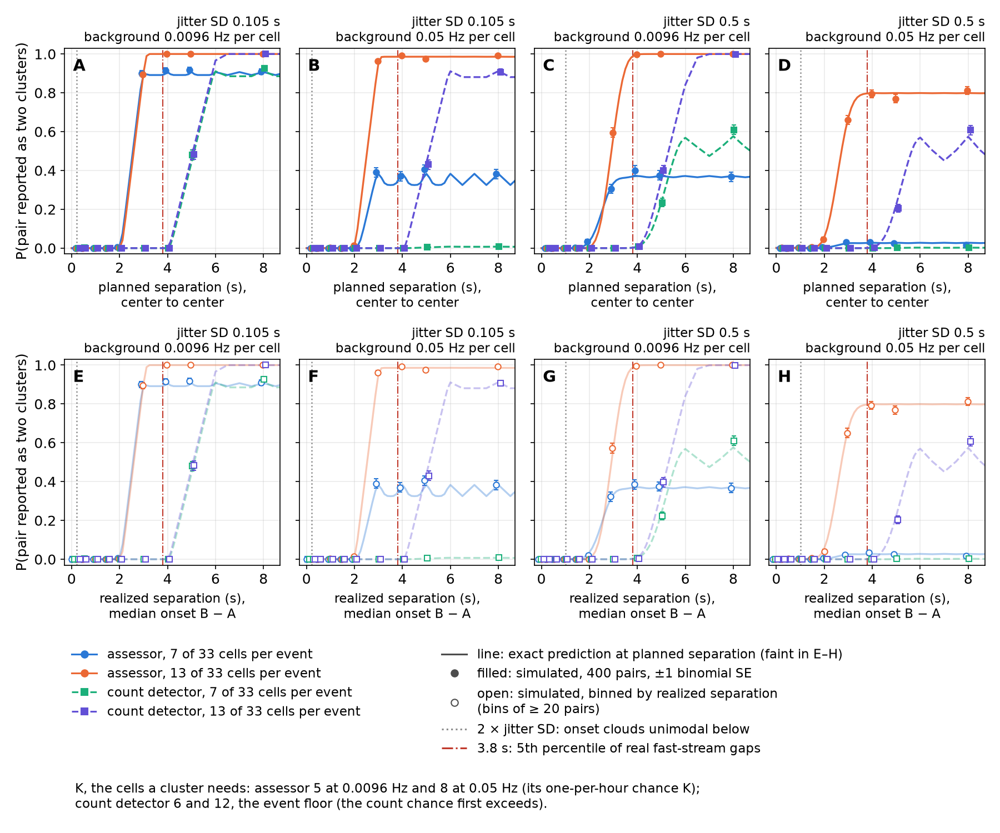
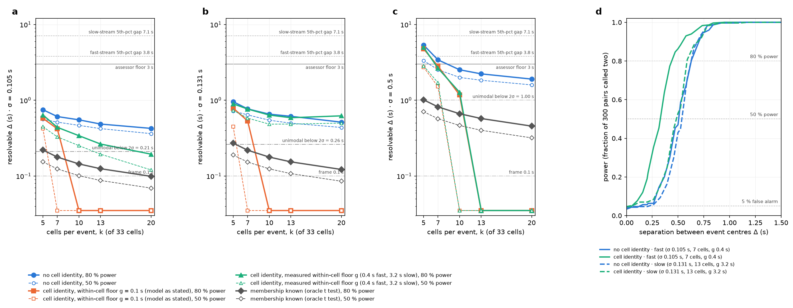

# Chapter 1. Predict first, simulate to check: an analytical baseline for finding coordinated events in multichannel event times

> **Draft for the author, not yet for a committee.** Written from the Aim 0 record on the goal
> page ([`goals/synthetic-validation.md`](../goals/synthetic-validation.md)) and the scripts and
> derivations in [`learned/synthetic_validation/`](../learned/synthetic_validation/README.md). Every
> number below is quoted from those records, which recompute it; none was computed for this
> chapter. Before this goes to a reader outside the lab, three things are owed, listed in
> *1.10, Limitations*: human review of the derivations (so far they were checked only by Claude
> review agents and by two more Claude sessions that rederived them), the one source still marked
> ⚠ below (Kish's book), and the two-source test that the dissertation's premise needs.

## 1.1 Introduction

A calcium-imaging recording of a few dozen cells, reduced to the onset times of each cell's
calcium events, is a multichannel stream of unlabeled event times. Some of those onsets are
coordinated: several cells have an event within a fraction of a second of one another, more often
than their own rates would produce by chance. The rest are background. The question every
downstream analysis rests on is which onsets belong to which coordinated event, and how many such
events there were.

In the arcuate KNDy neurons this work was built around, the events are action-potential
independent, so the spike-train literature's priors about what an event means for the cell do not
transfer. What does transfer is the statistics of point processes. A recording of 33 cells holds
background events at about 0.0096 Hz per cell, coordinated events whose participants' onsets
scatter about the event time with a standard deviation of 0.105 s on the fast stream and 0.131 s
on the slow one, and events joined by roughly 7 (fast) to 13 (slow) of the 33 cells.

The repository this dissertation is built on, bugarach, ports six coordination detectors from
their MATLAB originals and adds tools that measure a recording's parameters without a detector.
The plan for validating them (Chapters 2–4) is the usual one: measure the parameters of a
recording, simulate recordings from those parameters with known truth, tune and characterize each
detector on the simulations, and only then run on real data. That plan is brute force. Each
question about a detector costs a simulated grid, and the grid can only answer the conditions it
contains.

This chapter asks whether the brute force can be aimed. **For each measuring tool and each simple
detector, can we derive from the planted parameters what it should return, and then use
simulation only to test the derivation and measure what is left over?** We call this Aim 0:
*predict first, simulate to check*.

The answer, developed below, is that theory does not replace simulation but tells it where to
look. For one source of coordinated events it predicts the threshold-free coordination-rates tool
to within about 1–2 % of planted participation, predicts the rate of chance clusters that a
cluster-finding tool reports at any threshold, and turns the coordination-rates tool's three
windows into an estimator that recovers jitter, participation and event rate together. It explains
the two failures of the first simulation experiment. It gives closed forms for when reused cell
groups (assemblies) and reused latency orders become detectable, and shows that with the handful
of events in a real baseline window an order indicator can find one latency template at best. And
it shows that the shortest separation at which two events can be told apart is set by the tools'
bin widths, about 2.5 and 5 s, not by the data, whose own floor is under 1 s.

### Contributions

1. A closed form for **window sharing**, the chance g_n(w, σ) that n Gaussian-jittered onsets of
   one event fall in one window of width w, and from it the bias of the coordination-rates tool's
   participant estimate, k̂ = 2 + (k − 2) g₃/g₂.
2. The **at-most-one-event term**, which corrects the tool's expected pair and triple counts for an
   event train whose events cannot share a window, and its generalization to any stationary event
   train through the train's pair correlation.
3. The **joint fit**: jitter, participants and event rate recovered together from the tool's pair
   and triple counts at three windows.
4. A closed form for the cluster-finding tool's **chance-cluster rate** at any threshold, and from
   it the smallest threshold safe against chance at a given background.
5. The **membership limit**: with M assemblies, pair co-participation variance is 1 + (E − 1)/M
   times its value under random participation, so assemblies converge to random only when the
   number of events is fixed.
6. The **order indicator's** exact one-template form, (2/π) arctan(δ/σ), and its exact no-order
   mean under a ranking sort, c/√n̄ with c = √(4(k + 1)/(3πN)), and the power that follows at the
   lab's event counts.
7. The **minimum separation** of two events: the floor for any method, and the split probability of
   the two binning tools, each checked by simulation.

What is old and what is new is set out in *1.9*. In short, window sharing for two onsets and
uniform jitter, reading jitter across bin widths, and the cumulant route are prior work; the
n-onset Gaussian form, the at-most-one-event term, the formal fit with event rate, and the
analytical no-order null for this indicator were not found in the sources read.

## 1.2 Background

### 1.2.1 The data and the generative model

The input is one list of onset times per channel (cell, or region of interest) and the recording's
duration. Frame interval is optional. In the lab's recordings the frame is 0.1 s and a recording
lasts about 45 minutes.

The generative model for one source of coordinated events is a cluster process of the
Neyman–Scott type (Neyman & Scott 1952): cluster centers placed at random, and the members of each
cluster scattered about its center by a probability law. With Gaussian scatter it is now called the
Thomas process, although Thomas (1949) gave only the count distribution of clustered plants in
sampling quadrats, with no spatial scatter law; the name is a later convention. Each cell carries independent Poisson background onsets at rate b. On top
of that, E coordinated events occur in a recording of duration T (rate λ = E/T). Each event is
joined by k of the N cells; each participant's onset is the event time plus independent Gaussian
jitter of standard deviation σ, rounded to the frame. Two departures from the textbook process
matter below: the number of events is fixed rather than Poisson, and events are held at least 20 s
apart rather than placed independently.

Table 1.1 collects the symbols.

**Table 1.1. Symbols.**

| symbol | meaning | values in the first experiment |
|---|---|---|
| N | cells in a recording | 33 |
| k | participants per event (cells) | 5, 10, 20 (participation 0.15, 0.3, 0.6) |
| σ | jitter: SD of a participant's onset about the event time | 0.05, 0.2, 0.5, 1.0 s |
| b | background rate per cell | 0.01 Hz (lab-like) and 0.05 Hz |
| E, λ | coordinated events per recording; per second | 15 or 45 in 45 min |
| w | the coordination-rates tool's window | 1, 2, 4 s |
| K | the assessor's threshold, an absolute count of cells | 3, 4, 6 cells |
| g_n | the chance that n onsets of one event share a window | |
| M | number of assemblies, or of latency templates | |
| δ, r | spread of a latency template's offsets; r = δ/σ | |
| F, n̄ | the order indicator; mean number of events a pair of cells shares | |

### 1.2.2 The tools

Two tools measure a recording without a detector, and one simple detector is analyzed beside them.

- **The coordination-rates tool** (`tools/measure_coordination_rates.py`) counts how much more often
  pairs and triples of cells are active in the same window than they are in time-shifted copies of
  the recording (the surrogates). From those excess counts it solves for participants per event,
  events per minute, and the coordinated share (the rate of coordinated onsets per cell, λk/N). It
  needs no event definition and no threshold. Its route is the cumulant route of CuBIC (Staude,
  Rotter & Grün 2010) on the multiple-interaction model of Kuhn, Aertsen & Rotter (2003), with
  factorial cumulants of the population count, which add over independent processes.
- **The assessor** (`bugarach.assess`) finds clusters of at least K active cells in 1 s bins,
  gathers each cluster's onsets within ±1.5 s, and reports participants, rate and onset jitter.
- **The count detector** (`bugarach.detectors.count`) calls a coordinated event wherever the number
  of distinct cells active in a 2 s bin reaches a threshold.

These three see only how many cells are active in each window or bin; we call them
**population-count tools**. Two further statistics look at *which* cells are active together and
are needed for structure the population count cannot see: the repository's **assembly test**
(`bugarach.assembly`), and an **order indicator** defined in *1.6*.

### 1.2.3 Prior work

**Coincidence detection across bin widths.** Grün et al. (1999, eq. 5) derived the chance that two
uniformly jittered onsets are split by a bin border (the "fission probability") and showed how
detection depends on the analysis bin width. Pazienti et al. (2008) derived how dithering interacts
with jittered coincidences and estimated synchronization precision from how detection decays with
the dither interval, at a single tolerated spread. Louis, Borgelt & Grün (2010), building on the
complexity distribution of Grün, Abeles & Diesmann (2008), gave the full distribution of the
population count for groups with **uniform** jitter: given how far the jitter window overlaps a bin,
each member is captured independently, so the group's contribution is binomial. They then read group
size and jitter from where one feature of the observed-minus-independent distribution (its second
maximum) changes slope as the bin widens, the slope change sitting at bin width 2s + 1 for jitter
±s. This is the closest precedent for the joint fit, and it differs in three ways: the jitter is
uniform rather than Gaussian, the reading is a slope-change rule rather than a fit, and the event
rate is not estimated. They also neglect two events sharing a bin, as an approximation for low
rates, which is the case the at-most-one-event term and the event-train form treat.

**Cluster processes.** In spatial statistics the clustering parameters of a Neyman–Scott process
are fitted by minimum contrast on its K-function, the pair-count curve across scales, which has a
closed form for the Thomas process (Waagepetersen 2007). Fitting a model that can be simulated but
not written down, by matching simulated summaries, goes back at least to Diggle & Gratton (1984),
which is the situation Aim 1's brute-force grid is in. PP-Seq (Williams, Degleris, Wang & Linderman 2020) is a Neyman–Scott model
of neural sequences with per-neuron offsets, and Wang et al. (2024) give Bayesian inference for
the class.

**Assemblies.** The PCA assembly method with a Marchenko–Pastur null comes from Peyrache et al.
(2009, 2010), building on Chapin & Nicolelis (1999), and was extended by Lopes-dos-Santos et al.
(2011, 2013).

**Order.** Kreuz, Satuvuori, Pofahl & Mulansky (2017) define SPIKE-order and the Synfire Indicator,
which finds the order of a set of spike trains by simulated annealing and scores it against
surrogates. Their group has applied it to wide-field calcium imaging (Cecchini et al. 2021) and
still sorts by annealing in its 2026 review. Mariani et al. (2025) replaced annealing with a direct
shift for latency correction: 9.7 s against 861.8 s for annealing on one 183-train dataset.

## 1.3 The coordination-rates tool, predicted

### 1.3.1 Window sharing

Place a window of width w at a uniformly random phase. The chance that it holds all n onsets of
one event is

  g_n(w, σ) = E[max(0, 1 − R_n / w)],

where R_n is the range of the n onsets. For two onsets the difference D is N(0, 2σ²), and with
s = σ√2 and a = w/s,

  g₂(w, σ) = (2Φ(a) − 1) − (2s/w)(φ(0) − φ(a)),

with Φ and φ the standard normal distribution and density. For three onsets g₃ is a
one-dimensional integral over the distribution of the range of three normals; it depends only on
w/σ and is tabulated once. Rounding onsets to the 0.1 s frame adds nothing in expectation, because
event times are continuous and the windows sit on the frame grid. (An early version added a
frame-rounding term, which biased jitter low at 0.05 s; it was dropped.)

### 1.3.2 The expected excess counts

With at most one event per window, the coordinated part of the population count has factorial
moments p (k)_r g_r, where p = λw and (k)_r is the falling factorial. The shift surrogate keeps
each cell's own train, so it carries each cell's coordinated onsets (rate λk/N) but scatters them.
The excess the tool measures is then

  f₂ = p (k)₂ g₂ − (pk)² (1 − 1/N)
  f₃ = p (k)₃ g₃ − 3p² k (k)₂ g₂ + 2 (pk)³ (1 − 1/N²).

The second terms are the **at-most-one-event term**: a Poisson event train would let two events
share a window now and then, and the generator's 20 s minimum spacing forbids it, so that
contribution is removed from the pair and triple counts. Every prediction is passed through the
tool's own `solve()`, so prediction and measurement are the same estimator, down to its refusal
when f₂ or f₃ is not positive.

### 1.3.3 Why the window must exceed the jitter

Dropping the small terms, f₃/f₂ ≈ (k − 2) g₃/g₂. The tool assumes every window catches every onset
of an event (g = 1), so it reports

  **k̂ = 2 + (k − 2) g₃/g₂.**

As σ approaches w, g₃ falls faster than g₂ and k̂ falls toward 2. That is the mechanism behind the
practical rule that the window must be wider than the jitter, and it predicts by how much a given
window undercounts.

### 1.3.4 Any stationary event train

Real events are not held 20 s apart. On the lab's fast stream, 1.7 % of gaps between events are
shorter than 3 s and 7.5 % shorter than 5 s. The general form replaces the at-most-one-event term
with the event train's pair correlation, and carries one more effect the hard-core form omitted:
the surrogates' shifted copies are not independent of the event train, so the surrogates "see" the
events' spacing (`event_train.py`; derivation in
[`separation/real_intervals/`](../learned/synthetic_validation/separation/real_intervals/derivation.md)).
Poisson, hard-core, renewal, empirical and Palm trains are implemented; without a train the
hard-core form is unchanged.

### 1.3.5 The joint fit

The tool reports a pair and a triple count at each of its three windows. Fitting those six numbers
against the exact forms above for (σ, k, λ) gives jitter, participants and rate at once. The
dependence on w enters only through g₂ and g₃, which is what makes σ identifiable. The fit replaces
an earlier one-parameter fit of the pair count across windows, which ignored the at-most-one-event
term; its readings were partly model error. On real event trains the fit takes the stream's own
train (`fit_joint(..., train=EventTrain.palm(gaps, λ))`).

## 1.4 The assessor's threshold, predicted

On a background-only recording each cell is active in a 1 s bin with probability 1 − e^(−b), so a
bin reaches K cells with probability

  q = P(Binomial(N, 1 − e^(−b)) ≥ K).

The assessor starts a cluster on a bin at or over K whose two preceding bins are below it, so the
chance-cluster rate is

  **60 q (1 − q)² per minute.**

Setting this against a budget of one chance call per hour gives the smallest threshold that is safe
against chance. Whether a planted event reaches K is not modeled here; it depends on k, σ and the
bin, and is left to simulation and to later work.

## 1.5 Testing the predictions

### 1.5.1 The simulation testbed

The first experiment (Aim 1a, `aim1_one_source.py`) simulated one source with a fresh random set of
participants per event, on a grid of 4 jitters × 3 participations × 2 event counts × 2 backgrounds
= 48 conditions, 5 recordings each, 240 recordings of 33 cells and 45 minutes. Each recording was
measured without access to the planted values, with the coordination-rates tool at 1, 2 and 4 s and
the assessor at K = 3, 4 and 6. A further 200 background-only recordings (100 per background)
tested the chance-cluster prediction.

The first run of this grid was found to share backgrounds across conditions (the generator drew the
background before the events, so every condition with the same replicate index had the same
background, and errors were correlated across conditions). It was rerun with a seed per recording,
and all numbers here are from the rerun.

### 1.5.2 Protocol

For each condition and window, the residual is the absolute difference between the condition's
median recovered/planted ratio and the predicted/planted ratio. `theory.py`'s `check()` recomputes
every prediction and residual from the run record in about a minute; `theory.py --from-record`
prints every number quoted in this section.

### 1.5.3 What brute force found

**Figure 1.1. Recovery against planted jitter, events of 10 or more cells.** 160 of the 240
recordings. Each point is a median over participation, event count and the 5 recordings per
condition; bars are the interquartile range. A–C and E–G: recovered ÷ planted, at 0.01 Hz (top)
and 0.05 Hz (bottom). D and H: recovered jitter in seconds against the identity line, so an
estimator that returns a constant draws as a flat line. The violet joint fit is introduced in
*1.3.5*.

The simulation alone found two failures.

- **A fixed threshold does not transfer across backgrounds.** At 0.05 Hz per cell, chance alone gave
  the assessor 7.97 clusters per minute at K = 3 and 3.85 at K = 4, against 0.33 or 1 planted
  events per minute.
- **The assessor reads jitter only at the lower background.** At 0.01 Hz and K = 4 it read 0.07,
  0.23, 0.49 and 0.72 s for planted 0.05, 0.2, 0.5 and 1 s (Figure 1.1 D). At 0.05 Hz it read
  0.64–0.73 s whatever was planted (Figure 1.1 H). It also cannot read above about 0.74 s, the SD
  of a Gaussian of SD 1 s truncated at its ±1.5 s gather.

Two smaller regularities: at 1 s jitter the 1 s window read 0.34–0.42 of planted participants and
the 4 s window 0.68–0.85, and the coordinated share moved least of all estimates, 0.78–1.11 of
planted at the 2 and 4 s windows at 0.01 Hz.

### 1.5.4 What theory predicts

**Figure 1.2. The full prediction matches the coordination-rates tool and the assessor's chance
clusters.** One point per condition and window. A–C, E–G: the tool's three estimates as ratios to
planted; colored points use the full prediction (with the at-most-one-event term), grey points the
same measurements placed at the prediction for a Poisson event train. D, H: chance clusters per
minute on 100 background-only recordings per background, with exact Poisson 95 % intervals.

**Participants.** For events of 10 or more cells, the prediction matches the condition median to a
median residual of 0.007 of planted at 0.01 Hz and 0.016 at 0.05 Hz (worst 0.037 and 0.11).
Without the at-most-one-event term the residual is about 0.05. Of 48 condition-windows per
background, 7 and 10 sit beyond 2 standard errors; if the prediction were exact, simulation says
about 6 would, because the standard error of a median of 5 values is heavy-tailed. A sign test
gave a possible small high bias at 0.01 Hz (measured below predicted in 12 of 16 conditions,
p = 0.08), and the general event-train form removed it (p = 0.19): it was the surrogates seeing the
events' spacing.

**Chance clusters.** Predicted 0.256 and 0.019 per minute at K = 3 and 4 and 0.01 Hz (measured
0.262 and 0.020); 7.97, 3.86 and 0.284 at K = 3, 4 and 6 and 0.05 Hz (measured 7.97, 3.85 and
0.279). All lie within their 95 % intervals. This explains the first failure: the smallest
threshold safe against one chance call per hour is 5 cells at 0.01 Hz and 8 at 0.05 Hz, so a
threshold has to be set per recording from its own background, as the repository's event floor
already is. A safe threshold also loses spread-out events: at 0.01 Hz and K = 6 the assessor
reports 0.76–0.80 of planted 10-cell events at 0.5 s jitter and 0.29–0.33 at 1 s, because their
onsets fall in several bins.

**Jitter, by the joint fit.** For events of 10 or more cells, planted 0.2, 0.5 and 1.0 s read 0.22,
0.50 and 1.01 s at 0.01 Hz and 0.20, 0.52 and 1.01 s at 0.05 Hz, with participants within
0.94–1.14 and rate within 0.73–1.14 of planted per condition. This explains the second failure: the
information about jitter is in how the pair and triple counts change across windows, which the
assessor never looks at. Planted 0.05 s is not resolved (it reads 0.075 and 0.039 s, and 5 of 40
recordings hit the fit's lower limit), and 5-cell events read 0.1 to 3.6 times planted.

**Rate and share** are predicted less well: median residuals of 0.03 and 0.02 at 0.01 Hz, with
measured above predicted in 43 and 41 of 48. The general event-train form explains most of the
rate excess: the median residual falls from 0.030 to 0.013.

**On real gaps.** Simulated on renewal trains drawn from the fast stream's measured gaps, the
hard-core form fails at the 4 s window: it predicts rate 1.17 and participants 0.89 of planted where
the shipped tool measures 1.03 and 0.96, and the joint fit reads jitter 1.5–1.65 times high. The
general form fixes both (χ² about 15, against 74–133, over 12 condition-windows).

## 1.6 Structure the population count cannot see

The predictions so far concern population-count tools. A source may also have structure in *which*
cells take part (membership) and in *when* each takes part relative to the others (order). This
section asks how much of each is needed before it can be detected.

### 1.6.1 Membership: when do assemblies look random?

Let a source draw each event's participants from one of M fixed assemblies of k cells, chosen with
equal probability, and assume perfect readout (every member seen, no background cell joining). Two
events then share an assembly with probability 1/M, and the variance of pair co-participation
counts across cell pairs is

  **1 + (E − 1)/M**

times its value under random participation. With unequal use, 1/M becomes Σ p_m², where p_m is the
share of events using assembly m. This has the form of Kish's design effect for clustered samples,
1 + (b̄ − 1)ρ, with b̄ the mean cluster size and ρ the intraclass correlation (Kish 1965 ⚠; stated,
with its weighting factor, in Kish 1987, as given by Gabler, Häder & Lahiri 1999): here E plays b̄
and 1/M plays ρ.

The formula answers the question of whether assembled participation converges to random as sources
multiply: **only if the total number of events is held fixed**, and then almost by definition, since
many assemblies each used once are random participation. If each new assembly brings its own e
events (E = Me), the excess stays near e and never reaches random. Membership is invisible to
population-count tools by construction, exactly so when every cell has the same rate.

**Figure 1.3. Assembled participation stays detectable after its variance has converged.** 33
cells, 10 per event, 45 events. A: pair co-participation variance over its value under random
participation, mean of 400 simulations, for M from 1 to 10 000. B: share of 60 recordings in which
the repository's assembly test rejects both of its nulls (margin-preserving and uniform), and
either one; under random participation both reject in 1 of 60 and either in 3 of 60 (dashed and
dotted lines).

Detection outlasts the variance. Both nulls reject in every recording while reuse E/M lies between
1 and 15, in 72 % at reuse 0.3, and still in 13 % at reuse 0.045, where the variance ratio is 1.04.
At M = 1 only the uniform null rejects, because one assembly holding every event is the case a
margin-preserving null cannot see.

### 1.6.2 Order: a closed form, and the bias at few events

**The question.** On the lab's own recordings, Kreuz's Synfire Indicator fell as spike count rose
(Spearman ρ −0.75 on the fast stream, −0.40 on the slow, across recordings that share mice). Is
that order in the data or a property of the indicator? Does an order indicator have a closed form,
and how large is it when no order is present?

**A latency template is extra jitter to the population count.** If each participant has a fixed
offset from a template of spread δ, two participants' lag has SD √(2(δ² + σ²)), so g_n and the
joint fit see an effective jitter √(δ² + σ²). Only cell-by-cell statistics separate the two.

**The indicator.** With known events and no background, count for each pair of cells who leads
across the events they share. The **score sort** orders cells by net lead count (a Borda count;
O(N²) and no search). F is the net agreement of the pair lead signs with that order, as a share of
pair co-participations: 1 for a perfect sequence, near 0 with no order once events are many. A
**local search** then moves single cells while that raises F.

**Figure 1.4. The order indicator follows its closed form for one template and falls as 1/√M and
1/√n̄.** 33 cells, 10 per event. A: one template, 200 events; solid, (2/π) arctan r; dashed, with
the no-order bias of 200 events added. B: M templates at r = 2.5, 2000 events; solid, the
many-template asymptote; dashed, with the bias added. C: no order planted, under both sorts.

- **One template**: F = (2/π) arctan r, with r = δ/σ. This is the population Kendall rank
  correlation between template and observed latencies under a normal model: for a bivariate normal
  pair with correlation ρ, τ = (2/π) arcsin ρ (Kruskal 1958, sec. 9), and here ρ = r/√(1 + r²). The score sort sits on it at r = 1 and 2.5 (0.503 and 0.753).
- **M templates**: the signal falls as 1/√M from √(2/π) · √((2/π) arcsin(r²/(1 + r²))), 0.65 at
  r = 2.5. This form is asymptotic and runs up to 10 % high at M = 2–16.
- **No order**: under the score sort the mean of F is exact for every N, k and E, and for n̄ ≳ 2 it
  is **c/√n̄ with c(N, k) = √(4(k + 1)/(3πN))**, 0.376 at 33 cells and 10 per event, with nothing
  fitted ([`kendall_w/`](../learned/synthetic_validation/kendall_w/derivation.md)). It matched fresh
  simulation in 33 of 33 comparisons. With every cell in every event this is Kendall's W
  (Kendall & Babington Smith 1939); with partial participation the score's covariance is that of
  Durbin's (1951) incomplete-block test in Skillings & Mack's (1981) form. The local search's
  constant is larger (0.50) and still fitted.

**With few events the bias is large.** At 33 cells the no-order F is 0.48 ± 0.06 at 10 events of 7
cells and 0.14 ± 0.02 at 140. A calibrated null removes the mean bias; detection then depends on the
null's spread. Table 1.2 gives the power that results.

**Table 1.2. Power to detect M latency templates at r = 2.5** (share of 300 recordings beyond the
95th percentile of 300 order-free recordings of the same size).

| events per recording | 7 cells per event | 13 cells per event |
|---|---|---|
| 5 | 1 template 0.43; 2, 0.13 | 1 template 1.00; 2, 0.73; 4, 0.34 |
| 10 | 1 template 0.99; 2, 0.66; 4, 0.31 | 2 templates 0.99; 4, 0.68; 8, 0.37 |
| 25 | 2 templates 1.00; 4, 0.79; 8, 0.51 | 4 templates 1.00; 8, 0.89; 16, 0.55 |

The lab's baseline windows hold about 1–8 coordinated events each (medians 1, 2 and 3 on the fast,
slow and combined streams), so at that scale an order indicator can find one template at best.

**Against the Synfire Indicator.** Kreuz's indicator differs from F in four ways: it finds
coincidences with ISI-adaptive windows rather than known events (on sparse trains these also pair
onsets of neighboring events); it sorts by simulated annealing; it normalizes by all spikes, so with
known coincidences and no background F_Kreuz = F (k − 1)/(N − 1), a factor of 0.28 at 10 of 33
cells; and its null swaps order within coincidences. The lab's earlier observation that the
indicator falls with spike count is **consistent with** the no-order bias, but not tested: dilution
by non-coincident spikes and cross-event coincidences predict a fall too, and Kreuz et al. (2017,
sec. 3.1) warn that the indicator is not sufficient to compare datasets with very different numbers
of trains and spikes. Ranking by net lead count is the textbook Borda or Copeland ranking; it comes
within a factor of 5 of the fewest disagreements (Coppersmith, Fleischer & Rudra 2006), and
Copeland counting, which ranks items by the number of pairwise comparisons won, reaches the
information-theoretic limit for recovering the top k items up to constant factors (Shah & Wainwright
2018). A
search of the Kreuz group's papers, code and website found no ranking sort and no analytical null
([`kreuz_sort/`](../learned/synthetic_validation/kreuz_sort/README.md)).

## 1.7 The minimum separation of two events

How close can two coordinated events be and still be counted as two? Three derivations answer it,
each checked by simulation and independently re-simulated
([`separation/`](../learned/synthetic_validation/separation/README.md)).

- **The data's floor is 0.26–0.76 s.** That is the separation at which a likelihood-ratio test on
  onset times and cell identity resolves two events from one at 80 % power and 5 % false alarm, for
  σ of 0.105–0.131 s, 7–13 of 33 cells and 0.0096 Hz. Jitter sets it, at 2–6 σ. Onset clouds are
  unimodal below 2σ, but that is not the statistical limit. The 0.1 s frame does not bind.
- **The tools' floor is set by their bins.** The chance that a pair is reported as two reaches half
  its plateau at (merge rule + ½) × bin width: about 2.5 s for the assessor (1 s bins) and about
  5 s for the count detector (2 s bins), almost independent of jitter, participation, background
  and threshold. The data set only the plateau, f², with f the chance one event reaches K by
  itself. The exact prediction matched 28,800 simulated pairs within binomial noise.
- **So between about 0.6 and 2.5 s the tools merge pairs the data could separate.** On the lab's
  measured gaps the consequence is small: the assessor resolves about 98 % of fast-stream gaps when
  both events are detected, and the count detector at its shipped 2 s bins merges about 7 % of
  fast-stream gaps and 1 % of slow ones. These are lower bounds, because the gap list itself merged
  events under 2 s apart.

**Figure 1.5. The tools merge pairs closer than their bins.** The chance a pair of events is
reported as two, against the separation of their centers (A–D) and against the realized separation
of their median onsets (E–H). Lines are the exact prediction; points are 400 simulated pairs each.
Assessor solid, count detector dashed; 7 and 13 of 33 cells; jitter 0.105 and 0.5 s; background
0.0096 and 0.05 Hz. Dotted: 2σ. Dash-dot: the 3.8 s fifth percentile of real fast-stream gaps.

**Figure 1.6. The data's floor lies well below the tools'.** The separation any test resolves at
50 % and 80 % power, against cells per event, at σ = 0.105, 0.131 and 0.5 s (a–c), with and without
cell identity. Panel d shows the power curves at the lab's two streams.

## 1.8 Checking the derivations

Three kinds of check were made, and their limits should be stated plainly.

**Against simulation.** Every closed form above was tested against simulated recordings on which it
was not fitted, per condition, with the residual and its sampling noise reported. That is the
chapter's main evidence.

**Rederivation.** Two further Claude sessions were given the original question, the code and the
first experiment's record, each in its own checkout, without this chapter's results. All three
reached the same core derivation: the expected pair and triple counts with the at-most-one-event
term, k̂ = 2 + (k − 2) g₃/g₂, and the chance-cluster rate. They shared the prompt, the repository,
the model and the tool definitions, and the tool is itself defined by cumulants, so the route was
close to forced. This is a consistency check, not independent review. The rederivations did add
results: the per-estimate noise and when the tool will refuse an estimate, the assessor's output as
a mixture of chance and event clusters, the event floor as the rate at which chance first crosses a
count, and the joint fit itself, which came from one of them.

**Adversarial review.** The draft results were reviewed by eleven Claude review agents in four
rounds, the last three blind to earlier findings
([run record](../reviews/synthetic-validation-aim0_2026-10-23.md)). The review found the shared
backgrounds, the frame-rounding term's bias, a misstated expected count of outlying residuals, and
two overreaching claims about order; each correction is recorded on the goal page under *Tried and
dropped*. No human has yet reviewed the derivations.

## 1.9 What is old and what is new

| result | status |
|---|---|
| Window sharing, two onsets, uniform jitter | Grün et al. 1999 ("fission probability") |
| Reading group size and jitter across bin widths | Grün, Abeles & Diesmann 2008; Louis, Borgelt & Grün 2010, by a slope-change rule with uniform jitter |
| The full population-count distribution for jittered groups, all orders | Louis, Borgelt & Grün 2010, for uniform jitter |
| The cumulant route to participation | CuBIC (Staude, Rotter & Grün 2010) |
| Fitting a cluster process's parameters by pair counts across scales | spatial statistics: minimum contrast on the K-function (Waagepetersen 2007) |
| g_n for Gaussian jitter and n onsets, and k̂ built on it | not found; the uniform-jitter analogue is in Louis, Borgelt & Grün 2010 |
| The at-most-one-event term, and the general event-train form with the surrogate's dependence | not found |
| A formal fit across windows that also recovers the event rate | not found; Louis, Borgelt & Grün 2010 read size and jitter from a slope change and do not estimate the rate |
| The membership variance ratio | the form of Kish's design effect |
| One-template F = (2/π) arctan r | τ = (2/π) arcsin ρ for the bivariate normal (Kruskal 1958) |
| The score sort | Borda/Copeland ranking; Schneider, Havenith & Nikolić 2006 rank units by summed pairwise delays |
| The exact no-order mean of F, c/√n̄ | the covariance is Durbin's and Skillings–Mack's; its use as an analytical null for an order indicator was not found |

"Not found" is a statement about the search, which is recorded in
[`prior_art/`](../learned/synthetic_validation/prior_art/README.md) with what was and was not
opened. The hippocampal replay and cortical sequence rank-order literature (Lee & Wilson 2002;
Luczak et al. 2007), where rank-order nulls with few cells are standard, was not searched.

## 1.10 Discussion

### What theory replaces, and what it does not

For one source, theory predicts the coordination-rates tool, the assessor's chance clusters, and
what each window can and cannot read. It turns two failures that simulation found but could not
explain into consequences of a formula: a fixed threshold fails because the chance-cluster rate
rises steeply with background, and the assessor cannot read jitter because the information is in
how pair and triple counts change across windows. It also produces a new estimator, the joint fit,
that the brute-force experiment did not contain.

It does not predict whether a planted event reaches a threshold, the assessor's participants and
jitter, the rolling detectors (CoactDetect and LoCo, with their rolling context and merge gaps),
clustered intervals or per-cell burstiness. Those stay with simulation. What changes is where the
simulation grid is placed: around the predicted boundaries, on dimensionless axes (σ/w, λw, Nbw, and
K against the event floor), rather than on a uniform grid chosen in advance.

### What it says about the lab's recordings

The lab's regime sits at the edge of what has been tested. Its jitter (0.105–0.150 s) lies between
the joint fit's resolved point (0.2 s) and its unresolved one (0.05 s). Its fast-stream events
(about 7 cells) lie between the 5-cell arm, which is noise-dominated, and the 10-cell arm, which is
well predicted. Its real gaps break the hard-core assumption at the 4 s window, and the general form
that repairs this is untested on real data. Its baseline windows hold too few events for an order
indicator to find more than one template. And its shortest gaps are mostly longer than the tools'
2.5 and 5 s split points, so merging costs little on these data even though the tools are well
above the data's own floor.

### Two sources

The dissertation's premise is that two or more sources are mixed in one recording. On that the
chapter has a prediction and no test: two sources with the same jitter look, to pair and triple
counts, like one source whose participation blends the two, so pair-and-triple tools cannot tell
them apart. The full population-count distribution carries more. Louis, Borgelt & Grün (2010,
Fig. 6) separated two and three groups of different sizes from it, and noted that the groups become
inseparable as their sizes converge. So separating sources may need higher orders of the population
count than the coordination-rates tool uses, different jitters (which the joint fit across windows
might resolve), or cell-by-cell structure (membership or order), which *1.6* shows needs more
events than a baseline window holds. That is the question Chapter 2 starts from.

### Limitations

1. **One generator.** Every check uses one simulated source with Gaussian jitter, a single k per
   source, and random membership; the hard-core results also assume events at least 20 s apart.
   Real data will need a mixture over k.
2. **Not yet tested in the lab's regime.** Jitter 0.10–0.15 s and 7-cell events, as above.
3. **The Palm form for real event trains is untested on real data**, and real gaps should be
   measured down to one frame, not through a list that merged events under 2 s.
4. **Review.** The derivations were checked by simulation, by two Claude sessions that rederived
   them, and by Claude review agents; no human has reviewed them. Before submission, each
   derivation in [`theory.py`](../learned/synthetic_validation/theory.py),
   [`kendall_w/`](../learned/synthetic_validation/kendall_w/derivation.md) and
   [`separation/`](../learned/synthetic_validation/separation/README.md) needs a human reader.
5. **Sources.** Every cited paper except Kish's 1965 book is now held (its design-effect formula is
   cited through Gabler, Häder & Lahiri 1999, who attribute it to Kish 1987) and was checked against the
   claim it supports; reading them corrected three attributions (Thomas 1949 has no spatial scatter
   law, Diggle & Gratton 1984 is about simulation-based inference rather than minimum contrast, and
   Kruskal 1958 does not name Greiner).
6. **Order, without background.** The order results assume known events, no background onsets and
   no frame grid; rounding onsets to 0.1 s lowers F about 9 % at δ = σ = 0.1 s. The comparison with
   Kreuz's indicator on the same trains has not been run.

### Next steps

In the order the results already owe them:

1. Add the lab's regime to the first experiment's grid (σ = 0.1 and 0.15 s; 7 cells per event;
   0.0096 Hz), rerun the joint fit, and compare its jitter with the correlogram tool's on the same
   recordings.
2. Test the two-source prediction by simulation, and that a latency template reads as jitter in the
   joint fit.
3. Model planted-event detection (the chance an event reaches K) for the assessor and the count
   detector, and the dilution of the membership excess by real readout.
4. Compare the order indicator with Kreuz's on the same simulated trains, and run the Synfire scan on
   order-free simulations matched to the lab's August recordings before any explanation of that
   result is claimed.

Further out: the random-matrix threshold for when a fixed assembly shows in the co-activation
matrix above sampling noise; likelihood bounds on the best precision any method could reach for
(λ, k, σ), as the boundary for Chapter 2; and the shared-modulation prediction, that shared slow
rate change adds pair excess growing with the window while coordination levels off (Staude, Rotter &
Grün 2008).

## 1.11 Conclusion

Brute-force simulation answers the questions it is asked, at the conditions it contains. For the
population-count tools, a few closed forms (window sharing, the at-most-one-event term and its
event-train generalization, and the chance-cluster rate) predict what those tools return to within
a percent or two, explain why a fixed threshold and a fixed window fail, and yield an estimator that
recovers jitter where the existing tools cannot. For structure in membership and order, closed forms
say how much reuse and how many events detection needs, and the answer at the lab's scale is
sobering: a baseline window holds enough events for one latency template at best. For separation,
the tools, not the data, set the limit. The chapters that follow use simulation where theory runs
out: two sources, detection at a threshold, and the rolling detectors.

## Reproducing this chapter

From the repository root:

    PYTHONPATH=src python docs/learned/synthetic_validation/aim1_one_source.py --workers 24
    PYTHONPATH=src python docs/learned/synthetic_validation/theory.py
    PYTHONPATH=src python docs/learned/synthetic_validation/theory.py --train empirical
    PYTHONPATH=src python docs/learned/synthetic_validation/theory.py --check-real
    PYTHONPATH=src python docs/learned/synthetic_validation/membership_limit.py
    python docs/learned/synthetic_validation/order_limit.py
    PYTHONPATH=src python docs/learned/synthetic_validation/aim1_figure.py
    PYTHONPATH=src python docs/learned/synthetic_validation/aim0_figures.py

The separation scripts and their run times are listed in
[`separation/README.md`](../learned/synthetic_validation/separation/README.md).

## References

⚠ marks a source read as abstract or documentation only, or not opened.

- Cecchini G, et al. (2021). *PLoS Comput Biol* 17:e1008963.
- Chapin JK, Nicolelis MAL (1999). *J Neurosci Methods* 94:121.
- Coppersmith D, Fleischer L, Rudra A (2006). Ordering by weighted number of wins gives a good ranking for weighted tournaments. *Proc. SODA 2006*; journal version *ACM Trans Algorithms* 6(3), 2010.
- Diggle PJ, Gratton RJ (1984). Monte Carlo methods of inference for implicit statistical models. *J R Stat Soc B* 46:193–227.
- Durbin J (1951). Incomplete blocks in ranking experiments. *Br J Stat Psychol* 4:85–90.
- Grün S, Diesmann M, Grammont F, Riehle A, Aertsen A (1999). *J Neurosci Methods* 94:67–79.
- Grün S, Abeles M, Diesmann M (2008). *LNCS* 5286:96.
- Kendall MG, Babington Smith B (1939). The problem of m rankings. *Ann Math Stat* 10:275–287.
- Gabler S, Häder S, Lahiri P (1999). A model based justification of Kish's formula for design effects for weighting and clustering. *Survey Methodology* 25:105–106.
- Kish L (1965). *Survey Sampling*. Wiley. ⚠ Not held; borrowable copies were unavailable, and the formula is cited through Gabler et al.
- Kreuz T, Satuvuori E, Pofahl M, Mulansky M (2017). *New J Phys* 19:043028.
- Kruskal WH (1958). Ordinal measures of association. *JASA* 53:814–861.
- Kuhn A, Aertsen A, Rotter S (2003). *Neural Comput* 15:67.
- Lopes-dos-Santos V, Conde-Ocazionez S, Nicolelis MAL, Ribeiro ST, Tort ABL (2011). *PLoS ONE* 6:e20996.
- Lopes-dos-Santos V, Ribeiro S, Tort ABL (2013). *J Neurosci Methods* 220:149.
- Louis S, Borgelt C, Grün S (2010). Complexity distribution as a measure for assembly size and temporal precision. *Neural Netw* 23:705–712.
- Mariani B, et al. (2025). *J Neurosci Methods* 416:110378.
- Neyman J, Scott EL (1952). A theory of the spatial distribution of galaxies. *ApJ* 116:144.
- Pazienti A, Maldonado PE, Diesmann M, Grün S (2008). Effectiveness of systematic spike dithering depends on the precision of cortical synchronization. *Brain Res* 1225:39–46.
- Peyrache A, Khamassi M, Benchenane K, Wiener SI, Battaglia FP (2009). *Nat Neurosci* 12:919.
- Peyrache A, Benchenane K, Khamassi M, Wiener SI, Battaglia FP (2010). *J Comput Neurosci* 29:309.
- Schneider G, Havenith MN, Nikolić D (2006). *Neural Comput* 18:2387.
- Shah NB, Wainwright MJ (2018). Simple, robust and optimal ranking from pairwise comparisons. *JMLR* 18(199). Read as arXiv 1512.08949.
- Skillings JH, Mack GA (1981). On the use of a Friedman-type statistic in balanced and unbalanced block designs. *Technometrics* 23:171–177.
- Staude B, Rotter S, Grün S (2008). *Neural Comput* 20:1973.
- Staude B, Rotter S, Grün S (2010). *J Comput Neurosci* 29:327.
- Thomas M (1949). A generalization of Poisson's binomial limit for use in ecology. *Biometrika* 36:18–25.
- Waagepetersen RP (2007). An estimating function approach to inference for inhomogeneous Neyman–Scott processes. *Biometrics* 63:252–258.
- Wang Y, Degleris A, Williams AH, Linderman SW (2024). *JASA* 119:2382.
- Williams AH, Degleris A, Wang Y, Linderman SW (2020). *NeurIPS*.

*Volumes, pages and author lists for Durbin, Kendall & Babington Smith, Grün et al. 1999, Pazienti
et al., Schneider et al. and Skillings & Mack were checked against Crossref. The entries marked
"et al." are still incomplete. The PDFs are in the lab's literature library under
`01-lit/bugarach/synthetic_validation/`.*
