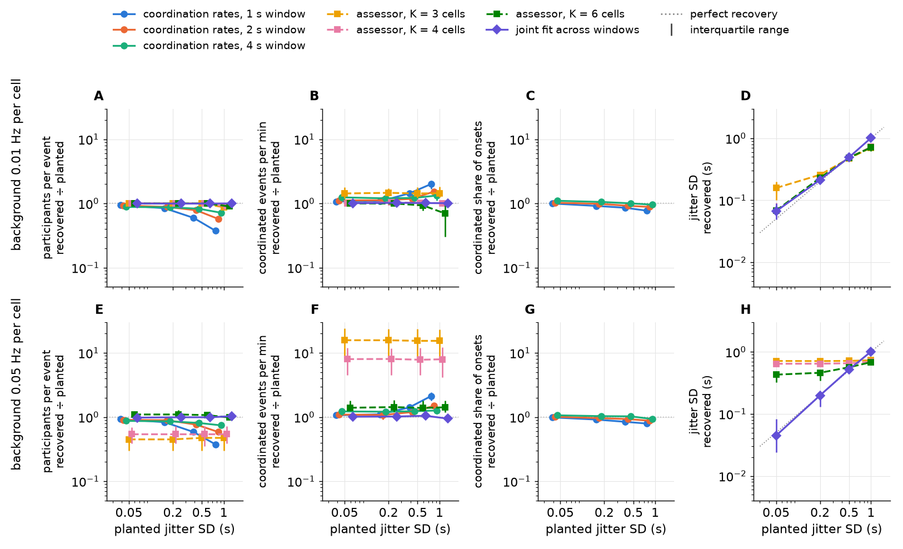
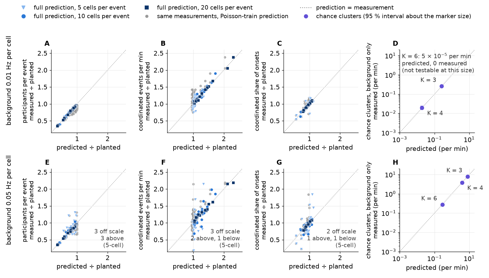
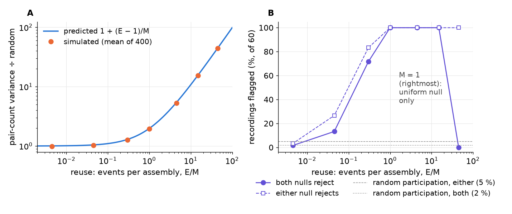
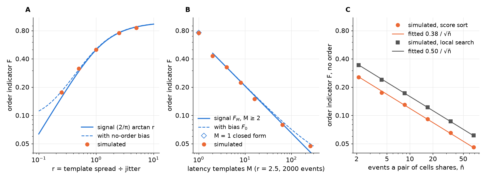

# Goal: validate the toolset on synthetic data with two or more sources of coordinated events

**Set by Tony, 2026-10-22; picked up 2026-10-23** from the handoff
[`todo/2026-10-23-handoff-synthetic-validation.md`](../todo/2026-10-23-handoff-synthetic-validation.md),
which holds his words in full. Branch prefix `synth/`.

Treat bugarach as a general toolset, not one built for this lab's data. The input is a
multichannel stream of unlabelled event times. The premise is that **two or more sources** of
coordinated events are mixed in it, each with its own participation, jitter, intervals and
membership. The loop: measure the parameters with our tools, simulate from them, tune a few
coded detectors on the simulation, characterize each detector, then run on the original
recording. **This step is synthetic only.** It checks the approach against known truth and
answers, condition by condition, what each detector can do: close events, noisy backgrounds,
low participation. Tony: *"Treat like a phd project (except we have days not years)."*

## Where it stands

- 2026-10-23: **Aim 1a ran** (one simulated source of coordinated events, a fresh random set of
  cells per event; 240 recordings measured without the planted values). A fixed cell-count
  threshold for the assessor (the repository's cluster-finding tool) does not transfer across
  backgrounds, and the assessor reads jitter only at the lower background, 0.01 Hz per cell, which
  is close to the lab's measured 0.0096 Hz. The run was redone the same day with a seed per
  recording, after the first run's recordings were found to share backgrounds. The goal page and
  Tony's four decisions (*Settled*) date from the same day.
- 2026-10-23: **Aim 0, theory**, after Tony asked whether an analytical prediction could replace
  the brute force. It predicts the coordination-rates tool (the repository's threshold-free
  counter of shared activity) for one source: participants to a median of about 0.01–0.02 of
  planted for events of 10 or more cells. A fit across its three windows recovers jitter from
  0.2 s up. The lab's own jitter (0.10–0.15 s) and its smaller events (7–12 of 33 cells) are
  untested or outside that range. Two more Claude sessions, given the same prompt and model,
  reached the same core derivation (a consistency check). Nothing here tests two sources yet.
- 2026-10-23: **membership and order.** Fixed groups of cells reused across events look more and
  more like random participation as the groups multiply, but only if the total number of events
  stays fixed. An order indicator has one exact closed form; with few events its no-order bias is
  large: at 5 events of 7 cells, the low end of the lab's baseline windows, one template is
  detected in fewer than half of recordings. It has not been compared with Kreuz's Synfire Indicator on the same data.
- 2026-10-23/24: **reviewed by 11 Claude review agents** (no human reviewer) in four rounds, the
  last three blind to earlier findings
  ([run record](../reviews/synthetic-validation-aim0_2026-10-23.md)). The simulation numbers below
  were recomputed after the fixes; numbers from the blind passes rest on the first, shared-seed
  record and are marked.

### Symbols and tools used below

| symbol or term | meaning | values in Aim 1a |
|---|---|---|
| N | cells (ROIs) in a recording | 33 |
| k | participants per event (cells) | 5, 10, 20 (participation 0.15, 0.3, 0.6) |
| σ | jitter: SD of each participant's onset about the event time (s) | 0.05, 0.2, 0.5, 1.0 s |
| b | background rate (Hz per cell); the lab measures 0.0096 ([`generator.md`](../generator.md)), so 0.01 is lab-like and 0.05 about 5× busier | 0.01, 0.05 Hz per cell |
| E, λ | coordinated events per recording; per second | 15 or 45 in 45 min |
| w | the coordination-rates tool's window (s) | 1, 2, 4 s |
| K | the assessor's threshold, an absolute count of cells (not the glossary's percentage K) | 3, 4, 6 cells |
| g_n | the chance that n onsets of one event fall in the same window | |
| condition | one grid point (k, σ, E, b), simulated as 5 recordings | 48 conditions |
| M | the number of assemblies, or of latency templates | |
| δ, r | a template's spread of offsets (s); r = δ/σ | |
| F, n̄ | the order indicator (defined in *Order*); the mean number of events a pair of cells shares | |
| k̂ | the coordination-rates tool's estimate of k | |

- **The coordination-rates tool** (`tools/measure_coordination_rates.py`) counts how much more
  often pairs and triples of cells are active in the same window than in time-shifted copies of
  the recording (the surrogates). It converts that into participants per event, events per
  minute and the coordinated share (each cell's rate of coordinated onsets, λk/N in Hz; its ratio
  to planted is the same as for the fraction of onsets that are coordinated). It needs no event
  definition and no threshold.
- **The assessor** (`bugarach.assess`) finds clusters of at least K active cells in 1 s bins,
  gathers each cluster's onsets within ±1.5 s, and reports participants, rate and onset jitter.
- **Population-count tools** see only how many cells are active in each window or bin: these two
  and the count detector (`bugarach.detectors.count`, a sliding count of active cells). **Cell-by-cell
  statistics** look at which cells are active together:
  `bugarach.assembly` and an order indicator.
- **An assembly** is a fixed set of cells reused across events. **A latency template** is a fixed
  lead or lag per cell, the same in every event of one source; it is what Kreuz's SPIKE-order
  looks for.
- **Blind A and blind B** are the two extra Claude sessions that rederived the theory without seeing
  it (*Aim 0, rederived by two more sessions*); their numbers rest on the first, shared-seed record.

### Aim 1a, first result (2026-10-23; measured; reseeded the same day)

**Figure 1, recovery against planted jitter, events of 10 or more cells.** 160 of the 240
simulated recordings (33 cells, 45 min each); 5-cell events are quoted in the text. Each point is
a median over participation, event count and the 5 recordings per condition; bars are the
interquartile range. A–C, E–G: recovered ÷ planted. D, H: recovered jitter in seconds against the
identity line, so an estimator that returns a constant draws as a flat line. In A–C and E–G the
series are offset sideways for legibility; in D and H they sit at the planted jitter. The violet
joint fit is Aim 0's (*Aim 0, the predictions*, third bullet).

Numbers below are for events of 10 or more cells, per-condition medians unless marked pooled;
`theory.py --from-record` prints them.
- **A fixed K does not transfer across backgrounds, so K should be set per recording from its own
  null**, as ADR-0008's event floor is set per window. At 0.05 Hz per cell, chance alone gives the
  assessor 7.97 clusters per minute at K = 3 cells and 3.85 at K = 4, against 0.33 or 1 planted
  events per minute (measured on background-only recordings, Figure 2 H; on the recordings with
  events, the same excess is Figure 1 F). Predicted from the assessor's clustering rule against
  ADR-0008's budget of one chance call per hour, the smallest safe K is 5 at 0.01 Hz and 8 at
  0.05 Hz. ADR-0008's own floor, which counts in a sliding 2 s window, gives 6 and 12 cells, and
  both blind passes derived it to within one cell. A K that is safe against chance also loses
  spread-out events: at 0.01 Hz the assessor's cluster rate at K = 6 is 0.76–0.80 of the planted
  rate for 10-cell events at 0.5 s jitter and 0.29–0.33 at 1 s, because their onsets fall in
  several bins (Figure 1 B pools these with 20-cell events). By the floor, 5-cell events sit
  below it at both backgrounds and 10-cell events below it at 0.05 Hz.
- **The assessor reads jitter only at 0.01 Hz, and only to a planted 0.5 s.** Pooled as plotted,
  at 0.01 Hz K = 4 reads 0.07, 0.23, 0.49 and 0.72 s for planted 0.05, 0.2, 0.5 and 1 s (D). At
  0.05 Hz it reads 0.64–0.73 s at K = 3 or 4 whatever was planted, and 0.43–0.68 s at K = 6,
  rising only from 0.5 s (H); chance clusters there also halve its participant count (E). Its
  reading cannot pass about 0.74 s, the SD of a Gaussian of SD 1 s truncated at the ±1.5 s
  gather. At low jitter and high background, chance onsets inside the gather set the reading;
  both blind passes model the assessor's output as a mix of chance and event clusters (blind B
  reports a 2 % median error on its jitter, on the shared-seed record).
- **Participants need a window wider than the jitter.** At 1 s jitter the 1 s window reads
  0.34–0.42 of planted and the 4 s window 0.68–0.85 (A, E); across all jitters the 4 s window
  stays within 0.68–1.04. At 1 s jitter the same tool's event rate at the 1 s window reads
  1.6–2.4 times planted (B, F). Aim 0 predicts both.
- **The coordinated share moves least**: 0.78–1.11 of planted at the 2 and 4 s windows at
  0.01 Hz, and 0.67–1.11 at 0.05 Hz.
- **5-cell events** are below the event floor, and at 0.05 Hz every estimate of them is
  noise-dominated: up to 6.3 times planted (participants) and 6.4 (rate). K = 6 cannot count a
  5-cell event from its own cells; chance joiners lift a few to 6 (a cluster rate of 0–0.27 of
  planted at 0.01 Hz). The lab's fast stream, about 7 of 33 cells, sits between this arm and the
  10-cell one.

### Aim 0, the predictions (2026-10-23; derived, checked against Aim 1a)

Tony, 2026-10-23: *"Is it possible there's an analytical prediction to be made here? We are
solving this with brute force."* **Not replace, but aim it.** For one source the theory predicts
the coordination-rates tool and the assessor's chance clusters, and so explains Aim 1a's two
failures: chance clusters set where a fixed K fails, and window sharing sets what each window can
read (which a different estimator, the joint fit, then uses to recover jitter). It does not
predict whether a planted event reaches K, the assessor's participants and jitter, the rolling
detectors, or two sources, so those stay with simulation. Derivations and assumptions are in
[`theory.py`](../learned/synthetic_validation/theory.py). `check()` recomputes everything here in
about a minute into [`theory_check.json`](../learned/synthetic_validation/theory_check.json),
from the run record [`aim1_one_source.json`](../learned/synthetic_validation/aim1_one_source.json).

**The core prediction.** A window of width w catches all n onsets of one event with probability
g_n(w, σ). The tool assumes every window catches all of an event's onsets, so it reports
k̂ = 2 + (k − 2) g_3/g_2. As the jitter approaches the window, g_3 falls faster than g_2 and k̂
falls toward 2: the *window must exceed the jitter* result. Events here are at least 20 s apart,
so a window never holds two of them. A Poisson event train would let two events share a window
now and then; the **at-most-one-event term** removes that contribution from the expected pair and
triple counts.

**Figure 2, the full prediction matches the coordination-rates tool and the assessor's chance clusters.** One point per condition and window. A–C, E–G: the
coordination-rates tool's three estimates as ratios to planted. Coloured points use the full
prediction (with the at-most-one-event term); grey points are the same measurements placed at
the prediction for a Poisson event train. D, H: chance clusters per minute on 100 background-only
recordings per background, pooled, with exact Poisson 95 % intervals (about the size of the markers).
The at-most-one-event term shrinks the participant residual from about 0.05 to 0.007–0.016.

The residual below is |condition median of recovered ÷ planted − predicted ÷ planted|. The tool
refused an estimate (pair or triple count ≤ 0) in 17 of 720 recording-windows, all 5-cell events
at 0.05 Hz; the medians exclude them and the prediction cannot, so those medians carry a
selection bias. "Of 48" below means condition-windows for events of 10 or more cells at one
background (16 conditions × 3 windows); the three windows reuse the same recordings.
- **Participants: predicted to a median residual of 0.007 at 0.01 Hz and 0.016 at 0.05 Hz**
  (0.006–0.020 at each jitter; worst 0.037 and 0.11); about 0.05 without the at-most-one-event
  term. 7 and 10 of 48 sit beyond 2 SE of their condition's 5 recordings. If the prediction were
  exact, simulation says 11.8 % would (the SE of a median from 5 values is heavy-tailed), so
  about 6 are expected; 10 has a binomial chance of 0.05. Taking one sign per condition, measured
  is below predicted in 12 of 16 conditions at 0.01 Hz (sign test p = 0.08) and 9 of 16 at
  0.05 Hz (p = 0.80): a possible small high bias in the prediction at 0.01 Hz, not established.
- **Chance clusters at K (explains Aim 1a's first failure).** On background-only recordings the
  assessor's
  rate is 60 q (1 − q)² per minute, q the chance a 1 s bin holds K or more active cells; squared
  because the assessor starts a cluster only when the two preceding bins are below K. Predicted
  0.256 and 0.019 per min at K = 3 and 4 cells and 0.01 Hz (measured 0.262, 0.020); 7.97, 3.86
  and 0.284 at 0.05 Hz (measured 7.97, 3.85, 0.279); all within their 95 % intervals. At K = 6
  and 0.01 Hz the prediction is 5 × 10⁻⁵ per min, 0.2 clusters in the whole arm, so measuring 0
  tests nothing. Whether a planted event reaches K is not modelled here.
- **The joint fit recovers jitter from 0.2 s up (explains Aim 1a's second failure); 0.05 s is not
  resolved and the lab's 0.10–0.15 s is untested.** The joint fit takes jitter, participants and
  rate together from the pair and triple counts at the 1, 2 and 4 s windows. For events of 10 or
  more cells, planted 0.2, 0.5 and 1.0 s read 0.22, 0.50 and 1.01 s at 0.01 Hz and 0.20, 0.52 and
  1.01 s at 0.05 Hz (condition medians within 0.88–1.13 of planted); participants within
  0.94–1.14 and rate within 0.73–1.14 per condition. Planted 0.05 s reads 0.075 and 0.039 s, and
  1 and 4 of its 20 recordings hit the fit's lower limit of 0.005 s. 5-cell events read 0.1 to
  3.6 times planted, so the lab's smaller events (fast stream about 7 cells) are not covered
  either. The lab's measured σ is 0.105–0.150 s ([GLOSSARY](../GLOSSARY.md)), between the
  resolved and unresolved points (plan item 1). A latency template would add to the jitter here
  (derived, not simulated; see *Order*). The fit assumes one k, Gaussian jitter and events at
  least 20 s apart; real data will need a mixture over k (blind A).
- **Event rate and share: predicted less well; measured high at 0.01 Hz.** The rate residual
  has median 0.03 (worst 0.18) at 0.01 Hz and 0.06 (worst 0.38) at 0.05 Hz; the share 0.02 (worst
  0.07) and 0.02 (worst 0.28). Measured exceeds predicted in 43 (rate) and 41 (share) of 48 at
  0.01 Hz; at 0.05 Hz in 30 and 29, so no consistent direction there. Candidate cause: the
  surrogates' shifted copies are not independent of the event train. Two review agents' tests
  found that dependence lifts the pair count about 0.5–1 %, of the right sign and size for the
  rate residual (run record; not kept here).
- **Not predicted: 5-cell events at 0.05 Hz**, which are noise-dominated (see Aim 1a).
- **Two sources: predicted, not tested.** Two sources with the same jitter look, to pair and
  triple counts, like one source whose participation blends the two, so these tools cannot tell
  them apart (blind B; plan item 2).

**What is old and what is new.** Reading jitter from how coincidence counts change with the window
is old (Grün et al. 1999 for pairs). Fitting group size and jitter together across bin widths is
Louis & Grün 2009 and Louis, Borgelt & Grün 2010, for the population count's distribution; the
cumulant route is CuBIC's (Staude, Rotter & Grün 2010). Not found in the sources read: g_n for
Gaussian jitter and n onsets, the pair-and-triple form with the at-most-one-event term, and the
event rate in the same fit. The full chain, with what was and was not opened, is in the
[folder README](../learned/synthetic_validation/README.md#prior-art).

### Aim 0, rederived by two more sessions (2026-10-23)

Tony asked for the pass to be run *"two more times with independent agents that don't know what
you discovered, to see if this is the only solution"*. **Same core derivation in all three
sessions; a consistency check, not independent review.** Two more Claude sessions got his first
question, the code and the Aim 1a record, each in its own checkout of `main`. They shared the
prompt, the repository, the shared-seed record, the tool definitions and the model with this
session, and the tool is itself defined by cumulants, so the route was close to forced. This
session's at-most-one-event term is in commit d495ab0e (2026-10-23 15:40), before the blind
reports were committed; both blind passes derived the same term. Their reports
are kept verbatim: [`blind_a/REPORT.md`](../learned/synthetic_validation/blind_a/REPORT.md),
[`blind_b/REPORT.md`](../learned/synthetic_validation/blind_b/REPORT.md).

| result | this session | blind A | blind B |
|---|---|---|---|
| expected pair and triple counts with the at-most-one-event term | full form | drops the surrogate's 1/N and 1/N² corrections | drops the 1/N² correction in the triple term |
| k̂ = 2 + (k − 2) g_3/g_2 | yes | yes | yes |
| jitter from how the pair count changes with window | one-parameter fit (dropped) | joint fit (adopted, re-specified) | ratio of two windows, read 0.2 s 5–15 % high |
| chance clusters 60 q (1 − q)² per min | yes | yes | yes |
| two equal-jitter sources inseparable from pair and triple counts | taken from B | implied by its linear form, not stated | stated, untested |

**What only the blind passes found:**
- the shared-background flaw in Aim 1a (both);
- the noise of each estimate, and with it when the tool will refuse (A and B by two different
  approximations; CuBIC gives its own estimators' noise);
- the assessor's participants and jitter as a mix of chance and event clusters (both);
- the event floor as the rate at which chance first crosses a count, within one cell of the
  simulated floor (both; `tools/measure_chance_floor.py` already had a closed form for its
  sliding window);
- count-detector recall within 0.03 of simulated recall in 19 of B's 24 conditions, and up to
  0.12 low at 0.05 Hz and high K (B);
- the joint fit (A).

**Open residuals** (on the shared-seed record): B's report gives the triple count 5–7 % below
prediction at 0.05 Hz over 60 seeds (its saved 40-seed run, `blind_b/sim_cumulant_check.txt`:
3–19 % per window); A, the rate 3–5 % high.

### Aim 0, membership (2026-10-23; simulated with membership as the only structure)

Tony asked whether the analysis generalizes so that, as sources multiply, assembled participation
converges to random. **Only if the total number of events is fixed as assemblies multiply**, and
then it is close to a tautology: many assemblies each used once are random participation. The
excess pair co-participation variance over random then falls as (E − 1)/M. If instead each new
assembly brings its own e events (E = M e), the excess stays near e and never reaches random
(derived from the formula below, not simulated). And detection outlasts the variance: the
repository's assembly test still flags 13 % of recordings at reuse 0.045, where the variance
ratio is 1.04 (Figure 3 B). Membership is invisible to population-count tools by construction
(derived; exact only for equal per-cell rates); only cell-by-cell statistics see it.

The model ([`membership_limit.py`](../learned/synthetic_validation/membership_limit.py)): M
assemblies of k random cells (they may overlap), each event picking one with equal probability,
and perfect readout (every member seen, no background cell joining). Two events then share an
assembly with probability 1/M, and the variance of pair co-participation counts across cell pairs
is **1 + (E − 1)/M** times its value under random participation. For unequal use, 1/M becomes
Σ p_m², p_m the share of events that use assembly m. This has the form of Kish's design effect
(1965; ⚠ analogy, book not opened). Real readout dilutes the excess; no correction is derived yet.

**Figure 3, assembled participation stays detectable after its variance has converged.** 33 cells, 10 per event, 45 events. A: the
pair co-participation variance divided by its value under random participation, mean of 400
simulations; the seven points share one simulated random baseline, so their common 1–2 %
shortfall is one error, not seven (the exact baseline, Eπ(1 − π), would remove it). M runs from 1
to 10 000. B: the share of 60 recordings in which the repository's assembly test
(`bugarach.assembly`, 200 surrogates per null; the package default is 1000) rejects both of its
nulls, and either one. Its two nulls are a margin-preserving null, which keeps each cell's event
count, and a uniform null. Under random participation both reject in 1 of 60 recordings and
either in 3 of 60 (the dashed and dotted lines).

Both nulls reject in every recording while reuse E/M is between 1 and 15, in 72 % at 0.3 and in
13 % at 0.045 (B). At M = 1 only the uniform null rejects: one assembly holding every event is the
case the margin-preserving null cannot see, as the module documents.

### Aim 0, order (2026-10-23; simulated with order as the only structure)

**The question.** In August Kreuz's Synfire Indicator, computed by `tools/synfire_scan.py` through
PySpike, fell as spike count rose (Spearman ρ −0.75 fast, −0.40 slow, on the 84-recording August
folder, whose recordings share mice;
[`todo/2026-08-19-synfire-measured-and-what-it-cost.md`](../todo/2026-08-19-synfire-measured-and-what-it-cost.md)).
Tony expects Kreuz's method to be brute force and slow. Does an order indicator have a closed
form, and how large is it when no order is present?

**A latency template also reaches the population-count tools, as extra jitter** (derived, not
simulated; on average over random membership). With template spread δ and jitter σ, two
participants' lag has SD √(2(δ² + σ²)), so g_n and the joint fit see √(δ² + σ²). Only cell-by-cell
statistics separate the two.

**The method** ([`order_limit.py`](../learned/synthetic_validation/order_limit.py)): known events,
no background. For each pair of cells, count who leads across the events they share. The **score
sort** orders the cells by each one's net lead count (a Borda count; O(N²), no search). The
**local search** then moves single cells while that raises F. **F** is the net agreement of the
pair lead signs with the order (agreeing minus disagreeing), as a share of pair co-participations:
1 for a perfect sequence, near 0 with no order once events are many. The 0.1 s frame grid is
omitted; rounded onsets tie, and a review agent's test found that lowers F about 9 % at
δ = σ = 0.1 s.

**Figure 4, the order indicator follows its closed form for one template and falls as 1/√M and 1/√n̄.** 33 cells, 10 per event. A: one
template, 200 events; solid, (2/π) arctan r; dashed, the same with the no-order bias of 200
events added. B: M templates at r = 2.5, 2000 events; solid, the many-template signal, an
asymptotic form that at M = 2 already sits well below the one-template value at M = 1 (diamond);
dashed, with the no-order bias added. C: no order planted, under both sorts. All three panels
share one log axis.

- **One template**: F = (2/π) arctan r, equivalently (2/π) arcsin(r/√(1 + r²)): the population
  Kendall rank correlation between template and observed latencies under a normal model
  (Greiner's relation, via Kruskal 1958; ⚠ neither opened). This is the one exact form. The score
  sort sits on it at r = 1 and 2.5 (0.503 and 0.753) and 2 % below at r = 5, where the sort
  itself misorders cells. At r = 0.25 it reads 0.176
  against the closed form's 0.156; the 0.02 excess is the no-order bias.
- **M templates**: the signal falls as 1/√M from a constant √(2/π) · √((2/π) arcsin(r²/(1 + r²))),
  0.65 at r = 2.5 (derivation in the script). It is asymptotic and assumes the order agrees with
  every pair's net sign, so it runs up to 10 % high at M = 2–16. The no-order bias adds to it in
  quadrature (as √(signal² + bias²)) when the bias is small; at 10 events of 7 cells that sum
  overstates F by a fifth. Both were checked at fixed E only (2000 and 200 events).
- **No order**: F ≈ c/√n̄, the 1/√n scaling of a mean of random signs. **c is fitted, not
  derived**: 0.38 under the score sort and 0.50 under the local search at 33 cells and 10 per
  event, over n̄ = 2–68; across 15–100 cells and 5–30 per event, 0.22–0.51 (score sort) and
  0.31–0.60 (local search). Kreuz et al. 2017 (sec. 2.5, 3.1) already describe the finite-size
  effect and note the null would be binomial if pairs were independent.

**With few events the no-order bias is large, and raw indicators are not comparable across
recordings.** Simulated directly at 33 cells under the score sort, the no-order F (mean ± SD over
200 recordings) is 0.48 ± 0.06 at 10 events of 7 cells (n̄ 0.4) and 0.14 ± 0.02 at 140; with 13
per event, 0.34 ± 0.04 and 0.09 ± 0.01. A calibrated null such as `synfire_scan.py`'s relabelling
removes the mean bias, under random membership; detection then depends on the null's spread.
**Power, simulated on both sides** (share of recordings with M templates at r = 2.5 beyond the
95th percentile of order-free recordings of the same size, 300 each):

| events per recording | 7 cells per event | 13 cells per event |
|---|---|---|
| 5 | 1 template 0.43; 2, 0.13 | 1 template 1.00; 2, 0.73; 4, 0.34 |
| 10 | 1 template 0.99; 2, 0.66; 4, 0.31 | 2 templates 0.99; 4, 0.68; 8, 0.37 |
| 25 | 2 templates 1.00; 4, 0.79; 8, 0.51 | 4 templates 1.00; 8, 0.89; 16, 0.55 |

Each power is from 300 recordings (SE up to 0.03, plus the noise of the null's 95th percentile).

The lab's baseline windows hold about 1–8 coordinated events each (medians 1, 2 and 3 for the
fast, slow and combined streams; [`windows.csv`](../learned/runs/2026-09-25-real-intervals/windows.csv)),
so at that scale an order indicator finds one template at best. r in the real recordings is
unknown, and a stronger search raises the no-order bias (c 0.50 against 0.38, Figure 4 C), so
annealing should carry more of it than the score sort.

**Against Kreuz's synfire measure: not yet measured on the same trains.** His sort is a search
(simulated annealing over orders); his indicator itself is not. F differs from SPIKE-order's
Synfire Indicator (Kreuz, Satuvuori, Pofahl & Mulansky 2017, *New J Phys* 19:043028) in four
ways:

| | F here | Kreuz's Synfire Indicator |
|---|---|---|
| coincidences | known events | ISI-adaptive windows, which on sparse trains also pair onsets of neighbouring events (see the note below the table) |
| order | score sort, no search; no timing measured, and its power against annealing is not measured | simulated annealing (PySpike; it draws from the C library's `rand()`, which a numpy seed does not fix). `synfire_scan.py` repeats the sort for every surrogate and restart, so a faster sort cuts the unit cost, not that multiplier |
| normalization | pair co-participations | all spikes (eq. 14): with no background and known coincidences F_Kreuz = F (k − 1)/(N − 1), a factor of 0.28 at 10 of 33 cells (N = trains scored), and less with background spikes |
| null | order-free simulation, or the fitted c/√n̄ | surrogates that swap order within coincidences and keep spike times (sec. 2.5); `synfire_scan.py`'s August null instead permutes which cell owns each onset across the baseline window |

Cross-event coincidences, in two review agents' PySpike 0.9.0 tests (33 cells, 10 per event,
r = 2.5; not kept here): about 35 % more coincidences with an event every 25 s, which put his
indicator about 22 % below its known-event value; about 41–44 % more with irregular gaps, where
the shortfall was 3 % in one test. The August null approximates the exchangeable limit (cells
interchangeable within events) and also moves background onsets.

- **The August fall of the Synfire Indicator with spike count is consistent with the no-order
  bias, but untested.** The same todo's order-free control (40 generated recordings) had a median
  indicator of 0.101, against 0.036 fast and 0.099 slow, so neither stream's median exceeds an
  order-free control. Against their own relabel null, though, 23 of 80 recordings (fast) and 44 of
  82 (slow) were significant at p < 0.05, against 3 of 40 controls; the recordings share mice, so
  they are not independent units. Dilution by non-coincident spikes and cross-event
  coincidences predict a fall with spike count too. Kreuz et al. 2017 (sec. 3.1) warn that their
  indicator is "not sufficient to reliably compare two datasets with widely different number of
  spike trains and spikes". The test is plan item 3.
- **Prior art for the fast sort: it has known guarantees, and Kreuz's lab still anneals the sort.**
  Sorting by net wins comes within a factor of 5 of the fewest disagreements (Coppersmith,
  Fleischer & Rudra 2010), and Borda counting is optimal up to constants for top-k ranking from
  noisy comparisons (Shah & Wainwright 2018). Mariani et al. 2025 replaced annealing with a direct
  shift for latency correction (9.7 s against 861.8 s for annealing on one 183-train dataset);
  Kreuz's 2026 review still sorts by annealing. Kreuz's lab has applied the Synfire Indicator to
  wide-field calcium imaging (Cecchini et al. 2021; ⚠ not read). ⚠ Not searched: the hippocampal
  replay and cortical sequence rank-order methods (Lee & Wilson 2002; Luczak et al. 2007), where
  rank-order nulls with few cells are standard. Citations and what was opened are in the
  [folder README](../learned/synthetic_validation/README.md#prior-art).

### What membership and order change for the generator

A source should carry participation and jitter (k, σ), intervals, a membership rule (random, or
an assembly reused E/M times) and a latency template (spread δ). That is close to the PP-Seq model
of Williams, Degleris, Wang & Linderman (NeurIPS 2020), a Neyman–Scott process with per-neuron
offsets whose number of sequence types is chosen by cross-validation; a candidate comparison for
Aim 1c.

## Settled

| what | strength | source |
|---|---|---|
| **Membership is a grid axis**: a source either has fixed members (an assembly) or recruits at random each event, and both are simulated. The second also serves as the out-of-sample column (score on the generator you did not tune on). | decided | Tony, 2026-10-23 |
| **The v0.1 input is per-channel onset times plus the recording's duration.** Frame interval is optional and inferred when missing. Amplitude and width are v0.2. The lab's [`export_folder_spec.md`](../export_folder_spec.md) is one producer's contract, not the general one. | decided | Tony, 2026-10-23 |
| **The first capability map has four detectors**: CoactDetect, LoCo, binned SCE (synchronous calcium events), count (sliding). The others join once the grid is sized. | decided | Tony, 2026-10-23 |
| **Compute is WSMIP065** (the lab workstation). Run status is mirrored as set up in [`windows_workstation_setup.md`](../windows_workstation_setup.md) §8; a finished run goes to Dropbox and the repo. | decided | Tony, 2026-10-23 |
| Coded detectors only; the learned models are on hold. | decided | Tony, 2026-10-22 (handoff) |
| Negatives are rate-matched and carry no coordination; no decoys. A call on a weaker source is a hit for that source. | decided | [ADR-0019](../adr/0019-the-decoys-are-retired-negatives-are-rate-matched.md), ADR-0006 |
| Our current export supplies realistic parameter values only, never truth. | decided | Tony, 2026-10-22 (*"our existing flawed data"*) |
| A fixed K does not transfer across backgrounds; the assessor reads jitter only at 0.01 Hz (lab-like) and only to a planted 0.5 s | measured (one generator) | *Aim 1a, first result* |
| The coordination-rates tool's participants are predicted to a median residual of 0.007–0.016 for events of 10+ cells (worst 0.11); rate and share less well | derived and checked (one generator: one k, Gaussian jitter, events ≥ 20 s apart) | *Aim 0, the predictions* |
| A joint fit across the tool's windows recovers jitter from 0.2 s up, participants within 0.94–1.14 and rate within 0.73–1.14, for events of 10+ cells; not 0.05 s, not 5-cell events, and the lab's 0.10–0.15 s and 7-cell events untested | derived and checked (same scope) | *Aim 0, the predictions* |
| Chance clusters at K follow 60 q (1 − q)² per minute | derived and checked (background only; K = 6 at 0.01 Hz untestable at this size) | *Aim 0, the predictions* |
| With assemblies, pair co-participation variance is 1 + (E − 1)/M times random; it reaches random only at fixed E | derived and checked (equally used random assemblies, perfect readout, fixed E; E = M e derived only) | *Aim 0, membership* |
| One latency template gives F = (2/π) arctan r; the no-order constant is fitted; at 5–10 events of 7 cells one template is detected in 43–99 % of recordings | derived and checked; fitted; simulated (known events, no background, no frame grid, random membership) | *Aim 0, order* |
| Three sessions reached the same core derivation | consistency check, not review | *Aim 0, rederived by two more sessions* |

## Tried and dropped

- **A Poisson treatment of the event train** (first derivation): left a participant residual of
  about 0.05 of planted (up to 0.20 at the 4 s window); the at-most-one-event term removes it.
- **One background per replicate** (the first Aim 1a run): the generator draws the background
  first, so every condition with the same replicate index got the same background, and errors
  were correlated across conditions.
- **A one-parameter jitter fit of the pair count across windows**: it ignored the
  at-most-one-event term, so its readings (0.2 s read as 0.17 s; jitter appearing to floor near
  the 0.1 s frame) were partly model error and partly the fit's search bound. Replaced by the
  joint fit.
- **A frame-rounding term in window sharing**: rounding onsets to the frame adds nothing in
  expectation, and the term biased the joint fit low at 0.05 s (8 % at 0.01 Hz, 35 % at 0.05 Hz,
  in a review agent's rerun). Dropped.
- **Chance plus every planted event as the assessor's cluster rate**: it assumed every event
  reaches K. Replaced by the chance term on background-only recordings.
- **A 10-recording chance arm**: too few clusters at K = 4 and 0.01 Hz to tell a predicted rate
  from one twice as large. Replaced by 100 recordings per background.
- **A membership detection rule written for the script** (one statistic against one null):
  replaced by the repository's own assembly test.
- **"About 2 of 48 expected beyond 2 SE"**: the normal rate, wrong for an SE estimated from 5
  values. Replaced by the simulated rate and a sign test.
- **"The assessor cannot measure jitter"**: Figure 1 D shows it can at 0.01 Hz. The claim now
  holds only at 0.05 Hz and above a planted 0.5 s.
- **"The order signal sits below the bias at the lab's scale, from about 4 templates"**, and then
  **"clears the null by 2 SD up to about 3 templates"**: the first extrapolated a constant fitted
  at 10 cells per event, the second the asymptotic many-template form, below the event counts
  simulated, and both compared means, which is about 50 % power. Replaced by power simulated on
  both sides at 5–25 events.
- **Figure 1 drawn only where the assessor marks its jitter defined**: that flag also needs a
  surrogate cluster, which the run's 120 surrogates often lacked. Replaced by every observed
  value.
- **Figure 1's jitter panels offset sideways**: against the identity line a sideways offset reads
  as bias. D and H are now drawn at the planted jitter.

## What the tree has, and what it lacks (surveyed 2026-10-23)

**The generator plants one source.** `bugarach.simulate.simulate_coordination` has one jitter,
one interval schedule and several participation levels; `PlantedEvent.kind` is only
`coordinated` or `distractor`. **Membership is a fresh uniform draw per event**
(`rng.choice(n_roi, …)`); there is no assembly mode. `tools/assembly_power.py` plants a fixed
assembly on an events-by-ROI matrix with no times, and is the template for one.
**Shared slow comodulation is not in the generator either**: its burst multiplier is drawn per
ROI. The shared form exists only inside `tools/measure_slow_comodulation.py` (`_ou_multiplier`).

**Measuring tools that run on arrays in memory**, so Aim 1 can use them directly:
`assess.assess_coactivity` (participants, jitter, span, cluster rate, rate per ROI, at chosen K)
and `measure_coordination_rates.measure` + `solve` (participants per shared moment, their rate and
the coordinated share, with no K and no event definition). So do the correlogram tool's
`pairs` and `hwhm`. The command lines of the correlogram, real-interval and slow-comodulation
tools read `dataset.default()` only; running them on a synthetic folder needs a `--folder` flag
or a pointer swap, and there is **no library writer** for a simulated folder (three tests write
one inline).

**Round trips that already exist:** `tests/test_adapt.py` (one setting, eight seeds: participants
+18 %, jitter +9 %, frequency −7 % at K = 4) and the coordination-rates tool's bench calibration.
Nothing sweeps conditions, and nothing runs simulate → assess → `derive_spec` → compare.

**The rate-matched negative tool is not built.** Its pieces exist
(`surrogates.rigid_shift`, `operational_time`, `window_circular_shift`;
`event_floor.rigid_frames`); its todo is
[`2026-10-23-rate-matched-negatives-and-the-bench-without-decoys.md`](../todo/2026-10-23-rate-matched-negatives-and-the-bench-without-decoys.md).
**It is owed before Aim 2 scores anything**, and it is the first build item below.

**Scoring has no notion of a source**: `score.score_stream` reads `gt.times` and `gt.frac` only.

## The plan (revised from the handoff's)

**Aim 0: predict first, simulate to check** (added 2026-10-23). For each question, derive what
the tools and the simpler detectors should return from the planted parameters, then simulate to
test the prediction and measure what is left over.

*Owed by results this page already states*, in order:
1. Add the lab's regime to the Aim 1a grid (σ = 0.1 and 0.15 s; 7 cells per event; 0.0096 Hz)
   and rerun the joint fit. Compare its jitter with the correlogram tool's on the same simulated
   recordings; that tool's half-width needs its own calibration on this generator, since its
   bench calibration was made at other participation and rates.
2. Check by simulation the two-source prediction (equal jitters leave only a combined
   participation term in pair and triple counts), and that a latency template reads as jitter
   in the joint fit. The goal's premise is two or more sources, so this comes before the order
   work.
3. Model planted-event detection (the chance that an event reaches K) for the assessor and the
   count detector, and the readout dilution of the membership excess. Aim 2 scores both
   detectors, so this comes before the order comparison.
4. Compare the order indicator with Kreuz's on the same simulated trains (value, time taken, and
   power against the relabel null); then run `synfire_scan.py` on order-free simulations matched
   to the August recordings before any explanation of the August result is claimed. Needs: a way
   to write a simulation as a folder; a capped coincidence window (in released PySpike `max_tau`
   does not cap it, [`FOUNDATIONS.md`](../FOUNDATIONS.md) §2); and a note that its reruns
   reproduce only in the same process, which `synfire_scan.py`'s docstring overstates.

*For later aims*:

5. Derive how strong a fixed assembly must be before the cell-by-cell co-activation matrix shows
   it above sampling noise (random-matrix theory; references in the
   [folder README](../learned/synthetic_validation/README.md#prior-art)). The repository has met
   the limits of the usual PCA method: `bugarach.assembly` notes its noise bound is unavailable
   with fewer events than cells, and [`assembly_report.md`](../assembly_report.md) found PCA
   against it flags essentially every simulated recording.
6. Derive the best precision any method could reach for (λ, k, σ) from these recordings, as
   Aim 1's boundary of what can be recovered (likelihood bounds; references in the folder
   README).
7. Check the shared-modulation ([GLOSSARY](../GLOSSARY.md), *shared modulation*) prediction: shared slow rate change adds pair
   excess that grows with the window while coordination levels off. Staude, Rotter & Grün 2008
   (*Neural Comput* 20:1973) show how to separate coordination from rate covariation.
8. Re-plot Figure 1 on dimensionless axes (σ/w, λw, N·b·w, K against the event floor) and place
   the Aim 2 grid around the predicted boundaries.

No closed form is planned for CoactDetect's and LoCo's rolling context and merge gaps, for
clustered intervals, or for per-cell burstiness; those are checked by simulation only.

**Aim 1: recover the parameters, and find where they stop being identifiable.**
1a. One source, random membership: sweep jitter, participation, event count and background rate;
    measure with the two in-memory tools, without the planted values; plot true against recovered. *First experiment.*
1b. One source, fixed assembly: the same sweep, plus whether `bugarach.assembly`'s recurrence test
    finds the assembly.
1c. Two sources: sweep how far apart their jitters, intervals and participations are. The output is
    the separation below which the tools report one source.
Needs, in order: multi-source and assembly support in the generator (seeds of existing calls stay
byte-identical; `tests/test_real_intervals_off_by_default.py` guards that), and a `source` field on
`PlantedEvent`.

**Aim 2: a capability map per detector.** Factorial grid over jitter, participation,
background rate, shared slow comodulation (needs the generator change above), intervals, number of
channels, membership and source separation. Same tuning budget in every condition. Recall scored **per
source**, false alarms on the rate-matched negative. One column scored on a generator setting the
detectors were not tuned on.

**Aim 3: close the loop.** Treat a held-out synthetic recording from a different generator setting
as the "real" one: measure, simulate, choose detectors from the maps, tune, detect, and re-measure
the parameters from the calls. Cossart's statistics (`docs/learned/assessment_cossart.json`) stand
in for a stranger's data.

## Waiting on Tony

- **Has the lab asked Kreuz (or Mulansky)** whether a fast sort or an analytical null for the
  Synfire Indicator exists? The repository's correspondence with Kreuz does not cover it: his
  letter of 2026-04-23 (paraphrased in
  [`todo/2026-08-24-kreuz-answered-the-spike-synch-questions-in-april.md`](../todo/2026-08-24-kreuz-answered-the-spike-synch-questions-in-april.md)),
  which pointed to his own papers on a construction this repository had claimed, and the
  August–September `max_tau` thread ([`kreuz_note.md`](../kreuz_note.md) and its two sequels), in
  which he pointed to Mariani et al. 2025. Ask before the score sort or the 1/√n̄ scaling is
  offered as new.
- **Has anyone asked the Grün lab** about the joint fit? Louis & Grün 2009 and Louis, Borgelt &
  Grün 2010 are its closest precedent (*Aim 0, the predictions*).

## Open work a session can do without a ruling

1. Aim 0's numbered next steps (*The plan*), items 1–8.
2. Aim 1a, extended: recovery against participation and event count separately (Figure 1 pools
   them).
3. The rate-matched negative tool (todo above).
4. The generator: several sources, each with its own participation, jitter, intervals, membership
   rule (random or an assembly) and latency template; optional shared slow comodulation.
5. A `--folder` route for the correlogram, real-interval and slow-comodulation tools, and one
   library function that writes a simulation as a folder.
6. `score` per source.

## Not here

The real-data run; any group or treatment comparison (fireflies' by default, ADR-0017); the
learned models.

## Where the work lives

| what | where |
|---|---|
| Aim 0 and Aim 1 scripts, records and figures | [`docs/learned/synthetic_validation/`](../learned/synthetic_validation/README.md) |
| Figures for reading | also in the darkroom, `bugarach/2026-10-23-synthetic-validation/` (claimed in `docs/SESSIONS.md`) |
| The murderboard of Aim 0 | [run record](../reviews/synthetic-validation-aim0_2026-10-23.md) and its role reports |

## Keeping this page true

- **A result toward this goal updates this page in the same PR.** A decision moves from *Waiting
  on Tony* to *Settled* with its date; a dropped approach moves to *Tried and dropped* with its
  reason.
- **A session working on this goal says so on its board claim** (`Goal: synthetic-validation`)
  and names its branch `synth/<slug>`.
- **Every simulation number on this page is recomputed by a script beside its record**
  (`theory.py --from-record`, `membership_limit.py`, `order_limit.py`). Numbers from the
  literature, the August todo and review agents' tests are marked as such. A number changed by
  hand is a number nobody will recompute.
