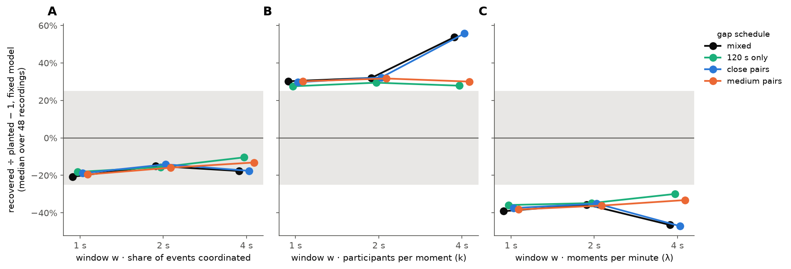
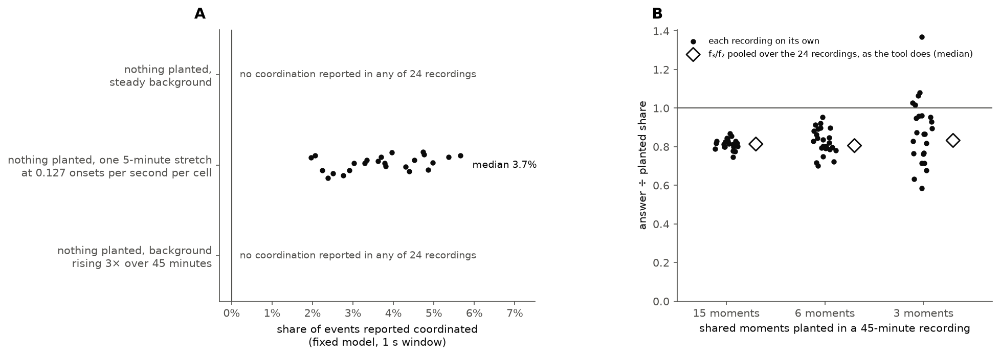

# What share of calcium events are coordinated, counted without defining an event

**Figure 1. The count the measure is built from.** Planted shared moments in the lane above: ▼ blue, in a close pair (2 s apart); ▼ orange, in a medium pair (10 to 20 s apart); ▼ aqua, single (120 s or more from the next). Raster: one tick per onset. Bottom: onsets per 1 s window, *X*.

**Figure 2. Same mean, wider spread.** A: how often each count *X* occurs; aqua, one rigidly shifted copy; black, the recording. B: aqua dots, *f*₂ and *f*₃ of each of 20 shifted copies; black diamond, the recording; arrow, the excess that is kept.

**Figure 3. Planted against recovered.** One point per simulated recording (48 recordings); filled, fixed model (adopted); open, binomial model; grey band, within ±25% of planted (the pass band); line, recovered = planted.

**Figure 4. Window size and the gaps between moments.** Median error over 48 recordings, fixed model, at windows of 1, 2 and 4 s. Black, the mixed schedule; aqua, 120 s gaps only; blue, with close pairs; orange, with medium pairs; grey band, ±25%. A: the share of events. B: participants per moment. C: moments per minute.

**Figure 5. What it cannot see, and how far one recording strays.** A: share of events reported coordinated in recordings with nothing planted, one dot per recording (24 recordings per row). B: each recording's own answer (dots) and the answer with *f*₃/*f*₂ pooled over the 24 recordings as the tool does (open diamond), divided by the planted share; line, a perfect answer.

---

Written 2026-10-14 for readers who are not math-oriented. It explains
[`tools/measure_coordination_rates.py`](../../../tools/measure_coordination_rates.py), the
measure that will report how much of the activity is coordinated under treatment, before any
treatment result is shown (that is a separate piece of work). The script that draws every
figure is [`explain_coordination_share.py`](explain_coordination_share.py); the numbers quoted
below are in [`numbers.json`](numbers.json).

**Every figure is drawn from simulated recordings. No real recording is shown or quoted.** The
real numbers wait on the producer's corrected export: see *What waits* at the end.

## The objection this answers

*How can you count coordinated events if you have not defined what one is?* This measure never
decides which onsets belong to a coordinated event. It counts every onset in short windows of
time and asks how unevenly those counts are spread. Cells that share moments make the counts
uneven in a particular way, and the size of that unevenness is the answer.

## Terms

- **Cell**: one imaged neuron, called an ROI (region of interest) elsewhere in this project.
- **Onset**: the time one cell's calcium event reaches half its rise. Each onset is found in one
  cell alone, using nothing from any other cell, so it is fixed before coordination is asked about.
- **Shared moment**: a time at which several cells have an onset together, give or take a
  tenth of a second. The simulations plant these; the measure never looks for them.
- ***N***: the number of cells in the recording (32 in every simulation here).
- ***w***: the window length, in seconds (1 s unless a figure says otherwise).
- ***X***: the number of onsets, over all cells, in one window of *w* seconds.
- ***k***: how many cells join one shared moment.
- **λ** (lambda): how often shared moments happen, per second; the figures give it per minute.
- ***f*₂, *f*₃**: the second and third *factorial cumulants* of *X*, defined below. Read them
  as "pairs of onsets beyond chance" and "triples of onsets beyond chance".
- **Share of events coordinated**: of all a cell's onsets, the fraction that belong to a shared
  moment. This is the number the measure reports (`coordinated_share_of_rate` in the tool).

## The simulated recordings

They copy the fast stream's bench (`bugarach.bench`): 32 cells over 45 minutes; each cell's own
background rate drawn so that a few cells are busy and many are nearly silent, as in real
fields; 15 planted shared moments, 5 each at 10, 6 and 3 participating cells; onsets scattered
around each moment by 0.106 s, the measured fast-stream jitter. Half the recordings run at the
bench's quiet background (0.0049 onsets per second per cell) and half at its busy one (0.0169).

**What is new here is the spacing of the moments**, and it belongs to this page only (Tony,
2026-10-14). The bench keeps its moments at least 120 s apart. Real recordings have shared
moments closer than that, so every recording in the main set ("mixed") holds **2 close pairs**
(two moments 2 s apart), **2 medium pairs** (10 to 20 s apart) and **7 single moments**, with
every pair and single at least 120 s from the next. Three more sets isolate each part: 120 s
gaps only, close pairs only, and medium pairs only. The bench itself is not changed, and the
question of what the revised bench should be is still waiting on Tony
([todo](../../todo/2026-10-08-the-stack-ceiling-and-the-short-interval-bench.md)).

Figure 1 shows 6 minutes of one quiet recording (35m10s to 41m10s of seed 10), chosen as the
stretch where a close pair and a medium pair are both in view and largest. Figure 2 uses one
busy recording (seed 3).

## How the measure works

### 1. Count onsets in windows, then look at the spread, not the mean

Cut the recording into windows of *w* seconds and count the onsets in each, over all cells.
That count is *X*, the bottom row of Figure 1, the count. (The tool counts twice, with the windows
shifted by half a window the second time, and averages, so that a moment cut by a window edge
is not lost.)

The mean of *X* is the total event rate, and **it is the same whether cells share moments or
not**: a shared moment only moves onsets in time, it does not add any. What sharing changes is
the spread. Independent cells rarely put many onsets in one window; a shared moment of 10 cells
puts 10 there at once. In Figure 2, the same mean, wider spread, both versions of one recording
have a mean of 0.47 onsets per window, and only the recording has windows holding 5 to 11 onsets.

The factorial cumulants measure that extra spread:

- *f*₂ = E[*X*(*X*−1)] − E[*X*]², pairs of onsets in one window beyond what chance gives;
- *f*₃ = E[*X*(*X*−1)(*X*−2)] − 3 E[*X*(*X*−1)] E[*X*] + 2 E[*X*]³, triples beyond chance.

**For cells with independent onsets, both are zero on average, whatever each cell's rate.** Only
onsets that come together push them above zero.

### 2. Chance is measured, not assumed

Real cells are not perfectly independent even with no shared moments: the whole field can drift
up or down over minutes. So the tool does not take zero as chance. It makes 20 copies of the
recording in which **each cell's whole train of onsets is slid along in time by its own amount**,
wrapping round the end, with every two cells' amounts at least two windows apart (`shifted`).
Each cell keeps its own rate and its own rhythm; what is destroyed is which cells had onsets at
the same time. The copies' *f*₂ and *f*₃ are subtracted from the recording's.

In Figure 2B the 20 copies sit at zero and the recording sits well above: an excess *f*₂ of
0.214 and an excess *f*₃ of 1.369 per 1 s window.

### 3. From two numbers to three answers

Suppose shared moments happen at rate λ and every one is joined by *k* cells. A window holding a
moment holds *k*(*k*−1) ordered pairs and *k*(*k*−1)(*k*−2) ordered triples from it, so per window

*f*₂ = λ *w* *k*(*k*−1) and *f*₃ = λ *w* *k*(*k*−1)(*k*−2).

Dividing the second by the first gives *k* − 2, so *k* = *f*₃/*f*₂ + 2. Putting *k* back into
*f*₂ gives λ. Each cell's coordinated rate is then λ*k*/*N* (moments per second, times the
fraction of cells joining each), and **dividing that by the cell's event rate gives the share of
events that are coordinated**. The tool's `solve` does exactly this. One recording's *f*₃ is noisy,
so the tool pools *f*₃/*f*₂ over every recording in the run and takes *f*₂ and the rate from each
recording on its own.

### 4. The two models, and which one is adopted

The step above assumed every moment has the same *k*. The tool calls this the **fixed** model.
The other it reports is **binomial**: each cell joins each moment independently with the same
probability, so *k* varies from moment to moment. Pairs and triples alone cannot tell the two
apart, because a moment joined by one cell looks exactly like background.

On these simulated recordings neither model recovers the planted share exactly, and they
disagree by about a factor of two in their errors (Figure 3, planted against recovered):
**the fixed model reads 21% low, the binomial 11% low** (median over 48 recordings at 1 s).
Both are inside the pass band. The reason both read low is that the planted moments come in
three sizes (10, 6 and 3 cells), which neither model assumes. Larger moments carry more triples
per pair, so *f*₃/*f*₂ is set mostly by the large ones; *k* comes out too high and λ too low
(Figure 4B and 4C), and the two errors nearly cancel in the share, but not quite.

**The bench adopts the fixed model** (`ADOPTED_MODEL`). The tool's note beside it gives the
reason: the bench plants each moment with a fixed number of cells, so the fixed model is the
one that matches what the bench's background subtraction removes. **That is a reason about
matching the bench, not about accuracy.** On these recordings the binomial model is the closer
of the two, and every fixed-model share here reads low by about a fifth. A reader of the
treatment results should take the fixed-model share as an underestimate of that size, at least
on recordings that look like these.

### 5. Window size and gaps between moments

Figure 4, window size and the gaps between moments, answers both questions at once.

- **The share hardly moves.** Over windows of 1, 2 and 4 s and all four gap schedules, the
  fixed model's error stays between −10% and −21% (Figure 4A). The binomial model, in
  `numbers.json`, stays between +1% and −11%.
- **Close pairs do move the other two numbers, at the widest window.** At 4 s, a pair of moments
  2 s apart usually falls in one window, and the measure sees one moment twice the size,
  half as often. Participants per moment then read 56% high instead of 28%, and moments per
  minute 47% low instead of 30% (Figure 4B and 4C, blue and black against aqua). The share is
  their product and survives: twice the size at half the rate is the same number of coordinated
  onsets.
- **Medium pairs, 10 to 20 s apart, change nothing at any window.** They are always in separate
  windows.

So **the share of events coordinated can be read at any of the three windows**. Participants per
moment and moments per minute should be read at 1 or 2 s: there, close pairs move them by about 3
percentage points at most. The tool's primary window is 1 s.

## What it cannot see

Figure 5, what it cannot see, uses recordings with **nothing planted**, where the right answer is
no coordination at all.

- **A stretch where the whole field is busier reads as coordination.** One 5-minute stretch in
  which every cell's rate rises to 0.127 onsets per second (the bench's elevated-rate level) is
  reported as a median 3.7% coordinated share, and up to 5.7% (Figure 5A, middle row). The
  shifted copies cannot remove it: each cell's busy stretch is slid by a different amount, so in
  the copies the stretches no longer line up. The tool's `CAL_NO_PROBE` note found the same on
  the bench and says the effect may be large on the slow stream.
- **A slow, steady rise does not.** A background that rises threefold over the 45 minutes is
  reported as no coordination in all 24 recordings (Figure 5A, bottom row). A change that slow
  survives the sliding — after a shift of a minute or so, each cell is still about as busy as its
  neighbours — so the copies carry it too and it is subtracted. The line between the two is the
  span of the shifts: two windows per cell, about a minute for 32 cells at 1 s. **A shared change
  faster than about a minute is counted as coordination; a slower one is not.** (The todo that
  commissioned this page had this backwards; the tool's own docstring has it right.)
- **A steady field with nothing planted gives no answer at all**, not a small one (Figure 5A, top
  row): the excess *f*₃ pooled over the 24 recordings is not above zero, so `solve` declines.

**Few shared moments make one recording's own answer noisy** (Figure 5B). With 15 moments in 45
minutes, the middle 80% of recordings recover between 78% and 84% of the planted share on their
own; with 6 moments, 73% to 91%; with 3, 69% to 105%. Pooling *f*₃/*f*₂ over the run, as the tool
does, pulls each set back to about 81% to 83%. No recording failed to give an answer. Lowering
the background to a half or a quarter of the quiet level, with all 15 moments kept, changes the
pooled answer by about two percentage points (79% at the quiet level, 81% at a half and a quarter).
Figure 5B's recordings are all at the quiet background, with every moment 120 s or more from the
next. **So a lower event rate on its own does not
make the answer noisy; few shared moments do.**

The tool also drops recordings too short or too sparse for its background fit (`shape_usable`:
under 300 s, under 20 onsets, or under 5 cells) from the quiet and busy rates it reports. Every
simulated recording here clears those floors. How many real recordings a treatment run loses to
them waits for the real numbers.

## How we know it works

The tool checks itself on simulated recordings where every planted moment's cells are known, and
passes when the median error of the share is within ±25% (`CAL_TOL`). Figure 3 is that check,
drawn at 1 s on the mixed-gap recordings, and Figure 4A carries it to 2 and 4 s: the fixed model
passes on every gap schedule at every window, and so does the binomial (in `numbers.json`). On the bench's own recordings
the check is part of every run of the tool, and its result is stored with the run.

## What waits

- **The real numbers.** The baseline run on the 66-recording `senktide_ttx` export gives each
  stream's share under both models, and how many recordings fail `shape_usable`. **They are not
  quoted here.** That export has been under a contamination stop since 2026-10-05: the
  motion-correction pinning census missed ROIs in four DI recordings, and pinning makes several
  ROIs show events at the same time, which is exactly what this measure counts. The numbers go in
  when the producer's corrected export is the default and the run is repeated on it
  ([the stop](../../todo/2026-10-05-the-pinning-census-undercounts-on-the-default-folder.md)).
- **The gap schedule here is temporary.** When the revised bench is decided, this page should be
  redrawn on it.

Not murderboarded as of the first draft; the review record will be linked here when it exists.
