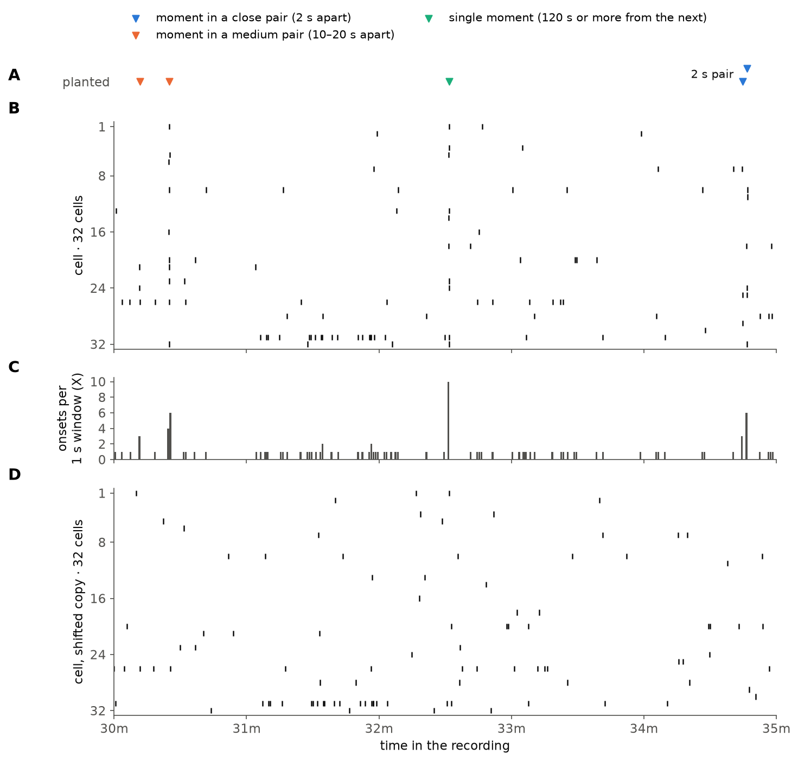
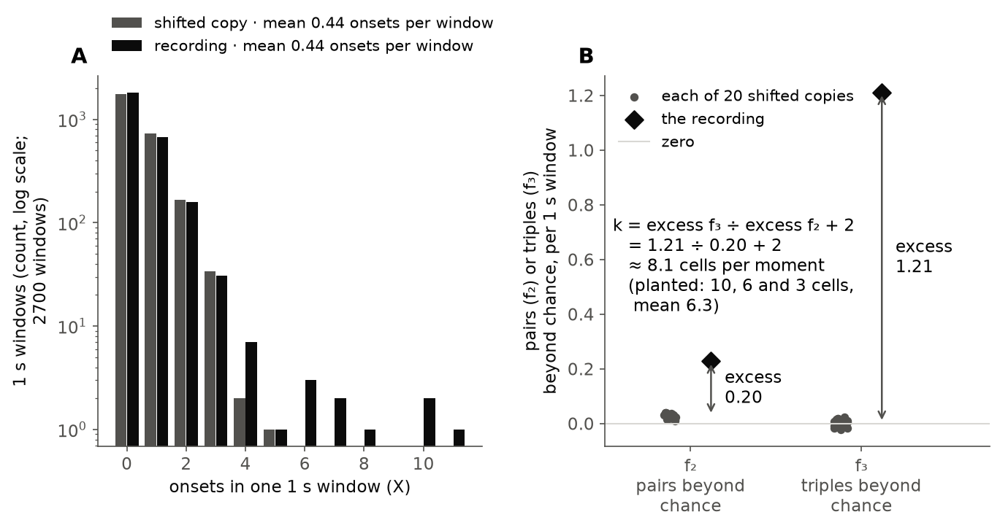
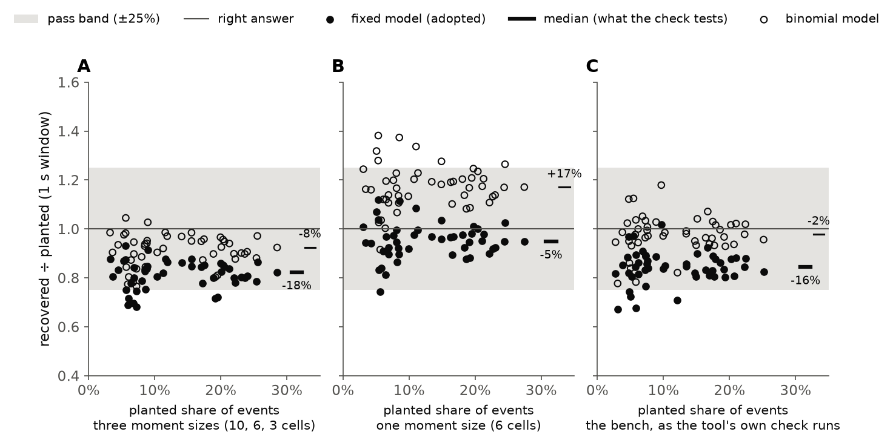
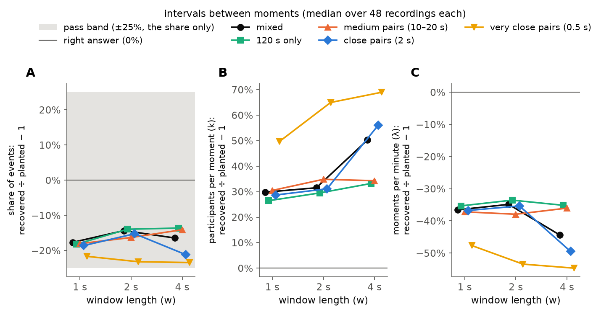
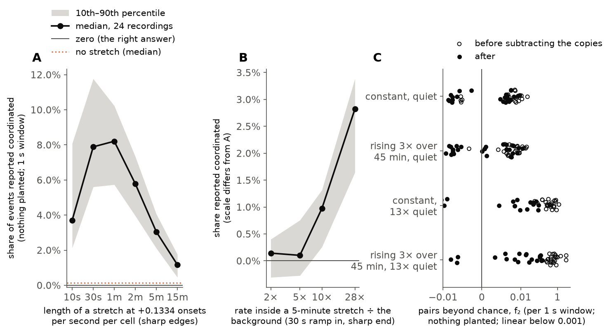
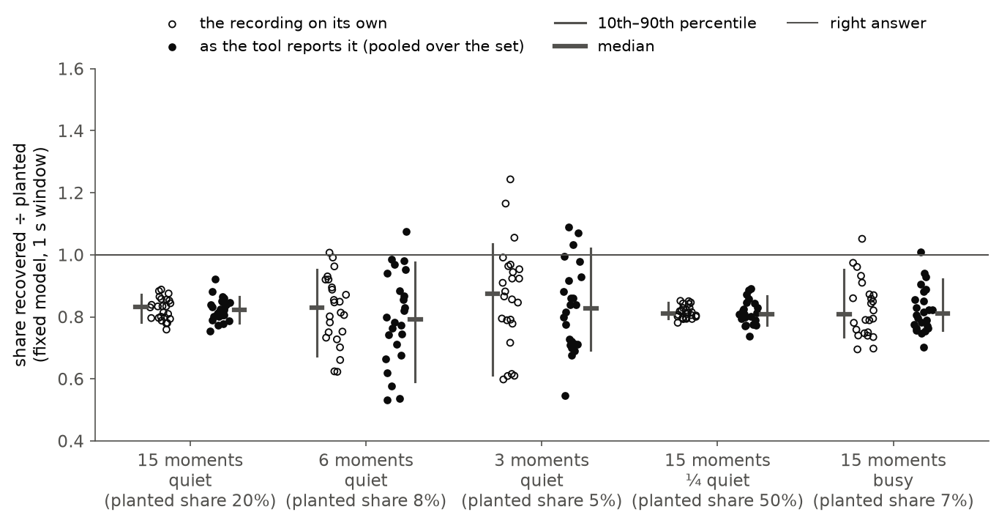

# What share of calcium events is coordinated, counted without defining a coordinated event

**Figure 1. The count.** One simulated recording, 32 cells, 5 minutes shown. A: the shared moments the simulation planted, in a lane the measure never sees (▼ blue: a close pair, 2 s apart, drawn one above the other; ▼ orange: a medium pair, 10–20 s apart; ▼ green: a single moment). B: one tick per onset. C: onsets per 1 s window, *X*. D: the same 5 minutes in one shifted copy.

**Figure 2. Same mean, wider spread.** One simulated recording at the busy background. A: how many 1 s windows hold each count *X*; gray, one shifted copy; black, the recording. B: gray dots, pairs (*f*₂) and triples (*f*₃) beyond chance in each of 20 shifted copies; black diamond, the recording; arrow, the excess the measure keeps; pale line, zero.

**Figure 3. Recovered against planted.** Simulated recordings, 48 per panel: filled, fixed model (adopted); open, binomial model; short bar, each model's median, with its error; gray band, the pass band (±25%, which the median must fall inside); line, the right answer. A: moments of three sizes (the mixed set of Figure 4). B: the same, every moment 6 cells. C: the bench's own recordings, as the tool's built-in check runs them.

**Figure 4. Window size and the intervals between moments.** Median error over 48 simulated recordings per line, fixed model, at windows of 1, 2 and 4 s: ● black, mixed; ■ green, 120 s only; ▲ orange, medium pairs; ◆ blue, close pairs; ▼ yellow, very close pairs. Gray band in A, the pass band; line, the right answer (0%). A: the share of events. B: participants per moment. C: moments per minute.

**Figure 5. What else it counts.** Simulated recordings with nothing planted, 24 per point, each worked out as one recording in a run with 24 recordings that do hold planted moments. A and B: the share of events reported coordinated (line, median; gray, 10th–90th percentile; solid line, zero; dotted, no stretch, A only) for a stretch where every cell is busier, by its length (A) and by how much busier (B). C: pairs beyond chance, *f*₂, before (open) and after (filled) subtracting the shifted copies, one point per recording.

**Figure 6. How far one recording strays.** Simulated recordings, 24 per group, each 45 minutes long: open, each recording's answer worked out on its own; filled, its answer as the tool reports it, with *f*₃/*f*₂ pooled over the 24; gray bar and whisker, median and 10th–90th percentile; line, the right answer.

---

## The question

*How can you count coordinated events if you have not defined what one is?* This measure never
decides which onsets belong together. It counts every onset in short windows of time and asks
how unevenly those counts are spread. Implicitly, it counts as coordination **onsets in several
cells within one window (1 s here), more often than the same cells give when each one's onsets
are slid in time by up to about half a minute.** So anything that lines cells up over less than
about a minute counts, including the start and end of a stretch where the whole field gets
busier. Figure 5, what else it counts, shows how much.

This is the measure bugarach will report treatment results through: the share of calcium events
that are coordinated, beside the overall event rate (ADR-0017 makes this the first exception to
the rule that group and treatment comparisons are the separate `fireflies` analysis's work).
Today it runs on baseline windows only. **Before it is read on treatment windows, one caveat
matters most:** a treatment that changes the whole field's rate within a window (a drug washing
in, or senktide's rising activity) will read as extra coordination, and a treatment that changes
how big or how close together the shared moments are will move these numbers with no change in
coordination at all. Neither has been measured on real treatment windows.

**Every figure is simulated, with a known answer. No real recording is shown.** One input comes
from real recordings: the bench's intervals between moments (Figure 3C), measured on the default
data set, which is now under a contamination stop (see *What waits*).

## Terms

- **Cell**: one imaged neuron, called an ROI (region of interest) elsewhere in this project.
- **Onset**: the time one cell's calcium event reaches half its rise. Each onset is found in one
  cell alone, so it is settled before coordination is asked about.
- **Shared moment**: a time at which several cells have an onset together, give or take about a
  tenth of a second. The simulations plant these, so the right answer is known; the measure
  never looks for them.
- **Window**, ***w***: a stretch of *w* seconds (1 s unless a figure says otherwise). ***X***:
  the number of onsets, over all cells, in one window. ***N***: the number of cells (32 here).
- ***k***, **participants per moment**: how many cells join one shared moment. **λ**, **moments
  per minute**: how often shared moments happen.
- **Share of events coordinated**: of all onsets in a recording, over all cells, the fraction
  that belong to a shared moment.
- **Shifted copy**: the recording with each cell's whole train of onsets slid in time by its own
  amount; step 2 below.
- **The bench**: this project's standard simulated recordings, with planted events whose answer
  is known, used to test the coordination detectors and this measure. Its recordings copy the
  **fast stream**: each recording's events come in two named streams, fast and slow, and these
  simulations copy the fast one.
- **Quiet** and **busy** background: the bench's two background rates, 0.0049 and 0.0169 onsets
  per second per cell (the 25th and 75th percentiles of real baseline recordings).

## How the measure works

### 1. Count onsets in windows, and look at the spread, not the mean

Cut the recording into windows of *w* seconds and count the onsets in each, over all cells: that
is *X*, Figure 1C. The tool counts twice, the second time with the windows moved by half a
window, and averages the two. A moment whose onsets straddle a window edge is split between two
windows: in Figure 1C the 10-cell moment at 30m25s shows as two bars, 4 and 6.

A shared moment of 10 cells puts up to 10 onsets in one window. Cells with independent onsets
rarely do. So sharing shows in **how spread out the counts are**. In Figure 2A, same mean, wider
spread, the recording and a shifted copy of it (step 2) average the same 0.44 onsets per window,
but only the recording has windows holding 6 to 11.

Two numbers measure that extra spread: ***f*₂**, pairs of onsets in one window beyond what
independent cells at steady rates give, and ***f*₃**, triples beyond that (formulas under *For
developers*). For such cells both are close to zero. A shared moment makes far more triples than
pairs: 10 cells make 90 ordered pairs and 720 ordered triples, which is why *f*₃ sits far above
*f*₂ in Figure 2B.

### 2. Chance is measured, not assumed

Real cells are not independent and steady: one cell's own onsets come in clumps, and the whole
field drifts over minutes. So chance is measured. The tool makes 20 copies of the recording in
which **each cell's whole train of onsets is slid in time by its own amount**, wrapping around at
the end; no two cells are slid by amounts within two windows of each other, so for 32 cells the
slides run from about −32 s to +32 s. (Slides closer together than that leave the cells of one
moment together, and the copies then subtract real coordination.) Each cell keeps its rate and
its own rhythm; what is destroyed is which cells had onsets at the same time. Figure 1D is one
copy: the columns of ticks in Figure 1B are gone, and each cell keeps its number of onsets over
the whole recording.

The copies' *f*₂ and *f*₃ are subtracted from the recording's. In Figure 2B the copies' *f*₂ sits
a little above zero (0.03 per window), from each cell's own clumping. What is left is the
excess: 0.20 pairs and 1.21 triples per window.

### 3. From two numbers to three answers

If every shared moment is joined by *k* cells, the excess triples divided by the excess pairs is
*k* − 2 (for 10 cells, 720 ÷ 90 = 8). In Figure 2B: 1.21 ÷ 0.20 + 2 ≈ **8.1 cells per moment**.
That recording's moments were planted at 10, 6 and 3 cells, 6.3 on average, so the answer reads
high; *Why the fixed model reads low*, below, says why. The excess pairs then give moments per
minute, λ. Each cell's coordinated onsets per second are λ*k*/*N*, and **dividing that by the
average cell's event rate gives the share of events coordinated**.

The tool does not use each recording's own *f*₃ ÷ *f*₂. It pools that ratio over every recording
it analyses together, and takes *f*₂ and the event rate from each recording on its own. That
steadies the median over recordings, not a single recording's answer (Figure 6).

## Does it get the right answer?

Every simulated recording here starts from the bench's own generator: 32 cells over 45 minutes,
at the quiet or the busy background, with 15 shared moments planted per recording, 5 each joined
by 10, 6 and 3 cells. Figure 3 checks the answer on three sets of recordings; Figure 4 varies the
window and the intervals between moments; Figure 5 plants nothing; Figure 6 varies how many
moments there are.

### The check, and the two models

The tool checks itself on simulated recordings and passes when the **median** error of the share
is within ±25% (the tool does not say why 25%). Its check runs without the bench's elevated-rate
stretch: the tool's own note on that (`CAL_NO_PROBE`) records that with the stretch in, the check
fails, reading the share 43% high. The band applies to the share only. Participants per moment
and moments per minute are outside it on every set here (Figure 4), and are not checked.

Step 3 assumed every moment is joined by the same number of cells: the tool's **fixed** model,
the one it adopts. Its other model, **binomial**, lets each cell join each moment with the same
probability, so the number varies. Pairs and triples alone cannot tell the two apart: two numbers
cannot fix how often moments happen, how big they are on average and how much their size varies.

- **Moments of three sizes** (Figure 3A, the mixed set of Figure 4): the fixed model reads **18%
  low**, the binomial 8% low (medians).
- **Every moment 6 cells** (Figure 3B): the fixed model reads **5% low**, the binomial **17%
  high**.
- **The bench's own recordings** (Figure 3C), built as the tool's check builds them: fixed 16%
  low, binomial 2% low. These recordings also carry the bench's decoys (6 per recording, each a
  near-coincidence of 6 cells, planted to test detectors), and the tool's check counts them as
  coordinated, since this measure cannot tell them apart. So C's right answer includes them.

All three medians pass. Single recordings under the fixed model recover from 0.67 to 1.12 of the
planted share, so some fall outside the band.

**Why the fixed model reads low.** Two reasons. First, the ratio of triples to pairs is pulled up
by the biggest moments, so when moment sizes vary, *k* reads high and λ reads low, and their
product, the share, ends up low. Second, a moment whose onsets straddle a window edge loses some
of its pairs and triples (Figure 1C); counting twice with shifted windows steadies this but does
not recover it. From size variation alone it reads 5% low (one size) to 18% low (three sizes);
moments closer together than a window add more, up to 23% (Figure 4). **In real recordings the
spread of moment sizes is not known, so neither is the size of the error.** The binomial model's
closeness in Figure 3A is a cancellation: with one size it reads high (Figure 3B).

The tool's note gives its reason for adopting the fixed model: the bench plants a fixed number of
cells at each of its levels. But the bench mixes three levels in every recording, which is
exactly where the fixed model reads low, and on the bench itself (Figure 3C) the binomial model is
the closer one. **So the choice is not settled by accuracy**, and this page flags it rather than
defends it.

### Window size, and moments close together

The bench has drawn its intervals between moments from real recordings since 2026-10-07 (median
41 s on the fast stream). Before measuring, any two events less than 2 s apart were merged, so no
interval under 2 s can be drawn, and the bench never plants the closest moments real recordings
may hold. These sets plant them on purpose. Every recording keeps its 15 moments and turns some
of them into pairs, every pair and single at least 120 s from the next: the **mixed** set has 2
close pairs (2 s apart) and 2 medium pairs (10 to 20 s apart); three sets have 2 pairs of one
kind (medium, close, or very close at 0.5 s); and **120 s only** has none. Figure 4, window size
and the intervals between moments, compares them.

- **The share moves little unless moments are closer than a window.** For 120 s only, medium
  pairs and the mixed set at every window, and close pairs at 1 and 2 s, the fixed model reads 14%
  to 19% low (Figure 4A). At 4 s, a 2 s pair falls in one window half the time, and close pairs
  read 21% low against 14% for 120 s only. Very close pairs read 22% to 23% low at every window.
  Under the binomial model the share reads 3% to 17% low across the same sets and windows.
- **Participants per moment and moments per minute move a great deal.** When two moments land in
  one window, the measure sees one moment of both together, half as often. At 4 s, close pairs
  push participants per moment to 56% high (against 33% for 120 s only) and moments per minute to
  49% low (against 35%; Figures 4B and 4C). Very close pairs do it at every window: 50% to 69%
  high, and 48% to 55% low. Across all sets the two read 26% to 69% high and 34% to 55% low.
- **Medium pairs** move each number by no more than about 5 percentage points from 120 s only.

## What else it counts

Figure 5, what else it counts, uses recordings with **nothing planted**, where the right answer
is no coordination. Each is worked out as one recording in a run alongside 24 recordings that do
hold planted moments, as the tool pools over a folder, so its participants per moment come from
those. (Analysed only alongside each other, recordings with nothing planted usually give no
answer.)

- **A stretch where the whole field is busier is counted, from its first and last half minute.**
  Add a stretch in which every cell's rate rises by 0.1334 onsets per second (the bench's
  elevated-rate level, 28 times the quiet background in all) and switches on and off sharply. The
  shifted copies slide each cell by up to about half a minute, so a long stretch still mostly
  lines up with itself in the copies, and only its first and last half minute do not. From about
  a minute up, that leaves about the same false excess whatever the length (350 to 380 extra pairs
  per recording); a longer stretch adds more real onsets beside it, so the reported share falls:
  a median 8.2% for 1 minute, 3.0% for 5 minutes, 1.2% for 15 minutes (Figure 5A). Below about a
  minute the stretch is shorter than the slides, so less of it survives: 3.7% at 10 s, 7.9% at
  30 s. The worst single recordings read up to 14%.
- **How much busier matters too** (Figure 5B). A 5-minute stretch that ramps in over 30 s and
  ends sharply (the bench's own elevated-rate stretch), at twice the background in all, reads
  0.14%, the same as no stretch at all; at 10 times, 1.0%; at 28 times, 2.8%, when the stretch
  has added about three quarters of all the recording's onsets. A 30 s ramp barely changes the
  sharp-edged result (3.0%): it is shorter than the slides' reach.
- **A slow, smooth change is removed.** Raise the background threefold, smoothly, over the 45
  minutes. At a busy enough background (13 times quiet) the rise adds clearly to *f*₂, and
  subtracting the shifted copies removes 98% of what it added (Figure 5C, the row "rising 3× over
  45 min, 13× quiet"). At the quiet background the same rise barely registers at all.
- **Each cell's own clumping is removed** almost entirely at 13 times quiet (99%; the row
  "constant, 13× quiet"). At the quiet background there is almost nothing to remove.
- **With no stretch, a recording reports close to zero, on either side of it**: a median 0.1%,
  lowest −0.4% and highest +0.6% over the 24 (the dotted line in Figure 5A). A share can come out
  negative, when a recording has fewer pairs than its shifted copies. If every recording in a run
  has no shared moments at all, the pooled triples land just above or just below zero by chance:
  below, the tool gives no answer; just above, it gives a small, meaningless one.

These recordings are the ones the paper by Staude, Grün and Rotter on changing rates was written
for (see *Where the method comes from*); its correction has not been tried here.

## How far one recording strays

The tool reports a share for each recording. Figure 6, how far one recording strays, shows how
far that can miss for a single 45-minute recording. Each group also changes the planted share
(shown under it), so these are descriptions, not separated causes.

- **Fewer shared moments, much more spread.** With 15 moments in 45 minutes at the quiet
  background, the middle 80% of recordings recover 0.78 to 0.86 of the planted share as the tool
  reports it. With 6 moments, 0.59 to 0.98; with 3, 0.69 to 1.02, and single recordings from 0.55
  to 1.09. Part of that spread is which sizes a recording's few moments happened to be.
- **Real recordings are nearer the narrow end of moments.** The bench's realistic intervals give
  about 7 moments per 45 minutes, close to the 6-moment group, and real baseline windows can be as
  short as 15 minutes, which at that rate is about 2 or 3 moments.
- **Pooling did not narrow the spread here.** The pooled answers (filled) spread about as widely
  as each recording's own (open), and more widely with 6 moments: one pooled *k* does not fit
  recordings whose moments differ in size. Which recordings to pool together for a treatment
  comparison is open: pooling a baseline with its treatment window forces one *k* on both.
- **A lower event rate alone did not add spread** (¼ quiet: 0.77 to 0.87). **A busier background
  did** (busy: 0.76 to 0.92 as reported, 0.74 to 0.95 for each recording's own answer).

Every recording in Figure 6 gave an answer.

## The simulated recordings

Every recording starts from the bench's own generator (`simulate_coordination`): each cell's
background rate drawn so that a few cells are busy and many nearly silent, and each cell's onsets
clumped in time as in real recordings. The bench's planted events and decoys are turned off, and
shared moments are planted here instead, with each moment's onsets scattered around it with a
standard deviation of 0.106 s (the correlogram's measured fast-stream jitter, which the tool's
check also uses). There are 24 recordings at each background. The interval schedule was chosen
for this page; the bench itself is not changed, and its revised version awaits a decision
([todo](../../todo/2026-10-08-the-stack-ceiling-and-the-short-interval-bench.md)). Figure 3C
instead uses the bench's own recordings, exactly as the tool's check builds them: intervals drawn
from real recordings (about 7 moments per 45 minutes) and the decoys on.

Figure 1 shows minutes 30 to 35 of quiet recording 13, picked as the 5 minutes with the largest
close and medium pairs that also hold a single moment. Figure 2 uses busy recording 3.

## Where the method comes from

Reading shared events from the spread of the population count is not new. Ehm, Staude and Rotter
(2007, *Electron J Stat* 1:473) estimate how often joint events happen and how big they are from
the population count alone, by a different estimator. Staude, Rotter and Grün (2010, *J Comput
Neurosci* 29:327, "CuBIC") use cumulants of the population count to infer a lower bound on how
many neurons take part in coordinated events. Both models here belong to the compound Poisson
family those papers use: the binomial model is the multiple-interaction process of Kuhn, Aertsen
and Rotter (2003, *Neural Comput* 15:67), and the fixed model is the case with one event size.
*f*₂ and *f*₃ are what statisticians call factorial cumulants, standard in physics counting
statistics. Sliding whole trains to measure chance is the spike-train shifting surrogate (Pipa,
Wheeler, Singer and Nikolić 2008, *J Comput Neurosci* 25:64, after the multiple-shift method of
Grün and colleagues); this tool's slides sit on a shuffled ladder at least two windows apart and
wrap around, where the published ones are random.

The same authors addressed this page's two weaknesses: rate changes shared across cells (Staude,
Rotter and Grün 2008, *Neural Comput* 20:1973; Staude, Grün and Rotter 2010, *Front Comput
Neurosci* 4:16), and cells whose own onsets are not Poisson (Reimer, Staude, Ehm and Rotter 2012,
*J Neurosci Methods* 208:18). Neither correction has been tried here.

What is this project's: a two-number shortcut (pairs and triples, closed by one of the two
models) to what Ehm and colleagues estimate in full; reporting it as a share of events; the
ladder of slides; applying it to calcium-event onsets; and the checks above. ⚠ The literature on
factorial cumulants outside neuroscience was searched only shallowly, and nobody has asked these
authors about it.

## What waits

- **The real numbers.** The baseline run on the default data set (66 recordings) gives each
  stream's share under both models. **They are not quoted here, because the data set is under a
  contamination stop since 2026-10-05: cells pinned at the image's lowest value by motion
  correction show events at the same moments, which is exactly what this measure counts.** The
  check that removes events inside pinned stretches missed cells in one recording and removed too
  much in another; four recordings, all from the diestrus (DI) group, are affected, and three
  still await review cell by cell. The numbers go in when the corrected data set replaces it and
  the run is repeated ([the stop](../../todo/2026-10-05-the-pinning-census-undercounts-on-the-default-folder.md)).
- **Treatment windows.** The tool reads baseline windows only. Running it on treatment windows is
  the next piece of work, and the caveats in *The question* apply to it first.
- **The interval schedule here is temporary.** When the revised bench is decided, this page should
  be redrawn on it.

## For developers

- The measure: [`tools/measure_coordination_rates.py`](../../../tools/measure_coordination_rates.py).
  The share is `coordinated_share_of_rate`; the shift is `shifted`; the solve is `solve` (one
  recording) and `per_recording` with `pooled_ratio` (pooled, as reported); the adopted model is
  `ADOPTED_MODEL`; the pass band is `CAL_TOL`; the limits on recordings are `shape_usable` (it
  leaves out of the reported background rates any recording under 300 s, with under 20 onsets, or
  with under 5 cells; every recording here clears them). The default data set is `senktide_ttx`.
- `CAL_NO_PROBE` says the shifted copies cannot subtract a field-wide busy stretch. Figure 5A
  shows they remove most of it, leaving its first and last half minute; the module docstring's
  account agrees with the figure. The docstring's two models are said to "bracket" the answer;
  in Figure 3A and 3C both read low.
- *f*₂ = E[*X*(*X*−1)] − E[*X*]² and *f*₃ = E[*X*(*X*−1)(*X*−2)] − 3 E[*X*(*X*−1)] E[*X*] +
  2 E[*X*]³, where E[·] is the average over windows. With moments of *k* cells at rate λ per
  second, falling whole inside windows, *f*₂ = λ*wk*(*k*−1) and *f*₃ = λ*wk*(*k*−1)(*k*−2).
- The figures: [`explain_coordination_share.py`](explain_coordination_share.py); every number
  quoted above is in [`numbers.json`](numbers.json).
- The review: [murderboard record](../../reviews/coordination_share_explainer_2026-10-14.md).
