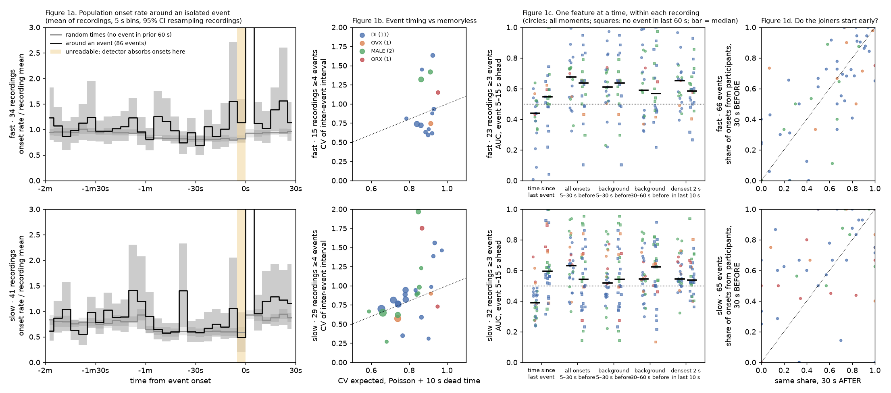

# Can a coordinated event be predicted? Precursors in the baseline windows

Run 2026-10-30 on WSMIP064, at Tony's request: *"is it possible to predict a coordinated event? is
there a pattern or feature of calcium events across ROIs that precedes a coordinated event?"*

**Exploratory, one run, not murderboarded. It measures and decides nothing.** No earlier work in
the repo, its branches or its PRs asked this question; the nearest are
[slow co-modulation](../../slow_comodulation/README.md) (minute-scale shared rate),
[elevated-rate stretches](../2026-09-24-elevated-rate-stretches/README.md) and the Aim 0 order
indicator ([goal page](../../../goals/synthetic-validation.md)).

**Figure 1.** Top row fast, bottom row slow; colour is group (DI, OVX, MALE, ORX). **a**, population
onset rate (onsets per ROI per second, divided by the recording's mean) around isolated events (no
event in the preceding 60 s), against random times meeting the same rule; mean of recordings in 5 s
bins, 95% interval from resampling recordings. The shaded 5 s before onset cannot be read (see
*The blind spot*). **b**, coefficient of variation (CV) of the interval between events, per recording
with at least 4 events, against the CV a Poisson process with the corpus's minimum interval
(about 10 s) as dead time would give; dotted line is equality; marker size is the event count.
**c**, area under the ROC curve (AUC) of one feature for "an event starts 5–15 s from now", computed
inside each recording with at least 3 events; circles every eligible second, squares only seconds
with no event in the last 60 s; bar is the median; 0.5 is chance. **d**, share of all onsets in the
30 s before an event that come from the ROIs that then take part in it, against the same share in
the 30 s after it.

## Dataset and the contamination stop

`2026-09-23_revised_2v_long_senktide_ttx_STEPS_AND_PINS_EXCLUDED` (role `senktide_ttx`, the
default), **baseline analysis windows only** (FOUNDATIONS §9). The folder is under the 2026-10-05
contamination stop (pinned ROIs left in four DI recordings). **Tony chose to run anyway** (2026-10-30,
"run all 66, plus sensitivity"), so every number was measured twice: on all 66 recordings
(`all66/`) and with the four named recordings removed (`without_pinned_four/`). **Every headline
below agrees between the two to within 0.03.** This is not a clearance of the stop, which still
waits on the corrected export.

**Events** are the CoactDetect calls at each baseline window's own ADR-0008 floor (`own_floor`)
from [the 2026-09-24 detection run](../2026-09-24-detect-66-floors/README.md): 183 fast events in 37
recordings and 423 slow events in 41. Its per-call table is the input; it is in Dropbox
(`<darkroom>/bugarach/runs/2026-09-24-detect-66-floors/calls.tar.gz`). Participants follow the
repository's rule: ROIs with an onset in [onset − 1 s, onset + width + 1 s].

## Answer

**Only weakly, and mostly from the fact that events cluster.** Within a recording, the best
predictor ranks a moment 5–15 s before an event above an ordinary moment about two times in three.

| precursor (Figure) | fast | slow |
|---|---|---|
| a clock: regular intervals (1b) | **no.** CV 0.81 against 0.90 for Poisson with dead time; successive intervals uncorrelated (median ρ = 0.00) | **no.** CV 0.88 against 0.84; ρ = 0.02 |
| a recent event (1c, time since last event; AUC below 0.5 means *shorter* predicts) | 0.44 [0.39, 0.51] | **0.39 [0.35, 0.44]**, below 0.5 in 88% of 32 recordings |
| all onsets 5–30 s before (1c) | 0.68 [0.55, 0.73] | 0.63 [0.57, 0.67] |
| **background** onsets 5–30 s before, every onset belonging to an event removed (1c) | **0.61 [0.55, 0.72]**, above 0.5 in 87% of 23 recordings; 0.64 with no event in the last 60 s | 0.52 [0.49, 0.58]: **gone** |
| the cells that will join have onsets first (1d) | no: 0.59 of pre-event onsets against 0.46 for the same cells at random times, interval spans 0 | they have more onsets before (0.75 against 0.66 at random times, [+0.01, +0.15]) **and just as much after (0.74)**: a slow active state, not a precursor |
| all features, logistic regression, leave one mouse out, z-scored within recording | AUC 0.69 [0.57, 0.75]; precision 0.089 against a base rate of 0.036 | AUC 0.66 [0.60, 0.74]; precision 0.22 against 0.059 |

Brackets are 95% intervals from resampling the mice whose recordings enter that row.

**So:** on slow, what predicts an event is the previous event; strip the events out and the
background says nothing. On fast there is a modest rise in background activity in the half-minute
before an event, and it survives both removing event onsets and requiring a minute with no event.
None of it is close to usable forecasting: at best a 2.5–3.7× lift over a base rate of 4–6%.

## Three things that would mislead

1. **A pooled AUC of 0.81–0.86 is not prediction.** Fitting across recordings learns *which
   recording* is busy (recordings with many events have short gaps), not *when*. Inside a recording
   that model scores near or below chance, because the within-recording sign of time-since-last is
   the reverse of the across-recording one. Every AUC above is computed within recordings, with
   features z-scored per recording without labels.
2. **The blind spot.** Every event has zero onsets in the last 1 s (fast) or 3 s (slow) before its
   onset, because the detector puts any onset that close into the event. The final seconds are
   empty by construction. The predictor is therefore kept 5 s clear of the target; any early-warning
   question about those seconds needs an onset defined without the detector.
3. **The groups are thin.** OVX and ORX have 1–3 recordings each with at least 3 baseline events, so
   the answer is mostly DI and MALE. Nothing here compares groups (ADR-0017).

## Files

- `measure.py` the measurement (`python measure.py <calls.csv> <out> [--drop-pinned]`; reads the
  default folder through `dataset.current()`, so it needs `BUGARACH_ACK_CONTAMINATION` until the stop
  clears). `summarize.py` prints `summary.txt`; `figure.py` draws Figure 1.
- `all66/`, `without_pinned_four/`: `results.json` (carries `dataset.stamp()`), `summary.txt`,
  per-recording tables (`univariate_within_auc.csv`, `auc_by_recording.csv`, `ici_*.csv`,
  `participants_pre_*.csv`).
- Dropbox only (bulk): the per-second prediction tables and pickles,
  `<darkroom>/bugarach/runs/2026-10-30-precursors-of-coordinated-events/`.
- What to do next: [the v2 todo](../../../todo/2026-11-02-precursors-v2.md).
