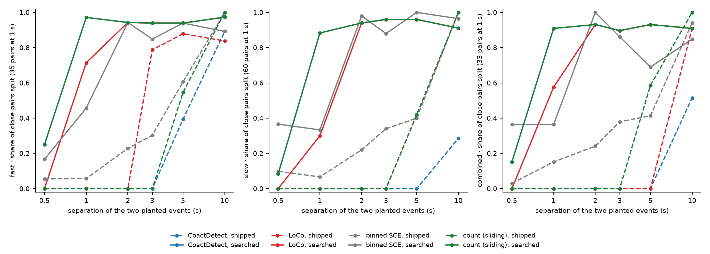

# Can the detectors be set to separate close events? From 1 s apart, yes; at 0.5 s, not yet

> **Working material, not murderboarded.** A run record for sessions in this tree. Simulated
> recordings only; no real recording was read. Nothing here is installed.

**Figure 1, the share of close pairs split, at the shipped setting and at the searched one.**
A pair is two planted events one separation apart with every other planted event at least 20 s
away; it is split when each of its two events is matched by a call of its own. Dashed: the
shipped setting. Solid: the setting the search picked, on seeds the search never saw. Columns:
the fast, slow and combined benches. The y-axis label gives the number of pairs behind the 1 s
point; the other points rest on 29 to 71 pairs. CoactDetect's searched line lies exactly under
count (sliding)'s, because at that setting the two make the same calls (below).

## What was asked

Tony, 2026-11-11, on the first run of the separation axis
([record](../2026-11-11-separation-axis/README.md)): *"this was expected. nothing was optimized
or even built on events this close. lets build some test data sets and see if any of them can
be modified to separate close events"*.

## The test sets and the score

- **The sets** (`bugarach.close_events.make`): each stream's own bench recording with half the
  gaps between neighbouring planted events set to one separation, planted by the generator's
  own route, with no decoys. A set is named by stream, separation, background and seed, and is
  rebuilt from those four.
- **The score** (`bugarach.close_events.pair_score`): the share of pairs split, and beside it
  the share of **isolated** planted events that get two or more calls. The second is the
  control: a setting that breaks every call into fragments would split every pair and
  double-call every isolated event.
- **The search** (`tools/search_close_events.py`): each detector's window or bin, its merge
  gap, and for count (sliding) its dip split; nothing in any detector's code. A candidate is
  admissible when its false calls per hour with nothing planted are within the detector's
  budget on that stream, it double-calls at most 5 % of isolated events, and it recalls
  isolated events within 0.05 of the shipped setting. The pick is the admissible candidate
  with the highest split rate over 0.5, 1 and 2 s.
- **Two sets of seeds.** Selection: 288 recordings with close events and 48 with nothing
  planted. Report: 1,152 recordings on seeds the selection never saw. The fast stream gets
  twice the seeds, as every bench run does.

## What it shows

Share of pairs split, on the report seeds. The last three columns are pooled over the six
separations (isolated events) or come from the selection's recordings with nothing planted
(false calls).

| stream | detector | setting | 0.5 s | 1 s | 2 s | 3 s | 5 s | 10 s | isolated events recalled | called twice | false calls per hour, nothing planted |
|---|---|---|---|---|---|---|---|---|---|---|---|
| fast | CoactDetect | shipped | 0.00 | 0.00 | 0.00 | 0.00 | 0.39 | 0.89 | 0.96 | 0.000 | 0.11 |
| fast | CoactDetect | `int_win_sec=0.5, merge_gap_sec=0.0` | 0.25 | 0.97 | 0.94 | 0.94 | 0.94 | 0.97 | 1.00 | 0.009 | 0.00 |
| fast | LoCo | shipped | 0.00 | 0.00 | 0.00 | 0.79 | 0.88 | 0.84 | 0.90 | 0.000 | 0.00 |
| fast | LoCo | `bin_width_sec=0.5, merge_gap_sec=0.5` | 0.00 | 0.71 | 0.94 | 0.94 | 0.94 | 0.97 | 1.00 | 0.000 | 0.00 |
| fast | binned SCE | shipped | 0.06 | 0.06 | 0.23 | 0.30 | 0.61 | 1.00 | 0.99 | 0.004 | 2.56 |
| fast | binned SCE | `bin_width_sec=2.0, threshold_pctile=98.0, merge_gap_sec=0.0` | 0.17 | 0.46 | 0.94 | 0.85 | 0.94 | 0.89 | 0.96 | 0.004 | 0.11 |
| fast | count (sliding) | shipped | 0.00 | 0.00 | 0.00 | 0.00 | 0.55 | 1.00 | 1.00 | 0.000 | 0.72 |
| fast | count (sliding) | `win_sec=0.5, merge_gap_sec=0.0` | 0.25 | 0.97 | 0.94 | 0.94 | 0.94 | 0.97 | 1.00 | 0.009 | 0.00 |
| slow | CoactDetect | shipped | 0.00 | 0.00 | 0.00 | 0.00 | 0.00 | 0.29 | 1.00 | 0.000 | 0.11 |
| slow | CoactDetect | `int_win_sec=0.5, merge_gap_sec=0.0` | 0.08 | 0.88 | 0.94 | 0.96 | 0.96 | 0.91 | 0.98 | 0.002 | 0.00 |
| slow | LoCo | shipped | 0.00 | 0.00 | 0.00 | 0.00 | 0.42 | 1.00 | 1.00 | 0.000 | 0.00 |
| slow | LoCo | `bin_width_sec=0.5, merge_gap_sec=0.5` | 0.00 | 0.30 | 0.94 | 0.96 | 0.96 | 0.91 | 0.98 | 0.000 | 0.00 |
| slow | binned SCE | shipped | 0.10 | 0.07 | 0.22 | 0.34 | 0.40 | 1.00 | 0.99 | 0.006 | 3.22 |
| slow | binned SCE | `bin_width_sec=2.0, threshold_pctile=98.0, merge_gap_sec=0.0` | 0.37 | 0.33 | 0.98 | 0.88 | 1.00 | 0.96 | 0.97 | 0.022 | 0.00 |
| slow | count (sliding) | shipped | 0.00 | 0.00 | 0.00 | 0.00 | 0.42 | 1.00 | 1.00 | 0.000 | 0.11 |
| slow | count (sliding) | `win_sec=0.5, merge_gap_sec=0.0` | 0.08 | 0.88 | 0.94 | 0.96 | 0.96 | 0.91 | 0.98 | 0.002 | 0.00 |
| combined | CoactDetect | shipped | 0.00 | 0.00 | 0.00 | 0.00 | 0.00 | 0.52 | 1.00 | 0.000 | 0.44 |
| combined | CoactDetect | `int_win_sec=0.5, merge_gap_sec=0.0` | 0.15 | 0.91 | 0.93 | 0.90 | 0.93 | 0.91 | 0.93 | 0.001 | 0.00 |
| combined | LoCo | shipped | 0.00 | 0.00 | 0.00 | 0.00 | 0.00 | 0.91 | 0.93 | 0.000 | 0.00 |
| combined | LoCo | `bin_width_sec=0.5, merge_gap_sec=0.5` | 0.00 | 0.58 | 0.93 | 0.90 | 0.93 | 0.91 | 0.93 | 0.000 | 0.00 |
| combined | binned SCE | shipped | 0.03 | 0.15 | 0.24 | 0.38 | 0.41 | 0.94 | 0.99 | 0.007 | 3.11 |
| combined | binned SCE | `bin_width_sec=2.0, threshold_pctile=98.0, merge_gap_sec=0.0` | 0.36 | 0.36 | 1.00 | 0.86 | 0.69 | 0.85 | 0.93 | 0.004 | 0.22 |
| combined | count (sliding) | shipped | 0.00 | 0.00 | 0.00 | 0.00 | 0.59 | 1.00 | 1.00 | 0.000 | 0.44 |
| combined | count (sliding) | `win_sec=0.5, merge_gap_sec=0.0` | 0.15 | 0.91 | 0.93 | 0.90 | 0.93 | 0.91 | 0.93 | 0.001 | 0.00 |

CoactDetect's and LoCo's searched settings run in their sliding form (`window_mode=sliding`).

- **From 1 s apart, pairs can be split on every stream.** Count (sliding) in a 0.5 s window with
  no merge gap splits 0.88 to 0.97 of pairs at 1 s and 0.90 to 0.97 from 2 to 10 s, where the
  shipped settings split none below 5 s. It double-calls at most 0.9 % of isolated events and
  made no call on the recordings with nothing planted.
- **It takes a narrower window, not only a shorter merge gap.** Among admissible settings of
  count (sliding), the best split rate over 0.5, 1 and 2 s is 0.00 to 0.13 at a 2 s window,
  0.32 to 0.50 at 1 s and 0.66 to 0.83 at 0.5 s. No setting that keeps the 2 s window splits
  close pairs.
- **The count that makes a call did not change.** The 0.5 s window is run at the recording's
  2 s floor (8 to 10 cells on the three recordings checked), so it asks for the same number of
  cells in a quarter of the time. It is a stricter rule, and it does not admit smaller events.
- **CoactDetect at that setting is count (sliding).** In its sliding form at a 0.5 s window
  with no merge gap, CoactDetect made the same calls as count (sliding) on 9 of 9 recordings
  checked: the floor decides every call and its own null decides none.
- **LoCo and binned SCE separate from 2 s, not from 1 s.** LoCo's searched setting splits 0.30
  to 0.71 at 1 s and 0.93 to 0.94 at 2 s. Binned SCE needed its bin cut from 10 s to 2 s, which
  also took its false calls from about 3 per hour to under 0.3.
- **At 0.5 s nothing admissible splits more than 0.37.** A 0.3 s window reached 0.78 on slow
  over the three close separations, and was refused: it double-called 9 % of isolated events
  and recalled 0.87 of them. The derivation on the goal page puts what any method could
  resolve from these onsets at 0.26 to 0.76 s, so 0.5 s is at the edge of what the data hold.

## What it does not show

- **One generator, with Gaussian jitter of 0.105 to 0.150 s.** A 0.5 s window holds nearly all
  of such an event. If real events are wider than that, the same window loses participants and
  recall falls. The declined ADR-0012's extractor read 0.32 to 0.36 s on the real folders, and
  which instrument is right is not settled. This is the first thing to check on the revised
  export.
- **Split under the bench's tolerance of 2.5 s.** Two calls anywhere within 2.5 s of a pair
  count as a split. The double-call rate on isolated events bounds how often a stray call
  could be doing that (under 1 % for the count setting); a stricter per-event tolerance is owed.
- **Nothing is adopted and nothing was retuned for anything else.** The picks optimise the
  split rate under three limits. Their F1 on the whole bench, and the other two budgets
  (elevated-rate, precision swing), were not measured.
- **Chains of three or more close events are left out of both counts.**

## How to rerun it

    python tools/search_close_events.py --out docs/learned/runs/2026-11-11-close-events-search --figure <darkroom folder>

About 7 minutes on 14 workers (WSMIP065). The figure is also in the darkroom,
`bugarach/2026-11-11-close-events-search/`.
