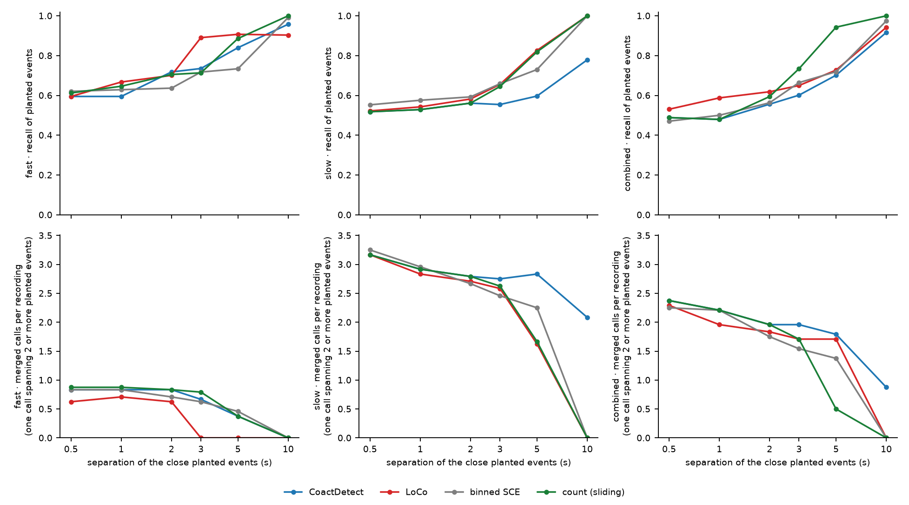

# The separation axis at the shipped settings: no detector separates events 2 s apart or closer

> **Working material, not murderboarded.** A run record for sessions in this tree. Simulated
> recordings only; no real recording was read.

**Figure 1, recall falls to about half once planted events sit 2 s apart or closer, on every
stream.** Top row: recall of planted events. Bottom row: merged calls per recording, a merged
call being one call whose span holds two or more planted events. Columns: the fast, slow and
combined benches. Each point is 24 simulated recordings of 45 minutes (2 backgrounds × 12 seeds)
in which half the gaps between neighbouring planted events are set to the separation on the
x-axis and the rest keep the realistic spacing. Each detector runs at its stream's shipped
setting and each recording's own floor. No decoys are planted.

## What was asked

[ADR-0022](../../../adr/0022-close-events-are-a-bench-axis-the-event-definition-stays-at-2-s.md)
(Tony, 2026-11-11) makes close events a bench axis of set separations, below 2 s included,
because a person separates events closer than that. This is the first run of that axis on all
three streams, for the four detectors of the first capability map
([ADR-0021](../../../adr/0021-the-toolset-is-validated-on-synthetic-data-first-with-coded-detectors.md)):
CoactDetect, LoCo, binned SCE (synchronous calcium events) and count (sliding).

## What it shows

Recall, mean of the two backgrounds
([`separation_axis_summary.json`](separation_axis_summary.json) holds F1 and the merged calls):

| stream | detector | 0.5 s | 1 s | 2 s | 3 s | 5 s | 10 s |
|---|---|---|---|---|---|---|---|
| fast | CoactDetect | 0.59 | 0.59 | 0.72 | 0.74 | 0.84 | 0.96 |
| fast | LoCo | 0.59 | 0.67 | 0.70 | 0.89 | 0.91 | 0.90 |
| fast | binned SCE | 0.62 | 0.63 | 0.64 | 0.72 | 0.73 | 0.99 |
| fast | count (sliding) | 0.61 | 0.65 | 0.71 | 0.71 | 0.89 | 1.00 |
| slow | CoactDetect | 0.52 | 0.53 | 0.56 | 0.55 | 0.60 | 0.78 |
| slow | LoCo | 0.52 | 0.54 | 0.58 | 0.66 | 0.83 | 1.00 |
| slow | binned SCE | 0.55 | 0.58 | 0.59 | 0.66 | 0.73 | 1.00 |
| slow | count (sliding) | 0.52 | 0.53 | 0.56 | 0.64 | 0.82 | 1.00 |
| combined | CoactDetect | 0.49 | 0.48 | 0.56 | 0.60 | 0.70 | 0.92 |
| combined | LoCo | 0.53 | 0.59 | 0.62 | 0.65 | 0.73 | 0.94 |
| combined | binned SCE | 0.47 | 0.50 | 0.56 | 0.66 | 0.72 | 0.97 |
| combined | count (sliding) | 0.49 | 0.48 | 0.59 | 0.73 | 0.94 | 1.00 |

- **At 2 s or closer, every detector on every stream joins the close events.** Recall is 0.47
  to 0.72 there, against 0.90 to 1.00 at 10 s (CoactDetect on slow, 0.78). With half the gaps
  close, a recall near one half is what joining nearly every close pair gives.
- **Nothing here distinguishes 0.5 s from 1 s.** The shipped merge gaps are 3 to 8 s, so both
  sit far inside them.
- **The detectors come apart between 3 and 5 s.** LoCo on fast recovers by 3 s (0.89); count
  (sliding) recovers by 5 s on all three streams (0.82 to 0.94); CoactDetect on slow has not
  recovered at 10 s and still makes 2.1 merged calls per recording there.

## What it does not show

- **These are the shipped settings, which were searched on a bench with no events closer than
  about 2 s.** The result is what those merge gaps were bound to give. Whether a detector *can*
  separate close events is the next run: the search with close events present.
- **Recall near one half is not a measured share of pairs separated.** The planted events come
  in pairs and short chains, and the scorer allows a call within 2.5 s of a planted event.
  A per-pair score (both events of a pair called, as two calls) is owed.
- **One generator.** Each bench's own recording: fitted background, three participation levels,
  realistic spacing for the gaps that are not set.

## How to rerun it

    python tools/measure_separation_axis.py --out docs/learned/runs/2026-11-11-separation-axis --figure <darkroom folder>

432 recordings in about 2 minutes on 14 workers (WSMIP065). The figure is also in the darkroom,
`bugarach/2026-11-11-separation-axis/`.
