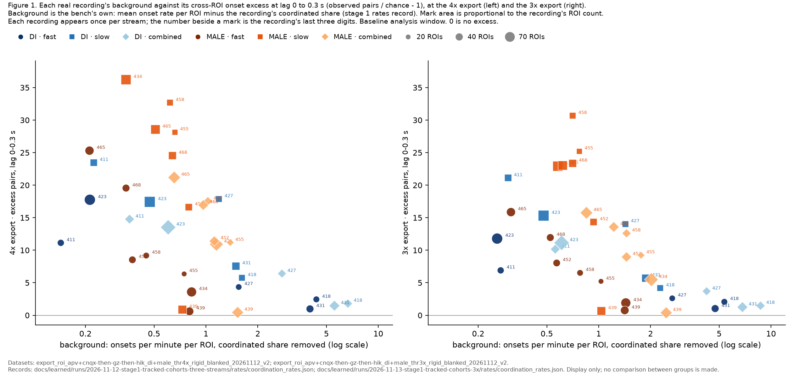

# How much of the recordings' range the bench sets cover, 2026-11-24

**Use this page when** you want the per-recording features behind
[ADR 2026-11-24-1063](../../../adr/2026-11-24-1063-the-benches-cover-the-range-the-recordings-show-a-twin-for-e.md),
or the values a bench set plants beside the range its recordings span.

> Working material, not murderboarded. It describes what a synthetic set has to reproduce. It
> compares nothing between groups (ADR-0017), and nothing here is adopted.

**Dataset.** The tracked cohorts, 12 recordings (DI 5, MALE 7), baseline analysis windows only:
`export_roi_apv+cnqx-then-gz-then-hik_di+male_thr4x_rigid_blanked_20261112_v2` (4x) and its 3x
sibling. The full study and the revised senktide/TTX export are not measured here.

**Files.**

- `coverage.py` writes `coverage.csv`: one row per recording, stream (fast, slow, combined) and
  threshold, with ROIs (regions of interest), background, coordinated events per hour,
  participation and excess. Run it from the repository root. Its docstring says which record or
  function each column comes from; nothing is measured a new way.
- `figure1.py` draws `figure1_background_vs_excess.png` (Figure 1, below). Run it from the
  repository root with the output path as its argument.

## Figure 1. Background against short-lag excess, every recording, stream and threshold

**Background** is the bench's own definition (`tools/remeasure_bench.py`): a recording's mean
onset rate per ROI minus its coordinated share, from the stage 1 coordination-rates record, in
onsets per minute per ROI. **Excess** is Review A's statistic: observed cross-ROI onset pairs at
lag 0 to 0.3 s over the pairs expected if every ROI's onsets were independent at its own total,
minus 1 (dimensionless; 0 is no excess). Mark area is proportional to the recording's ROI count.

Excess falls as background rises, and part of that is the statistic itself: chance pairs grow
with the square of the rate, so the same coordination reads as less excess on a busier
recording. Read the figure for where the recordings sit, not as a finding about coordination.

## The range against the bench sets (4x)

Ranges are the minimum and maximum over the group's recordings. "Bench" is what the set built from
those recordings plants (`docs/learned/bench_sets/<stream>_<group>.json`).

| stream · group | ROIs | background (per min per ROI) | events per hour | participation, median of event peaks | excess |
|---|---|---|---|---|---|
| fast · DI (5 recordings) | 24 to 73; bench 29 | 0.14 to 4.4; bench 0.21 and 4.0 | 12 to 57; bench 37 | 0.16 to 0.58 (median 0.38); bench 0.31 | 1.0 to 17.8 |
| fast · MALE (7) | 18 to 59; bench 35 | 0.21 to 0.82; bench 0.36 and 0.77 | 0 to 45; bench 21 | 0.21 to 0.39 (median 0.26); bench 0.17 | 0.65 to 25.3 |
| slow · DI (5) | 24 to 73; bench 29 | 0.22 to 1.6; bench 0.47 and 1.5 | 21 to 135; bench 65 | 0.28 to 0.77 (median 0.58); bench 0.53 | 5.8 to 23.5 |
| slow · MALE (7) | 18 to 59; bench 35 | 0.34 to 0.79; bench 0.56 and 0.69 | 6 to 96; bench 49 | 0.23 to 0.79 (median 0.54); bench 0.31 | 0.9 to 36.2 |
| combined · DI (5) | 24 to 73; bench 29 | 0.36 to 6.7; bench 0.62 and 5.6 | 21 to 126; bench 71 | 0.28 to 0.83 (median 0.67); bench 0.38 | 1.5 to 14.8 |
| combined · MALE (7) | 18 to 59; bench 35 | 0.65 to 1.5; bench 1.01 and 1.28 | 18 to 105; bench 53 | 0.24 to 0.87 (median 0.64); bench 0.31 | 0.5 to 21.2 |

Three things to read off it:

1. **Each set is one recording at two backgrounds.** ROIs, participation and event rate are one
   value each (medians, or pooled), and the two backgrounds are the 25th and 75th percentiles of
   the recordings' backgrounds. Where a group's backgrounds are close together, as MALE's are,
   the two backgrounds are close too: 1.01 and 1.28 for MALE combined.
2. **Participation is measured two ways and they disagree.** The bench's value comes from the
   clustering measurement in `tools/remeasure_bench.py`; the column here is each coordinated
   event's peak ROI count in the 2 s window (stage 1 intervals record), as a share of the
   recording's ROIs. The bench's value is lower in every set, by up to half (MALE combined: 0.31
   against 0.64). Peak counts favour large events, because an event is only counted once it
   reaches the floor, so the second is not simply right. Which one recovers a planted value is
   the stage 3 question.
3. **Within each group the spread is wide on every feature**, and the groups spread on different
   features: DI's backgrounds span 30-fold in fast and 18-fold in combined, MALE's span 2 to
   4-fold; MALE's excess spans from 0.5 to 36.

## What Review A's pooled correlogram showed, and why

Review A's Figure 2 pools pair counts over a group's recordings, so the recordings with the most
pairs dominate it. In combined DI at 4x, 20260924_423 (73 ROIs) supplies 54 % of the real
short-lag pairs, and the busy simulated recordings supply 71 % of the simulated ones. Pooled, real
is 4.2 and simulated 1.3. Recording by recording, real DI combined excess (1.5 to 14.8) lies inside
the simulated range (0.7 busy to 18.5 quiet).

**At matched background the simulations are still lower** (combined, 4x): the MALE quiet
simulation at 1.01 per minute reads 6.8, against 10.9 to 17.6 for the four MALE recordings between
0.96 and 1.15 per minute; the DI busy simulation at 5.6 per minute reads 0.7, against 1.5 and 1.8
for the two DI recordings at 5.56 and 6.65 per minute. The cause is not traced. Participation
(point 2 above) is the first candidate.

**Combined pairs within one ROI.** The exported combined stream is exactly the fast onsets plus
the slow onsets (21,683 = 11,361 + 10,322 at 4x). 8 to 20 % of its onsets have another onset in the
same ROI within 0.5 s, one fast and one slow by construction; the simulation plants almost none.
Removing them moves the pooled combined excess only from 4.2 to 3.9 (DI) and 12.3 to 12.1 (MALE).
Whether such a pair is one calcium event seen by both streams or two events is not known here.
