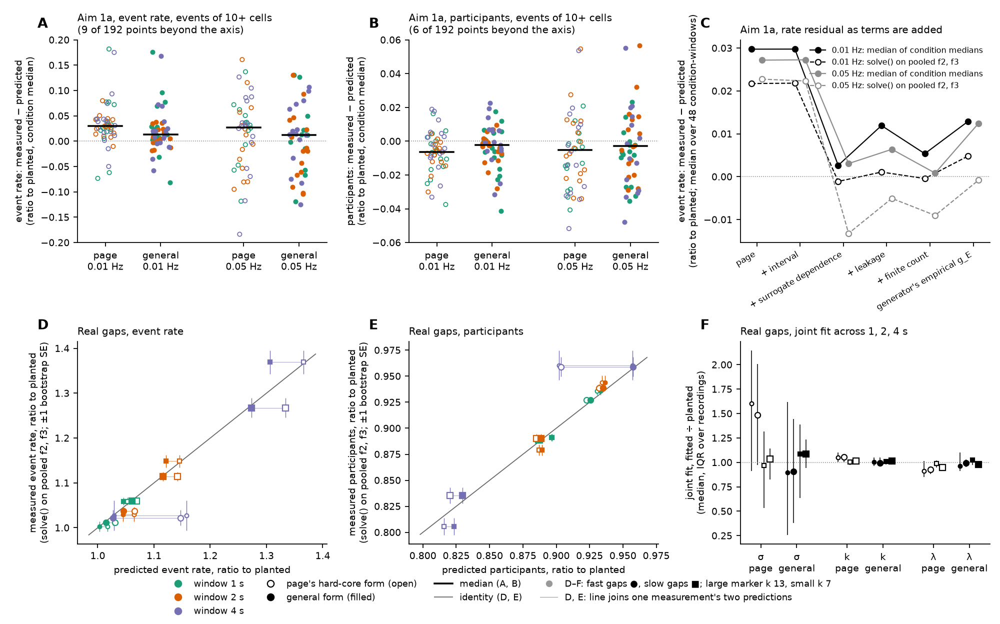

# The coordination-rates prediction for any event train

**Question** (handoff 2026-10-25, item 2). `theory.py` predicts the coordination-rates tool's
surrogate-corrected excess factorial cumulants f2 and f3 on one assumption: events are at least 20 s
apart, so no window holds two of them. Real gaps break that assumption. 28 % of fast gaps and 38 %
of slow gaps are under 20 s, and the 5th percentiles are 3.8 s and 7.1 s. Below, f2 and f3 are
derived for any stationary event train, described by its intensity λ and its pair correlation
g_E(τ). The derivation also covers the tool's shift surrogates, which `theory.py` takes to be
independent of the event train. They are not.

The code is `intervals.py`, and its output is `intervals_output.txt`.

## 1. Model and assumptions

Symbols are as in `theory.py`: N cells, k participants per event, σ the jitter SD (s), w the
window (s), λ the event rate (per s) and b the background rate (Hz per cell).

- **A1. Events.** The event times form a stationary point process with intensity λ and
  second-order product density ρ₂(τ) = λ² g_E(τ). That density counts ordered pairs of distinct
  events at lag τ. Triples use the renewal (Markov) closure: for three ordered events with gaps
  u₁ and u₂, ρ₃ = λ³ g_E(u₁) g_E(u₂). This is exact for a renewal train, and both the generator and
  the real-gap simulations here are renewal trains.
- **A2. Membership.** Each event takes exactly k of the N cells, drawn uniformly. The draw is
  independent across events and independent of the event times. Two events can therefore share
  cells: on average k²/N of them.
- **A3. Jitter.** Each participant's onset is its event's time plus ε ~ N(0, σ²). The ε are
  independent of everything else.
- **A4. Background.** Each cell carries an independent homogeneous Poisson train at rate b. A
  Poisson train's factorial cumulants of order 2 and above are zero. A circular shift of it is
  again Poisson, and it is independent of the coordinated onsets. So the background adds nothing
  to f2 or f3, in the recording or in any surrogate. It adds only noise.
- **A5. Windows and grid phase.** Windows are w long and tile the recording. The tool uses two
  grid offsets, 0 and w/2, and both have the same expectation, because the event train is
  stationary and so its phase against the grid is uniform. Rounding onsets to the 0.1 s frame
  changes nothing. An onset rounds into frames j … j+w/Δ−1 exactly when its continuous time lies in
  a window of the same width w, shifted by half a frame. So every window probability below holds
  unchanged with rounding. This is a stronger statement than `s_eff`'s pairwise one.
- **A6. Surrogate.** `shifted()` moves cell i's train circularly by d_i. The d_i are a random
  permutation of {0, 2w, 4w, …, 2w(N−1)}, plus one common shift. The common shift does not matter
  under stationarity. The permutation does not matter because membership is exchangeable across
  cells (A2). So the expected surrogate cumulant is that of one fixed offset set, d_x = 2wx for
  x = 0 … N−1. The tool averages 20 surrogates, which has the same expectation.
- **A7. Estimator.** The tool's f2 and f3 are sample factorial cumulants over one recording's
  windows, so their expectation is conditional on the recording's event count m. A stationary
  renewal train has ∫(g_E − 1) dτ = (CV² − 1)/λ over its correlation range, where CV is the
  intervals' coefficient of variation. With the count fixed, the integral over the recording is
  −1/λ. To first order, the difference is a uniform deficit, g_E → g_E − CV²/m (1/m for Poisson
  intervals, as for a binomial process). A uniform offset cancels exactly in f2, because the
  recording and the surrogate have the same ∫M₁₁ = k²w². It moves f3 by −3λ²k(k)₂ w(a₂)·CV²/m:
  −0.2 % on Aim 1a, and up to −2.6 % on slow real gaps at w = 4 s, where CV² = 3.6. Other
  O(1/number of windows) biases are the same in the recording and its surrogates, so they cancel,
  and they are dropped. A first version used −1/m. The Monte Carlo check of §7.1 caught it: the
  surrogate's own f2 was overpredicted by about 25 % on slow gaps, where CV² = 3.6 and the needed
  deficit was about 3.5/m.
- **Not modelled.** Two onsets of one cell in one frame count once (`_frames` uses `np.unique`).
  That needs two events within a frame and is ignored. Onsets clipped at the recording ends are
  also ignored. The real gaps are resampled independently (a renewal train), so any serial
  correlation of real gaps, such as bursts, is not represented.

## 2. Factorial cumulants of a cluster count

Fix a window W = [0, w). Let C be the number of coordinated onsets in W. Think of one event at
time t as a cluster, and let C_t be the number of its onsets that land in W. Under A1–A3, clusters
are independent given the event times. So log E[(1+z)^C] = log G_E[φ_t(z)], where G_E is the
probability generating functional of the event train and φ_t(z) = E[(1+z)^{C_t}].

Write μ_r(t) = E[(C_t)_r] for the r-th factorial moment of one cluster. Let γ₁ = λ, γ₂ and γ₃ be
the event train's factorial cumulant densities. Expanding in z and reading off z²/2! and z³/3!
gives the count's factorial cumulants:

    κ[2] = λ ∫μ₂ + ∫∫ γ₂(t,s) μ₁(t) μ₁(s)
    κ[3] = λ ∫μ₃ + 3 ∫∫ γ₂(t,s) μ₁(t) μ₂(s) + ∫∫∫ γ₃ μ₁ μ₁ μ₁

where γ₂ = λ²(g_E − 1). Under the renewal closure, for ordered gaps u₁ and u₂,

    γ₃ = λ³ K(u₁, u₂),   K = g(u₁) g(u₂) − g(u₁) − g(u₂) − g(u₁+u₂) + 2.

**What each term is.** The first term counts pairs and triples from one event. The γ₂ terms count
pairs from two different events: one onset from each, or one onset from one event and two from the
other. The γ₃ term counts triples with one onset from each of three events. The pairs from two
events include pairs where one cell fires in both events. Membership is independent across events
(A2), so those pairs carry their share, k²/N per event pair, with no extra term.

## 3. The recording

In the recording, one onset lands in W with probability q(t) = Φ((w−t)/σ) − Φ(−t/σ). Onsets are
independent given t, so μ₁ = k q, μ₂ = (k)₂ q² and μ₃ = (k)₃ q³. Three quantities follow:

- ∫q² = w g₂ and ∫q³ = w g₃, which are `theory.py`'s window-sharing g_n.
- Q(τ) = ∫q(t) q(t+τ) dt = E[(w − |τ + D|)₊], with D ~ N(0, 2σ²).
- Q₁₂(τ) = ∫q(t) q(t+τ)² dt and Q₃(x, y) = ∫q(t) q(t+x) q(t+x+y) dt.

So the recording's cumulants are

    κ[2] = λ (k)₂ w g₂ + λ² k² ∫(g−1) Q
    κ[3] = λ (k)₃ w g₃ + 3 λ² k (k)₂ ∫(g−1) Q₁₂ + λ³ k³ ∫∫ K Q₃

## 4. The surrogate

In the surrogate, cell x's onsets sit at t + ε + d_x. Each cluster is still independent given the
event times, so the formula of §2 holds with the cluster's moments recomputed. Write
S_r(t) = Σ_x q(t + d_x)^r. Then

    μ₁ˢ = (k/N) S₁
    μ₂ˢ = (k)₂/(N)₂ · (S₁² − S₂)
    μ₃ˢ = (k)₃/(N)₃ · (S₁³ − 3 S₁S₂ + 2 S₃)

using P(given distinct cells all join one event) = (k)_r/(N)_r. Two kinds of term change.

- **Leakage: one event, two cells.** After the shift, two cells of one event sit at least 2w
  apart. They share a window only if their jitter difference bridges the gap. So
  ∫μ₂ˢ = (k)₂ Σ_{m≠0} (N−|m|)/(N(N−1)) · Q(2wm). This is 0.0256 of ∫μ₂ at σ = 1 s and w = 1 s,
  0.003 at σ = 0.5 s and w = 1 s, and 0 at the lab's σ.
- **Dependence: two events, two cells.** The surrogate's pairs from two different events are
  those of the recording, moved by d_x − d_y:

      ∫∫ γ₂ μ₁ˢ μ₁ˢ = λ² k² Σ_m (N−|m|)/N² · I(2wm),   I(a) = ∫(g−1)(τ) Q(τ + a) dτ.

  The m = 0 term (weight 1/N) is the same cell in both events. Its lag is not shifted, so it sees
  the recording's I(0). `theory.py` sets I(2wm) = 0 for every m ≠ 0, as if the shifted copies saw
  an uncorrelated train. With a 20 s hard core, though, I(a) = −w² whenever |a| < 20 − w − (a few
  σ). The offsets span 2w(N−1): 64 s at 1 s and 256 s at 4 s. So with N = 33 about 48 % of
  cell pairs at w = 1 s, 21 % at 2 s and 12 % at 4 s are offset by less than the hard core. For
  those pairs the surrogate's shifted copies still never share a window, and the surrogate
  undercounts chance pairs.

The triple terms follow the same way. 3∫∫γ₂ μ₁ˢ μ₂ˢ is negligible unless σ ~ w. For ∫∫∫γ₃ μ₁ˢμ₁ˢμ₁ˢ,
take cells at lattice indices x, x+m₁ and x+m₁+m₂. Its weight is c(m₁, m₂)/N³, where c counts the
x that keep all three indices in 0 … N−1, and it is evaluated as ∫∫ K(u − 2wm₁, v − 2wm₂) Q₃(u, v).

## 5. The result

The tool reports f_r = κ[r](recording) − κ[r](surrogate). Both are polynomials in k and λ, with
coefficients that depend only on (w, σ, N, g_E):

    f2 = λ (k)₂ a₂ + λ² k² b₂
    f3 = λ (k)₃ a₃ + 3 λ² k (k)₂ b₃ + λ³ k³ c₃

    a₂ = w g₂ − Σ_{m≠0} (N−|m|)/(N(N−1)) Q(2wm)
    b₂ = (1 − 1/N) I(0) − Σ_{m≠0} (N−|m|)/N² I(2wm)
    a₃ = w g₃ − (surrogate one-event triples, ∫μ₃ˢ/(k)₃)
    b₃ = ∫(g−1) Q₁₂ − ∫(g−1)(τ) M₁₂ˢ(τ) dτ,   M₁₂ˢ(τ) = ∫ μ₁ˢ(t) μ₂ˢ(t+τ) dt / (k (k)₂)
    c₃ = ∫∫K Q₃ − Σ_{m₁,m₂} c(m₁,m₂)/N³ ∫∫ K(u−2wm₁, v−2wm₂) Q₃(u,v)

The predicted cumulants go through the tool's own `solve()`, as in `theory.py`.

### Reductions (checked numerically, `intervals_output.txt` §1)

- **Poisson train** (g_E ≡ 1). Then I ≡ 0 and K ≡ 0, so f2 = λ(k)₂ a₂ and f3 = λ(k)₃ a₃. These
  are `theory.poisson_cumulants` exactly, less the surrogate leakage, which is zero at small σ.
- **Hard core d ≥ w + 8σ**, with the surrogate taken as independent (I(2wm) = 0 for m ≠ 0, and the
  off-lattice part of c₃ set to zero). Then I(0) = −w², ∫(g−1)Q₁₂ = −w² g₂ and ∫∫KQ₃ = 2w³, and

      f2 = p(k)₂g₂ − (pk)²(1 − 1/N)
      f3 = p(k)₃g₃ − 3p²k(k)₂g₂ + 2(pk)³(1 − 1/N²),   p = λw

  These are `theory.predicted_excess_cumulants`. Numerically, every real-recording coefficient
  reproduces `theory.py` to 1e-4 or better, from σ = 0.005 s to 3 s at all three windows.
- **What `theory.py` leaves out, even for a hard core.** It leaves out three things: the
  surrogate's dependence on the train, the leakage, and the CV²/m finite-count term. §7 measures
  each. At k = 13, σ = 0.105 s and λ = 0.01 Hz, the dependence term alone is +0.60 %, +0.59 % and
  +0.54 % of f2 at 1, 2 and 4 s. Its share is ≈ λw·k/(k−1)·(fraction of offsets inside the hard
  core), so it grows with the event rate.

## 6. From an interval distribution to g_E

For a renewal train with interval density f, the renewal density is h = Σ_n f^{*n}. It is the
density of other events at lag τ after a given event, and g_E = h / λ_f, with λ_f = 1 / mean
interval. `PairCorrelation.from_intervals` builds h by repeated FFT convolution, out to 340 s, the
surrogate's full span plus margin. From samples, it first smooths them with a 0.05 s kernel.

When the event rate λ and the gaps disagree, as on real recordings, the code offers a
Palm-preserving form. On real recordings, 9.7 fast events per hour sit against a mean gap of
101 s, which would mean 36 per hour. In that form, g_E = 1 + (h − λ_f)/λ. It keeps the density of
neighbours seen from an event, which is what a gap histogram measures, and it tends to 1 at long
lags. In this note's simulations λ = λ_f, and the two forms coincide.

## 7. Results

What is derived, what is simulated and what is fitted:

- **Derived:** the coefficients a₂ … c₃, computed numerically on grids, with no free constant.
- **Simulated:** the Monte Carlo check of the surrogate (§7.1), the generator's empirical pair
  correlation (§7.2), and the real-gap recordings (§7.3).
- **Fitted:** only the joint fits of §7.4.

### 7.1 The surrogate term, checked by Monte Carlo

The setup is Aim 1a's generator with no background, k = 20 and σ = 0.2 s, 150 recordings at each
event count, with the recording's and the surrogate's cumulants kept apart.

**The recording.** Its own f2 and f3 match the prediction within about 1.5 SE at every window.

**The surrogate taken alone.** Its f2 is 4 to 15 times what `theory.py`'s independent offsets
give, and the general form tracks it. At 45 events and w = 1 s:

| surrogate f2 at 45 events, w = 1 s | value |
|---|---|
| measured | −0.0475 (SE 0.0008) |
| general, generator's empirical g_E | −0.0475 |
| general, analytic renewal law | −0.0507 |
| `theory.py` | −0.0034 |

The analytic renewal law ignores the generator's overrun rescaling, which raises g_E at 20–30 s
by about 0.06. With the empirical g_E, every window and event count agrees within about 1 SE in
f2 and 1.1 SE in f3. As a share of the excess f2, the
dependence is +0.4 % at 15 events and +0.8 to +1.0 % at 45. That is the 0.5–1 % the review agents
reported.

### 7.2 Aim 1a: the rate residual

Two of the new terms do nothing to Aim 1a's residual. **The interval term is exactly zero**
(below 1e-13 of f2): the generator never puts two events in one window, as `theory.py` assumed.
The leakage term is negligible except at σ = 1 s, where it reaches −2.7 % of f2 at w = 1 s.

**The surrogate-dependence term is what moves the residual.** For events of 10+ cells it is
+0.75 % of f2 (median; range +0.26 % to +3.1 %, largest at 45 events and w = 1 s), and about 0 in
f3. The finite-count term moves f3 by −0.2 % (median).

The table covers events of 10+ cells, 48 condition-windows per background. The residual is the
condition median of measured ÷ planted, minus predicted ÷ planted.

| 0.01 Hz, event rate | median residual | median abs. residual | measured > predicted | sign test p | residual on pooled f2, f3 |
|---|---|---|---|---|---|
| page (`theory.py`) | +0.030 | 0.032 | 43 of 48 | < 0.001 | +0.022 (39 of 48) |
| + surrogate dependence only | +0.003 | 0.016 | 30 of 48 | 0.11 | −0.001 |
| general, analytic law (+ leakage, finite count) | +0.005 | 0.016 | 29 of 48 | 0.19 | −0.000 |
| **general, generator's empirical g_E** | **+0.013** | 0.020 | 35 of 48 | 0.002 | **+0.005** (31 of 48) |

**With the generator's actual interval law, the general form removes about 57 % of the median
rate residual (0.030 → 0.013) and 80 % of the pooled one (0.022 → 0.005).** All of the removed
part is surrogate dependence. The analytic law appears to do better, but it overstates the
surrogate term (§7.1), so I quote the empirical law.

Most of what remains sits between the two columns. The median of five per-recording solve()
ratios runs above solve() on the pooled cumulants by about 0.008 under every prediction. That gap
is the estimator's nonlinearity at five recordings, not a missing term.

Participants at 0.01 Hz move the same way:

- page form: median residual −0.006, measured above predicted in 14 of 48 (p = 0.006), which is
  the possible small high bias at 0.01 Hz that the goal page notes;
- general form: −0.002, 19 of 48 (p = 0.19).

At 0.05 Hz the residuals were never one-signed, and the general form leaves the rate residual at
+0.012 (27 of 48).

### 7.3 Real gaps

**Setup.** Each recording has a stationary renewal event train, with gaps resampled from
`gaps.csv` per stream. Events are planted through `simulate_coordination` itself, by substituting
the event times into `_place_renewal`.

| | fast stream | slow stream |
|---|---|---|
| σ | 0.105 s | 0.131 s |
| λ = 1 / mean gap | 0.0099 Hz | 0.0195 Hz |
| events per recording | 27 | 52 |
| gaps under 4 s | 6.3 % | 0.7 % |
| CV² of the gaps | 2.8 | 3.6 |

The rest is common to both streams: b = 0.0096 Hz, N = 33, T = 2700 s, k = 7 and 13, and 40
recordings per condition. The measured value is solve() on the 40 recordings' mean f2 and f3, as a
ratio to planted, with a bootstrap SE. Medians over recordings are in `intervals_output.txt`.

| stream, k, w | rate: page | rate: general | rate: measured | participants: page | participants: general | participants: measured |
|---|---|---|---|---|---|---|
| fast 7, 1 s | 1.017 | 1.003 | 1.002 (0.011) | 0.931 | 0.933 | 0.936 (0.004) |
| fast 7, 2 s | 1.064 | 1.045 | 1.030 (0.016) | 0.934 | 0.937 | 0.944 (0.007) |
| fast 7, 4 s | **1.158** | 1.029 | 1.027 (0.033) | **0.902** | 0.957 | 0.960 (0.014) |
| fast 13, 1 s | 1.030 | 1.015 | 1.012 (0.004) | 0.923 | 0.926 | 0.927 (0.003) |
| fast 13, 2 s | 1.066 | 1.046 | 1.038 (0.007) | 0.932 | 0.935 | 0.939 (0.004) |
| fast 13, 4 s | **1.148** | 1.027 | 1.022 (0.017) | **0.904** | 0.957 | 0.959 (0.009) |
| slow 7, 1 s | 1.053 | 1.046 | 1.059 (0.008) | 0.896 | 0.897 | 0.891 (0.003) |
| slow 7, 2 s | 1.145 | 1.121 | 1.148 (0.014) | 0.887 | 0.889 | 0.879 (0.005) |
| slow 7, 4 s | 1.366 | 1.306 | 1.369 (0.026) | 0.816 | 0.823 | 0.806 (0.008) |
| slow 13, 1 s | 1.069 | 1.061 | 1.060 (0.006) | 0.887 | 0.887 | 0.889 (0.003) |
| slow 13, 2 s | 1.142 | 1.116 | 1.114 (0.010) | 0.885 | 0.889 | 0.890 (0.004) |
| slow 13, 4 s | 1.334 | 1.273 | 1.267 (0.022) | 0.820 | 0.830 | 0.836 (0.008) |

Goodness of fit over the 12 condition-windows, as χ² of (measured − predicted)/SE:

| prediction | participants | event rate | share |
|---|---|---|---|
| Poisson train | 2006 | 919 | 346 |
| page (hard-core 20 s) | 74 | 131 | 133 |
| **general (these gaps)** | **15.0** | **15.6** | **12.6** |

**How wrong the page's prediction is on real interval statistics.** The page form's median error
is −0.023 in rate and −0.016 in share. Its worst error is on the fast stream at w = 4 s, where the
6 % of gaps under 4 s put two events in one window. There it overpredicts the rate by 0.13 of
planted (1.15 against 1.03) and underpredicts participants by 0.06 (0.90 against 0.96). At
w = 1–2 s it is off by 0.01–0.03 in rate, mostly through the surrogate term. On the slow stream
almost no gap is under 4 s, so the hard core nearly holds at these windows. The two forms differ
there by 0.01–0.06 in rate, and the measurements do not clearly prefer either. The k = 13 rows sit
on the general form, where the page form is off by up to 0.07 (slow 13 at 4 s). The k = 7 rows sit
on the page form, 1.9 and 2.4 SE above the general form at 2 and 4 s. Read the other way, the Poisson
form, which is what "no assumption" would give, is far worse than either: it reads participants
up to 0.18 too high.

### 7.4 The joint fit (`fit_joint`) on real intervals

`theory.fit_joint` assumes the hard core. Fed the general form's exact, noise-free cumulants, it
returns biased values. The general fit is the same estimator with the general form inside, given
the gaps' g_E.

| noise-free input | fitted σ ÷ planted | fitted k ÷ planted | fitted λ ÷ planted |
|---|---|---|---|
| fast gaps, `fit_joint` (hard core) | **1.65 (k 7), 1.55 (k 13)** | 1.05 | 0.92 |
| slow gaps, `fit_joint` (hard core) | 0.91 | 1.00 | 0.97 |
| fast gaps, general fit | 1.02–1.03 | 1.003 | 0.995 |
| slow gaps, general fit | 0.998 | 1.000 | 1.000 |

The fast stream's jitter comes out more than 50 % high. The fit reads the extra pairs and triples
at 4 s, which come from two events sharing a window, as window sharing by a wide cloud.

On the 40 simulated recordings per condition, the medians over recordings are:

- **`fit_joint`, fast stream:** σ 1.60 and 1.49 times planted (IQR 0.91–2.14), k 1.05, λ 0.91–0.93.
- **General fit, fast stream:** σ 0.90 and 0.91 (IQR 0.26–1.62; 5 to 6 of 40 at the σ bound),
  k 0.99–1.00, λ 0.96–0.99.
- **Slow stream, either fit:** σ 0.97–1.09, k 1.01–1.02, λ 0.95–1.02.

So the general form removes the bias in k and λ, and the bias in σ. What remains is noise: at the
lab's σ the jitter is poorly fixed by 1, 2 and 4 s windows either way. That agrees with the goal
page's "lab σ untested", now tested.

### 7.5 Limits

- `gaps.csv` merged events under 2 s apart, so the real gap law below 2 s is unknown. The
  interval term at w = 1–2 s is therefore a lower bound.
- On real recordings λ ≠ 1/mean gap. The fast stream has 9.7 events per hour, against 36 per hour
  implied by the mean gap, so real use needs the Palm form of §6 at the measured λ. These
  simulations do not test that form.
- Resampling the gaps independently drops any serial correlation of real gaps, such as bursts.
- One k per condition, Gaussian jitter and random membership, as in `theory.py`.



**Figure: the page's hard-core prediction against the general form.**

- **A, B.** Aim 1a, events of 10+ cells. Each point is one condition-window: the condition median
  of measured ÷ planted, minus predicted ÷ planted. Open marks use the page form, filled marks the
  general form with the generator's empirical g_E. Colour is the window (1, 2, 4 s), and the bars
  are medians. The axes are clipped, and the panel titles give the number of points beyond them.
- **C.** Aim 1a event-rate residual, median over 48 condition-windows, as each term is added:
  interval, surrogate dependence, leakage, finite count, and last the generator's empirical g_E in
  place of the analytic law. Solid lines are medians of condition medians, dashed lines solve() on
  the pooled f2 and f3. Black is 0.01 Hz, grey 0.05 Hz.
- **D, E.** Real gaps. Measured event rate (D) and participants (E), as solve() on the 40
  recordings' mean f2 and f3, against the prediction, both as ratios to planted, ±1 bootstrap SE.
  Open marks are the page form, filled marks the general form, and a thin line joins the two
  predictions of one measurement. Circles are fast gaps, squares slow gaps. Large marks are
  k = 13, small marks k = 7. Colour is the window, and the line is identity.
- **F.** Real gaps, the joint fit across 1, 2 and 4 s: fitted ÷ planted σ, k and λ, median and IQR
  over 40 recordings. Open marks are `theory.fit_joint`, filled marks the general fit. Markers are
  as in D and E.

## 8. Recommendation

**Yes, both should take an event train. The default should be the current hard core plus the
surrogate-dependence term.** The default alone removes most of Aim 1a's one-signed rate excess
without any new input. The interval term matters only once events can share a window, which is
every real recording.

The proposed interface for `theory.py`:

```python
class EventTrain:                       # rho2 = lam^2 g(tau); renewal closure for triples
    poisson() / hard_core(d=20.0)
    renewal(intervals=None, density=None, mean=None)     # g = h / lam_f
    palm(intervals, lam)                # real data: lam != 1/mean gap
    from_times(list_of_event_time_arrays, T)             # empirical, circular lags
    .fixed_count(m)                     # the CV^2/m conditioning; cancels in f2

coefficients(w, sigma, n_cells, train) -> a2, b2, a3, b3, c3      # cached
predicted_excess_cumulants(k, sigma, w, lam, n_cells, train=EventTrain.hard_core(), n_events=None)
predict_solve(..., train=..., n_events=None)
fit_joint(cum, n_cells, train=EventTrain.hard_core(), n_events=None)
```

How it would work:

- `fit_joint` tabulates the coefficients once per train on a log σ grid. f2 and f3 are
  polynomials in k and λ with σ-only coefficients, so the fit stays as fast as now.
- The surrogate is the tool's own: lattice offsets 2w × 0 … N−1. If `shifted()` changes, the
  theory must follow it. One way is to read the spacing from `measure_coordination_rates`, as
  `DT` and `WINDOWS` are read now.
- Record what the empirical form needs. `aim1_one_source.py` and later runs should store each
  recording's planted event times (or gaps) so `from_times` can use them. The analytic generator
  law overstates the surrogate's own f2 by 7–16 % at 45 events and up to 60 % at 15 events at
  w = 4 s.
- On real data, measure the gaps without the 2 s merge (down to one frame), and pass the stream's
  own λ through `palm`.
